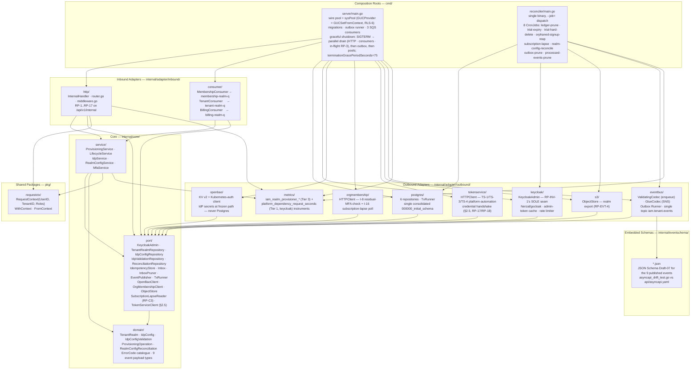
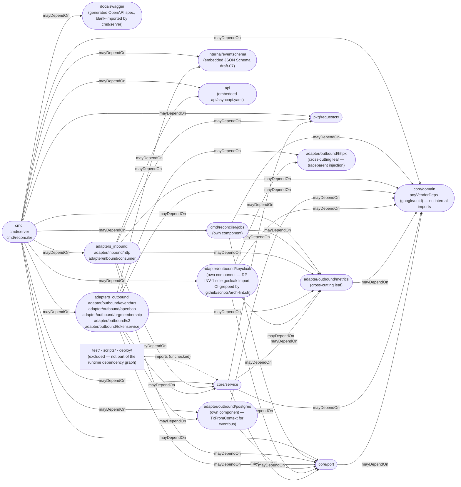
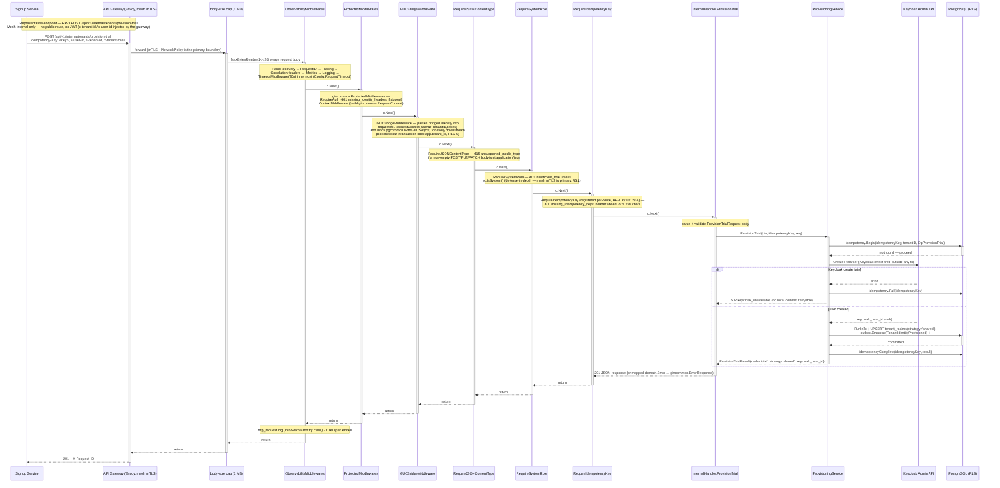
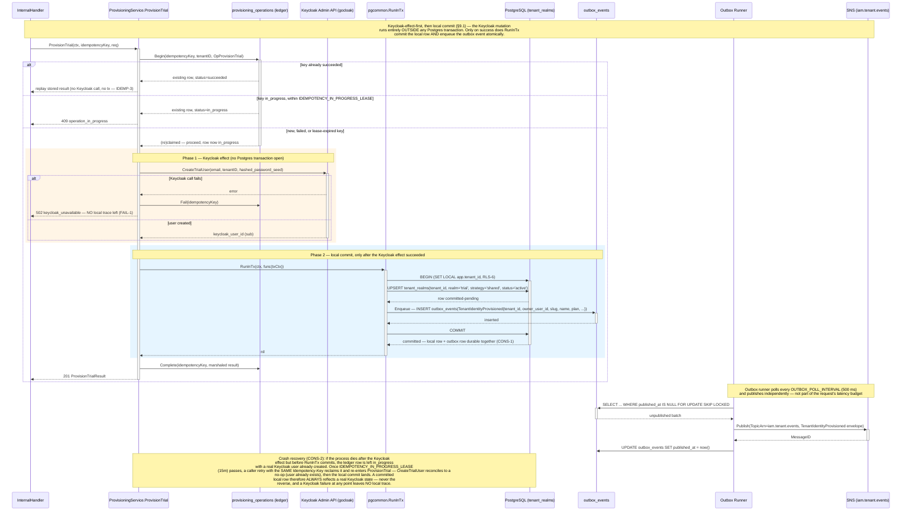
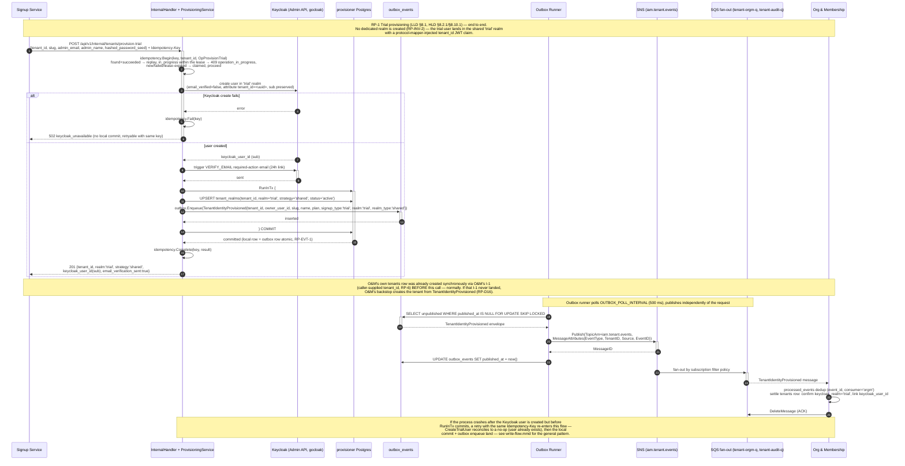
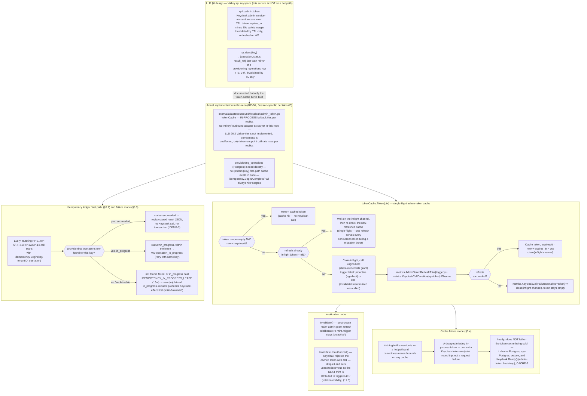
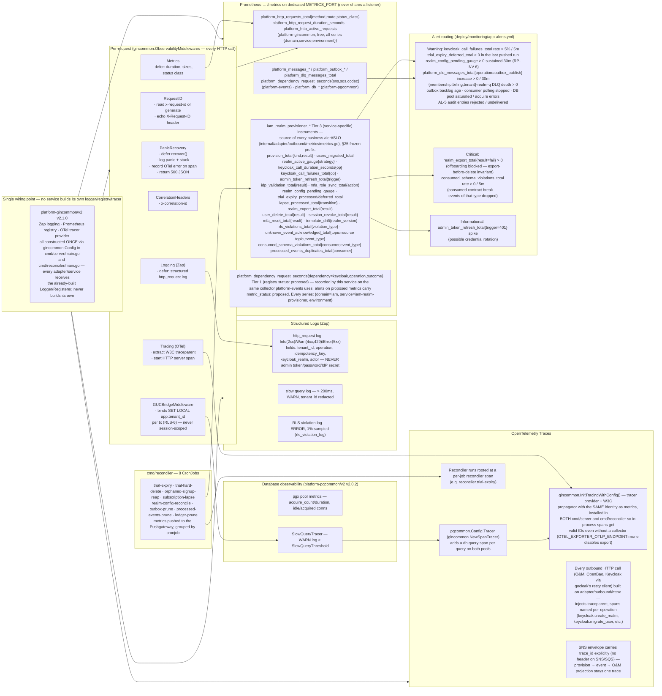
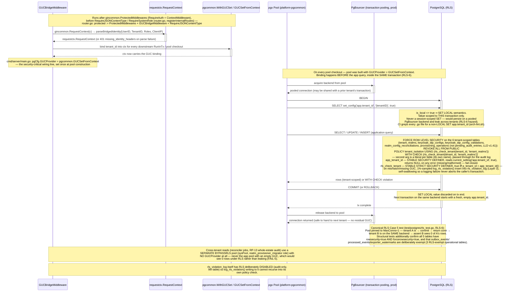
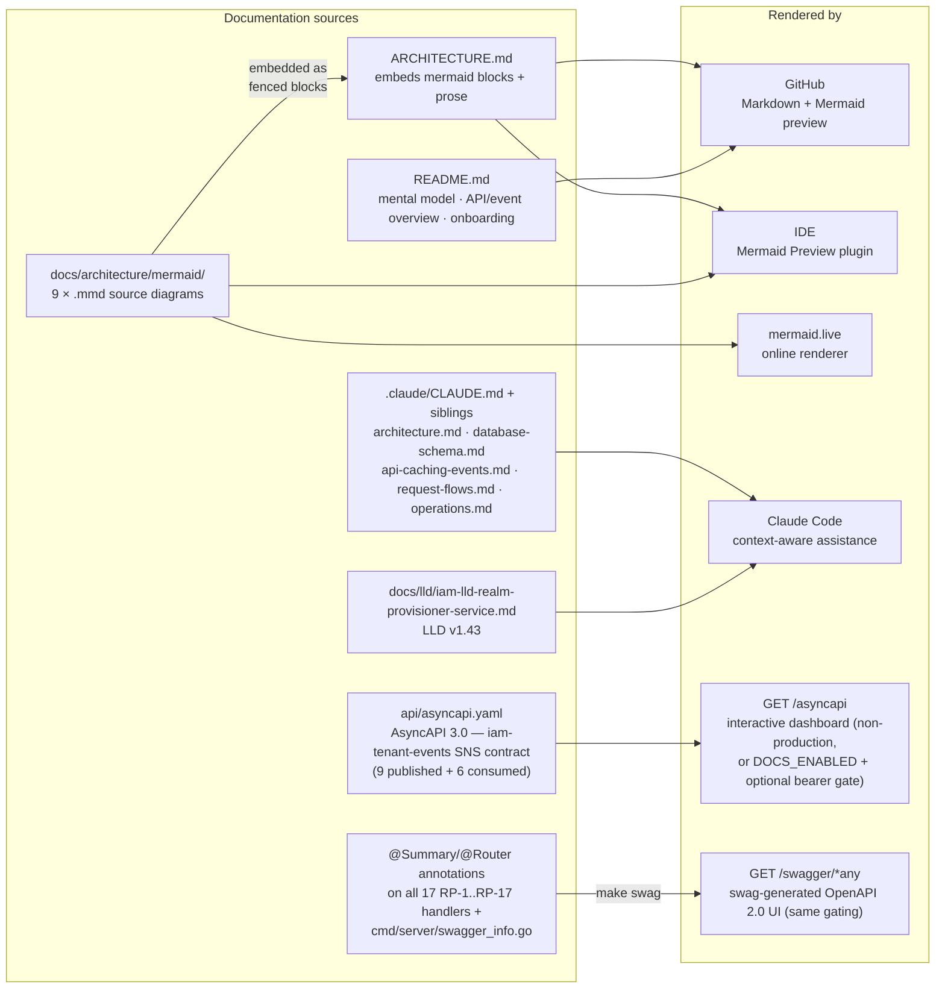

# Architecture

This document describes the internal structure, dependency rules, and runtime data flows of `iam-realm-provisioner`.

`iam-realm-provisioner` is a **private Go service** (`github.com/BCBP-SOLUTIONS-FZC-LLC/iam-realm-provisioner`, Go 1.26.9) deployed as a containerised microservice (HPA 2–4 replicas), refining **IAM HLD v1.53 §5.2** (LLD **v1.42**, `docs/lld/iam-lld-realm-provisioner-service.md`; where LLD and HLD disagree, HLD is authoritative). It is the **single writer to the Keycloak Admin API** across the entire IAM subsystem (RP-INV-1, HLD §4.2/§5.2) and the system of record for the small amount of local state — realm identity, IdP config, reconciliation and idempotency ledgers — needed to make that writing safe, idempotent, and replayable. Org & Membership owns the application-side `tenants` row; this service owns Keycloak-side realm reality and its `tenant_realms` mirror (RP-D6) — neither writes the other's store. It ships as **two binaries from one image**: `cmd/server` (the mesh-only `/api/v1/internal` API, RP-1..RP-17, three inbound SQS consumers, and the transactional outbox runner) and `cmd/reconciler` (a single binary dispatched by `--job=<name>`, covering RP-C1..RP-C4 plus two operational prune jobs, each its own Kubernetes CronJob). The service sits on **neither of the platform's two hot paths** (HLD §4.3) — work is bursty, coarse-grained tenant-lifecycle operations, where correctness, auditability, and idempotency matter more than latency.

**Does not own:** tenants-as-business-entities, memberships, roles, invitations (Org & Membership); JWT issuance / login (Keycloak itself); delegation, tender ACL, group-mapping, or the plan/department catalogues (sibling services extracted from Core); any per-user table (there is none — Keycloak is the sole store of user identity and credentials); secret material in Postgres (IdP secrets live only in OpenBao).

---

## Layer model

The service is organised in concentric Clean Architecture layers. Inner layers have **zero knowledge** of outer layers; dependencies always point inward.

> Source: [`docs/architecture/mermaid/layer-model.mmd`](docs/architecture/mermaid/layer-model.mmd)



**Rule:** `domain` ← `port` ← `service` ← `adapter` ← `cmd`. `core/service` may also import `pkg/requestctx` and `internal/adapter/outbound/metrics` (observability leaf — documented exception, matching sibling convention: `mfa_service.go`, `idp_service.go`, `realm_config_service.go` import it directly to record business-outcome counters at the point of the outcome). Nothing else in `core/` imports `adapter/`. Tests import service and domain packages but are not part of the production dependency chain. Enforced in CI by `go-arch-lint` (`.go-arch-lint.yml`) plus five extra greps in `.github/scripts/arch-lint.sh`: **RP-INV-1** (`grep -rl "Nerzal/gocloak" --include="*.go" .` outside `internal/adapter/outbound/keycloak/` must be empty), **RLS-6** (`grep -rn "SET app\.tenant_id"` across `*.go`/`*.sql` must only ever appear as `SET LOCAL`), and three architectural invariants requiring logs/metrics/traces, database connections/config/operations, and SNS/SQS/outbox writes to flow through `platform-gincommon`/`platform-pgcommon`/`platform-events` respectively, with no independent second path.

The `keycloak` adapter is its **own** arch-lint component, separate from the rest of `adapters_outbound`, so nothing else can compile against gocloak types without declaring a forbidden dependency — RP-INV-1 (this service is the *only* holder of a Keycloak admin credential in the entire platform) is thereby verified both structurally (component boundary) and textually (the grep). `Nerzal/gocloak` v13.9.0 is not a dependency of any sibling IAM service. Every mutating and read operation against Keycloak's Admin API is one method on `port.KeycloakAdmin` (`internal/core/port/keycloak_admin.go`, 29 methods: `CreateRealmFromTemplate`, `RegisterOIDCClients`, `MigrateUser`, `CreateTrialUser`, `CreateInvitedUser`, `CreateOrUpdateIdp`, `AssignRequiresMFA`, `RevokeUserSessions`, `ExportRealm`, `DeleteRealmIfExists`, `Ready`, the platform-automation service-account trio `CreateServiceAccountClient(realmName, clientID, jwksURL) (sub uuid.UUID, created bool, err error)` / `ClearServiceAccountKeysCache` / `DeleteServiceAccountClientIfExists` (§2.5, RP-17/RP-18), and the rest); exactly one adapter implements it.

---

## Package dependency graph

Arrows represent Go `import` relationships (module-internal only) — this graph mirrors `.go-arch-lint.yml` component-by-component.

> Source: [`docs/architecture/mermaid/package-dependencies.mmd`](docs/architecture/mermaid/package-dependencies.mmd)



`core/domain` is the dependency sink — `anyVendorDeps: true` (covers only `google/uuid`), no internal imports. `core/port` may depend on `domain` only. `requestctx`, `eventschema`, `apispec` (the `api/` package, `api/embed.go`'s `AsyncAPISpec []byte`), and `swaggerdocs` (`docs/swagger`, generated `make swag` output, blank-imported by `cmd/server/main.go` to self-register at init) are standalone leaves with `anyVendorDeps: true`. `reconciler_jobs` (`cmd/reconciler/jobs`) is its own component — not merged into `cmd` — specifically so it can be declared as a normal dependency of `cmd/reconciler`'s `main.go` without a false-positive self-cycle warning. Enforced via `deepScan: false` (import-level checks only) and `exclude: [test, scripts, deploy]` / `excludeFiles: ['.*_test\.go$']` — a composition root wiring an adapter into a service constructor in `main.go` is how Clean Architecture is supposed to work, not a violation.

---

## Request flow

Every HTTP request passes through the full middleware stack before reaching a handler; every route in this service lives under the single mesh-internal group `/api/v1/internal/*` (AUTH-1) — there is almost no public surface, and no JWT is checked here (`x-user-id`/`x-tenant-id`/`x-tenant-roles` are gateway-injected after mesh mTLS authentication).

> Source: [`docs/architecture/mermaid/request-flow.mmd`](docs/architecture/mermaid/request-flow.mmd)



**Middleware execution model.** Every business route runs through `gincommon.ProtectedMiddlewares` (`RequireAuth`, `ContextMiddleware`) then this service's own chain, appended in `registerInternalRoutes` (`internal/adapter/inbound/http/router.go`):

```
body-size cap (1 MB)
    ObservabilityMiddlewares (PanicRecovery · RequestID · Tracing · CorrelationHeaders · Metrics · Logging
                              · TimeoutMiddleware(30s) innermost, via gincommon.Config.RequestTimeout —
                              so metrics/logs/spans record the same 503 the client gets)
      ProtectedMiddlewares (RequireAuth · ContextMiddleware)
        GUCBridgeMiddleware       — binds pgcommon.WithGUCSet(ctx), RLS-6
          RequireJSONContentType  — 415 on non-JSON body
            RequireSystemRole     — 403 unless rc.IsSystem() (defense-in-depth)
              RequireIdempotencyKey / RequireOperatorRole  — per-route
                Handler ← executes here
```

`/healthz` and `/readyz` (`registerInfraRoutes`) and the docs surface (`registerDocsRoutes`, gated by `DocsConfig`) are registered **before** the internal group and carry none of this chain, so a load-balancer probe with no headers still gets `200`. `/healthz` is pure liveness — it never inspects a dependency; `/readyz` checks Postgres, sys-Postgres, the outbox runner, and Keycloak's admin-token bootstrap via each dependency's `Health(ctx)` (`Pinger` interface), returning `503` on any failure so it can shed load.

---

## Write flow and transactional outbox

Every mutating operation picks one of **two ordering disciplines** (LLD §9.1) — there is no distributed transaction spanning Keycloak and Postgres, so the choice of which side commits first is itself the correctness mechanism.

1. **Keycloak-effect-first, then local commit** (default — provisioning, migration, IdP, MFA, successful realm-config apply). The Keycloak mutation runs entirely **outside** any Postgres transaction; only after it succeeds does `RunInTx` commit the local row **and** enqueue the outbox event(s) atomically (RP-EVT-1 / CONS-1). A crash after the Keycloak effect but before the local commit leaves real Keycloak state with no local record — recovered by idempotent replay of the same `Idempotency-Key`: `CreateTrialUser` (or the equivalent Keycloak call) reconciles to a no-op because the user already exists, then the local commit lands. A committed local row therefore **always** reflects a real Keycloak state (CONS-2); a Keycloak failure at any point leaves **no** local trace (FAIL-1).
2. **Local-intent-first, then reconcile** (RP-8 when Keycloak is transiently down, RP-INV-6). The desired value is recorded `pending` in `realm_config_reconciliations` and the caller gets `200 {applied:false, reconciling:true}` — not an error — and RP-C4 converges it on its next 10-minute tick.

> Source: [`docs/architecture/mermaid/write-flow.mmd`](docs/architecture/mermaid/write-flow.mmd)



`EventPublisher.Enqueue(ctx, Event)` inserts into `outbox_events` inside the caller's transaction — every local state change and its event share one `RunInTx`. The publisher reads the open `pgx.Tx` from ctx (`postgres.TxFromContext`); callers never pass a tx. Every mutating entry point starts with `idempotency.Begin` and every exit path calls `Complete` or `Fail` — no row is left `in_progress` after a definite outcome (IDEMP-1); `Complete`/`Fail` run on a context detached from the request, so even a timed-out or disconnected request records its outcome. The outbox runner polls every `OUTBOX_POLL_INTERVAL` (default 500 ms) and publishes to SNS; a successful publish marks `published_at`, a failure retries up to `OUTBOX_MAX_ATTEMPTS` (5), then the row moves to platform-events' `outbox_dead_letters` table, counted in `platform_dlq_messages_total{operation="outbox_publish",reason="max_attempts"}`.

---

## Provisioning flow

New tenants enter the system through **RP-1** (trial provisioning, LLD §8.1). No dedicated realm is created (RP-INV-2) — the trial user lands in the shared `trial` realm with a protocol-mapper-injected `tenant_id` JWT claim.

> Source: [`docs/architecture/mermaid/provisioning-flow.mmd`](docs/architecture/mermaid/provisioning-flow.mmd)



**Other provisioning flows share the same discipline.** `ProvisionDirect` (RP-2) places the tenant on the least-loaded shard (§9.5, from the **local** `tenant_realms` mirror), clones `realm-template.json`, registers OIDC clients, creates the admin user, then commits `tenant_realms{strategy=dedicated}` + `TenantIdentityProvisioned` + `TenantRealmReady` + `DirectPaidSignup` + `TenantConverted{direct_signup=true}` — with compensating teardown (`DeleteRealmIfExists`, itself idempotent) if any Keycloak step in the sequence fails (§9.3). `Convert` (RP-3) creates the dedicated realm (named deterministically from the tenant's full UUID), registers OIDC clients, lists every user on the shared realm and calls `MigrateUser` per user (preserving `sub`, copying TOTP, flagging WebAuthn for re-enrollment), best-effort force-logs-out the shared realm, and only then commits `strategy=dedicated` + `TenantRealmReady` + `TenantConverted`. Compensating teardown (`DeleteRealmIfExists`) only runs while the dedicated realm is still empty — `MigrateUser` deletes each user from the shared realm before recreating them in the dedicated one, so once a single user has actually been migrated, the dedicated realm holds a user that exists nowhere else; tearing it down at that point would be permanent data loss, not a rollback. A retry with the same `Idempotency-Key` resumes instead: the deterministic realm name means a `CreateRealmFromTemplate` conflict on retry can only be this tenant's own earlier attempt, and a fresh listing of the shared realm naturally picks up only whatever users remain unmigrated. `RevertConversion` (RP-4) reverses a conversion within a fixed window: migrates users back to the shared realm, tears down the dedicated realm, and re-mints the tenant's `platform-automation` client back in the shared realm (the dedicated realm's client died with the realm it lived in) before committing. `CreateInvitedUser` (RP-5) applies Org & Membership's `required_actions` verbatim (F5) and persists nothing locally. Every one of these entry points opens with `idempotency.Begin` and closes with `Complete`/`Fail` — never left `in_progress`.

**Platform-automation mint (§2.5, RP-1/RP-2/RP-3/RP-4, RP-17/RP-18).** RP-1/RP-2/RP-3 (and RP-4 on revert) each call a shared `mintPlatformAutomation` helper before their own `RunInTx`: `KeycloakAdmin.CreateServiceAccountClient(realm, clientID, jwksURL)` mints (or resumes) a `client-jwt`/JWKS-authenticated service-account client — returning `(sub, created, err)` — then `TokenServiceClient.RegisterPrincipal` (TS-4) and `IssueOrRotateCredential` (TS-1) register it and issue its first credential with Token Service (`iam-token-service`). If either Token Service call fails after a **freshly-minted** client (`created=true`), that client is best-effort deleted (`DeleteServiceAccountClientIfExists`) so a caller with no realm-level teardown (RP-1's shared realm is never deleted) isn't left with an orphan; a **resumed** client (`created=false`) is never deleted this way, since it may already be serving live traffic from an earlier attempt. `Convert` (RP-3) additionally retires the tenant's now-stale shared-realm client once conversion commits. RP-17 (`POST .../service-account/keys/refresh`) calls `ClearServiceAccountKeysCache` so Keycloak notices a rotated/revoked key — it does not self-refresh a `jwks.url` client's cached keys. RP-18 is this service **calling** Token Service's TS-3 (`ReadPrincipal`), not a hosted endpoint.

---

## Cache strategy

This service sits on **neither of the platform's two hot paths**, so the only caching that exists is a single-flight admin-token cache and a strictly-read-through idempotency ledger — not a request-latency optimisation.

> Source: [`docs/architecture/mermaid/cache-strategy.mmd`](docs/architecture/mermaid/cache-strategy.mmd)



The `keycloak` adapter (`internal/adapter/outbound/keycloak/admin_token.go`) wraps `gocloak` with this admin-token cache plus a bounded exponential backoff on 5xx/timeout (`429` honours `Retry-After`) and a client-side token-bucket rate limiter (`KEYCLOAK_RATE_LIMIT_RPS`, default 20) — `Wait()` blocks rather than rejecting, so a conversion burst is smoothed rather than failed. This limiter, not replica count, is the real throughput ceiling during a mass migration (§9.4/§21.1).

---

## Data model overview

Database `provisioner` on shared RDS PostgreSQL (Multi-AZ, PgBouncer transaction pooling). **10 tables**: six tenant-scoped with RLS (`FORCE ROW LEVEL SECURITY` + `REVOKE ALL FROM PUBLIC` + `tenant_isolation` policy on `app.tenant_id`) — `tenant_realms`, `keycloak_idp_configs`, `keycloak_idp_config_validations`, `realm_config_reconciliations`, `provisioning_operations`, `pending_audit_entries` (durable `TenantIdpConfigChanged` → Audit Log AL-5 hand-off, drained by a `cmd/server` goroutine); plus three RLS-exempt operational tables — `processed_events` and `outbox_events` (schema owned by `platform-events` via `outbox.ApplySchema`), and `exporter_watermarks` (the `RLSViolationCounts` exporter's persisted high-water mark, §11.2). `rls_violation_log` is a sampled (1%) audit trail written by `log_rls_violation()`; RLS is disabled on it so logging cannot recurse.

`RealmConfigReconciliation` carries RP-INV-6's durability guarantee: a `pending` row is an observable Keycloak divergence, converged by RP-C4, never a silent miss.

`record_version`-based optimistic locking on `tenant_realms` and `keycloak_idp_configs`. Cross-tenant admin access requires the `BYPASSRLS` role **`realm_provisioner_migrator`** (never the app role `realm_provisioner_app` — CI-verified via MIG-3 / MIG-5).

Full table catalogue and every RLS/migration/trigger invariant is in [`.claude/database-schema.md`](.claude/database-schema.md).

---

## Event and outbox flow

One outbound SNS topic — this service is a **co-producer** with Org & Membership rather than the sole producer:

> Source: [`docs/architecture/mermaid/event-outbox-flow.mmd`](docs/architecture/mermaid/event-outbox-flow.mmd)

```mermaid
sequenceDiagram
    participant SVC as core/service
    participant TX as pgcommon.RunInTx
    participant DB as PostgreSQL (business table)
    participant OB as outbox_events
    participant Codec as ValidatingCodec (enqueue) → GlueCodec (publish, prod) / NoopCodec (dev)
    participant Runner as Outbox Runner (poll 500 ms)
    participant SNS as SNS — single topic iam.tenant.events<br/>(events.NewSNSPublisher, NOT a RoutingPublisher)
    participant OMQ as SQS tenant-orgm-q / tenant-audit-q / tenant-notification-q / tenant-authz-q<br/>(O&M's own subscriptions — this service never self-consumes)

    Note over SVC,OB: Phase 1 — Atomic write + event enqueue (RP-EVT-1 / CONS-1)<br/>Every one of the 9 published events shares its RunInTx with the local state change that caused it

    SVC ->>+ TX: RunInTx(ctx, func(txCtx))
    TX ->>+ DB: UPSERT/UPDATE tenant_realms (or keycloak_idp_configs, record_version optimistic lock)
    DB -->>- TX: row affected
    TX ->>+ Codec: Encode(ctx, event.Type, jsonPayload) — enqueue-time
    Note over Codec: ValidatingCodec validates against embedded internal/eventschema/*.json<br/>(fail-closed — unknown/invalid type never inserts, TX rolls back)
    Codec -->>- TX: encoded (plain JSON at this stage)
    TX ->>+ OB: INSERT outbox_events(id UUID v7, event_type, payload, source='iam-realm-provisioner',<br/>tenant_id, trace_id, created_at, scheduled_at)
    OB -->>- TX: inserted
    TX ->>+ DB: COMMIT
    DB -->>- TX: committed — business row + outbox row durable together
    TX -->>- SVC: nil

    Note over Runner,OMQ: Phase 2 — Outbound publish (at-least-once, FAIL-3) — this service is a<br/>CO-PRODUCER on iam.tenant.events with O&M (which produces only TenantCreated/TrialStarted<br/>on the same topic) — schema names are disjoint (RP-D5)

    loop every OUTBOX_POLL_INTERVAL (500 ms)
        Runner ->>+ OB: SELECT ... WHERE published_at IS NULL LIMIT 50 FOR UPDATE SKIP LOCKED
        OB -->>- Runner: unpublished batch
        loop for each envelope
            Runner ->>+ Codec: Encode — publish-time GlueCodec
            Note over Codec: Prepends 18-byte Glue header {0x03,0x00,schema_version_UUID}.<br/>UUID from an in-memory cache, resolved ONCE at startup via glue:GetSchemaByDefinition<br/>with this build's embedded schema (shared "iam-tenant-events" registry, §7.3.1) —<br/>never "latest", no refresher, no per-event Glue call.<br/>NoopCodec pass-through when GLUE_REGISTRY_TENANT_NAME is unset (dev).
            Codec -->>- Runner: encoded bytes
            Runner ->>+ SNS: Publish(TopicArn=SNS_TOPIC_TENANT_ARN,<br/>MessageAttributes{EventType, TenantID, Source, EventID, Subject})
            SNS -->>- Runner: MessageID
            Runner ->> OB: UPDATE outbox_events SET published_at = now()
            Note over Runner: retry to OUTBOX_MAX_ATTEMPTS (5) with backoff, DLQ beyond (platform_dlq_messages_total{operation=outbox_publish})
        end
    end

    SNS ->>+ OMQ: fan-out by per-event SNS subscription filter policy<br/>(9 event types — TenantIdentityProvisioned, TenantRealmReady, TenantConverted,<br/>DirectPaidSignup, TrialExpired, TrialReactivated, TenantSuspended,<br/>TenantOffboarded, TenantReactivated{source=operator})
    deactivate OMQ
    Note over OMQ: O&M settles tenants row · Audit · Notification · AuthZ cache invalidation

    Note over SVC,OMQ: ── This service is ALSO a consumer — 3 inbound SQS queues, each its own -dlq (maxReceiveCount=5) ──

    participant SNS_M as SNS iam.membership.events (O&M-produced)
    participant Q1 as membership-realm-q
    participant C1 as MembershipConsumer → MfaService.SyncRequiresMfa
    participant SNS_T2 as SNS iam.tenant.events (O&M's TrialStarted)
    participant Q2 as tenant-realm-q
    participant C2 as TenantConsumer → record local trial_ends_at (RP-4)
    participant SNS_B as SNS billing.events (Billing-produced)
    participant Q3 as billing-realm-q
    participant C3 as BillingConsumer → re-enable suspended dedicated realm

    SNS_M ->>+ Q1: filter EventType IN [DepartmentMembershipGranted,<br/>DepartmentMembershipLevelChanged, TenantRoleGranted, TenantRoleRevoked]
    Q1 -->>- C1: message
    C1 ->> C1: inbox IsProcessed pre-check → Keycloak reconcile → inbox ProcessOnce claim (consumer='membership', no local write)

    SNS_T2 ->>+ Q2: filter EventType IN [TrialStarted]
    Q2 -->>- C2: message
    C2 ->> C2: inbox ProcessOnce { claim(consumer='tenant'), UPDATE tenant_realms.trial_ends_at } — one tx

    SNS_B ->>+ Q3: filter EventType IN [TenantReactivated]
    Q3 -->>- C3: message
    C3 ->> C3: IsProcessed pre-check → EnableRealm outside tx → inbox ProcessOnce { claim(consumer='billing'), UPDATE } — Keycloak-effect-first

    Note over Q1,C3: Every queue runs the same pipeline before the handlers above (sqspipeline.NewConsumer + Handler):<br/>library GlueDecodeCodec strips the Glue header (platform-events counts platform_messages_* by queue) →<br/>validateConsumed against eventschema.ConsumedByConsumer (per consumer — billing's TenantReactivated is Billing's)<br/>violation → consumed_schema_violations_total++ → straight to -dlq (reason schema_violation), handler never called
    Note over Q1,C3: A message that keeps failing: deliveries 1-4 → handler, 5th → platform-events forwards it to -dlq<br/>(WithDLQForwarding, platform_dlq_messages_total++) before SQS's own RedrivePolicy would
```



**Published: `iam.tenant.events`, 9 event types** — `TenantIdentityProvisioned`, `TenantRealmReady`, `TenantConverted`, `DirectPaidSignup`, `TrialExpired`, `TrialReactivated`, `TenantSuspended`, `TenantOffboarded`, `TenantReactivated{source=operator}`. O&M produces `TenantCreated`/`TrialStarted` on the *same* topic (co-producer, disjoint schema names, RP-D5). `TenantOffboarded` is emitted **only after** the S3 export has succeeded and the realm has been deleted (`export_s3_key` always references a durable object, RP-EVT-4); O&M consumes it for its own GDPR wipe and this service does not re-emit it. The envelope carries `{id (UUID v7), source=iam-realm-provisioner, tenant_id, trace_id, specversion, time, subject, actor, dataschema, data}` — `tenant_id` lives on the envelope, never inside `data`.

**Consumed — 3 inbound SQS queues**, naming pattern `<topic-short>-<consumer-short>-q` (consumer short-name `realm`), each its own `-dlq` (`maxReceiveCount = 5`), deduped via `processed_events` composite PK `(event_id, consumer)` with `consumer ∈ {membership, tenant, billing}`:

| Queue | Topic | Filter | Handler |
|---|---|---|---|
| `membership-realm-q` | `iam.membership.events` | `DepartmentMembershipGranted`, `DepartmentMembershipLevelChanged`, `TenantRoleGranted`, `TenantRoleRevoked` | MFA-role sync (`MfaService.SyncRequiresMfa`) — unconditional assign-if-absent on grant, revoke on `TenantRoleRevoked` only after `OrgMembershipClient.HasResidualMFARequirement` (O&M's I-8) confirms no residual requirement. I-8 failure is **fail-open via SQS redelivery** (the message is not deleted), so MFA is never silently dropped. |
| `tenant-realm-q` | `iam.tenant.events` | `TrialStarted` | Record local `trial_ends_at` (RP-4) — this service never queries O&M for expired trials, it's push-only |
| `billing-realm-q` | `billing.events` | `TenantReactivated` (`source=billing`) | Re-enable a suspended dedicated realm (no-op if not suspended) |

**Downstream consumers of `iam.tenant.events` (Commercial domain, CD-26)** — owned by Commercial services, documented in `api/asyncapi.yaml` and LLD §7.4; not consumed by this service:

| Queue | Owner | Filter |
|---|---|---|
| `tenant-billing-q` | Billing | `TenantSuspended`, `TenantReactivated`, `TenantConverted`, `TenantOffboarded` (CD-24: operator suspensions + un-suspends previously invisible to Billing; CD-49 adds conversion and offboarding) |
| `tenant-entitlements-q` | Entitlements | `TenantConverted`, `TenantSuspended`, `TenantReactivated`, `TenantOffboarded`, `TrialExpired` (CD-6) |
| `tenant-usage-q` | Usage & Metering | `TenantConverted`, `TenantSuspended`, `TenantOffboarded`, `TenantReactivated` (CD-49) |

Each queue's consumer and handler are built by `internal/adapter/inbound/sqspipeline` from platform-events (`eventcfg.LoadSQS`, the library's `GlueDecodeCodec`, `WithDLQForwarding` over `NewSQSDLQPublisherWithClient`; `RequireDLQ` fails startup for a queue with no RedrivePolicy): `platform_messages_*` counters → **straight-to-DLQ route** → a consumer span → **consumed-schema validation** → the consumer's `Handle`, which dedups through platform-events' `pkg/inbox` (`InboxRepository`, claim + projection in one transaction). The Glue-decoded payload is validated against this service's own extracted consumed-message schema (`eventschema.ConsumedByConsumer`, keyed per consumer — billing's `TenantReactivated` is Billing's, never this service's own produced one). No Glue call; unknown types pass through to `ackUnknown`. A violation never reaches the handler or `processed_events`; it is sent straight to `-dlq` on its first delivery through the library's DLQ publisher (original body and attributes, reason `schema_violation`), and it pages via `iam_realm_provisioner_consumed_schema_violations_total`. A message whose handler keeps failing is forwarded to `-dlq` by platform-events on its 5th delivery.

Dedup is platform-events' `pkg/inbox` (`InboxRepository`, one `inbox.Store` per consumer): `ProcessOnce` claims `(event_id, consumer)` as the first statement of the transaction that also runs the handler's Postgres write, so a concurrent redelivery blocks on the claim and then sees a duplicate. `TenantConsumer` claims and writes in one `ProcessOnce`; `BillingConsumer` pre-checks `IsProcessed`, calls Keycloak `EnableRealm` outside any transaction (Keycloak-effect-first), then claims and writes; `MembershipConsumer` writes nothing locally — it pre-checks, reconciles in Keycloak, then claims, matching `iam-org-membership`. Unknown event types are silently ack'd, counted, and recorded in `processed_events` so a producer adding a type cannot storm the queue. This service **never self-consumes** the nine events it produces, and Billing-produced `TenantReactivated{source=billing}` arrives on a **different** topic than the operator-produced `TenantReactivated{source=operator}` this service itself emits (RP-D13) — the two are never confused. The domain migration `ALTER`s `outbox_events.payload` from JSONB to `text` (a PgBouncer simple-query bytea-hex workaround) and adds a normalize trigger, so `postgres.MigrateSchema` (run by the migrate hook Job, or at server startup when `RUN_MIGRATIONS` is not `false`) runs `outbox.ApplySchema` **before** the domain migration (MIG-2, inverted vs. some siblings) — `outbox_events` must already exist for the `ALTER` to apply.

`cmd/server/main.go` starts the outbox runner (after `OUTBOX_STARTUP_JITTER` seconds of random delay, to avoid every replica's runner waking in lockstep) and all three SQS consumers together at the end of composition-root wiring. An unset consumer queue URL disables **that** consumer with a `WARN` log rather than failing startup — a partially-configured deployment degrades one inbound path, it doesn't crash the process.

---

## Observability stack

Two observability concerns run per request: Prometheus metrics (synchronous, in-process) and OpenTelemetry spans (async, OTLP export). Structured logs are written after each response. This service has no user-facing latency hot path, so SLOs target **operation success and freshness**, not p99 request latency — availability target **99.9%** for the `/internal` provisioning API.

`gincommon.ObservabilityMiddlewares` is invoked once in `cmd/server/main.go` **before** any collector registration, so business / events / pgcommon metrics land on the same `gincommon.MetricsRegisterer()` as HTTP `platform_http_*`, with matching `{domain, service, environment}` const labels (`Config.Domain="iam"`, `Environment=APP_ENV`; `events.InitMetrics`/`pgmetrics.InitWithIdentity` reuse gincommon's identity, pgmetrics before `NewPool`). One `/metrics` scrape (`gincommon.MetricsHandler()`, on the dedicated `METRICS_PORT`, never sharing a listener with the API surface) serves HTTP + business + outbox + pg collectors together. Both binaries call `gincommon.InitTracingWithConfig()` (same identity as the metrics) unconditionally so in-process spans get valid trace IDs even without a collector. Reconciler CronJobs have no `/metrics` listener: each run pushes its metrics to the Pushgateway at `PROMETHEUS_PUSHGATEWAY_URL`, grouped by `cronjob`.

> Source: [`docs/architecture/mermaid/observability-stack.mmd`](docs/architecture/mermaid/observability-stack.mmd)



| Operation / scenario | Target | Notes |
|---|---|---|
| RP-1 trial provision | p95 ≤ 1.5 s | 1–2 Keycloak calls + email trigger + 1 tx |
| RP-2 direct-paid provision | p95 ≤ 4 s | realm clone + OIDC clients + admin user |
| RP-3 conversion | p95 ≤ 8 s + ~0.3 s/user migrated | dominated by per-user migration Keycloak calls |
| RP-6 IdP configure | p95 ≤ 2 s | validation + Keycloak IdP write |
| RP-8 realm-config apply | p95 ≤ 1 s | single Keycloak setting write |
| Membership→MFA-role effect | ≤ one SQS delivery | reconcile handler |
| Trial-expiry / lapse freshness | ≤ one cron tick (daily) + retry | `*_deferred_total` |
| Realm-config reconcile freshness | ≤ one RP-C4 tick (10 min) | `realm_config_pending_gauge` |

**DB-state gauge exporters.** `realm_active_gauge`, `realm_config_pending_gauge`, and `template_drift` are refreshed every 5 minutes by goroutines (`runBusinessExporters` in `cmd/server/exporters.go`) polling `pgadapter.GaugeRepository` on the BYPASSRLS `sysPool` — these are counts of current table state, so no request or reconciler path can maintain them directly. A fourth goroutine in the same function keeps `rls_violations_total` (a monotonic counter, not a gauge — `Add`s each tick's window delta rather than `Set`s an absolute value) fresh from `rls_violation_log`, backing RLS-6's two alerts; it needs a Terraform-side `GRANT SELECT` this repo cannot itself provide (`.claude/operations.md` §20). `trial_expiry_*`, `lapse_processed_total`, and `realm_export_total` are incremented inside the one-shot reconciler CronJob process, which has no `/metrics` listener; each run pushes its registry to the Prometheus Pushgateway (`PROMETHEUS_PUSHGATEWAY_URL`, grouped by `cronjob`, replacing the previous run's group), and the reconciler alerts read the pushed per-run value (LLD §11.2).

**Structured log fields:** `tenant_id`, `operation`, `idempotency_key`, `keycloak_realm`, `actor` — never the admin token, any password seed, or an IdP secret. Slow queries > 200 ms log at WARN with `tenant_id` redacted; RLS violations log at ERROR (1% sampled).

**Graceful shutdown.** On `SIGTERM`, `cmd/server/main.go` first drains in parallel (bounded by `httpDrainTimeout`, 30s): the HTTP and metrics servers, the three SQS consumers' in-flight messages, and any detached RP-3 conversions (`ProvisioningService.Drain`). It then stops the outbox runner (its current batch, `OUTBOX_DRAIN_TIMEOUT`), cancels background goroutines, and closes both pools on a fresh 10s budget before flushing logs and traces via `gincommon.Shutdown`. `terminationGracePeriodSeconds = 75` covers that sum. At-least-once delivery plus `processed_events` makes a mid-drain redelivery safe; a conversion still running at the deadline leaves its key `in_progress`, and a retry reclaims it after `IDEMPOTENCY_IN_PROGRESS_LEASE`.

---

## Row-Level Security (RLS) and GUC injection

Every SQL query on the request path runs with `app.tenant_id` bound **transaction-locally**. PostgreSQL RLS policies use this GUC to enforce tenant isolation at the database layer — a missing or wrong GUC fails closed (empty result / `WITH CHECK` rejection, never an error that could be swallowed).

> Source: [`docs/architecture/mermaid/rls-guc-flow.mmd`](docs/architecture/mermaid/rls-guc-flow.mmd)



`GUCProvider = pgcommon.GUCSetFromContext` is set once, at pool construction in `cmd/server/main.go` — the single security-critical wiring line. Every write **and every read** on the request path goes through `RunInTx`, so `set_config('app.tenant_id', ..., is_local => true)` runs inside the same transaction as the application query on every checkout, never a session-scoped `SET` (which would persist on a pooled PgBouncer backend and leak a tenant's GUC to the next request — RLS-6). All 7 tables carry `ALTER TABLE ... ENABLE/FORCE ROW LEVEL SECURITY` + `REVOKE ALL FROM PUBLIC` + a `tenant_isolation` policy where applicable; only a `BYPASSRLS` role can bypass it, and the app role `realm_provisioner_app` is never granted `BYPASSRLS` (the migration's final `DO $$` block actively strips it if ever found set, logging a `WARNING` if it lacks privilege to fix it — a defense-in-depth self-heal, MIG-3/MIG-5). A third role, `admin_readonly` (`NOLOGIN BYPASSRLS`), exists purely for cross-tenant compliance/support `SELECT`s and is never used by application code.

### The `sysPool` — the BYPASSRLS side of every pool pair

Both pools start from `pgcommon.ConfigFromEnv()` so DSN assembly, sizing, `PGBouncerMode`, and `SlowQueryThreshold` have exactly one implementation:

```go
pgCfg, pgWarnings := pgcommon.ConfigFromEnv() // DATABASE_URL / PG_*, incl. PG_BOUNCER_MODE
pgCfg.DSN = pgadapter.DSNFromEnv()            // the library's DSN; PG_STATEMENT_TIMEOUT is a per-tx SET LOCAL, not a DSN option
pgCfg.GUCProvider = pgcommon.GUCSetFromContext // ← the security-critical line
pgCfg.Tracer = gincommon.NewSpanTracer(cfg.ServiceName)
pool, err := pgcommon.NewPool(ctx, pgCfg)

// sysPool is built by SystemPoolConfig (ConfigFromEnv + forced PGBouncerMode), never a bare literal.
sysCfg := pgadapter.SystemPoolConfig(pgadapter.SystemDSNFromEnv(), log)
sysCfg.Tracer = gincommon.NewSpanTracer(cfg.ServiceName)
sysPool, err := pgcommon.NewPool(ctx, sysCfg)
```

`SystemPoolConfig` re-reads `pgcommon.ConfigFromEnv()`, forces `PGBouncerMode: true`, clears `GUCProvider` (a `BYPASSRLS` role must see every tenant), sets `PoolName: "system"` and the PgBouncer `MinConns` default, inherits the per-transaction `StatementTimeout`, and wires the gincommon logger — matching `iam-org-membership`. Tracer is set by the call site. A bare `pgcommon.Config{DSN: ...}` literal silently drops `PGBouncerMode`, and under `PG_BOUNCER_MODE=true` that pool would keep pgx's named prepared statements — which PgBouncer rejects in transaction-pooling mode with `prepared statement already exists` (CONFIG-2). In production `SYSTEM_DATABASE_URL` must target the `realm_provisioner_migrator` (`BYPASSRLS`) role — never the app role; in dev it falls back to the app DSN with a startup warning, and cross-tenant queries then correctly return 0 rows under RLS rather than leaking (FAIL-5). `sysPool` is used **only** by the reconciler jobs' cross-tenant sweeps and RP-13's whole-estate scan — never by any tenant-scoped request path. `MIGRATION_DATABASE_URL` is a third, direct (non-PgBouncer) DSN used solely for DDL, since transaction pooling is incompatible with schema changes and the app role has no `CREATE` on `public` (see `outbox.ApplySchema`-before-domain-migration ordering, MIG-2, in § Event and outbox flow above; broader rollout/migration safety — additive-first, `CREATE UNIQUE INDEX CONCURRENTLY` in a separate release, MIG-1/MIG-6/MIG-8/MIG-9 — is unchanged from the LLD). Both binaries drain with `Pool.DrainAndClose` on shutdown.

---

## Concurrency and optimistic locking

`tenant_realms` and `keycloak_idp_configs` carry `record_version` (CONC-1). Writers pass back the version they last read; a mismatch returns **0 rows affected**, which the repository maps to `409 optimistic_lock_conflict` — CONC-4 requires that response to include the current `record_version` so the caller can re-read and retry:

```go
tag, err := tx.Exec(ctx,
    "UPDATE tenant_realms SET status=$1 WHERE tenant_id=$2 AND record_version=$3",
    newStatus, tenantID, expectedVersion,
)
if tag.RowsAffected() == 0 {
    return domain.NewError(domain.ErrOptimisticLockConflict, "...")
}
```

The `touch_row()` `BEFORE UPDATE` trigger (attached only to these two tables) bumps `record_version` and `updated_at` on any real change, guarded by `WHEN (OLD.* IS DISTINCT FROM NEW.*)` — a no-op `UPDATE` leaves both untouched (TRG-1/TRG-3), so retried idempotent writes never spuriously advance the version or publish a redundant event. The idempotency ledger's `in_progress` state additionally serialises concurrent duplicates of the *same* operation (CONC-2/CONC-3); distinct tenants remain fully parallel. `keycloak_idp_config_validations`, `realm_config_reconciliations`, and `provisioning_operations` carry no `record_version` and no touch trigger — they are append-mostly / status-flip tables, not optimistic-locked entities.

### Idempotency (IDEMP-1..4)

- **IDEMP-1** — Every replayable operation converges to the same final state — no duplicate realms, no double-migration, no double-emit.
- **IDEMP-2** — `processed_events` PK `(event_id, consumer)` is the canonical bus-event dedup. For the two consumers that write to Postgres the mark commits in the same transaction as the projection write, so an event is never recorded as handled unless its effect landed. `provisioning_operations` is the canonical ledger for HTTP-triggered mutations.
- **IDEMP-3** — A `succeeded` key replays the stored `result` without re-executing Keycloak. `in_progress` → `409 operation_in_progress`; a `failed` key, or an `in_progress` one older than `IDEMPOTENCY_IN_PROGRESS_LEASE` (15m — the owning pod died), is reclaimed by the retry. `Complete`/`Fail` run on a context detached from the request, so a request deadline or client disconnect never strands a key `in_progress`.
- **IDEMP-4** — 8-day `processed_events` window is deliberate (`PROCESSED_EVENTS_TTL_DAYS` > 7-day SQS lifetime). Beyond-window duplicates are backstopped by value-level Keycloak reconcile (create-if-absent / delete-if-exists).

---

## Failure domains

**Consistency invariants (CONS-1..3):**

- **CONS-1** — Local business write + integration event(s) commit together via the transactional outbox; no event without state, no committed state without event. The Keycloak mutation sits *outside* that transaction.
- **CONS-2** — A committed local row always reflects a real Keycloak state. The inverse (Keycloak state, no local row) is recovered by idempotent replay of the same `Idempotency-Key`.
- **CONS-3** — Realm-config is the one deliberate exception (RP-INV-6): a `pending` row in `realm_config_reconciliations` is a durable, observable divergence, and RP-C4 converges it.

**Failure invariants (FAIL-1..6):**

- **FAIL-1** — Dependency failures never leave partial *local* business state. A Keycloak failure aborts before `RunInTx` ever opens; a DB failure rolls back the outbox row with the business row. A partial *Keycloak* sequence (e.g. `Convert`'s multi-step realm build) is compensated via `DeleteRealmIfExists` (§9.3).
- **FAIL-2** — Cache failures degrade latency only (an in-process token-cache miss costs one extra token-endpoint call, nothing more).
- **FAIL-3** — Outbox delivery is at-least-once; consumer dedup makes it exactly-once at the consumer.
- **FAIL-4** — All 8 CronJobs are safe to restart/re-run; they re-select only still-eligible rows.
- **FAIL-5** — Missing tenant context fails closed (RLS-2) — the app pool with no GUC returns 0 rows rather than leaking.
- **FAIL-6** — A cross-service dependency being down never corrupts local state and never affects any other service's hot path. O&M's I-8 failure redelivers via SQS; it never silently drops an MFA requirement.

**Domain error catalogue** (`internal/core/domain/errors.go`, §17) maps 1:1 to HTTP status at the handler layer:

| Error | Status | Trigger |
|---|---|---|
| `invalid_request` / `invalid_realm_strategy` / `invalid_idp_protocol` / `unsupported_realm_setting` / `missing_idempotency_key` | 400 | Field-level / enum / missing `Idempotency-Key` |
| `idp_region_portability_failed` | 400 | One or more §11.6 CRITICAL checks failed |
| `idp_warnings_unacknowledged` | 422 | §11.6 WARN item(s) not acknowledged |
| `tenant_realm_not_found` / `idp_config_not_found` | 404 | Resource missing (RP-15/RP-16 treat Keycloak user-not-found as **204**, not 404) |
| `idp_requires_dedicated_realm` / `realm_already_dedicated` / `revert_window_expired` / `tenant_offboarded` / `operation_in_progress` / `optimistic_lock_conflict` | 409 | State-machine / idempotency / CONC-3 |
| `user_email_conflict` (wire: `EMAIL_ALREADY_REGISTERED`) | 409 | Additive — RP-1/RP-2/RP-5 email conflict that `resolveUserCreateConflict` could not resolve as the caller's own retry (§9.2) |
| `keycloak_unavailable` / `conversion_failed` | 502 | Keycloak transport / partial-migration failure (retryable; no local commit) |
| `org_membership_unavailable` / `object_store_unavailable` | 503 | I-8 or S3 export down |

**Dependency degradation matrix** — this service sits on **no synchronous request-path dependency for any other service's hot path**; every row below is about what happens to **this service's own** operations:

| Operation | Sync dependency | Posture | On failure |
|---|---|---|---|
| RP-1 / RP-2 provision | Keycloak Admin API | fail-closed | `502 keycloak_unavailable`; no local commit; retry with same `Idempotency-Key` |
| RP-3 / RP-4 convert / revert | Keycloak Admin API | fail-closed | compensating `DeleteRealmIfExists`; no local dedicated row |
| Invite (O&M → RP-5) | Keycloak Admin API | fail-closed | `502` → O&M `503 realm_provisioner_unavailable`; no invitation |
| MFA reset (O&M → RP-9) | Keycloak Admin API | fail-closed | `502` → O&M `503`; no `MFAReset` (no reconciler, unlike RP-16) |
| Realm-config (O&M → RP-8) | Keycloak Admin API | fail-open + durable reconcile | `pending` row, RP-C4 converges (RP-INV-6) |
| Session revoke (O&M → RP-16) | Keycloak Admin API | fail-open on O&M's side | RP still fail-closed at the Keycloak call; O&M commits regardless (AUTH-8 TTL backstop) |
| User delete (O&M → RP-15) | Keycloak Admin API | fail-closed / idempotent | `502` retryable; user-not-found → 204 |
| `TenantRoleRevoked` MFA drop | O&M I-8 | fail-open via redelivery | SQS message not deleted; never a silent MFA drop |
| RP-6 / RP-7 IdP | OpenBao KV + Keycloak | fail-closed | no partial `keycloak_idp_configs` row |
| Offboarding export | S3 | fail-closed | tenant stays `suspended`; `realm_export_total{result="fail"}` is **critical** |
| Outbox publish | SNS | retried, then DLQ | local commit already happened — delay, not loss |
| RP-C3 suspend phase | O&M I-16 (`SubscriptionLapseReader`) | fail-open, degrade to WARN | skips the suspend phase only if `ORG_MEMBERSHIP_BASE_URL` is unset; offboard phase still runs |

Two fail-closed calls that sibling services feel (invite, MFA-reset) stop completing during a Keycloak outage; neither corrupts this service's local state. Export-before-delete (RP-EVT-4): if S3 is down the tenant stays `suspended` — a realm is never deleted without a confirmed export.

---

## Key invariants

| Invariant | Where enforced |
|---|---|
| Single Keycloak Admin writer (RP-INV-1) | `port.KeycloakAdmin` + `keycloak` arch-lint component + CI grep for `Nerzal/gocloak` outside that package |
| Shared `trial` realm is never disabled/deleted (RP-INV-2) | Lifecycle paths disable/delete *users* in the shared realm, never the realm; dedicated-realm teardown only |
| No cross-tenant data access | PostgreSQL RLS `FORCE` on all six tenant-scoped tables + `GUCBridgeMiddleware` + transaction-local GUC (RLS-1..6) |
| Event atomicity (no dual-write of *local* state) | Local row + outbox row committed in the same `pgcommon.RunInTx` (RP-EVT-1 / CONS-1); Keycloak sits outside |
| A committed local row always reflects real Keycloak state (CONS-2) | Keycloak-effect-first; compensating `DeleteRealmIfExists` on partial failure (§9.3) |
| Realm-config divergence is durable and visible (RP-INV-6 / CONS-3) | `pending` `realm_config_reconciliations` row + RP-C4; never a silent miss |
| Cache never serves stale data across tenants | Admin token is not tenant-scoped; there is no per-tenant Valkey keyspace implemented yet (LLD `rp:` prefix reserved) |
| `payload.tenant_id` never present in events | Envelope carries `tenant_id`; payload structs intentionally omit it |
| Optimistic lock version is monotonic and DB-owned | `touch_row()` trigger increments `record_version`; application never sets it directly (TRG-1) |
| HTTP mutations are replay-safe | `provisioning_operations` + caller `Idempotency-Key`; `succeeded` replays stored `result` (IDEMP-3) |
| Bus-event consumption is exactly-once at this consumer | `processed_events` PK `(event_id, consumer)` (IDEMP-2) |
| MFA revoke never silent-drops | I-8 failure → SQS redelivery, not delete (FAIL-6) |
| Offboarding never deletes without a confirmed export (RP-EVT-4) | S3 `Put` then `DeleteRealm`; failure leaves `suspended` |
| `offboarded` is terminal (RP-INV-5) | No transition out of `exported`/`deleted` |
| ValidatingCodec is fail-closed | Unknown event type → error at Encode → outbox never inserts |
| Secret material never in Postgres | IdP secrets in OpenBao; `hashed_password_seed` written only to Keycloak; admin token never logged |
| Operator suspension is reversible | RP-14 `source=operator` excluded from RP-C3 auto-offboard; RP-10 re-enables (`Reactivate` reverses **both** a billing-lapse suspension and an operator suspension from one endpoint) |
| Trial-expiry is realm-side (RP-4) | Local `trial_ends_at` from `TrialStarted`; RP-C1 never queries O&M |

---

## Deployment

### Container image — three binaries

The `Dockerfile` builds and copies **three** entrypoints into the distroless final image, plus the versioned realm template:

| Binary | Path in image | Purpose |
|---|---|---|
| `iam-realm-provisioner-server` | `/iam-realm-provisioner-server` | HTTP server (`cmd/server`) — long-running, serves `/api/v1/internal/*`, runs the outbox + 3 SQS consumers + AL-5 audit drainer |
| `iam-realm-provisioner-reconciler` | `/iam-realm-provisioner-reconciler` | Single-binary reconciler dispatched by `--job=<name>` (`cmd/reconciler`) — one-shot, invoked by 7 K8s CronJobs |
| `migrate` | `/migrate` | Schema migration (`cmd/migrate`, `postgres.MigrateSchema`) — the Helm pre-install/pre-upgrade hook Job |
| (data) | `/deploy/keycloak/realm-template.json` | The realm template `REALM_TEMPLATE_PATH` points at (§12.2) |

Two-stage Dockerfile: a Go builder stage compiles the binaries, the runtime stage is `gcr.io/distroless/static-debian12:nonroot` (no shell, no package manager, runs as non-root) — the deployed container copies only the compiled binaries and the realm template, not the source tree, which is why `api/asyncapi.yaml` must be compiled in via `//go:embed` rather than read from disk at runtime.

### Helm chart

`deploy/helm/` renders a single `Deployment` for the server, a migrate hook `Job`, and 7 `CronJob` resources, all from the same image. Each CronJob overrides `command: ["/iam-realm-provisioner-reconciler"]` with `--job=<name>`. Schedules are taken from `values.yaml`'s `cronjobs:` map, matched 1:1 to `cmd/reconciler/jobs/*.go`:

| CronJob | Schedule | Purpose |
|---|---|---|
| `trial-expiry` | `0 2 * * *` | RP-C1: sweep local `tenant_realms` for expired shared-realm trials; call RP-12 per tenant. **Never queries O&M.** |
| `trial-hard-delete` | `0 3 * * *` | RP-C2: past `TRIAL_GRACE_DAYS`, hard-delete shared-realm trial users and the `platform-automation-<tenant_id>` client, then scrub the local row; atomically erases PII from `keycloak_idp_configs`, `keycloak_idp_config_validations`, `realm_config_reconciliations`, `provisioning_operations` via `NewGDPRScrubFn` (never `pending_audit_entries`: undelivered audit records, LLD v1.41) (`gdpr.go`, BYPASSRLS transaction) |
| `orphaned-signup-reap` | `17 * * * *` | §8.7 (Signup BFF gap A-3): reap RP-1 signups O&M never created a tenant for — `strategy='shared' AND status='active' AND trial_ends_at IS NULL` (no `TrialStarted`), every other lifecycle column NULL, older than `ORPHAN_SIGNUP_AFTER` (48h). Re-checks the row `FOR UPDATE`, hard-deletes the shared-realm users and automation client, revokes the Token Service principal (TS-7), then scrubs PII + soft-deletes the row exactly like RP-C2. No event. |
| `subscription-lapse` | `0 2 * * *` | RP-C3: `cancelled → suspended → offboarded`, two phases sharing one `RECONCILER_BATCH_LIMIT` budget — suspend polls O&M's I-16 lapse list (WARN + skip if `ORG_MEMBERSHIP_BASE_URL` is unset), offboard always runs against local `suspension_source='billing_lapse'` rows past `RETENTION_DAYS`; offboard phase atomically erases PII from the same five tables via `NewGDPRScrubFn` (`gdpr.go`, BYPASSRLS transaction) |
| `realm-config-reconcile` | `*/10 * * * *` | RP-C4: retry every `realm_config_reconciliations` row in `status='pending'`; past `RECONCILER_MAX_ATTEMPTS` (default 20) a row moves to a terminal `failed` status instead of retrying forever (poison-pill cap) |
| `outbox-prune` | `0 4 * * *` | Prune published `outbox_events` past `OUTBOX_RETENTION_DAYS` |
| `processed-events-prune` | `30 4 * * *` | Prune `processed_events` past `PROCESSED_EVENTS_TTL_DAYS` |
| `ledger-prune` | `0 5 * * *` | Prune `provisioning_operations` past `PROVISIONING_OPERATIONS_TTL_DAYS` (30) and `rls_violation_log` past `RLS_VIOLATION_LOG_TTL_DAYS` (90), in batched deletes |

**Migrate hook.** `templates/migrate-job.yaml` runs `/migrate` before the Deployment's pods roll (`pre-install,pre-upgrade`), so replicas run with `RUN_MIGRATIONS=false`. Hook ordering: the Secret (weight -9), then a hook-scoped NetworkPolicy allowing DNS + Postgres egress (weight -5 — the namespace is default-deny), then the Job (weight 0). The Job runs as the namespace's `default` ServiceAccount with no token mounted, because the chart's own ServiceAccount does not exist yet during a first install's pre-install hooks.

`terminationGracePeriodSeconds = 75` — see [Graceful shutdown](#observability-stack) for the drain sequence it covers. HPA: 2–4 replicas on CPU (70%) + memory (80%). PDB `minAvailable: 1`. Resources (server): CPU 250m/1, Memory 256Mi/512Mi.

Pod AWS access (SNS/SQS/Glue/S3/KMS) is IRSA; secret access is OpenBao Kubernetes auth using the same ServiceAccount token (`deploy/openbao/`). `deploy/iam/` is AWS-resources-only — no `secretsmanager:*`.

### Migration safety

Rolling deploy, 2 replicas. `migrate.Runner` `lock_timeout=30s`. Additive changes zero-downtime. `UNIQUE` via `CREATE UNIQUE INDEX CONCURRENTLY` + `ADD CONSTRAINT ... USING INDEX` in separate releases (MIG-8). Because nothing was deployed before the LLD v1.0 sign-off, the initial schema is the single consolidated `000000_initial_schema` (LLD §19). Future changes follow MIG-1/MIG-6/MIG-9. See CONTRIBUTING § "Adding a new repository migration" for the checklist.

---

## Testing strategy

- **Unit** — two suites, both run by `make test-unit`: white-box tests colocated with the code under test (`TEST_INTERNAL_PKGS` in the Makefile), and a separate black-box `test/unit/` tree (`package unit_test`, `TEST_UNIT_PKGS`) exercising domain/service behavior through only their exported surface. See CONTRIBUTING § "Test layout" for what belongs in which. The colocated white-box suite:
  - `internal/core/service/*_test.go` (`testify/mock` for `port.KeycloakAdmin` / `OrgMembershipClient` / `OpenBaoClient` / `IdempotencyStore`): provisioning-flow branches (trial/direct/convert/revert); Keycloak-effect-first ordering; compensating teardown; idempotency-ledger replay; MFA reconcile under redelivery; §11.6 validator (CRITICAL blocks 400, WARN allows only with ack); realm-config apply → reconcile-on-Keycloak-failure; shard-placement tie-break.
  - `internal/adapter/inbound/http/*_test.go` (functional `fake*` mocks of every port): request binding, path/param parsing, idempotency-key handling, and every `domain.Error` code's HTTP-status mapping per handler.
  - `internal/adapter/outbound/keycloak/*_test.go`: gocloak pointed at an `httptest.Server` standing in for Keycloak's REST API — every realm/user/IdP/MFA method's success and error branches, without a real container.
  - `internal/adapter/outbound/postgres/*_test.go`: pure-logic branches (`withPool`, `wrapConnErr`, `nilIfZeroUUID`) that don't need a live database.
  - `cmd/reconciler/jobs/*_test.go` (functional mocks, `package jobs` white-box): each of the 7 reconciler jobs' dispatch logic, including RP-C3's two-phase suspend/offboard split — `SubscriptionLapses==nil` degradation, `BatchLimit` budget-sharing between phases, per-tenant idempotency-ledger keys, already-suspended/offboarded no-ops, and the RP-EVT-4 export→put→delete→commit call order.

- **Postgres / RLS** (`test/postgres/`, testcontainers-go, real PG, full migration suite):
  - RLS fail-closed (missing GUC / cross-tenant write / malformed GUC — all 0 rows or policy violation).
  - **Case 5 (§14.5, RLS-6):** no cross-tenant leak across a pooled backend. Pool pinned to `MaxConns=1`; tenant A tx → return connection → tenant B tx on same backend → assert B sees 0 of A's rows.
  - `processed_events` dedup (including a handler's follow-on event enqueued inside the claim transaction, never twice on redelivery), outbox enqueue/publish/prune, `realm_config_reconciliations` retry, `touch_row` no-op guard.
  - Idempotency ledger: `Complete`/`Fail` persist on a canceled request context; a stale `in_progress` key (older than the lease) is reclaimed, a fresh one is not.
  - Retention (`ledger-prune`): only rows past each table's window are deleted, in batches, and a canceled job stops between batches; `pending_audit_entries.last_error` stays valid UTF-8 when truncated.
  - Composition roots against a real database: `cmd/server` and `cmd/reconciler` `main()` (signal-driven, in-process), `cmd/migrate` (fresh schema, then a no-op re-run), and the gauge/RLS-violation-counter exporters.
  - CI greps for the forbidden non-`LOCAL` `SET app.tenant_id`.

- **Integration** (`test/integration/`, capped at `TEST_INTEGRATION_PARALLEL` — JVM/Quarkus containers are heavy): a **Keycloak 26 testcontainer** — real realm clone, `sub`-preserving user create, TOTP copy, IdP create, `requires-mfa` assign/revoke, realm disable/enable/export, admin-token cache + single-flight refresh, rate limiter under a simulated migration burst — and an **OpenBao testcontainer** — real KV v2 write→read→delete round trip, not-found → `ErrIdpConfigNotFound`, permission-denied, and a genuinely RS256-signed ServiceAccount JWT driving OpenBao's real Kubernetes-auth login/role-matching code (only the live cluster's TokenReview response is stubbed, since no real Kubernetes cluster is available to a testcontainer).

- **Contract** — nine published-event payloads vs `internal/eventschema/*.json` and `api/asyncapi.yaml`; consumed-event decodes vs producers' schemas; operator vs Billing `TenantReactivated` distinguished by `source` (RP-D13); `asyncapi_drift_test.go` asserts YAML message list ≡ `eventschema.ByEventType` keys.

- **E2E** (`test/e2e/`, `-tags=e2e`): trial provision → convert; IdP configure blocked then allowed; suspend/reactivate; idempotency replay.

- **Smoke** (`make test-smoke`, CI only, `.github/scripts/smoke-tests.sh`) checks the CI-built image (`/healthz` 200, `/asyncapi.yaml` serves the real spec) and fail-fast on missing required env.

Coverage is measured over `./cmd/...`, `./internal/...`, and `./pkg/...` (`COVER_PKG_LIST` in the Makefile — `cmd/...` is included so composition-root helpers like the gauge exporters and reconciler jobs are counted too), merged across the unit/postgres/integration suites (`scripts/merge_coverage.py`). Currently **97.2%** (rev 1.21, every suite passing; it was 97.8% at rev 1.17, before the rev 1.20–1.21 library, audit-delivery and production-readiness code landed), up from 92.2% before rev 1.17. A rev-1.16 pass judged the remaining gap — composition-root wiring in `cmd/server/main.go`/`cmd/reconciler/main.go`'s `run()` — unreachable without a live Postgres/Keycloak/AWS connection and set a ~92.6% practical ceiling; rev 1.17's new `cmd/server/main_integration_test.go`/`cmd/reconciler/main_integration_test.go`/`cmd/server/exporters_integration_test.go` (`//go:build integration`, real Postgres testcontainers) proved otherwise, exploiting `signal.Notify`'s pre-empt-default-terminate behavior to safely signal-test `main()` in-process. The CI coverage gate's floor moved to 95% accordingly. See [CONTRIBUTING.md](CONTRIBUTING.md) for the coverage gate.

---

## Consumer conformance checklist

Before a downstream service subscribes to `iam.tenant.events`, verify the following. This is scoped to what this repo actually documents — every sibling IAM service (`iam-authz-enrichment`, `iam-catalog-admin`, `iam-delegation`, `iam-group-mapping`, `iam-org-membership`, `iam-tender-acl`, `iam-user-profile`) is a Go module, so the guidance below is Go-only rather than a fabricated multi-language table.

**Decoding**
- [ ] Strip the 18-byte Glue header (`[0x03][0x00][16-byte schema version UUID]`) before deserialising the envelope JSON, when `GLUE_REGISTRY_TENANT_NAME` is set (`GlueCodec`); with `NoopCodec` (dev, unset) the message is plain JSON with no header
- [ ] `envelope.specversion` is always `"1"`; `envelope.dataschema` is the 16-byte Glue schema version UUID and is absent under `NoopCodec`
- [ ] Handle an unrecognised `event_type` gracefully (log + skip, not error) — this topic is co-produced (O&M's `TenantCreated`/`TrialStarted` share it, disjoint schema names, RP-D5) and new types may be added
- [ ] Ignore unknown JSON fields in the payload — a Go `encoding/json` decoder does this by default; do **not** wrap it in a `DisallowUnknownFields()` decoder for this contract

**Envelope shape** (`EventEnvelopeBase`, `api/asyncapi.yaml § components/schemas`)
- [ ] `id` (UUID v7), `type`, `source` (`"iam-realm-provisioner"`), `specversion`, `time`, `data`, `tenant_id` are the `required` fields — treat `envelope.tenant_id` as authoritative, never a `tenant_id` inside `data` (it is never present by design)
- [ ] `dataschema` and `subject`/`actor` are present-when-applicable, not universally required

**Idempotency**
- [ ] Record the envelope `id` against your own consumer name **before** committing any side-effect, mirroring this service's own `processed_events` composite PK `(event_id, consumer)` pattern
- [ ] Use an `ON CONFLICT DO NOTHING`-style insert — do not return an error on duplicate delivery, since SNS→SQS is at-least-once (FAIL-3)

**Ordering**
- [ ] Do not assume SNS preserves delivery order — a `TenantIdentityProvisioned` and a later `TenantConverted` for the same tenant can theoretically be redelivered out of order; handle via upsert-style projections, not insert-only

**Infrastructure**
- [ ] Configure a DLQ on the SQS subscription queue with `maxReceiveCount ≤ 5` — matches all three of this service's own inbound queues (`membership-realm-q`, `tenant-realm-q`, `billing-realm-q`)
- [ ] Enforce `aws:SourceArn == <SNS_TOPIC_TENANT_ARN>` in the SQS queue resource policy

**Observability**
- [ ] Emit a metric or alert on DLQ delivery — this service alerts on `{membership,billing,tenant}-realm-q` DLQ depth > 0 as a warning; a consuming service should hold itself to the same bar
- [ ] Log the envelope `id` and `type` on every processed message for end-to-end traceability

---

## Schema lifecycle

Unlike a service whose event set is under active, ongoing deprecation-and-versioning churn, this service's event surface was **frozen at LLD v1.0 sign-off** (§25 Frozen Name Inventory — "the identifiers below are frozen: schema/table/column names, enum spellings, event `type` names and payload field names, endpoint paths, queue names, the `consumer` discriminator, and the metric-name prefix. A change to any of these after sign-off is a **breaking change**"). `api/asyncapi.yaml` currently carries **no `x-lifecycle` annotations** — there is no `active`/`deprecated`/`retired` state machine and no dual-publish migration protocol in this repo, because none of the 9 published events has ever needed to evolve past its frozen v1.0 shape. This is a statement of what exists today, not a tooling gap: if a breaking change is ever required post-freeze, it follows LLD §7.3.1's evolution discipline (new Glue schema name/version + new AsyncAPI message + major version bump) — at which point adopting an `x-lifecycle` annotation convention would be the natural next step, not before.

The absence of `x-lifecycle` annotations does **not** fail CI: `schema-gov validate`'s Pass 4 only *warns* ("no x-lifecycle annotation") when a message has none — it only *errors* (gates) on an invalid status, a `deprecated` schema missing `deprecated-by`, an overdue `retire-after`, or a `retired` schema still present. So Pass 4 runs on every `schema-*.yml` workflow's `validate` step (`validate-quality.yml` itself carries no schema step — see below) and passes cleanly today; there is simply nothing for it to gate yet.

The full CI/CD schema-governance pipeline — registration, orphan detection, pruning, and a quarterly health report — was added in this PR (`.github/workflows/schema-registry.yml`, `schema-prune.yml`, `schema-health-quarterly.yml`; operator runbook at `docs/runbook-schema-registry.md`). One piece of it stays deliberately **dormant, not absent**: `schema-registry.yml`'s usage-check/enforce-lifecycle steps *would* auto-classify a schema as `NEVER_SEEN` from Prometheus publish-activity data and require it be marked `deprecated`/`retired` — but `PROMETHEUS_URL` is left unset in every environment today (this service is pre-production, LLD §19.5; its 9 events are frozen, not evolving), which makes `usage-check` run with `--source disabled` and `enforce-lifecycle` a deliberate no-op. Do not read "the pipeline exists" as "lifecycle enforcement is active" — it activates only once a real production Prometheus is wired and `PROMETHEUS_URL` is set (`.claude/operations.md` §13.2.1).

What **is** enforced today:
- **`internal/eventschema/asyncapi_drift_test.go`** — this repo's CI-enforceable substitute for a live AWS Glue Schema Registry comparison. It asserts `api/asyncapi.yaml`'s `iamTenantEvents` channel message list and `eventschema.ByEventType`'s map keys name exactly the same 9 events; `internal/eventschema/` is the one schema-governance workspace in this repo (no separate design-time-vs-runtime split the way a lifecycle-managed service might have).
- **`platform-schemagov`** (`schema-gov`, a Python 3.12 CLI installed from source in CI (`pip install git+…/platform-schemagov.git@v0.4.0`, authorized by the org `GO_PRIVATE_TOKEN` secret) because the GHCR package's Actions-access allow-list doesn't include this repo and `docker pull` returns `denied`; the `ghcr.io/bcbp-solutions-fzc-llc/platform-schemagov:0.4` image is used only by local `make` targets — zero Go-code presence) validates `api/asyncapi.yaml` against the shared `iam-tenant-events` Glue registry and fails the PR on drift — `schema-registry.yml`'s `pr-check` job, triggered on a PR touching `api/asyncapi.yaml`/`internal/eventschema/` — and drives the full registration/diff/prune/health pipeline above. `validate-quality.yml` itself carries no schema step; the drift gate lives entirely in `schema-registry.yml`. `api/asyncapi.yaml` must land in the same PR as any Glue version bump.
- Nine subjects are registered on the shared `iam-tenant-events` Glue registry (O&M registers `TenantCreated`/`TrialStarted` on the same registry — disjoint names, RP-D5, no collision risk). `schema-prune.yml` hard-blocks its `--execute` path whenever either O&M name is present in the registry — which, since this service never has a local file for them, is always — because the underlying CLI has no name-exclusion flag and `--execute` deletes every orphan candidate it finds.

---

## Threat model

STRIDE analysis of `iam-realm-provisioner`. Every row is grounded in a real mechanism in this repo, not a generic template entry.

| STRIDE | Threat | Component | Mitigation |
|--------|--------|-----------|------------|
| **Spoofing** | A forged caller reaches the single Keycloak Admin writer and mutates realm state platform-wide | HTTP inbound (RP-INV-1) | Mesh mTLS + NetworkPolicy is the primary boundary (no public route exists); `RequireSystemRole` is defense-in-depth; the entire platform funnels every tenant-realm operation through this one process, so a forged write here is uniquely high-blast-radius — `IAMRealmProvisionerCriticalErrorRate` (5xx > 20%/2m) escalates immediately |
| **Spoofing** | A forged pod ServiceAccount JWT is presented to OpenBao's Kubernetes-auth login | `adapter/outbound/openbao` | Kubernetes auth exchanges the pod's real ServiceAccount token for a client token at `/v1/auth/kubernetes/login`; the OpenBao role only trusts TokenReview responses from the real cluster API server, and the policy scopes that token to `secret/data/iam/realm-provisioner/idp/*` plus read-only on the Keycloak-admin path — nothing else |
| **Tampering** | A poisoned or stale cached admin token is reused after Keycloak revokes it | `keycloak/admin_token.go` (single-flight token cache) | `InvalidateUnauthorized()` drops the cached token on any `401` and forces the next mint to be attributed `trigger=401` (rotation visibility); `/readyz` does not depend on a warm cache, only on `Ready()`'s own bootstrap check |
| **Tampering** | Direct PostgreSQL write bypasses RLS and tenant isolation | PostgreSQL | `FORCE ROW LEVEL SECURITY` + `REVOKE ALL FROM PUBLIC` on all 6 tenant-scoped tables; only the `BYPASSRLS` `realm_provisioner_migrator` role can bypass, and the app role is actively stripped of `BYPASSRLS` if ever found set (MIG-3/MIG-5) |
| **Repudiation** | A mutation with no auditable actor or realm | All write paths | `actor`/`tenant_id`/`keycloak_realm` on every structured log line and every event envelope; the outbox is an immutable per-tenant event log; `keycloak_idp_config_validations` is append-only, giving §11.6 checks and admin acknowledgements a permanent audit trail |
| **Information Disclosure** | Cross-tenant row read via a missing or malformed GUC | PostgreSQL | `rls_check_tenant`/`app_tenant_id` fail closed (`NULL` on any error) rather than open; RLS Case 1–5 in `test/postgres/rls_test.go`, including the pooled-backend leakage case (RLS-6) |
| **Information Disclosure** | An IdP client secret or the Keycloak admin credential is logged or persisted somewhere recoverable | OpenBao / structured logs | IdP secrets never touch Postgres — only the frozen OpenBao KV v2 path, derivable from `(tenant_id, idp_alias)` already on the row, so no pointer to it is ever stored; the Keycloak admin credential is an OpenBao secret surfaced via an ephemeral ESO volume, never an env var/image/git artifact; log fields explicitly exclude the admin token, password seeds, and IdP secrets |
| **Information Disclosure** | RP-13's whole-estate IdP portability audit leaks a tenant's IdP secret while reporting on it | `IdpService.PortabilityAudit` | Re-runs `ValidateIdpConfig` against each stored config's **non-secret** `Config` only — it never re-reads a secret from OpenBao to produce its report |
| **Denial of Service** | A migration/provisioning burst overwhelms the Keycloak Admin API itself | `keycloak/` rate limiter (`KEYCLOAK_RATE_LIMIT_RPS`) | Client-side token-bucket limiter; `Wait()` blocks rather than rejecting, smoothing a conversion burst instead of failing it — this limiter, not replica count, is the real throughput ceiling (§9.4/§21.1) |
| **Denial of Service** | The same rate limiter, misconfigured too low, throttles a legitimate large conversion into missing its SLO | `keycloak/` rate limiter | `KEYCLOAK_RATE_LIMIT_RPS` is operator-tunable via config, not hardcoded; `test/load/` reports p50/p95/p99 per-user migration latency against the configured budget so a too-low value is caught before production |
| **Denial of Service** | The in-process outbox runner goroutine starves the 3 SQS consumer loops or vice versa under sustained load | Outbox runner (in-process, shares CPU with the server) | `OUTBOX_BATCH_SIZE` (default 50, `FOR UPDATE SKIP LOCKED`) caps per-cycle work; `outbox_events` is durable regardless of runner availability, so a starved runner delays publish, it never loses an event; `OUTBOX_DRAIN_TIMEOUT` bounds how long shutdown waits for the current batch |
| **Denial of Service** | A caller replays or floods the same `Idempotency-Key` | `provisioning_operations` ledger | `in_progress` serialises concurrent duplicates of the same key to `409 operation_in_progress`; a `succeeded` key replays the stored result with **no** second Keycloak call (IDEMP-3), so a flood of the same key never multiplies Keycloak load |
| **Elevation of Privilege** | A non-HTTP code path (SQS consumer, CronJob) touches a tenant-scoped table without a bound GUC | Background workers | Every tenant-scoped repository call outside `GUCBridgeMiddleware` either runs on the app pool inside a `RunInTx` that itself binds the GUC, or explicitly uses the separate `sysPool` (`BYPASSRLS`, no `GUCProvider`) for cross-tenant sweeps — there is no third path that reaches a tenant-scoped table with neither |
| **Elevation of Privilege** | A downstream consumer treats one of the 9 published events as an authorization grant rather than a point-in-time fact | Downstream consumers of `iam.tenant.events` | Consumer conformance checklist (above): events are at-least-once, may arrive out of order, and reflect a snapshot that can be superseded before consumption — a decision-critical access change must re-read authoritative state, not trust the payload alone |

**Out of scope (platform controls):** JWT issuance, MFA credential validation at login time, Keycloak session management — owned by Keycloak itself at runtime. Role assignments, department/plan catalogues — owned by Org & Membership and sibling services. AWS account-level IAM, VPC, and SNS topic policies — owned by platform infrastructure.

---

## Developer tools

A Swagger UI **is** mounted, alongside the AsyncAPI event-contract viewer — both registered in `registerDocsRoutes` (`internal/adapter/inbound/http/router.go`).

| Handler | Route | Gating | Purpose |
|---|---|---|---|
| `swaggerFiles`/`ginSwagger` | `GET /swagger/*any` | `DocsConfig.active()` | `swag`-generated OpenAPI 2.0 UI for the mesh-internal REST contract (all 17 RP-1..RP-17 handlers, custom-themed via `SwaggerThemeHandler`/`SwaggerInitializerHandler`) |
| `AsyncAPIHandler` | `GET /asyncapi` | `DocsConfig.active()` | Interactive server-side HTML dashboard for `api/asyncapi.yaml` (search, dark/light theme, deep-linkable schema fields — ported from `iam-org-membership`'s equivalent viewer) |
| `AsyncAPIYAMLHandler` | `GET /asyncapi.yaml` | `DocsConfig.active()` | Serves the raw embedded spec bytes |

`DocsConfig.active()` is `Environment != "production" || Enabled` (`router.go`) — the docs surface is always mounted outside production, and in production is opt-in via `DOCS_ENABLED`. When mounted in production **and** `DOCS_AUTH_TOKEN` is set, all three routes are additionally wrapped in a bearer-token check (`Authorization: Bearer <token>`, `401` otherwise); outside production, or with no token configured, there is no auth gate on any route. All three routes get `X-Frame-Options: DENY` and `X-Content-Type-Options: nosniff` headers regardless.

`api/asyncapi.yaml` is compiled into the binary via `//go:embed asyncapi.yaml` (`api/embed.go`'s `AsyncAPISpec []byte`), not read from disk at runtime — the Dockerfile's distroless final stage copies only the two compiled binaries, not the source tree, so a disk-read-relative-path approach would 404/500 in the deployed container. `AsyncAPIYAMLHandler` serves `apispec.AsyncAPISpec` directly, already an in-memory `[]byte`; `AsyncAPIHandler` parses those same embedded bytes to render the interactive dashboard. The Swagger spec (`docs/swagger/{docs.go,swagger.json,swagger.yaml}`) is checked-in, generated output — `make swag` regenerates it from `@Summary`/`@Router` annotations on every handler plus `cmd/server/swagger_info.go`'s global API metadata (`-g swagger_info.go -d cmd/server,internal/adapter/inbound/http`); `docs/swagger`'s generated `docs.go` is blank-imported by `cmd/server/main.go` to self-register the spec at init. `make swag-check` (`.github/scripts/check-swagger-stale.sh`, matching `iam-org-membership`'s identical script) runs `make swag` in place, then `git diff --quiet -- docs/swagger/` — any resulting change means a handler's annotations were edited without a regenerate-and-commit, and the script fails with the exact `git add`/`git commit` command to fix it (the Swagger-side mirror of `make schema-verify`'s AsyncAPI/Glue drift check). Wired into `validate-quality.yml` as a "Swagger staleness check" step.

---

## Session-specific decisions

A small number of judgment calls were made during implementation where the frozen LLD was silent on an internals-only detail, or where the local dev/test environment prevented full verification. Each is documented at its point of impact in the code as well as here:

1. **RP-9's Gin route parameter name** (`internal/adapter/inbound/http/router.go`) — LLD §25's frozen path spells the segment `:uid`, but Gin requires every route sharing a URL prefix to use the same wildcard capture name at each path position, and RP-15/RP-16 already use `:keycloak_user_id`. The capture name is an internal routing detail, not part of the wire contract — callers substitute the actual Keycloak user ID regardless — so RP-9 was registered with `:keycloak_user_id`. Non-breaking.
2. **RP-C3's O&M subscription-status contract is now wired to O&M's I-16.** O&M shipped `GET /api/v1/internal/subscription-lapses`, returning tenants already past its own `SUBSCRIPTION_GRACE_DAYS` — RP does not re-derive that grace window locally. The port (`internal/core/port/subscription_status_reader.go`) was redesigned around this shape as `SubscriptionLapseReader.ListLapsedSubscriptions`, implemented by `internal/adapter/outbound/orgmembership.Client`, and `cmd/reconciler/main.go` wires it whenever `ORG_MEMBERSHIP_BASE_URL` is set (left `nil` only in environments without an O&M instance, e.g. some dev/CI runs — see §20). Making the offboard phase's `billing_lapse` vs `operator` distinction durable required a new `tenant_realms.suspension_source` column (not just an event-payload field), since the offboard phase's retention query has to survive a process restart between suspend and offboard.
3. **Valkey admin-token cache.** LLD §6.2 specifies `rp:kcadmin:token` in Valkey, shared across replicas; the adapter ships the documented in-process single-flight fallback instead (correctness unaffected — only the token-endpoint call rate rises per replica). A `valkey/` outbound adapter is not in this repo yet (RP-D4).

---

## Documentation assets

Architecture diagrams live as standalone Mermaid source files under `docs/architecture/mermaid/` and are embedded into this document as fenced code blocks; each section above carries a `> Source:` link back to its `.mmd` file. Keep both in sync by hand when either changes.

> Source: [`docs/architecture/README.md`](docs/architecture/README.md)



| Document | Description |
|----------|-------------|
| [`.claude/architecture.md`](.claude/architecture.md) | Clean Architecture directory tree, shared library integration, dep rules |
| [`.claude/database-schema.md`](.claude/database-schema.md) | Tables, enums, RLS/migration/trigger invariants |
| [`.claude/api-caching-events.md`](.claude/api-caching-events.md) | Endpoint catalogue (RP-1..RP-17), cache keys, event catalogue |
| [`.claude/request-flows.md`](.claude/request-flows.md) | Provisioning, conversion, IdP, MFA, lapse, GDPR ordering |
| [`.claude/operations.md`](.claude/operations.md) | Security, observability, configuration, deployment, CI/CD, dependency degradation matrix |
| [`docs/architecture/README.md`](docs/architecture/README.md) | Standalone Mermaid diagram set index (the 9 `.mmd` files embedded above) |
| [`docs/lld/iam-lld-realm-provisioner-service.md`](docs/lld/iam-lld-realm-provisioner-service.md) | Full LLD (v1.43) — §15 GDPR scrub, §16 open-question register, §17 error taxonomy, §18.10 dependency table, §19 migration strategy, §25 frozen name inventory |

Render a diagram locally: open any `.mmd` file in a Mermaid-aware IDE (VS Code + Mermaid Preview, IntelliJ + Mermaid plugin) or paste into [mermaid.live](https://mermaid.live).
