# Realm Provisioner Service — Low-Level Design

## Tender Management SaaS Platform — IAM Subsystem

| Field | Value |
|---|---|
| Document type | Low-Level Design (LLD) |
| Service | `iam-realm-provisioner` (Realm Provisioner) |
| Go module | `github.com/BCBP-SOLUTIONS-FZC-LLC/iam-realm-provisioner` |
| Status | **Approved** — names frozen, all cross-team alignment items resolved (§16, §25) |
| Version | 1.37 |
| Date | 2026-10-22 |
| Base HLD | `IAM HLD v1.42` (Approved for LLD) |
| Parent design | HLD **§5.2** (service definition), §4.2/§4.3 (topology, two request paths), §8.2.1/§8.2.2/§8.2.6 (signup, invitation, MFA), §8.10 (subscription lifecycle), §9 (event architecture), §11.2/§11.6 (secrets — OpenBao per the v1.42 amendment, region-agnostic IdP checklist), §5.8/§11.7 (platform-automation service-account principal, brought forward into MVP) |
| Sibling LLDs | `iam-lld-org-membership-service.md` (primary — co-producer of `iam.tenant.events`, caller of RP-5/8/9/15/16), `iam-lld-token-service.md` (§2.5/RP-17/RP-18 — TS-1/TS-4 mint/rotate handshake for the platform-automation principal), plus the extraction LLDs O&M names: `iam-lld-catalog-admin-config-service.md`, `iam-lld-group-mapping-jit-config-service.md`, `iam-lld-tender-acl-service.md`, `iam-lld-delegation-service.md` |
| Owner database | RDS PostgreSQL `provisioner` (Multi-AZ, PgBouncer transaction pooling) |
| External system of record | Keycloak (realms, users, IdPs, MFA realm-roles) — mutated exclusively through this service via gocloak |
| Deployment stage | In development — nothing deployed to any environment (see §19) |
| Audience | IAM platform engineering (owner), Signup Service / web team (trial + direct-paid callers), Billing (conversion caller, `TenantReactivated` producer), Core Org & Membership (realm-config caller, `iam.membership.events` producer, `iam.tenant.events` co-producer and consumer), AuthZ Enrichment (realm→tenant map consumer of `TenantConverted`), SRE / Security |

### Revision history

| Rev | Date | Change |
|---|---|---|
| **1.37** | **2026-10-22** | **Orphaned signups are reaped (Signup BFF open gap A-3): new reconciler job `orphaned-signup-reap` (8 CronJobs) and setting `ORPHAN_SIGNUP_AFTER` (default 48h).** RP-1 creates the Keycloak user and the `tenant_realms` row before O&M's I-1 creates the tenant. When I-1 never succeeds (the user abandons after `409 slug_already_taken`, or a validation failure the O&M backstop dead-letters) the row never gets `trial_ends_at` — only O&M's `TrialStarted` sets it (RP-4) — so `trial-expiry` and `trial-hard-delete` never see it, and the user's email is locked out (a new signup is a new `tenant_id`, so RP-1 answers `409 USER_EMAIL_CONFLICT`). The new job (hourly, `17 * * * *`) selects `strategy='shared' AND status='active' AND deleted_at IS NULL AND trial_ends_at IS NULL AND converted_at IS NULL AND disabled_at IS NULL AND suspension_source IS NULL AND exported_at IS NULL AND created_at < now() - ORPHAN_SIGNUP_AFTER` — RP-1's freshly-written shape only; a direct-paid/converted tenant is `dedicated`, and a reactivated or reverted trial has `trial_ends_at`. Per tenant, in one `sysPool` transaction: re-check that predicate with `SELECT … FOR UPDATE`, `HardDeleteUsersInRealm`, then the RP-C2 erasure tail (now the shared `scrubAndTombstoneTenantRealm`: §15.2 PII scrub + soft-delete). The row lock is held across the Keycloak call. No event is emitted: RP-C2 emits none, and O&M has no tenant to apply one to (EVT-17 would retry it into its DLQ). Each reap logs a WARN with `tenant_id` only. **Race with a late I-1:** a `TrialStarted` that commits first fails the re-check (`skipped`). One that arrives after the reap loses its optimistic lock (the tombstone bumps `record_version`), and on redelivery the `tenant-realm-q` handler finds the row tombstoned through the new `TenantRealmRepository.IsTombstoned`. It acknowledges and drops the event with a WARN instead of retrying into `tenant-realm-q-dlq`. A row that is missing altogether still retries. Accepted residual risk: an I-1 that first succeeds more than `ORPHAN_SIGNUP_AFTER` after RP-1 leaves O&M with a tenant whose identity was erased. At 48h no live signup gets there (the BFF and the backstop both act within minutes), and the dropped-event WARN surfaces it. `ORPHAN_SIGNUP_AFTER` is a Go duration with a 1h floor. An invalid value aborts that job; other jobs ignore it. New Tier-3 counter `iam_realm_provisioner_orphaned_signup_reap_total{result=reaped|skipped|deferred}`, pushed like the other reconciler metrics. §7.1, §8.7, §11.2, §12, §13.1, FAIL-4 updated. |
| **1.36** | **2026-10-22** | **The `gateway` namespace is no longer a caller (Signup BFF open gap A-2, option A; Helm config only).** v1.27 added `gateway` to `existingCallerNamespaces` for the Signup BFF; once the BFF moved to `bff` (BFF-1, v1.35) the entry stayed, justified as the Envoy Gateway proxy — but this service has no route behind the gateway (`ingress.enabled: false` everywhere; every API route is `/api/v1/internal/*`, which the public gateway never routes). So every pod in `gateway` had unrestricted access to every RP route, at both layers: the Istio namespace allow, and the NetworkPolicy ingress-controller rule, which rendered unconditionally. Now (1) `gateway` is removed from `existingCallerNamespaces` in dev/staging/prod; (2) the NetworkPolicy ingress-controller rule renders only when `ingress.enabled`; (3) with `ingress.enabled` and the AuthorizationPolicy rendering, the chart fails unless the ingress-controller namespace is in `existingCallerNamespaces`. Remaining API-port callers: same namespace (`iam`), Billing (principal, RP-3/RP-4/RP-11), the Signup BFF (principal, RP-1/RP-2); `observability` on the metrics port. |
| **1.35** | **2026-10-22** | **Signup BFF admitted per pod, RP-1/RP-2 only (Signup BFF BFF-1; BFF open gap A-1, option B), and Billing's Istio paths fixed (Helm config only).** (1) The BFF was admitted by **namespace**, and the wrong one: env values listed `gateway` as "Signup BFF pod-to-pod" and added an `additionalIngressRules` entry for the whole `gateway` namespace, but the BFF runs in `bff` (BFF-1: SA `bff-signup`, SPIFFE `ns/bff/sa/bff-signup`). New Helm `signupBffCaller` (default enabled): NetworkPolicy admits only `bff`-namespace pods matching `podSelector` (default `app.kubernetes.io/name: bff-signup`; an empty selector fails the render), and the Istio AuthorizationPolicy admits only the `bff-signup` principal on exact `POST /api/v1/internal/tenants/provision-trial` (RP-1) and `/provision-direct` (RP-2). The `gateway` `additionalIngressRules` entries are removed from dev/staging/prod; `gateway` stays in `existingCallerNamespaces` for the Envoy Gateway proxy. The AuthorizationPolicy now renders when `commercialCallers.istio.enabled` and either caller is enabled, and fails if `existingCallerNamespaces` is empty. (2) **Billing's rules never matched:** Istio treats a `*` in the middle of a path as a literal, so `/api/v1/internal/tenants/*/convert` (and `/revert-conversion`, `/realm`) denied RP-3/RP-4/RP-11 wherever the policy rendered (staging, prod). They are now suffix matches (`*/convert`, `*/revert-conversion`, `*/realm`), each unique to its route. (3) RP-3's caller list no longer names the Signup BFF: per IAM HLD §8.10.2 / §10.7 only Billing calls `convert`, and the BFF is not admitted to it. |
| **1.34** | **2026-10-21** | **Token Service client decodes RFC 9457 problems — bug fix, no contract or frozen-name change.** Token Service (like every IAM service, via `platform-gincommon/v2`) now returns `application/problem+json` errors with an UPPER_SNAKE `errorCode`; the flat `{"error":"…"}` body is gone. `tokenservice.Client` still decoded a private `{error}` DTO and compared it against lowercase codes, so the field was always empty and **every TS-1 409 collapsed to the retryable `service_account_rotation_in_flight` default** — an optimistic-lock conflict or a revoked/expired `rotation_id` replay was retried as if transient. The client now decodes with `problem.FromResponse` and maps TS-1's `errorCode` (`ROTATION_IN_FLIGHT`, `OPTIMISTIC_LOCK_CONFLICT`, `CREDENTIAL_REPLAY_REVOKED`, `CREDENTIAL_REPLAY_EXPIRED`) through one table, `ts1ConflictCodes`; a non-problem body or unknown code still falls back to rotation-in-flight. The 400/422 error text now carries the problem's `errorCode`. Audit of the other IAM-service clients: `orgmembership` (I-8, I-16) and `auditlog` (AL-5) branch on HTTP status only and decode no error body — unchanged. §2.5 updated. |
| **1.33** | **2026-10-21** | **`TrialTenantProvisioned` removed; `TenantIdentityProvisioned` replaces it. A §25 frozen-name removal, allowed because no IAM service has been deployed to any environment.** O&M confirmed the rev 1.32 contract (field list frozen; `owner_user_id` is the Keycloak `sub`, the same as O&M's `tenant_memberships.user_id`) and had already made its `TrialTenantProvisioned` handler a no-op. The new event's payload is a strict superset of the old one (`keycloak_user_id` == `owner_user_id`; `realm`), so RP-1 now emits **only** `TenantIdentityProvisioned`. Coordinated in the same change set: O&M removed its consumer, schema extract and `tenant-orgm-q` filter entry (O&M LLD rev 2.33; its EVT-17 rule retries events for a not-yet-created tenant); Audit Log replaces its `tenant.trial_provisioned` entry type with `tenant.identity_provisioned` (security_3y, iam-audit-log PR #5); HLD v1.56 replaces the old name in §8.2.1, §8.10.6, §9.1.1 and §9.4. The produced-event count returns to **nine**. Glue: any `TrialTenantProvisioned` schema already registered in a non-production `iam-tenant-events` registry is now orphaned and must be deleted by RP (O&M's `schema-prune.yml` guard keeps protecting the name until then). §5.1, §5.4/§5.4.1, §7.3.1, §7.4, §7.5, §7.7, §8.1, §14, §22 (RP-D16), §25 updated; historical references in earlier revision rows are left as written. |
| **1.32** | **2026-10-21** | **New produced event `TenantIdentityProvisioned` — the signup backstop for Signup BFF open question BFF-2 (option B as amended by the BFF team), requested by Org & Membership on 2026-10-21. Additive to the §25 freeze (a 10th event name; nothing renamed, no existing payload changed).** Signup is two calls to two services (RP-1/RP-2, then O&M's I-1); if I-1 fails and the BFF loses its state, the Keycloak user exists but no tenant does. RP-1 and RP-2 now enqueue `TenantIdentityProvisioned{tenant_id, owner_user_id, slug, name, plan, signup_type(trial\|direct_paid), realm, realm_type(shared\|dedicated)}` **first** in their commit `RunInTx` (RP-2: before `TenantRealmReady`/`DirectPaidSignup`/`TenantConverted`), carrying the request's tenant fields verbatim so O&M can run its idempotent I-1 itself when the tenant is missing. No admin email/name (no PII on the bus, no new GDPR erasure path); no `default_locale` (RP-1/RP-2 do not accept one). Open schema (`additionalProperties: true`), Glue version 1. **RP-2 now captures the admin user's `sub`** (it previously discarded `CreateInvitedUser`'s return, including on the same-tenant email-conflict resolve path). **RP-1 now validates `plan` ∈ {`starter`,`pro`,`enterprise`}** (`400 INVALID_REQUEST`), matching RP-2 — the new schema enums `plan`, and an unchecked RP-1 plan would otherwise pass Keycloak and then fail enqueue-time validation on every retry. **Ordering:** `iam-tenant-events` is a standard (non-FIFO) SNS topic with no ordering key, so "first" is outbox order only; consumers must tolerate any arrival order. `TrialTenantProvisioned` keeps being emitted (O&M will stop consuming it; deprecation is a later RP decision). New decision **RP-D16**; §5.1, §5.4/§5.4.1 field disposition, §7.3/§7.3.1, §7.4, §7.5, §7.7, §8.1, §8.2, §22, §25 updated. **Deploy order:** the new schema must be registered in `iam-tenant-events` (`schema-registry.yml` / `make schema-register`) before this build rolls out — `GlueCodec` resolves every produced schema at startup. |
| **1.31** | **2026-10-18** | **Security patch + production go-live checklist.** (1) `github.com/moby/go-archive` v0.2.0 → **v0.3.3** (HIGH CVE-2026-17106; indirect via testcontainers, unreachable from production code, Dependabot alerts cleared). (2) `github.com/moby/sys/user` v0.4.0 → **v0.4.1** (MEDIUM CVE-2026-61801; same scope). `govulncheck ./...` now reports **0 vulnerabilities in any module or package**. (3) Production go-live checklist item 12 added (`operations.md`): caller-migration pre-deploy gate for RFC 9457 wire format change (Org & Membership, Billing, Signup BFF must parse `errorCode` + `application/problem+json` before this service is first deployed). No behavioral change; no frozen §17/§25 name changed. |
| **1.30** | **2026-10-18** | **Platform library upgrades and RFC 9457 Problem Details adoption. No frozen §17/§25 name changed; no schema migration.** (1) **`platform-gincommon` v1.6.0 → `/v2` v2.0.0** (new major module path — all 30 import sites in `internal/` updated); (2) **`platform-pgcommon/v2` v2.0.2** (pool-error-handling and RLS GUC-binding patch fixes; was v2.0.1). (3) **RFC 9457 Problem Details adoption** (`platform-gincommon/v2`'s `pkg/problem` + `gincommon.AbortWithProblem`): `ErrorResponse` struct, `HandleError`, `newErrorResponse`, `isDBUnavailable`, and `errorLogger` removed from `internal/adapter/inbound/http/errors.go`; replaced by a `domainErrToProblem` function backed by a `problem.MustType("realm", ...)` registry for every §17 code. All responses are now `Content-Type: application/problem+json` with the RFC 9457 shape `{type, title, status, detail, instance, traceId, errorCode, tenantId, timestamp, validationErrors?}`. Error codes are now **UPPER_SNAKE_CASE** in the `errorCode` field. Struct binding failures return `VALIDATION_FAILED` (with `validationErrors[]`) instead of the old generic `invalid_request`. §3.1 and §3.3.1 updated. Swagger docs regenerated (`docs/swagger/`). (4) `govulncheck` confirms **0 reachable vulnerabilities** (one module-level `GO-2026-5932` in `x/crypto/openpgp` — unreachable from production code, no fix available). |
| **1.29** | **2026-10-15** | **Dependency audit, swagger regeneration, and cross-service dependency table update. Documentation only — no behavioral change.** (1) **Dependency bump:** `aws-sdk-go-v2/service/glue` v1.169.1 → **v1.171.0** (patch-level, no Glue API surface change); `govulncheck ./...` confirms 0 reachable vulnerabilities (one module-level `GO-2026-5932` in `x/crypto/openpgp` has no fix available and is unreachable). (2) **§3.1 library versions corrected:** platform-events/v2 updated to **v2.1.0** (adds `WithRetryBackoff` SQS option), platform-pgcommon/v2 to **v2.0.1** (RLS GUC-binding and pool-error-handling fixes), glue client added to the §3.1 code block. (3) **Swagger regenerated:** `docs/swagger/{docs.go,swagger.json,swagger.yaml}` re-derived from handler annotations — picks up `idp_count` field on `GetRealmResult` (CD-20), 403 response on `POST /tenants/:id/convert`, `503` replacing `500` on `GET /tenants/:id/realm`, and updated descriptions for RP-3/RP-4/RP-11. (4) **README Cross-service dependencies table expanded:** added TS-2 RevokeCredential row (RP-3 post-commit, best-effort), RP-11 IdP-count-query row (fail-closed, never silent 0), AL-5 direct-write row (async `pending_audit_entries` drainer, 8192-byte metadata cap), and clarified TS-1 typed 409 codes including `credential_replay_expired`. AsyncAPI confirmed aligned (9 produced + 5 consumed events; `TestAsyncAPIVsSchemaDrift` passes). No frozen §17/§25 name changed; no schema migration. |
| **1.28** | **2026-10-15** | **Commercial HLD gaps CD-23/CD-22/CD-18 closed — TL decisions of 2026-10-15.** **(CD-23) Offboarding timeline shortened.** `RETENTION_DAYS` default `90 → 60` (suspended → offboarded); total from `cancelled_at` is now **90 days** (CANCELLED_GRACE_DAYS 30 + RETENTION_DAYS 60, down from ≈120 days with the old default). Timeline: suspend at `cancelled_at + 30 days`; offboard at `suspended_at + 60 days`. Operator suspensions (`suspension_source='operator'`) remain excluded from the auto-offboard sweep at all retention values — a structural guarantee via the `idx_tenant_realms_lapse_offboard` partial index, not a runtime check. **Rollout risk:** any tenant already `suspended` (billing_lapse) for more than 60 days at deploy time is immediately eligible for offboarding on the next RP-C3 run. Confirm with `SELECT tenant_id, disabled_at FROM tenant_realms WHERE status='suspended' AND suspension_source='billing_lapse' AND disabled_at < now() - interval '60 days'` in each environment before deploying. Code changes: `cmd/reconciler/main.go` default `90 → 60`; `deploy/helm/values.yaml` `RETENTION_DAYS: "90" → "60"`; five new unit tests (day-59/day-60 boundary, day-29/day-30 grace, operator-never-offboarded). §8.8 and §12 updated with explicit timeline. **(CD-22) Seat overage — check only.** Billing bills extra seats at renewal; no RP suspend route is called for seat overage. RP-14 remains strictly operator-only (`platform_operator` required); `commercial-system` (Billing) must receive `403 insufficient_role` on RP-14. New test `TestSuspend_CommercialSystem_403` added. §8.8 and §10.4 updated with CD-22 note. **(CD-18) Queue spelling.** All documentation references from old spelling `tenant-notif-q` corrected to canonical `tenant-notification-q` (TL decision). No code, Helm, or deployed-config change — documentation only. `scripts/init-floci.sh` local dev emulator variable renamed `TENANT_NOTIF_Q → TENANT_NOTIFICATION_Q` and queue name updated to match. No frozen §17/§25 name changed; no schema migration. |
| **1.23** | **2026-10-12** | **Production-readiness fixes — code review pass.** (1) **Audit delivery off-by-one fixed:** `AuditDeliveryService.DrainOnce` checked `p.Attempts >= maxAuditDeliveryAttempts` against the post-increment value from `ClaimDue`, parking entries after only 49 actual AL-5 write attempts instead of 50. Fixed to `> maxAuditDeliveryAttempts`. (2) **GDPR scrub abstracted and hardened:** new `cmd/reconciler/jobs/gdpr.go` extracts the five-table PII erasure (`keycloak_idp_configs`, `keycloak_idp_config_validations`, `realm_config_reconciliations`, `provisioning_operations`, `pending_audit_entries`) into `NewGDPRScrubFn` — a BYPASSRLS sysPool transaction used by both RP-C2 and RP-C3. `offboardTenant` now hard-fails when `GDPRScrubFn` is nil instead of logging a WARN and continuing to emit `TenantOffboarded` with PII intact. (3) **`outbox.NewRunner` constructed only for `outbox-prune`:** the other six reconciler CronJob pods were unconditionally holding a sysPool connection and background goroutine they never use. (4) **`failIdempotency` escalated to ErrorContext:** a key stuck `in_progress` (which causes the next scheduled run to silently skip the operation until the 15-minute lease expires) now surfaces in alert rules. (5) **Shared `httpx.ParseRetryAfter`:** canonical RFC 9110 §7.1.3 delta-seconds/HTTP-date parser with overflow guard added to `internal/adapter/outbound/httpx`; the auditlog adapter delegates to it, eliminating a duplicate implementation. (6) **`credential_replay_expired` (TS-D22) added:** fourth additive §17 error code for Token Service TS-1 409 — a replayed `rotation_id` whose credential has since expired (distinct from `credential_replay_revoked` TS-D13 where the credential was explicitly revoked). |
| **1.22** | **2026-10-12** | **Cross-service compatibility audit (performed 2026-09-30 on the `compatibility-check-sep30` branch, merged onto rev 1.21) against O&M, Token Service, and Audit Log — five real gaps found and fixed, no frozen §17/§25 name renamed. Additive only.** (1) **TS-3 metadata decode:** Token Service now returns `rotation_cadence_days` (int) and `next_rotation_at` (RFC 3339) per credential (its own TS-D14); RP's `port.CredentialSummary` gained matching pointer fields (nil-tolerant for older TS responses) and `internal/adapter/outbound/tokenservice/client.go` parses `next_rotation_at` with the same wrap-and-error discipline as `issued_at`/`expires_at`. RP-18 has no MVP call site yet, so the drop was silent today — the fix is preventative. (2) **TS-1 third 409 cause disambiguated:** Token Service's TS-1 has three §17 causes on 409 — `rotation_in_flight`, `optimistic_lock_conflict`, and `credential_replay_revoked` (TS-D13; a replayed `rotation_id` whose credential has since been revoked). RP was disambiguating only the first two and defaulted `credential_replay_revoked` to `rotation_in_flight`, so callers could not tell a live rotation race from a stale rotation_id. New additive §17 code `credential_replay_revoked` (409), matching switch arm in the TS client, dedicated test case. (3) **AL-5 `Retry-After` honoring + retry budget:** the drainer previously treated 429 identically to 5xx and re-tried on its own exponential backoff, ignoring Audit Log's rate-limit hint. New typed `port.RetryAfterError{Underlying, RetryAfter}` (Underlying wraps for `errors.Is`; RetryAfter parsed from delta-seconds or HTTP-date per RFC 7231 §7.1.3, clamped at 5 min so a hostile upstream cannot stall delivery arbitrarily); new additive port method `MarkRetryAfter(ctx, id, lastErr, delay)` overrides `next_attempt_at = now() + <delay>` via `make_interval(secs => $3)`; `AuditDeliveryService.DrainOnce` uses `errors.As` to route onto it when the typed error is present, otherwise falls back to the existing `MarkRetry`. Bounded by a new `maxAuditDeliveryAttempts = 50` cap — a row that accumulates ≥ 50 transient failures is parked `failed` on its next drain, capping retry-storm exposure from a misbehaving upstream stuck at `Retry-After: 1`. (4) **[Superseded at merge onto rev 1.21: platform-events v2 now owns and emits `platform_retry_total` and `platform_event_propagation_seconds` itself (see `docs/observability/metric-registry.md`), so this service no longer registers them; the original note follows.]** **Two new Tier 1 `platform_*` shadow metrics** brings the total from seven to nine, matching the standard's own examples completely except `platform_queue_depth`/`platform_dlq_depth` (deliberately not app-emitted — SQS-side observations scraped from CloudWatch): `platform_retry_total{dependency}` (Canonical, incremented from `AuditDeliveryService`'s retry branches — inbound SQS redeliveries deliberately not counted here, platform-events doesn't expose `ApproximateReceiveCount` per delivery) and `platform_event_propagation_seconds{consumer}` (Registry-Proposed, `time.Since(env.Timestamp)` per delivery in `instrumentConsumer`, clamped at 0 for producer-clock-ahead skew, skipped for envelopes without a Timestamp). Both `Status: Proposed`, both with full ratification packets in `registry.go`'s `PlatformRegistry`, pre-seeded label combinations so dashboards show 0 not "no data". (5) **`.env-example` unit bug:** `ORG_MEMBERSHIP_TIMEOUT_MS=5000` silently parsed as an error and fell back to the 5s default (`envDuration` uses `time.ParseDuration`, which requires a unit suffix like the other timeouts in the file such as `KEYCLOAK_TIMEOUT_MS=8s`). Corrected to `5s`; `_MS` suffix in the name is legacy. Also fixed 20 pre-existing broken test call sites in `internal/adapter/outbound/orgmembership/client_test.go` where the previous rev's `New()` signature migration (2 → 3 args including timeout) had not been propagated. Docs updated in lockstep: §4.4 `pending_audit_entries` (Retry-After override + 50-attempt cap), §17 (`credential_replay_revoked` row), §11.2 (nine Tier 1 candidates enumerated). No frozen name added, renamed, or removed; the 9-event inventory is unchanged; the LLD §17 error taxonomy is additive; `make arch-lint`, `make metric-naming-lint`, `make metrics-registry-lint`, and `go test -count=1 ./...` all pass. |
| **1.21** | **2026-10-04** | **Production-readiness fixes from a full review.** (1) **Idempotency ledger can no longer stick:** `Fail`/`Complete` run detached from the request context (a 30s-deadline or disconnected request used to leave the key `in_progress` → 409 forever), and `Begin` reclaims an `in_progress` row older than `IDEMPOTENCY_IN_PROGRESS_LEASE` (15m; crash/SIGKILL). (2) **Compensating teardown** (`bestEffortDeleteRealm`, client/secret deletes) runs on a detached 30s context instead of the possibly-cancelled request context, which leaked half-built realms. (3) **RP-3 conversion runs detached** from the 30s request deadline, bounded by `CONVERT_TIMEOUT` (10m): the §11.1 budget (8s + ~0.3s/user) exceeded 30s at ~70 users; callers get `409 operation_in_progress` and the retry replays the result; in-flight conversions drain at shutdown. (4) **Shutdown budget** matches iam-org-membership: HTTP, SQS consumer and conversion drains in parallel, then outbox, then pools on a fresh 10s budget; `terminationGracePeriodSeconds` 30 → 75. (5) **Migrate hook Job** runs as the namespace `default` ServiceAccount (token not mounted) — the chart's own ServiceAccount does not exist yet during a first install's pre-install hooks — with a hook NetworkPolicy (DNS + Postgres) created before it. (6) **Reconciler alerts** read the pushed per-run value by `service`/`cronjob` (the Helm twins filtered on the scrape `job`, which Pushgateway series never carry, and `increase()` over a daily step with `for: 1h` never held); SLO-3's marker sum uses one `__name__` selector; NetworkPolicy egress gains `pushgatewayPort` (9091) and `databasePorts` (5432, 6432). (7) **`RequireTenantMatch`**: a `/tenants/:id` request (or a provision body `tenant_id`) not matching the caller's `x-tenant-id` → `403 tenant_mismatch`, before any Keycloak call. (8) **Eight new alerts** ported from iam-org-membership plus AL-5 delivery: outbox backlog age, DLQ depth, consumer dead (polling stopped), DB pool saturation/acquire errors/retries exhausted, audit entries rejected/undelivered. (9) **`ledger-prune` CronJob** (7th): `provisioning_operations` (30d) and `rls_violation_log` (90d), with `idx_provops_created_at` and `idx_rls_violation_log_occurred_at`. (10) **`request_timeout` (503)** for statement/lock timeouts; `PG_LOCK_TIMEOUT=2s`. (11) `make vuln-check` scans `./...`. (12) **`pending_audit_entries.last_error` stays valid UTF-8:** it was cut at 1024 bytes mid-rune, and an upstream body could carry invalid bytes, either of which made Postgres reject the `MarkFailed`/`MarkRetry` write, so a rejected entry could never be parked; it is now cut on a rune boundary and sanitized. (13) **Tests:** detached RP-3 panic/drain-deadline paths, `request_timeout`/`tenant_mismatch` mapping, producer trace links, the Pushgateway push, `cmd/migrate` against real Postgres (now in `TEST_POSTGRES_PKGS`), the RLS-violation counter exporter, the inbox's in-transaction follow-on event, ledger reclaim on a canceled context, retention; merged coverage 97.2% with every suite passing (§14). (14) **Docs aligned with the code:** a reused `failed` key is reclaimed, not `409` (§9.2, and the service's own 409 message); §3's package tree, §4.2's indexes, §8.3, §9.3, §11.5, §13.1/§13.4, §15.7 (the `rls_violation_log` "no pruning mechanism" gap closed), §20.2, §21.2. (15) `make migrate-up`/`migrate-down` read `MIGRATION_DATABASE_URL` like `.env`, Helm and `cmd/migrate` (`DATABASE_MIGRATION_URL` still accepted). §17 gains `request_timeout`/`tenant_mismatch`; §12 and §13 updated; a production go-live checklist is in `.claude/operations.md`. |
| **1.27** | **2026-10-14** | **CD-19: existing-caller namespace list completed (Helm config only).** (1) **`gateway` namespace L4 gap identified and fixed:** the Signup BFF runs in the `gateway` edge namespace (IAM HLD §10.8) and calls RP-2 (`POST /tenants/provision-direct`) and the trial-signup endpoint pod-to-pod over the Istio mesh — not through the Envoy Gateway proxy in `envoy-gateway-system`. At the NetworkPolicy level the source is therefore `gateway`, not `envoy-gateway-system`, so `gateway` was not admitted at L4 for the API port (8080). Fixed via `networkPolicy.additionalIngressRules` in both `values-staging.yaml` and `values-prod.yaml`. (2) **`monitoring` admission confirmed:** the base `networkPolicy.metricsIngress` rule already admits the `monitoring` namespace on port 9090 (metrics scraping only, never port 8080). No L4 change needed; but because Istio's sidecar intercepts all inbound ports including 9090, `monitoring` must appear in `existingCallerNamespaces` so the Istio ALLOW policy does not deny Prometheus scraping. (3) **Env values files created:** `deploy/helm/values-staging.yaml` and `deploy/helm/values-prod.yaml` set `commercialCallers.enabled: true`, `commercialCallers.istio.enabled: true`, and `existingCallerNamespaces: [iam, envoy-gateway-system, gateway, monitoring]`. Base `values.yaml` defaults remain `false`/`[]`. (4) **Rendered AuthorizationPolicy for prod** (confirmed via `helm template`): four existing-caller namespace rules (`iam`, `envoy-gateway-system`, `gateway`, `monitoring`) with blanket ALLOW (all paths) + one Billing rule path-restricted to RP-3/RP-4/RP-11. `helm lint` passes for base, staging, and prod. (5) **Callers verified:** `gateway` ns → API port 8080 (RP-2, trial-signup) ✓; `monitoring` → port 9090 (/metrics) ✓; `billing` SA → RP-3/RP-4/RP-11 only ✓. No Go code changes; no schema migration. |
| **1.26** | **2026-10-14** | **CD-19 alignment fix — UUID, audit actor, and Helm Istio guard.** (1) **`CommercialActorID` corrected from `…00a2` → `…00c1`** (canonical Core value confirmed from `iam-org-membership` `pkg/requestctx/principals.go`; all IAM services must use `00000000-0000-0000-0000-0000000000c1` so audit-log entries share a consistent actor ID). Literal-value test added (`TestCommercialActorIDLiteralValue`). (2) **`parseBridgedIdentity` audit-actor fix:** `commercial-system` (both literal and UUID form) previously mapped to `uuid.Nil` (same as `iam-system`); now maps to `CommercialActorID` UUID. `iam-system` is unchanged at `uuid.Nil`. `IsCommercial()` still checks the role, not the UUID, so route-level enforcement is unaffected. New test `TestGUCBridgeMiddleware_CommercialSystem_SetsActorUUID` asserts `rc.UserID == CommercialActorID`. (3) **RP-3/RP-4 event actor populated:** `TenantConverted` (RP-3) and `TrialReactivated` (RP-4) events now carry `Actor: callerActor(ctx)` — `CommercialActorID` for commercial-system callers, `SystemActorID` when context has `uuid.Nil`. New `callerActor(ctx)` helper in `provisioning_service.go`. `provisioning_service.go` imports `pkg/requestctx` (same as `idp_service.go`). Tests added: `TestConvert_CommercialSystem_RecordsActor`, `TestRevertConversion_CommercialSystem_RecordsActor`. (4) **Helm Istio guard:** `authorizationpolicy.yaml` was rendered whenever `commercialCallers.enabled` was true; this broke clusters without Istio CRDs (`no matches for kind AuthorizationPolicy`). New flag `commercialCallers.istio.enabled` (default `false`); `authorizationpolicy.yaml` renders **only when** `commercialCallers.enabled AND commercialCallers.istio.enabled`. New `commercialCallers.istio.trustDomain` (default `cluster.local`) and `commercialCallers.istio.existingCallerNamespaces` (default `[]`). (5) **Istio ALLOW safety (CD-19 rule 3):** an Istio ALLOW policy denies every request matching no rule. `authorizationpolicy.yaml` now includes a rule that admits all principals from each `existingCallerNamespaces` namespace to all paths — operators set this to `[iam, envoy-gateway-system]` (or their equivalents) so existing callers (Core/O&M, Signup BFF via gateway) are not silently denied. The `coreServiceAccount` field and its explicit RP-11-only rule are removed (subsumed by including `iam` in `existingCallerNamespaces`). No §17/§25 frozen name added or changed; no schema migration. |
| **1.25** | **2026-10-14** | **CD-19: commercial-system principal + RP-3/RP-4/RP-11 Commercial allow-list.** New reserved principal `commercial-system` (actor UUID `00000000-0000-0000-0000-0000000000a2`, coordinate with Core — same UUID/name). Billing presents this principal on RP-3 (conversion saga), RP-4 (revert-conversion, CD-10), and RP-11 (realm info / idp_count, CD-20). These three routes now use `RequireSystemOrCommercial()` in a separate Gin group; all other /internal/* routes remain `RequireSystemRole()` (iam-system only). `parseBridgedIdentity` accepts `"commercial-system"` and `domain.CommercialActorID` as valid user IDs (mapped to `uuid.Nil` like `iam-system`). New `requestctx.IsCommercial()` method. Helm: new `commercialCallers.enabled` flag (default `false`); when `true` renders a NetworkPolicy ingress rule from the `billing` namespace (SA `commercial-billing`) and an Istio `AuthorizationPolicy` (security.istio.io/v1beta1) restricting that SA to exactly the three allowed paths plus Core (iam-org-membership SA) on RP-11 only. `TODO:CD-19` comments replaced with pointer to `deploy/helm/templates/`. Swagger updated on RP-3/RP-4/RP-11. LLD §5.3 caller matrix updated. Tests added: `parseBridgedIdentity` commercial variants, `RequireSystemOrCommercial` allowed/rejected principals, RP-3/RP-4/RP-11 commercial-system allowed, RP-2/RP-10 commercial-system 403, RP-4 7-day window enforced for commercial-system. No frozen §17/§25 name added or changed; no schema migration. |
| **1.24** | **2026-10-14** | **RP-11 hardened for CD-20 SSO-downgrade guard (Commercial HLD v0.10 §17.2).** `GetRealm` (RP-11) now returns `idp_count` — the count of **active** (`status='active'`) SAML/OIDC IdP configurations, excluding `disabled` and `pending_validation`. New `IdpConfigRepository.CountActiveByTenant` method (`WHERE status = 'active'` SQL, `wrapConnErr` propagation). Error behaviour: trial/shared-strategy tenants return `idp_count=0` immediately without a DB query (RP-6 blocks IdP configuration there anyway); IdP repository failure propagates as 503 (`db_unavailable` or `request_timeout`) — **never a silent zero** that would permit an SSO-losing plan downgrade. Named callers: Core (`iam-org-membership` I-18 `plan-change-check`, CD-20; URL is `/realm` not `/realm-info` — Core adapter correction needed), Billing (interim SSO guard, CD-20; billing→RP NetworkPolicy is CD-19, IAM Platform). Swagger updated; §5.3 RP-11 entry updated. Tests added: service unit tests (zero/two active IdPs, disabled not counted, trial shortcut, repo-error propagation), HTTP handler tests (idp_count in body, disabled not counted, trial returns 0, repo-error → 503, contract route+field), postgres integration tests (zero/two active, disabled+pending excluded, RLS scoping). No frozen name (§25) added, renamed, or removed; no schema migration. |
| **1.20** | **2026-10-03** | **Shared libraries on their latest releases and incorporated like `iam-org-membership` — no route, event or frozen-name change.** (1) **`platform-gincommon` v1.4.0 → v1.6.0** (latest); `InitTracingWithConfig` with the metrics' identity replaces `InitTracingFromEnv` (server + reconciler); `gincommon.NewSpanTracer` replaces the hand-rolled `otel_tracer.go`; `gincommon.MetricsHandler()` replaces a bare `promhttp.Handler()` that served the default registry, not gincommon's; `Config.RequestTimeout` replaces the outer `r.Use(TimeoutMiddleware)` that recorded a timed-out request as 200; `resolveAppEnv`/`loggerEnv` identity helpers. (2) **`platform-pgcommon/v2`**: `PG_STATEMENT_TIMEOUT` is the library's per-transaction `StatementTimeout` (the DSN `options=-c` hack and `ApplyStatementTimeout` are deleted; migrations never get a statement timeout); `pgcommon.MigrationDSNFromEnv`; sys pool `PoolName: "system"` + PgBouncer `MinConns`; `wrapConnErr`/`HandleError` classify via `IsOperatorIntervention`/`IsSystemError`/`IsPoolClosed` (57014 is no longer an outage) instead of SQLSTATE string matching and `puddle`. (3) **`platform-events/v2`**: outbox runner via `eventcfg.LoadOutbox`/`RunnerConfigFromEnv`; consumers via new `internal/adapter/inbound/sqspipeline` (`eventcfg.LoadSQS`, library `GlueDecodeCodec`, `WithDLQForwarding` over `NewSQSDLQPublisherWithClient`, `RequireDLQ` startup preflight, schema violations **straight to the DLQ on first delivery** — rev 1.18's `WithDeadLetterHandler` observer and 4-retry workaround removed); `processed_events` dedup via **`pkg/inbox`** (`InboxRepository` over `inbox.Store`, claim + projection in one transaction; `event_id` is now `uuid`, constraint `processed_events_pkey`, matching inbox's schema; `ProcessedEventsRepository` deleted; arch-lint forbids another writer). (4) **Migrate hook Job**: `cmd/migrate` + `postgres.MigrateSchema` (outbox schema → domain, with `ErrMigrationDirty`/`ErrVersionNotInSource` explained) + Helm `migrate-job.yaml` (pre-install/pre-upgrade; Secret hooked at weight -10); replicas run `RUN_MIGRATIONS=false`. (5) **Reconciler**: initialises platform-events/pgcommon metrics, reports as `service="iam-realm-provisioner"`, and pushes metrics to the Pushgateway (CronJob counters were previously never exported). §3.1, §3.3, §4.2, §12 updated. |
| **1.19** | **2026-09-24** | **`TenantIdpConfigChanged` transport specified — Audit Log AL-Q12 closed from this side.** §10.6 previously called this a "dedicated audit event" with no transport and implied it rode "this service and its outbox" — but it is not one of the 9 `iam-tenant-events` bus events (§7, §25), and HLD §9.4 lists it as a *direct audit write* entry type. It now flows through Audit Log's **AL-5** direct-write ingest (`POST /api/v1/internal/audit-entries`, Audit LLD §5.4, AL-D1): `entry_type=config.idp.changed`, `source_event_type=TenantIdpConfigChanged`, `security_3y` (tier derived by Audit). **Durable hand-off (RP-D15):** RP-6 and RP-7 enqueue the entry into a new RLS-scoped table **`pending_audit_entries`** (§4.2) *inside the same `RunInTx`* as the `keycloak_idp_configs` upsert/delete, so a committed IdP change always carries its audit entry; a `cmd/server` drainer on the BYPASSRLS `sysPool` POSTs each row (row `id` = AL-5 `Idempotency-Key`), deletes it on `200/201`, backs off `min(2^attempts s, 5 min)` on 429/5xx/timeout, and parks it `failed` on any other 4xx. The fire-and-forget pattern Audit's §5.4 recommends was rejected: a replayed `succeeded` RP-6 `Idempotency-Key` returns the stored result without re-executing (§9.2), so an entry lost to a crash before its POST would never be re-emitted. RP-7 now also emits (HLD §11.6: "every IdP configuration change"). New env `AUDIT_LOG_BASE_URL` (optional — unset WARN-disables delivery, rows accumulate durably), `AUDIT_DELIVERY_INTERVAL`, `AUDIT_DELIVERY_BATCH_SIZE` (§12); new Tier 3 metrics `iam_realm_provisioner_audit_entry_delivery_total{result}` and `iam_realm_provisioner_audit_entry_backlog_gauge{status}` (§11.2); new §18.7; §8.4, §10.6, §16 (AL-Q12 row), §18.10, §22 (RP-D15), §25 (additive table) updated. **Additive** — no frozen name changed; the 9-event inventory is unchanged. Header version bumped past the un-bumped 1.18. |
| **1.18** | **2026-09-23** | **Event-pipeline hardening, aligned with `iam-org-membership` rev 2.12 — no route, table, or frozen event-name change.** (1) **Glue version resolution by definition:** `GlueCodec` resolves each produced schema's version UUID once at startup via `glue:GetSchemaByDefinition` with the embedded schema in exactly `schema-gov register`'s compact form (`registeredDefinition`, Python-parity-tested), requiring `AVAILABLE`; the `GetSchemaVersion(LatestVersion)` prefetch, the 5-minute `StartRefresher`, `WithLogger` and `buildGlueCodec`'s logger parameter are deleted — "latest" mislabelled events during deploy/registration races, rollbacks and registered-ahead-of-deploy. An unregistered definition fails startup until `schema-registry.yml` registers it (§7.3.1). (2) **Consumed-payload validation:** the six consumed payload schemas `api/asyncapi.yaml` already defined had never been extracted (pre-existing drift — no `extract --check` gate); now in `internal/eventschema/` (15 files, in sync) as `eventschema.ConsumedByConsumer`, keyed per consumer (the `TenantReactivated` produced/consumed collision, RP-D13), and enforced before each handler by `cmd/server/inbound_schema.go`'s `validateConsumed` — new Tier-3 `iam_realm_provisioner_consumed_schema_violations_total{consumer,event_type}` + critical `IAMRealmProvisionerConsumedSchemaViolation`. `BillingTenantReactivatedPayload` relaxed to require only `tenant_id` (`source` no longer `const "billing"`): Billing's producer schema is unavailable to verify against and the handler never reads `source`, so enforcing it risked dropping every reactivation. The five O&M-produced consumed events were verified field-for-field against O&M's own schemas. (3) **Rev 1.17's consumer wrappers are now actually wired:** `instrumentConsumer` (via `inboundHandler`) and `dlqHandler` + `WithMaxReceiveCount(4)` (via the new `consumerOptions`) had been defined and unit-tested but never attached, so `platform_messages_*` and `platform_dlq_messages_total` were never emitted despite this document saying they were. (4) **`unknown_event_acknowledged_total{topic}`** now carries the queue's source topic instead of the consumer name. (5) Deliberately **not** adopted from O&M: straight-to-DLQ routing of permanent rejects (arch-lint's events invariant forbids raw SQS calls outside `cmd/server/main.go`); schema violations reach `-dlq` via SQS's own redrive. New floci integration tests cover the by-definition lookup and the dead-letter wiring (§14.2). |
| **1.17** | **2026-09-21** | **Rev 1.16's "95%+ is not reachable through more tests alone" was wrong — it is, and coverage now sits at 97.8%. Also: three new architectural-invariant CI guards, four new canonical Tier 1 `platform_*` consumer-lifecycle metrics, and an ARM64 `platform-schemagov` Makefile fix — no design, contract, or frozen-name change.** **Coverage breakthrough:** rev 1.16 judged `cmd/server/main.go`'s and `cmd/reconciler/main.go`'s `main()`/`run()` composition-root bodies unreachable without a live Postgres/Keycloak/AWS connection. New `cmd/server/main_integration_test.go` and `cmd/reconciler/main_integration_test.go` (`//go:build integration`, real Postgres testcontainers) prove otherwise: `signal.Notify` intercepts `SIGINT`/`SIGTERM` before the OS's default terminate action, so sending a real signal to the test process's own PID via `os.FindProcess(os.Getpid()).Signal(os.Interrupt)` triggers the same graceful-shutdown path production uses, safely and in-process — `main()` is started in a goroutine, polled via `/healthz`/`/readyz`/`/metrics` with `require.Eventually`, signaled, then asserted to return within 30s. `cmd/server/exporters_integration_test.go` closes the matching `runBusinessExporters` gap the same way. Both files leave `KEYCLOAK_BASE_URL`/`ORG_MEMBERSHIP_BASE_URL`/`TOKEN_SERVICE_BASE_URL`/SNS/Glue/SQS env vars unset under `APP_ENV=test`, exercising the composition roots' documented safe-fallback paths (noop publisher, NoopCodec) rather than requiring a full Keycloak/Token Service stack. Measured merged total: **92.2% → 97.8%**. `.github/scripts/coverage-gate.sh`'s default and `validate-test.yml`'s `COVERAGE_THRESHOLD` both ratcheted **90% → 95%** (buffer below the measured number for testcontainer-run variance, per this repo's standing ratchet policy — never set at or above the measured ceiling). Also folded `./cmd/server/...`/`./cmd/reconciler/...` into the Makefile's `TEST_POSTGRES_PKGS` (the lighter Postgres-only tier, not `test-integration`'s heavier Postgres+Keycloak one, since neither new test needs Keycloak). **Three new arch-lint invariants** (`.github/scripts/arch-lint.sh`, `make arch-lint`), closing gaps where this repo's own documented architectural guarantees had no CI enforcement beyond code review: an **observability invariant** (no `zap`/`logrus`/stdlib `log` import, no `prometheus.MustRegister`/`DefaultRegisterer` outside `gincommon.MetricsRegisterer()`, no independent `otel.SetTracerProvider` call — logs/metrics/traces must flow through `platform-gincommon` only); a **database invariant** (no `database/sql`/`lib/pq`, no `pgxpool.New`/`pgx.Connect` outside `pgcommon.NewPool`, no direct `golang-migrate` import — connections/config/operations must flow through `platform-pgcommon` only); and an **events invariant** (no raw `aws-sdk-go-v2/service/sns` import anywhere, no raw `.../sqs` import outside `cmd/server/main.go`'s consumer wiring, no literal `INSERT INTO outbox_events` outside `platform-events`' own `outbox.Enqueue`, no competing local `Envelope` type — `processed_events` dedup is this service's own by design and deliberately exempt). **Four new canonical Tier 1 `platform_*` consumer-lifecycle metrics** (§11.1, `internal/adapter/outbound/metrics/registry.go`, all `Status: Proposed`): `platform_messages_received_total`, `platform_messages_processed_total`, `platform_messages_failed_total`, `platform_dlq_messages_total` (all `{consumer}`-labeled, pre-seeded for `membership`/`tenant`/`billing`), shadow-emitted via new `instrumentConsumer`/`dlqHandler` wrappers (`cmd/server/wiring.go`) around all 3 SQS consumer handlers — bringing the total shadow-emitted Tier 1 candidate count to seven. `dlqHandler` always returns a non-nil error by design: `platform-events` deletes an SQS message only if its dead-letter handler returns `nil`, so a `nil` here would silently drop a poison message before it ever reaches the queue's own `-dlq` sibling; each consumer's new `events.WithMaxReceiveCount(4)` (one less than the queue's real `maxReceiveCount=5`) makes this app-level DLQ observer fire exactly once before SQS's own redrive takes over. `metrics_test.go`'s `TestNamingConvention_ConformsToPlatformObservabilityStandard` gained a high-cardinality label guard (rejects `user_id`/`email`/`tenant_id`/`request_id`/`event_id`/`session_id` on any registered metric) and now applies the same registry-compliance checks to Tier 2 as Tier 1. `metrics-registry-lint.sh`'s `RULE_FILES` extended to `deploy/helm/templates/hpa.yaml`/`deploy/monitoring/prometheus-adapter-rule.yaml` (forward-looking — neither references a `platform_*` name today). **Other fixes:** all 6 `platform-schemagov` Docker invocations in the Makefile (`schema-pull`, `extract-schemas`, `schema-validate`, `schema-diff`, `schema-register`, `schema-prune`) now pin `--platform=linux/amd64` — the published image has no arm64/v8 manifest, so a bare `docker pull`/`docker run` failed outright on Apple Silicon dev machines; request-binding `max=`/`dive,max=` validation tags added across every mutating handler's string/slice fields (`internal_handler.go`, `idp_handler.go`) previously unbounded; a shared rune-safe `truncateReason` helper bounds the two handlers (`RevertConversion`, `Reactivate`) that intentionally discard `ShouldBindJSON`'s error for an optional free-text `reason` field, since a `binding:"max=N"` tag is silently ineffective there; `validate-quality.yml` gained a "Swagger staleness check" step (`.github/scripts/check-swagger-stale.sh`, `make swag-check` — existed but was previously wired into no workflow). No §17/§25 name added, renamed, or removed; no behavioral or contract change. |
| **1.16** | **2026-09-19** | **Coverage pushed further (91.8% → 92.2%) and the CI gate's actual enforcement threshold corrected to match — no design, contract, or frozen-name change.** Closed several more branch-level gaps: `cmd/server/exporters.go`'s `tick` (100%, exporterInterval switched from `const` to `var` so a test can shrink it and exercise the periodic-refire `case <-ticker.C` branch without waiting 5 real minutes) and `cmd/server/wiring.go`'s `buildGlueCodec` (100%, new test points a real `*glue.Client` at a closed local port with `RetryMaxAttempts:1` to force a fast, deterministic prefetch failure without live AWS reachability); schema-corruption tests added for `IdempotencyRepository.Begin` (INSERT column list), `ReconciliationRepository.ListPending` (SELECT query failure), and `GaugeRepository`'s `groupedCounts`-backed `ActiveRealmsByStrategy` (distinct from the pre-existing connectivity-failure test, which only covers `withPool`'s connection-acquisition error, not a query that reaches Postgres and fails there). Re-verified `cmd/reconciler/main.go`'s `run()` has no further safely-testable branches beyond its two early-validation paths (already covered) — everything past that point is real Postgres/Keycloak/S3/AWS-config wiring. **CI gate fix:** `validate-test.yml`'s `COVERAGE_THRESHOLD` was pinned at `'80'`, silently undercutting `coverage-gate.sh`'s own stated default of `90` (a drift the rev-1.15 coverage push never actually corrected, despite reaching 91.8% — the workflow env var, not the script default, is what CI actually enforces). Corrected to `'90'`, now matching the script default and passing cleanly against the measured 92.2%. **Investigated and explicitly declined:** pushing to 95%+ is not reachable through more tests — of the ~293 remaining uncovered statements, ~277 (94.5%) are composition-root wiring in `cmd/server/main.go` (164), `cmd/reconciler/main.go`'s `run()`/`main()` (85), and `cmd/server/exporters.go`'s `runBusinessExporters` (28) — real Postgres/Keycloak/SQS/S3/OpenBao/SNS connections, not unit- or testcontainer-reachable short of the existing `test/e2e` harness (which doesn't feed `coverage.out`) or a disproportionate refactor of the composition roots into smaller mockable units. Even at 100% everywhere else, the ceiling is ~92.6% — so 90% was chosen as the enforced floor rather than chasing an unreachable 95%, per explicit direction. |
| **1.15** | **2026-09-19** | **Test-coverage hardening — one real Makefile bug found and fixed, one real testability gap fixed in `cmd/reconciler`, everything else additive test coverage. Merged coverage §14: 83.3% → 91.8%.** **Real bug:** `internal/adapter/outbound/tokenservice/...` (and `internal/adapter/outbound/httpx/...`) were missing from the Makefile's `TEST_INTERNAL_PKGS` list — both packages were correctly instrumented for coverage (`COVER_PKG_LIST` derives from `go list ./cmd/... ./internal/... ./pkg/...`) but their own passing `_test.go` files were never actually *run* as part of `make test-ci`, since that target only invokes `go test $(TEST_UNIT_PKGS) $(TEST_INTERNAL_PKGS)` — so `tokenservice/client.go`'s entire public surface silently measured 0% despite `client_test.go` being complete and green when run directly. Fixed by adding both packages to `TEST_INTERNAL_PKGS` (§13.5 note: this is exactly the kind of package-list drift a new outbound adapter directory can introduce silently — nothing fails, the number just quietly undercounts). **Testability fix, `cmd/reconciler/main.go`:** `die()` called `os.Exit(1)` directly, making it and its callers (`run()`'s two early flag-validation branches, `mustEnv`'s hard-failure branch) impossible to unit-test in-process (a subprocess/re-exec test would validate behavior but not contribute to the same process's `-coverprofile` statement count). Introduced the standard Go indirection `var osExit = os.Exit` — `die()` now calls `osExit(1)`; production behavior is bit-for-bit identical, but a test can stub `osExit` to record the code instead of terminating the test binary. `run()`'s two `die(...)` call sites also gained an explicit `return 1` immediately after — semantically a no-op in production (the process was already exiting there) but necessary so a stubbed-`osExit` test doesn't fall through into the real-Postgres/AWS-config bootstrap that follows. **Everything else is additive test coverage, no other production-code change:** every package in `internal/core/service`, `internal/adapter/outbound/keycloak`, `internal/adapter/outbound/tokenservice`, `internal/adapter/outbound/eventbus`, `internal/adapter/outbound/metrics`, `internal/adapter/outbound/openbao`, `internal/adapter/outbound/postgres` (via `test/postgres/*_test.go`, testcontainers), `cmd/reconciler/jobs` (via `test/postgres/reconciler_jobs_test.go`), `internal/adapter/inbound/http`, and `internal/adapter/inbound/consumer` gained new test cases closing specific branch-level gaps — full detail in `.claude/operations.md` §14. Two more real, pre-existing test-infrastructure gaps surfaced and were fixed along the way: `internal/adapter/inbound/consumer`'s package had no `TestMain` calling `metrics.Register(...)`, so every `metrics.*` package-level counter these consumers touch was silently `nil` in that package's entire test binary (masking two dedup-helper branches, `skipDuplicate`/`ackUnknown`, that could never have incremented a real counter under test); and `test/postgres/syspool_helper_test.go`'s `realm_provisioner_migrator` GRANT list was missing `outbox_events`, which `OutboxPrune`'s real `outbox.Runner` needs against the same `sysPool` production wiring uses (this repo's app-role migration only grants `outbox_events` to `realm_provisioner_app`; the `migrator` role's grant is Terraform-owned in production, §20.5's pattern, and the test harness needed the same additive grant already applied for `processed_events`/`rls_violation_log`). **Known, accepted remaining gaps (§14):** `main()` in both `cmd/server` and `cmd/reconciler`, and `cmd/server/exporters.go`'s `runBusinessExporters` — composition-root bodies that build a real DB pool/HTTP server/background goroutines against live infra inline; not meaningfully unit-testable without either the existing `test/e2e` harness (out of scope for this coverage measurement) or a disproportionately invasive refactor. `cmd/reconciler/main.go`'s `run()` itself stays low (10.6%) for the same reason once past its two now-tested early-validation branches. A handful of single-branch slivers remain in `internal/adapter/outbound/postgres` (a `rows.Err()` mid-iteration-error branch repeated across several `List*` methods, not cheaply fault-injectable against a healthy testcontainer) and a couple of provably-dead defensive nil-checks/marshal-error branches in `keycloak/admin.go` and `idp_config_repository.go`'s `Insert` (verified against the actual vendored `gocloak`/`resty` source and the concrete Go types passed to `json.Marshal` — not reachable with any real input). No §17/§25 name added, renamed, or removed; no behavioral or contract change beyond the two items above, both verified externally-transparent. |
| **1.14** | **2026-09-19** | **Post-EXT-6 hardening: five real bugs found and fixed in the client-jwt/JWKS mint path, plus one genuine design gap (RP-4 never carried the platform-automation principal back to the shared realm) — no frozen name or contract change.** (1) **Stale-client leak on RP-3 conversion.** `Convert` minted the dedicated-realm client but never retired the shared-realm one the principal moved off of; new `KeycloakAdmin.DeleteServiceAccountClientIfExists(realmName, clientID)` (idempotent, mirrors `DeleteRealmIfExists`) is called best-effort after a successful conversion commit. (2) **Orphaned client on a mint-time Token Service failure.** `mintPlatformAutomation` (RP-1/RP-2/RP-3) now best-effort deletes the Keycloak client it just minted if TS-4/TS-1 then fails — matters most for RP-1's shared realm, which has no realm-level compensating teardown to fall back on. (3) **That same cleanup was briefly over-eager.** `CreateServiceAccountClient` now returns a third value, `created bool` (signature: `(sub uuid.UUID, created bool, err error)`), so step (2) deletes a client **only** when this call minted it fresh — a *resumed* client (an earlier attempt's, possibly already registered and serving live traffic) is never deleted on a later, unrelated failure. (4) **A resumed client's auth config was never (re-)applied.** `CreateServiceAccountClient`'s resume path (found up front, or recovered after our own lost-response 409) now calls a single `ensureClientJWTAuth` step (GET-then-PUT the full client representation, only when actually stale) so a drifted/pre-EXT-6 client is corrected instead of silently left on the wrong authenticator. (5) **Two "impossible state" branches were misclassified as retryable.** "Existing client has no internal id" and "service-account client has no linked user" now return a plain error (→ `500 internal_error`) instead of `ErrKeycloakUnavailable` (→ `502`, which wrongly implies a retry will help) — these are permanent resource-state inconsistencies, not transient Keycloak connectivity failures. (6) **RP-4 (`RevertConversion`) design gap closed: it now re-mints the platform-automation principal.** `DeleteRealmIfExists` was already tearing down the dedicated realm's `platform-automation` client on every revert, but the local row's `service_account_principal_id`/`service_account_keycloak_client_id` were never cleared or updated — a reverted tenant was left pointing at a client/realm that no longer existed anywhere, and RP-17 (`RefreshServiceAccountKeys`) would silently no-op against it rather than surfacing the missing credential (§2.5 never documented RP-4 doing anything with the principal at all — this was an omission from rev 1.11, not a regression). `RevertConversion` now calls the same `mintPlatformAutomation` helper RP-1/RP-2/RP-3 use, minting a fresh tenant-scoped client (`platform-automation-<tenant_id>`) back in the shared realm and carrying the same Token Service principal over to it (TS-4's carry-over upsert) as part of the revert — symmetric with how `Convert` mints on the way in. A mint failure here fails the whole revert (no local commit), matching every other flow's Keycloak-effect-first discipline. **Known, accepted gap (unchanged, not addressed):** if TS-4's `RegisterPrincipal` succeeds but TS-1's `IssueOrRotateCredential` then fails on a fresh mint, Token Service is left believing the principal's `keycloak_client_id` points at the client this service then deletes per fix (2) — there is no Token Service API to revert that carry-over, so the window persists until the next successful retry of the same Idempotency-Key (self-heals via this service's normal idempotent-replay recovery model, §9.2) or indefinitely if no retry happens. Also fixed two compile-breaking gaps in the `-tags=integration` test suites (`test/postgres/reconciler_jobs_test.go`'s fake `KeycloakAdmin`, `test/integration/keycloak_service_account_test.go`) left behind by (3)'s signature change — `make ci`'s own `test-ci` step (`_test-postgres`/`_test-integration`, both `-tags=integration`) does eventually catch this, so it is not a CI gap in the full pipeline; the break only slipped past a narrower, ad-hoc `go vet ./...` sanity check run in isolation from `make ci` mid-fix. Worth an explicit habit going forward: after any `internal/core/port` interface change, run `go vet -tags=integration,e2e,load ./...` (or just `make ci`) before calling it done, not the untagged `go vet ./...` alone (§13.5/§14 note). Minor cleanups bundled in: deduplicated `closeBody` into `httpx.CloseBody` (a small unexported `warner` interface, not `port.Logger`, so the leaf `httptransport` component in `.go-arch-lint.yml` still depends on nothing internal); deduplicated the `systemPrincipalUserID`/`"00000000-0000-0000-0000-0000000000a1"` literal, which had drifted into three independent copies (`tokenservice`, `orgmembership`, and the inbound `http` middleware), down to the single pre-existing `domain.SystemActorID`; deduplicated `tokenservice/client.go`'s three near-identical status-to-error mapping blocks into one `classifyStatus` helper; corrected `IssueOrRotateCredential`'s 409 handling to distinguish TS-1's `optimistic_lock_conflict` cause from `rotation_in_flight` (previously every 409 was flattened into `ErrServiceAccountRotationInFlight`); corrected three doc comments (`port/token_service_client.go`, `tokenservice/client.go`'s package doc) still describing the pre-EXT-6 "RP applies a secret to Keycloak" design, which a maintainer following them could act on and reintroduce the single-secret-no-overlap bug EXT-6 fixed. No §17/§25 name added, renamed, or removed — every change here is either a bug fix against rev 1.11–1.13's own stated design, or a design gap closed to match what §2.5 always should have said about RP-4. |
| **1.13** | **2026-09-18** | **EXT-6 — platform-automation switched from client-secret to client-jwt/JWKS auth; RP-17 changes shape.** Investigation of backlog item EXT-6 ("author a rotated-secret grace TTL ≥900s on the platform-automation template") proved rev 1.11's implicit assumption false against a real Keycloak 26.0 instance: Keycloak's client-secret authenticator has no dual-secret grace mechanism — one secret per client, a new value immediately invalidates the old one, no realm-template setting exists for a second still-valid value. Corrected design (§2.5): the client is minted with `ClientAuthenticatorType: "client-jwt"` and `attributes.jwks.url` pointing at a JWKS Token Service now serves per tenant (that LLD's own EXT-6 revision) — verified empirically that two RSA keys published simultaneously in that JWKS **do** both authenticate, genuine overlap unlike the old design. `KeycloakAdmin.CreateServiceAccountClient` gains a `jwksURL` parameter; `KeycloakAdmin.SetClientSecret` **deleted**, replaced by `ClearServiceAccountKeysCache` (wraps `POST /admin/realms/{realm}/clear-keys-cache`) — required because Keycloak does not self-refresh a `jwks.url` client's cached keys (a new key is unrecognized, a removed key keeps authenticating, until this is called), though a client's first key needs no such warm-up. `port.TokenServiceClient` gains `JWKSURLFor(tenant_id)` (pure string construction). `mintPlatformAutomation` (RP-1/RP-2/RP-3) drops the old apply-a-secret step entirely — nothing Keycloak-side happens at mint time beyond minting the client itself. **RP-17 changes from "apply a caller-supplied secret" to "refresh this realm's Keycloak key cache"**: route `POST /tenants/:id/service-account/credentials/apply` → `POST /tenants/:id/service-account/keys/refresh`, empty body, `ProvisioningService.ApplyServiceAccountSecret` → `RefreshServiceAccountKeys`; same no-Idempotency-Key/fail-closed-on-Keycloak-unreachable posture, now serving both the rotate-apply and the revoke-enforce case with one action (previously only rotate-apply). New real-Keycloak integration test (`test/integration/keycloak_service_account_test.go`, replacing the rev-1.11 test that proved the now-corrected assumption) proves the full EXT-6 acceptance criterion: a fresh client's first key authenticates with no cache-clear; a second key is rejected until `ClearServiceAccountKeysCache`; both keys then authenticate simultaneously; a removed key keeps authenticating until cache-clear, then stops. No §25 frozen-name change — `RP-17`'s label and every table/column/event name are unchanged; only its request/response shape and the `KeycloakAdmin`/`TokenServiceClient` port surface changed. Coordinated with `iam-token-service`'s own EXT-6 revision (that LLD's rev 1.3). |
| **1.12** | **2026-09-18** | **Local dev: LocalStack → Floci — no design or contract change.** Replaced the `localstack` docker-compose service (Community edition — SNS/SQS/S3 only, no Glue) and the standalone `docker-compose.pro.yml` (LocalStack Pro, required `LOCALSTACK_AUTH_TOKEN`, added Glue+KMS) with a single `floci`/`floci-ui` pair (`docker-compose.yml`) — Floci is an open-source, always-free LocalStack-compatible emulator whose free tier already includes Glue Schema Registry, matching the pattern already adopted in `iam-org-membership`/`iam-tender-acl`/`iam-delegation`. `scripts/init-localstack.sh` replaced by `scripts/init-floci.sh`, which now also provisions the `iam-realm-exports` S3 bucket (`REALM_EXPORT_BUCKET`) — not automated by either prior script, a pre-existing gap closed in passing — and registers all 9 Glue schemas **last**, after every SNS/SQS/S3 resource (a sibling repo's own migration shipped a real healthcheck race by registering Glue first; avoided here from the start). KMS is **not** emulated — undocumented whether Floci's free tier covers it, and `REALM_EXPORT_KMS_KEY` already shipped unset in local dev before this change, so nothing regresses. Host ports 4572 (floci) / 4504 (floci-ui) — next unclaimed in the cross-repo sequence at time of writing. `.env-example`/README.md/`.claude/*.md`/`docs/runbook-schema-registry.md` updated to match; `make docker-up-pro` removed. |
| **1.11** | **2026-09-17** | **IB-2: platform-automation service-account principal (RP-17/RP-18) — new §2.5.** Backlog item IB-2 landed: this service now mints a per-tenant `platform-automation` Keycloak service-account client at RP-1 (shared trial realm, tenant-scoped clientId), RP-2 (dedicated realm, literal clientId), and RP-3 post-conversion (carries the same Token Service principal across into a newly-minted dedicated-realm client), via the TS-4 register / TS-1 issue handshake with the sibling `iam-token-service` (its own LLD, coordinated rev 1.1 there for the tenant-scoped clientId + carry-over upsert this needed). New `KeycloakAdmin.CreateServiceAccountClient`/`SetClientSecret` (§8), new outbound `port.TokenServiceClient` + `internal/adapter/outbound/tokenservice` (§3), two new nullable `tenant_realms` columns (`service_account_principal_id`, `service_account_keycloak_client_id`, §4.2, added to the single consolidated migration — no incremental ALTER, per this repo's still-pre-v1 convention), and a new standalone endpoint **RP-17** `POST /tenants/:id/service-account/credentials/apply` (§5.3) for rotation/break-glass (mint-time apply is embedded in RP-1/RP-2/RP-3 directly). RP-18 is this service **calling** Token Service's TS-3, not a new hosted endpoint. New additive §17 codes: `service_account_rotation_in_flight` (409), `service_account_not_provisioned` (422), `token_service_unavailable` (503). New required env var `TOKEN_SERVICE_BASE_URL` (§12, fail-fast like `KEYCLOAK_BASE_URL`/`ORG_MEMBERSHIP_BASE_URL`). No §25 frozen-name change — no new event type; `ServiceAccountRegistered`/`ServiceAccountCredentialIssued`/`ServiceAccountCredentialRotated` are Token Service's own produced events. Verified against a real Keycloak 26.0 testcontainer that `UpdateClient{Secret:…}` genuinely sets and rotates an arbitrary client secret (the plan's one unverified assumption going in). |
| **1.10** | **2026-09-11** | **RLS-6 CI de-duplication — the two independent RLS-6 gates §1.9 documented were an unintentional duplication, not a deliberate belt-and-suspenders design; consolidated to one, matching `iam-org-membership`'s structure exactly.** Checking `iam-org-membership`'s own `arch-lint.sh` found it does *only* the `go-arch-lint` check — no RLS-6 grep, no RP-INV-1 equivalent (that service never calls Keycloak) — with RLS-6 enforced exactly once, inlined directly in `validate-quality.yml`. This repo's `arch-lint.sh` had grown a second, redundant RLS-6 grep alongside the standalone `.github/scripts/check-forbidden-set-guc.sh` already called from `validate-quality.yml` — the same rule checked by two different regexes in two different workflows, an accidental drift rather than an intentional second gate. Removed `arch-lint.sh`'s RLS-6 block (kept its `go-arch-lint` + RP-INV-1 grep, its own legitimate addition beyond the sibling's script since RP-INV-1 has no sibling equivalent); inlined `check-forbidden-set-guc.sh`'s logic directly into `validate-quality.yml`'s "Reject non-transaction-local SET app.tenant_id" step (kept this repo's slightly stricter regex — an extra `set_config` exclusion the sibling's inline version lacks — rather than downgrading to match); deleted the now-empty-purpose `check-forbidden-set-guc.sh`. RLS-6 is now checked exactly once, in `validate-quality.yml`, matching the sibling's structure. §13.2 (and `.claude/operations.md`/`README.md`) corrected accordingly. No design, contract, or frozen-name change — this is CI-script bookkeeping only. |
| **1.9** | **2026-09-11** | **CI parity check against `iam-org-membership`'s `validate-quality.yml` — one real gap found and closed, plus a pre-existing doc-attribution bug fixed.** Comparing this repo's `validate-quality.yml` against the sibling's found the RLS-6 gate functionally identical (same regex intent, same rationale — the sibling inlines it in the workflow, this repo factors it into `.github/scripts/check-forbidden-set-guc.sh`; no gap). The real gap: the sibling's `validate-quality.yml` also runs a "Metric naming convention check" step this repo lacked. Added `.github/scripts/check-metric-naming.sh` (`make metric-naming-lint`, wired into `validate-quality.yml` and `make ci`) — unlike the sibling's static source-regex scan (that service has no Proposed/Canonical registry-ratification concept to check), this service's version re-runs `TestNamingConvention_ConformsToPlatformObservabilityStandard`/`TestPlatformRegistry_EntriesAreWellFormed` (already existing since §1.8) as an explicit quality-gate step, validating against the actually-registered Prometheus collectors rather than parsing Go source text, and additionally enforcing this service's registry-compliance/label-vocabulary rules the sibling's static scan structurally cannot. Also corrected a pre-existing misattribution in §13.2 (and `.claude/operations.md`/`README.md`): the RP-INV-1 no-`gocloak` grep and one of the two RLS-6 checks actually live in `.github/scripts/arch-lint.sh` (`validate-test.yml`), not `validate-quality.yml` as previously documented — this repo runs two independent RLS-6 gates (`arch-lint.sh` and `check-forbidden-set-guc.sh`, one per workflow), which is intentional redundancy, not a doc error in itself; only the workflow attribution was wrong. No design, contract, or frozen-name change. |
| **1.8** | **2026-09-11** | **Correction to 1.7: the platform, not this repo, ratifies a new platform_* metric — the three Tier 1 candidates are Proposed, not adopted.** A stricter "Enterprise Platform Observability Standard" clarified governance rules 9-12 (metric names/labels are a shared contract; a service SHALL NOT unilaterally invent or adopt a new `platform_*` metric before Platform Observability Registry ratification) and a Registry Ratification Requirement naming `platform_dependency_request_seconds`/`platform_duplicate_messages_total` explicitly as candidates needing a submitted packet before broad adoption. 1.7's alert/SLO cutover to the three new `platform_*` names was exactly the unilateral adoption this now-explicit rule forbids, so it is reverted here: `deploy/monitoring/app-alerts.yml`'s Keycloak-failure-rate and both RLS-6 alerts, and `deploy/monitoring/slo-rules.yml`'s SLO-2 recording rules (with the Helm-rendered `prometheusrule.yaml` kept in sync), read the Tier 3 `iam_realm_provisioner_*` metric again — the sole authoritative source for every alert/SLO in this repo. The three `platform_*` metrics themselves keep shadow-emitting unchanged (§11.2, unaffected by the alert revert) with a new `Status: Proposed` classification, tracked in a new `PlatformRegistry` manifest (`internal/adapter/outbound/metrics/registry.go`) and a full ratification packet per metric (semantic definition, required/approved labels, aggregation expectations) in the new `docs/observability/platform-metric-registry.md` — `platform_rls_violations_total` is flagged there as this service's own additional proposal, since it is not one of the standard's pre-named examples. New CI guardrails: `TestNamingConvention_ConformsToPlatformObservabilityStandard` now also checks registry-compliance (a `platform_*` name with no `PlatformRegistry` entry fails) and label-vocabulary compliance (a label outside that entry's approved set fails); `TestPlatformRegistry_EntriesAreWellFormed` guards the registry manifest itself; a new `.github/scripts/metrics-registry-lint.sh` (`make metrics-registry-lint`, wired into `make ci` and `validate-test.yml`) fails the build if any `Proposed` metric appears as a live query target in any alert/recording-rule/SLO file. §25's frozen `iam_realm_provisioner_*` prefix and every one of its names are untouched by this correction — nothing was ever renamed, only the alert/SLO wiring reverted. |
| **1.7** | **2026-09-11** | **Platform Observability Standard adopted — additive, no §25 freeze violation.** Three metrics were promoted to a new Tier 1 `platform_*` namespace shared across every domain on the platform (per the standard's own decision tree: `iam_realm_provisioner_keycloak_call_duration_seconds`/`_keycloak_call_failures_total` → `platform_dependency_request_seconds{dependency,operation,outcome}`; `iam_realm_provisioner_processed_events_duplicates_total` → `platform_duplicate_messages_total{consumer}`; `iam_realm_provisioner_rls_violations_total` → `platform_rls_violations_total{violation_type}`, each carrying the standard's required `{domain="iam", service="realm-provisioner", environment}` const labels). RP-INV-1 (this service is the sole Keycloak Admin API caller in the platform) means every other metric here fails the standard's "shared across IAM services" test and stays Tier 3 (`iam_realm_provisioner_*`, still the frozen §25 prefix) unchanged; `iam_realm_provisioner_unknown_event_acknowledged_total` is explicitly the standard's own worked Tier 3 example, so it was not promoted. The three deprecated Tier 3 metrics keep emitting unchanged (dual-emit) from the same call sites through a deprecation window (target removal 2026-12-11); `deploy/monitoring/app-alerts.yml`'s Keycloak-failure-rate and both RLS-6 alerts, and `deploy/monitoring/slo-rules.yml`'s SLO-2 recording rules, were switched to read the new `platform_*` names now (the data is identical and switching avoids ever double-alerting on both names during the overlap) — `deploy/helm/templates/prometheusrule.yaml` kept in sync. A new CI-enforced Go test (`internal/adapter/outbound/metrics/metrics_test.go`'s `TestNamingConvention_ConformsToPlatformObservabilityStandard`) asserts the standard's naming rules (`_total`/`_seconds` suffixes, required `platform_*` labels, no service-name leakage into a domain-shared name) against what is actually registered. §25's metric-prefix freeze is unaffected — no frozen name is renamed or removed, only additively paired with a new namespace during migration. |
| **1.6** | **2026-09-09** | **Real bug fix: every RP-3 (`Convert`) trial→dedicated conversion was failing against a real Keycloak — no design change.** `CreateRealmFromTemplate` (§12.2 mechanics) set Keycloak's internal `REALM.ID` primary key (a `VARCHAR(36)` column, sized for a bare UUID) to the same string as the logical realm name; RP-3's dedicated realm name (`"tenant-"` + the 36-char tenant UUID, §8.3) is 43 characters, always overflowing that column. Keycloak wraps the resulting SQL exception as a generic `409 Conflict detected`, which the existing "realm already exists, resume a prior partial attempt" branch (added for idempotent retry safety) misread as success — `Convert` proceeded and failed a few calls later in `RegisterOIDCClients` with an opaque `502 conversion_failed`. Invisible to every unit/mocked test (no fake `KeycloakAdmin` enforces Keycloak's own DB column limits); only caught once `test/e2e` was repaired (a nil business-metrics-counter panic on `Ready()`'s first Keycloak call, unrelated to this bug, had been silently preventing the entire e2e suite from ever reaching a real scenario). Fix: `CreateRealmFromTemplate` no longer sets `rep.ID` at all — Keycloak assigns its own PK, independent of realm-name length. Added a unit-level regression guard (`TestCreateRealmFromTemplate_NeverSetsRealmID`, asserting the outbound request body) since this specific failure mode is otherwise only exercised by the (not push-gated) e2e suite. §17/§25 untouched — no frozen name or contract change. |
| **1.5** | **2026-09-09** | **CI/CD and deployment tooling alignment with `iam-org-membership` — no design or contract change.** Fixed a real bug in `schema-registry.yml`: the diff/register steps computed the Glue schema name from `internal/eventschema/`'s snake_case filenames instead of the PascalCase name Glue actually uses, so the breaking-change diff gate silently never matched an already-registered schema on any run; added the same staging step (`.github/scripts/stage-produced-event-schemas.sh`) O&M's identical pipeline uses. Restructured `ci.yml` into parallel `build-image`/`trivy`/`smoke` jobs (was one sequential job) matching O&M's pipeline, added the CycloneDX SBOM step this service's Trivy scan lacked, and replaced the bare-summary `pr-summary` job with an actual PR comment (`.github/scripts/pr-summary.js`, ported from O&M). Aligned `deploy/`'s Helm chart with O&M's conventions: de-nested `deploy/helm/iam-realm-provisioner/` to `deploy/helm/`, renamed `values.yaml`'s `service.httpPort`→`service.port` and `cronJobs:`→`cronjobs:`, added `Chart.yaml`'s `kubeVersion`/maintainer email. §17/§25 untouched — no frozen name renamed, no behavioral change to any RP-* endpoint. |
| **1.4** | **2026-09-09** | **Documentation caught up to the real, current implementation — no design change, no frozen name affected.** A Swagger/OpenAPI UI is now mounted at `GET /swagger/*any` (all 16 RP-1..RP-16 handlers carry swag annotations, generated via `make swag` from `cmd/server/swagger_info.go` into `docs/swagger/`, gated identically to `/asyncapi`) — corrected §5.6's stale "no Swagger business-API browser is mounted" claim. The §11.6 Region-Agnostic IdP Configuration Checklist gained three CRITICAL checks found during API testing: `check_0_config_safe` (rejects an HTML/XML injection sequence in any config value), `check_14_oidc_client_id` (OIDC `client_id` required), `check_15_oidc_issuer_https` (OIDC `issuer` must be a non-empty, valid HTTPS URL) — now **12 CRITICAL / 4 WARN, 16 checks total** (was 9 CRITICAL/4 WARN, 13 checks); updated §8.4/§8.5.1. Documented status-guard corrections found in the same testing pass: RP-10 (`Reactivate`) now rejects a still-`provisioning` tenant (`409 tenant_offboarded`) and defaults a nil `new_trial_ends_at` to +30 days rather than emitting an empty string (was failing `TrialReactivated` schema validation); RP-12 (`ExpireTrial`) now rejects a dedicated-strategy tenant (`409 realm_already_dedicated`, was `400`) and a suspended tenant (`409 tenant_offboarded`); RP-6 (`ConfigureIdp`) checks `offboarded` before the dedicated-realm check; RP-7 (`RemoveIdp`) now checks the tenant realm and IdP config row exist before calling Keycloak (`404 tenant_realm_not_found`/`404 idp_config_not_found`) and makes the OpenBao secret delete explicitly best-effort; RP-11's response now names `record_version` explicitly (§8.11/§8.7/§8.4). Also aligned `api/asyncapi.yaml`'s structure (`info.license`, `defaultContentType`, `components.tags`/`securitySchemes`/`messageTraits`) with `iam-org-membership`'s spec and replaced the AsyncAPI HTML viewer with an interactive dashboard (search, dark/light theme, deep-linkable schema fields) ported from the same sibling service; added `KeycloakAdmin.FindUserByEmail` and two additive §17 codes (`keycloak_user_not_found` 404, `user_email_conflict` 409) so a lost-response retry on user creation (RP-1/RP-2/RP-5) can be resolved instead of permanently indistinguishable from a genuine email conflict. No name in §25 renamed or removed. |
| **1.3** | **2026-09-02** | **Documentation caught up to the real, current implementation — no design change.** RP-C3 is no longer an open wiring gap: the port was rewritten as `port.SubscriptionLapseReader` (`ListLapsedSubscriptions`), implemented by `internal/adapter/outbound/orgmembership.Client` against O&M's real **I-16** `GET /api/v1/internal/subscription-lapses`, and wired conditionally in `cmd/reconciler/main.go` off `ORG_MEMBERSHIP_BASE_URL`; the `subscription-lapse` job is now a two-phase sweep (suspend, sourced from O&M's I-16; offboard, sourced entirely from this service's own `tenant_realms` via the new `ListSuspendedPastRetention` query) sharing one `BatchLimit` budget, and a new durable `tenant_realms.suspension_source` column (`billing_lapse`\|`operator`, with a partial index `idx_tenant_realms_lapse_offboard`) makes the §8.8 operator-suspension exclusion a query-level guarantee rather than a runtime check — closes the open item at §1, §8.8, §15.5, §19.1, §20.3. Documented the now-real schema-governance pipeline built around `platform-schemagov` (`schema-registry.yml`'s PR-time drift gate and staging/production registration pipeline, the monthly `schema-prune.yml` with its permanent shared-registry `--execute` guard, and the read-only quarterly `schema-health-quarterly.yml`), expanding §7.3.1, §13.5, and §19.4 — the AsyncAPI/Glue drift gate lives in `schema-registry.yml`'s `pr-check` job, not `validate-quality.yml`. Documented the new `iam_realm_provisioner_rls_violations_total{violation_type}` counter, its 4th `runBusinessExporters` goroutine, and the two new tenant-isolation alerts (`IAMRealmProvisionerRLSCrossTenantAccess`, `IAMRealmProvisionerRLSMissingGUC`) in §11.2/§11.5, together with the honest caveat that the exporter runs as `realm_provisioner_migrator` against `rls_violation_log` with no corresponding `GRANT` in this repo's migration — a Terraform-side gap (new §20.5) that leaves both alerts dark until closed. Verified `release.yml` (two-binary cross-compilation, Docker/Trivy/SBOM/provenance/Cosign, `DEPLOY_GATE_ENABLED`-gated HTTP-5xx-rate health gate) against the real workflow and corrected §13.5's one-line description of it; added `freeze-watchdog.yml` (daily `SCHEMA_FREEZE` staleness watchdog, three-tier escalation) to the CI/CD list. Noted the new `.githooks/pre-commit` local commit gate (`make tidy && fmt-check && vet && lint`, installed via `make install-hooks`/`make setup`) in §13.5. No name in §25 renamed or removed; §25's metric-prefix note stays a prefix rule, not an exhaustive list, so `rls_violations_total` is additive and not itself added there. |
| **1.2** | **2026-09-01** | **Subsection alignment to `iam-lld-org-membership-service.md`.** Header fields now match Core's template (Document type, Go module, Base HLD, Sibling LLDs, Deployment stage). §1 gains the overview prose + HLD-section mapping table + sibling-LLD reference table Core uses. §3.1 is Shared library dependencies (HLD §15.4); §4 gains Core's 4.3 RLS / 4.4 Migrations / 4.5 Triggers (with RLS-/MIG-/TRG- invariant tables) and keeps data-ownership as §4.6. §5 gains Conventions (API-*), Authorization rules (AUTH-*), Status codes. §6 gains Cache invariants (CACHE-*). §9 gains CONC-/IDEMP-/FAIL-/CONS- invariant tables. §10 subsection order matches Core (isolation → network → validation → authorization) with RP-specific 10.5 Keycloak credential / 10.6 Audit kept. §11 splits tracing vs structured logs. §13.1 is Kubernetes resources (CronJob table from `values.yaml`); §13.3 is Migration safety. §15 is scenario-organized like Core (workflow-reference, user deletion, trial expiry, reactivation, offboarding, audit, retention, PII boundary). §18.10 is the cross-service dependency table. §19 renamed Migration Strategy with 19.1–19.5. No behavioral or name-freeze change. |
| **1.1** | **2026-09-01** | **Structural realignment to the org-membership LLD template.** Restructured section numbering/organization to match `iam-lld-org-membership-service.md`: renamed §1 "Service Overview" → "Document Overview" (added §1.1 "Relationship to the HLD"); split §3.3 "Shared-library integration" into one #### subsection per library; restructured §4 "Data Model" into a single "### 4.2 Tables" heading with one #### per table (renumbering the old §4.6 "Data ownership summary" to §4.3); inserted **new §20 "Operational Considerations"** (outbox health, RLS violation monitoring, the RP-C3 open-item's operational impact, a cross-service dependency/degradation matrix) and **new §21 "Performance Considerations"** (Keycloak Admin API rate limiter as the migration-throughput constraint, conversion per-user migration cost, shard-placement query cost, admin-token cache amortization); renumbered the former §20–§23 (Decision Register, Appendix — Glossary, Appendix — Operational Runbooks, Appendix — Frozen Name Inventory) to §22–§25 and updated every internal cross-reference accordingly. No content removed; no behavioral or design change. |
| **1.0** | **2026-08-31** | **Signed off — names frozen, Status → Approved.** All cross-team alignment items are resolved both sides (F1–F6, F8, F10; RP-1/2/3/4/6/10/11/12; OQ-7/OQ-8). Executed the **RP-9 name freeze**: added **§25 Frozen Name Inventory** (tables, enums + values, 9 event names + payload fields, endpoint paths, queue names, `consumer` discriminator, metric prefix, OpenBao path). One freeze-time correction: `processed_events.consumer` `{membership, billing}` → **`{membership, tenant, billing}`** (the RP-4 `tenant-realm-q` consumer had no discriminator value) — fixed the ER diagram and §4.5. Bumped the header from 0.9 (stale) to **1.0 / Approved**. No behavioral change beyond the consumer-enum correction. |
| 0.26 | 2026-08-31 | **F5 (invite `required_actions`) confirmed resolved both sides.** O&M's `CreateInvitedUser` now sends `{email, full_name, required_actions}` — `required_actions` computed by O&M from the invite's `initial_tenant_roles`/`initial_dept_mappings` and applied verbatim by RP-5 (verified against the O&M LLD §8.2.2 + P-6 flow diagram + its own "F5, resolved" note). RP-5/§5.2.1/§18.3 already specified exactly this contract, so no RP-side change was needed; added a §16 F5 Resolved row. This clears the last open cross-team divergence — the only remaining sign-off item is the RP-9 name-freeze. |
| 0.25 | 2026-08-31 | **O&M interface doc-sync closed.** O&M updated its published `port.RealmProvisionerClient` code block to declare `ResetMFA(ctx, tenantID, keycloakUserID uuid.UUID) error` (O&M §18.3, verified) — signature matches RP-9 exactly, so the last non-blocking follow-up from 0.24 is closed. Updated the §16 F6/OQ-8 row and the §18.3 mapping note; no functional change. |
| 0.24 | 2026-08-31 | **RP-9 (MFA reset) built out — F6 / OQ-8 closed both sides.** O&M scheduled the "Reset MFA" admin feature and built its half (public **P-34** `POST /api/v1/tenants/:id/members/:user_id/reset-mfa`, `RealmProvisionerClient.ResetMFA`, `MFAReset` audit event — verified against the O&M LLD). Completed the RP half: **§8.6** now carries the full RP-9 flow (sequence diagram + Keycloak-op detail) — resolve realm from `tenant_realms`, delete all OTP/WebAuthn credentials, re-add `CONFIGURE_TOTP` when the user still holds `requires-mfa`; **idempotent** (absent-credential reset → `204`), persists nothing locally, **fail-closed** (`502 keycloak_unavailable` → O&M `503`, no `MFAReset` emitted — no reconciler, unlike RP-16's fail-open). Updated §5.1 (RP-9 catalogue note), §11.2 (new `iam_realm_provisioner_mfa_reset_total{result}` metric), §18.3 (client-mapping row: ResetMFA "built both sides", removed the "coordinated future build" note), and §16 (new F6/OQ-8 Resolved row). **Flagged (non-blocking):** O&M's own `port.RealmProvisionerClient` code block still omits the `ResetMFA` signature its prose says is interface-promoted — an O&M doc-sync item. |
| 0.23 | 2026-08-31 | **F8 confirmed resolved both sides.** Verified against the O&M LLD that O&M has repointed its `RealmProvisionerClient` to the `/api/v1/internal` paths (`CreateInvitedUser` → `POST /api/v1/internal/tenants/:id/users`, `DeleteUser` → `DELETE …/users/:keycloak_user_id`, `PatchRealmConfig` → `PATCH …/realm-config`, future `ResetMFA`). Updated the §10.3 route-versioning note and §18.3 intro to "resolved both sides" and closed the coordinated O&M follow-up. **Flagged (not F8):** O&M currently sends only `{email, full_name}` on `CreateInvitedUser` (O&M LLD ~line 1485) — `required_actions` is not yet sent, which touches the F5 resolution (§18.3 RP-5 note); tracked separately for reconciliation. |
| 0.22 | 2026-08-28 | **F8 resolved — adopted O&M's `/api/v1/internal` route convention.** All internal routes (RP-1…RP-16) now carry the `/api/v1/internal/...` prefix, matching Org & Membership; health/readiness/metrics/docs routes stay unversioned. Fixed the O&M endpoint references (I-1/I-2/I-8) to their real `/api/v1/internal` paths. **Coordinated follow-up flagged:** O&M's `RealmProvisionerClient` must repoint its base URL to `/api/v1/internal` (§10.3, §18.3). |
| 0.21 | 2026-08-28 | **RP-3 closed — realm-template lifecycle confirmed (IAM Platform + SRE).** In-repo versioned `realm-template.json` under `deploy/keycloak/` (IAM-Platform-owned, PR-reviewed), promoted via CI/CD with Keycloak import validation + realm-creation smoke tests; **no retroactive application** (new realms only, bulk re-template out of MVP scope); **drift detection** report-only. Added §12.2; changed `tenant_realms.realm_template_version` from `uuid` to **`text`** (version tag, e.g. `v3`) for drift recording (§4.2); added `deploy/keycloak/` to §3.2, the `iam_realm_provisioner_template_drift` metric to §11.2, and updated the glossary. §16 RP-3 → Resolved. |
| 0.20 | 2026-08-28 | **RP-2 closed — Keycloak admin role set confirmed.** Keycloak ops confirmed the service account holds **master `create-realm` + `realm-admin` on managed realms**, not full master `admin`. Correction applied to §10.2: `create-realm` (master) is required for realm creation and was missing from the earlier `manage-*`-only list. Documented that `create-realm` auto-confers admin on RP-created realms (so no per-realm bootstrap grant is needed — RP is the sole creator, RP-INV-1), the single-account cross-realm migration model, and the optional bootstrap/runtime split as deferred hardening. §16 RP-2 → Resolved; fixed the stale `RP-Q2` reference. |
| 0.19 | 2026-08-28 | **Resolved the RP-side alignment blockers (F2/F3/F4) + F5/F8/F10; F1 confirmed closed both sides.** Added **RP-15** `DELETE /api/v1/internal/tenants/:id/users/:keycloak_user_id` (idempotent — O&M `DeleteUser`, invite-cleanup/removal, F2) and **RP-16** `POST …/users/:keycloak_user_id/revoke-sessions` (idempotent, O&M-fail-open — `RevokeUserSessions`, AUTH-8, F3), with the §8.13 flow, §2.1 scope, §5.2.1 disposition, metrics, and the §18.3 client mapping. **F4 (RP-D14):** realm-id/shard reach O&M via the `TenantRealmReady`/`TenantConverted` events, not a synchronous I-2 call — RP never calls O&M's I-2 (recommend O&M reclassify I-2 as operator/reconcile-only). **F5:** RP-5 applies O&M's `required_actions` verbatim. **F8:** documented the prefix-less internal-route convention vs O&M's `/api/v1/internal` (platform decision). **F10:** RP→O&M calls carry the system principal `x-user-id=…00a1` + target `x-tenant-id`. **F1:** confirmed O&M added `TenantReactivated{source=operator}` to `tenant-orgm-q` (line 316) — "consumes all nine" is now accurate on both sides. |
| 0.18 | 2026-08-28 | **F6 cross-referenced to O&M OQ-8.** O&M recorded the RP-9-is-O&M-initiated confirmation as its register item **OQ-8** (Open, scheduling-gated) with a `.claude/CLAUDE.md` "not yet added" pointer; no code/spec change either side, held until the "Reset MFA" admin feature is scheduled. Added the reciprocal OQ-8 pointer in §8.6 so both registers link. |
| 0.17 | 2026-08-28 | **F6 answered — RP-9 (MFA reset) confirmed O&M-initiated.** Per HLD §8.2.6 the tenant-admin "Reset MFA" action is a user-management operation (like invite/remove) that must be authorized on the O&M side (tenant_admin + MFA step-up + `MFAReset` audit) before reaching RP, which makes no authz decision (§10.6). Chain: admin → O&M public reset-mfa endpoint → O&M `RealmProvisionerClient.ResetMFA` → RP-9. Made the caller chain explicit in §5.1/§8.6/§18.3 and flagged the O&M-side additions (new public endpoint + `ResetMFA` client method) as a coordinated joint build — RP-9 already exists here, so it is not an RP gap. |
| 0.16 | 2026-08-28 | **RP-6 closed (O&M-confirmed) + corrected the tenant-row creation model.** O&M confirmed Signup pre-allocates `tenant_id` and passes the same value to both the Keycloak attribute and O&M's I-1 `id` (idempotent on `id`, I1-1). Verifying this surfaced a real model error: the LLD said RP's `TrialTenantProvisioned`/`DirectPaidSignup` events *create* O&M's `tenants` row — but O&M creates it via **I-1** (Signup-called) and those events only **settle/reconcile** it. Corrected throughout: §5.2/§5.2.1 field disposition (tenant metadata → O&M via Signup's I-1, not RP's event), §7.4/§7.5 (events "settle", payloads trimmed to `tenant_id`/`realm`/`keycloak_user_id`(+`direct_signup`)), §8.1 diagram note, §14.4 E2E, §18.1/§18.3. §16 RP-6 → Resolved (one O&M-side doc-gap follow-up: no direct-paid flow diagram). |
| 0.15 | 2026-08-28 | **OQ-7 contract locked.** O&M made `TenantSuspendedPayload.source` a `required` field (`enum: [billing_lapse, operator]`) in its `api/asyncapi.yaml` and marked OQ-7/T-16 resolved. Recorded in the §16 RP-11 entry that `source` is now contractually mandatory on every `TenantSuspended` — no behavior change here (this service already always sets it); confirmation only. |
| 0.14 | 2026-08-28 | **RP-11 closed (O&M schema change) + `source` value corrected.** O&M added `tenants.suspension_source` (`billing_lapse\|operator`, T-16) and reworked its CHECK constraints so an operator-sourced `active/trial → suspended` transition is accepted and stays out of the billing offboard clock — matching this LLD's §8.8 auto-offboard exclusion. Corrected this LLD's `TenantSuspended.source` value from `lapse` to **`billing_lapse`** (§7.5, §8.8) to match O&M's enum; made the lapse path emit `source=billing_lapse` explicitly; answered O&M's OQ-7 (field is `source`, always present, values `billing_lapse`/`operator`); updated §8.8/§8.12 notes and §16 RP-11 → Resolved. |
| 0.13 | 2026-08-28 | **RP-4 follow-up closed both sides.** O&M added Realm Provisioner as the `tenant-realm-q` / `TrialStarted` consumer in its own `api/asyncapi.yaml` (`sqsTenantRealm`/`tenantRealmQueue`/`receiveTenantRealm`, filter `EventType IN [TrialStarted]`) and LLD §7.3/§18.3. Verified against `iam-org-membership`; updated §7.1 and the §16 RP-4 entry to record the follow-up as closed (no outstanding cross-team catalogue item). |
| 0.12 | 2026-08-28 | **RP-4 closed (O&M-confirmed) — trial-expiry is realm-side, no O&M query.** O&M exposes no batch "expired trials" endpoint by design; this service tracks `trial_ends_at` locally and sweeps its own data. Added `trial_ends_at` to `tenant_realms` (§4.2) + a sweep index; added a new inbound consumer **`tenant-realm-q`** for O&M's `TrialStarted` (§7.1) that records the local timer; rewrote §8.7 to sweep local `tenant_realms` (removed the O&M query); consumer count 2 → **3** throughout (§1/§2.1/§3/§4/§7/§9.2/§11.5/§13/§14/§19); `OrgMembershipClient` now serves only the I-8 MFA check. Flagged one coordination follow-up: O&M §7.3 + HLD §9.1 must list this service as a `TrialStarted` consumer. §16 RP-4 → Resolved. |
| 0.11 | 2026-08-28 | **RP-1 closed (O&M-confirmed) + two filter corrections.** Verified against O&M LLD §7.3.2 and `iam-org-membership` `api/asyncapi.yaml`: O&M routes tenant-role events to `membership-realm-q`. Corrected this LLD's `membership-realm-q` filter to the authoritative `[DepartmentMembershipGranted, DepartmentMembershipLevelChanged, TenantRoleGranted, TenantRoleRevoked]` — **removed `DepartmentMembershipRevoked`** (O&M does not route it here) and **added `TenantRoleGranted`/`TenantRoleRevoked`**. Aligned MFA semantics (§7.1, §8.6, RP-EVT-6, RP-D3, §18.3): unconditional add on grant/elevate/`TenantRoleGranted`; drop only on `TenantRoleRevoked` after an O&M I-8 residual-requirement check (RP holds no membership state). §8.6 diagram gains the I-8 query + grant/revoke branches; `org_membership_client` port now also serves the I-8 MFA check. §16 RP-1 → Resolved. |
| 0.10 | 2026-08-28 | **HLD aligned to OpenBao — RP-10 closed.** The parent HLD was amended to **v1.42**: §11.2 rewritten from AWS Secrets Manager to OpenBao, a §17.1 resolved-decision added ("Secrets backend — OpenBao (supersedes AWS Secrets Manager)"), and the topology (§4.2), cost (§14.4), CI OIDC scope (§15.5.3), and local-dev compose (§15.5.1) updated to match. This LLD's parent-design reference bumped to v1.42; §4.3/§10.2 "divergence" language replaced with "per HLD §11.2 as amended"; §16 RP-10 and §22 RP-D11 marked Resolved (design no longer contradicts its parent — the only remaining piece is operational OpenBao-topology confirmation at implementation time). |
| 0.9 | 2026-08-28 | **Mermaid render fix.** Removed all semicolons from the nine diagram blocks — Mermaid treats `;` as a statement terminator, so a label like `(mTLS; /internal guarded)` broke the §8.0 sequence diagram parse. Replaced with commas (e.g. `(mTLS, /internal guarded)`); verified every diagram's `alt`/`loop`/`par` blocks are balanced. No content change. |
| 0.8 | 2026-08-28 | **Reconciled response fields with the data model.** Clarified that §5.2.1 maps request (input) fields, and added an **RP-3 response-field provenance** table resolving the apparent mismatch: realm-identity fields (`realm`/`strategy`/`keycloak_shard`) are read back from `tenant_realms`; `oidc_clients` is Keycloak state this service registers but does not mirror in a column; `users_migrated`/`webauthn_reenroll_required`/`shared_sessions_terminated` are per-operation summaries carried on the `TenantConverted` event + `provisioning_operations.result`, not durable columns. Same three provenances (persisted row / Keycloak effect / computed summary) stated to cover every endpoint's response. |
| 0.7 | 2026-08-28 | **Extended field disposition to all endpoints.** Added §5.2.1 — a consolidated field-disposition table for RP-1…RP-14 (field → Keycloak / O&M / OpenBao / `provisioner` DB / event / ignored, and whether it persists here), making explicit that no request carries user PII or credentials into Postgres and that the service has no per-user table (RP-5/RP-9 persist nothing locally). Notes `payment_method_id` (RP-3) is ignored/Billing-domain (PCI scope-out). |
| 0.6 | 2026-08-28 | **Clarified request-field disposition + completed the trial/direct-paid event payloads.** Added a "Field disposition (RP-1)" table to §5.2 making explicit that the provisioner persists only `tenant_id` + realm metadata: identity fields (`admin_email`/`admin_name`/`hashed_password_seed`) go to Keycloak, tenant/plan fields (`tenant_name`/`tenant_slug`/`plan`) are relayed to O&M via the event, and no request field except `tenant_id` maps to a `provisioner` column (credential material never touches Postgres, §10.4/§15.1). Fixed a real gap: `TrialTenantProvisioned` and `DirectPaidSignup` payloads (§7.5) now carry `tenant_name`, `tenant_slug`, and `admin_name` so O&M can actually build the `tenants` row and owner membership (HLD §8.2.1 step 7 / §8.10.6 step 5). |
| 0.5 | 2026-08-28 | **Resolved RP-12 (paid operator-reactivation event) as RP-D13.** The operator un-suspend of a paid tenant (RP-10, §8.11) emits **`TenantReactivated` with a `source(operator\|billing)` field** rather than a new event type — this service now *produces* `TenantReactivated(source=operator)` on `iam.tenant.events` and continues to *consume* Billing's `TenantReactivated(source=billing)` on `billing-realm-q` (different topics → no self-consumption). This brings the service's published tenant-event count to **nine**; updated §1/§2.1/§7.1/§7.3/§7.3.1 (Glue table)/§7.4 (fan-out)/§7.5 (catalogue + note 0)/RP-EVT-2, §14.3 tests, §18.3, §19, RP-D5 count, and added RP-D13; RP-12 marked Resolved. |
| 0.4 | 2026-08-28 | **Reversibility of emergency suspension.** Clarified that an RP-14 operator-suspended tenant is fully revertible to active via RP-10 (it is `suspended`, not the terminal `offboarded`): §8.11 gains the operator-reactivation path (inverse of §8.12); §8.8 now **excludes** administrative/operator suspensions (`source=operator`, no `cancelled_at`) from the auto-offboard sweep so they never silently age into `offboarded`; RP-10's catalogue row is broadened to name the operator-revert case. Added **RP-12** to resolve the status-projection event for a paid operator-reactivation (reuse `TenantReactivated(source)` vs a new `TenantResumed`). No "emergency cancel" exists to revert — `cancelled` has no RP effect (§2.2). |
| 0.3 | 2026-08-28 | **Added emergency operator suspension (RP-14, RP-D12).** New operator-only `POST /api/v1/internal/tenants/:id/suspend` for immediate abuse/security/legal-hold lockout outside the billing-driven lifecycle — effect-only (disables the dedicated realm, or a trial tenant's users, never the shared realm), emitting `TenantSuspended(source=operator, reason)` so O&M still owns/projects `subscription_status`; reversible via RP-10. Added the §8.12 flow, extended the `TenantSuspended` payload (`source`, `reason`), a §2.1 scope bullet, RP-D12, and RP-11 (O&M state-machine acceptance of a direct operator-sourced `active/trial → suspended` transition). No operator "force cancel" endpoint added — `cancelled` has no Realm-Provisioner effect (AuthZ/O&M concern, §2.2). |
| 0.2 | 2026-08-28 | **Secrets backend switched to OpenBao (RP-D11, RP-10) + review corrections.** Replaced AWS Secrets Manager with OpenBao throughout: per-tenant IdP secrets now map to the deterministic OpenBao KV v2 path `secret/data/iam/realm-provisioner/idp/<tenant_id>/<idp_alias>`, read/written via the OpenBao KV API at runtime, authorized by an OpenBao policy bound through Kubernetes auth (replacing AWS-IAM `secretsmanager:*` scoping); the Keycloak admin credential comes from OpenBao via ESO's OpenBao/Vault provider. Updated §4.3, §8.4 (sequence diagram), §10.2, §12 (new `openbao` config + `BAO_*` env), §13.2/§13.3/§13.5 (`deploy/openbao/` policy.hcl + role; `deploy/iam/` now AWS-resources-only), §22 (RP-D10 reworded, RP-D11 added), §16 (RP-10 added — flags the divergence from HLD §11.2 for platform-wide/HLD alignment), and §23 glossary. S3 realm-export SSE-KMS is unchanged (a separate at-rest concern). Also folded in two earlier review corrections: §3.1 clarified that `outbox.Runner` is `platform-events`' own runner (not bespoke); §4.5/§4.6 corrected that the `outbox_events` **schema is created/owned by `platform-events`** (`outbox.ApplySchema`), the service only customizing the payload column + grants, while `processed_events` is service-owned DDL. |
| 0.1 | 2026-08-28 | Initial draft. Written against IAM HLD v1.41 §5.2 (service definition — "the only service that calls Keycloak's Admin API"), §4.2/§4.3 (topology, sync vs. async paths), §8.2.1 (self-serve trial signup), §8.2.2 (user invitation), §8.2.6 (MFA enrollment/management), §8.10.1–§8.10.7 (trial provisioning, conversion, expiry, reactivation, direct-paid signup, lapse/suspension/offboarding), §9.1/§9.1.1 (`iam.tenant.events` two-producer topic, `membership-realm-q`/`billing-realm-q` subscriptions), §9.2/§9.3 (outbox + consumer idempotency), §9.4 (event catalogue), §11.2 (secrets), and §11.6 (Region-Agnostic IdP Configuration Checklist). Structure and depth follow the frozen sibling LLDs — `iam-lld-delegation-service.md` (producer-and-consumer template) and `iam-lld-org-membership-service.md` (outbox + `iam-tenant-events` co-producer, Glue Schema Registry) — and the shared-library conventions all seven IAM services already implement (`platform-gincommon`, `platform-pgcommon`, `platform-events`). Points the HLD and sibling LLDs leave silent are resolved here as new decisions under the `RP-#` register prefix (§16), distinct from the sibling registers' `A#`/`AE-#`/`DLG-#`/`TAC-#` prefixes to avoid cross-document ID collision. |

---

## Table of Contents

1. [Document Overview](#1-document-overview)
2. [Service Responsibilities and Boundaries](#2-service-responsibilities-and-boundaries)
3. [Architecture and Package Layout](#3-architecture-and-package-layout)
4. [Data Model](#4-data-model)
5. [API Contract](#5-api-contract)
6. [Caching Design](#6-caching-design)
7. [Event Architecture](#7-event-architecture)
8. [Key Request Flows](#8-key-request-flows)
9. [Concurrency, Consistency, and Failure Handling](#9-concurrency-consistency-and-failure-handling)
10. [Security](#10-security)
11. [Observability](#11-observability)
12. [Configuration](#12-configuration)
13. [Deployment and Scaling](#13-deployment-and-scaling)
14. [Testing Strategy](#14-testing-strategy)
15. [GDPR, Data Lifecycle, and Compliance](#15-gdpr-data-lifecycle-and-compliance)
16. [Open Questions and Sign-off Register](#16-open-questions-and-sign-off-register)
17. [Appendix — Error Taxonomy](#17-appendix--error-taxonomy)
18. [Integration Details](#18-integration-details)
19. [Migration Strategy](#19-migration-strategy)
20. [Operational Considerations](#20-operational-considerations)
21. [Performance Considerations](#21-performance-considerations)
22. [Decision Register](#22-decision-register)
23. [Appendix — Glossary](#23-appendix--glossary)
24. [Appendix — Operational Runbooks](#24-appendix--operational-runbooks)
25. [Appendix — Frozen Name Inventory (sign-off)](#25-appendix--frozen-name-inventory-sign-off)

---

## 1. Document Overview

This document is the low-level design for the **Realm Provisioner Service** (`iam-realm-provisioner`) — the **single writer to Keycloak's Admin API** and the system of record for **tenant identity lifecycle on the Keycloak side**. Every realm, user, identity-provider, and MFA-realm-role mutation on Keycloak flows through this one service via [gocloak](https://github.com/Nerzal/gocloak); no other service in the platform is permitted to reach Keycloak's `/admin/*` endpoints (HLD §4.2, §5.2). This is the load-bearing architectural constraint of the whole document: because exactly one service holds the Keycloak admin credential and issues every admin mutation, the admin path is auditable, idempotent, rate-limitable, replay-safe, and independently replaceable — and every guarantee in this LLD depends on that invariant (**RP-INV-1**, §2.4).

Refined into an implementable spec, this document gives the exact database schema, REST and internal API contracts, event payloads, caching behaviour, request flows, and operational characteristics needed to build and run the service. Where this document and the HLD disagree, the HLD is authoritative and the discrepancy is flagged in §16. Field names, event names, library names, and SLO numbers are taken directly from the HLD; see §4 (schema, HLD §7), §7 (events, HLD §9.4), and §11 (SLOs, HLD §3.4). No such disagreement remains open as of the v1.0 sign-off (§16); the one prior divergence (the pre-v1.42 secrets backend) was resolved by amending the HLD itself rather than by this document overriding its parent (RP-D11/RP-10, §22).

**The code is already at this end-state.** The consolidated `000000_initial_schema` migration (§19.1) creates the six tenant-scoped tables (five at v1.0 + `pending_audit_entries`, rev 1.19) plus `processed_events` and `rls_violation_log`; `outbox.ApplySchema` creates `outbox_events` before the domain migration. The outbound clients (`orgmembership`, `openbao`, `s3`) exist under `internal/adapter/outbound`; the nine produced-event schemas exist under `internal/eventschema/`; and the six reconciler jobs (`trial-expiry`, `trial-hard-delete`, `subscription-lapse`, `realm-config-reconcile`, `outbox-prune`, `processed-events-prune`) are dispatched from `cmd/reconciler`. RP-C3's O&M dependency is fully wired: `port.SubscriptionLapseReader` is implemented by `internal/adapter/outbound/orgmembership.Client` against O&M's real I-16 endpoint and conditionally constructed in `cmd/reconciler/main.go` off `ORG_MEMBERSHIP_BASE_URL` (§8.8, §20.3).

Its responsibilities span the entire subscription lifecycle described in HLD §8.10:

- **Trial provisioning** (§8.10.1 / §8.2.1) — create the tenant's user inside the shared `trial` realm, stamp the `tenant_id` Keycloak user attribute, trigger the Keycloak-managed verification email, and emit `TenantIdentityProvisioned` (rev 1.33; replaced `TrialTenantProvisioned`). **No dedicated realm is created at trial signup.**
- **User invitation** (§8.2.2) — create invited users in the appropriate realm with the correct Keycloak required actions (`VERIFY_EMAIL`, `UPDATE_PASSWORD`, and `CONFIGURE_TOTP` when the invite carries an MFA-triggering grant), on behalf of Org & Membership.
- **Trial → paid conversion** (§8.10.2) — place the tenant on a Keycloak shard, clone the versioned realm template into a dedicated realm `tenant-<slug>`, register the standard OIDC clients, **migrate every trial user** into the dedicated realm (preserving the `sub` UUID, copying TOTP; WebAuthn re-enrolls), force-logout the shared-realm sessions, and emit `TenantRealmReady` + `TenantConverted`.
- **Direct paid signup** (§8.10.6) — provision the dedicated realm straight away with no shared-realm intermediate, and emit `TenantRealmReady` + `TenantConverted` (`direct_signup=true`).
- **Federated SSO / IdP brokering** (§5.1, §8.2.4) — configure per-tenant SAML 2.0 and OIDC identity providers on the dedicated realm, **gated by the §11.6 Region-Agnostic IdP Configuration Checklist**, which this service owns and enforces.
- **MFA lifecycle** (§6.5, §8.2.6) — assign and revoke the `requires-mfa` realm role as users gain or lose Approver level or the `tenant_owner`/`tenant_admin` roles (driven by Org & Membership's membership events), and perform admin-initiated MFA resets.
- **Realm-config propagation** (§5.2) — apply realm-affecting tenant settings (`local_accounts_enabled`, IdP/federation config) via a **synchronous** Org & Membership → Realm Provisioner internal call, never a bus event, so the setting is effective immediately with no eventual-consistency window.
- **Lifecycle reconcilers** — daily jobs for trial expiry (§8.10.3), trial hard-delete after grace, subscription lapse `cancelled → suspended → offboarded` (§8.10.7), and realm-config reconciliation of any setting whose Keycloak mutation has not yet succeeded.
- **Reactivation** (§8.10.4 / §8.10.7) — re-enable a disabled trial user or a suspended tenant's dedicated realm.

The service is **low-volume and admin-driven** — it sits on neither of the platform's two hot paths (HLD §4.3). It never appears in the synchronous request path (that is AuthZ Enrichment) and it is not a high-throughput event projector (that is Org & Membership / User Profile). Its work is bursty, coarse-grained tenant-lifecycle operations measured in the tens-to-hundreds per day, each of which may make several Keycloak Admin API round-trips. Correctness, auditability, and idempotency matter far more here than latency or QPS; the design optimises accordingly (2-replica Deployment, manual scaling — HLD §5.2).

The service **owns the `provisioner` RDS PostgreSQL database** — its own authoritative record of what it has created in Keycloak (realm placement, IdP configurations, validation results, and the reconciliation ledger), plus the transactional outbox and the consumer idempotency ledger. It is a **dual role** on the event bus: it **publishes** nine tenant-lifecycle events on `iam.tenant.events` (the one IAM topic with two producers — this service and Org & Membership, HLD §9.1.1) and it **consumes** membership/role events (`membership-realm-q`), O&M's `TrialStarted` (`tenant-realm-q`, RP-4), and one billing event (`billing-realm-q`).

Two records, two owners (the same "system of record vs. projection" split the sibling services use): **this service** owns the Keycloak-side realm reality and its own `tenant_realms` mirror; **Org & Membership** owns the application-side `tenants` row and its `keycloak_realm` / `keycloak_realm_strategy` / `subscription_status` projection, updated by consuming this service's events on `tenant-orgm-q` (HLD §9.1.1). Neither writes the other's store.

### 1.1 Relationship to the HLD

Realm Provisioner is one of the IAM subsystem's original seven services (HLD v1.42 §5.2). This LLD refines the HLD sections that pertain to what this service owns:

| HLD section | What it specifies | Where this LLD refines it |
|---|---|---|
| §5.2 | Service responsibilities, tech, "the only service that calls Keycloak's Admin API" | §2, §3 |
| §4.2 / §4.3 | Topology; the two request paths (this service sits on neither hot path) | §3.1, §13 |
| §7.1–7.2 | DB topology, RLS / GUC injection | §4.3, §10.1 |
| §8.2.1 / §8.2.2 / §8.2.6 | Trial signup, invitation, MFA enrollment/reset | §8.1, §8.6, RP-5 / RP-9 |
| §8.10.1–§8.10.7 | Trial provisioning, conversion, expiry, reactivation, direct-paid, lapse/offboarding | §8.1–§8.3, §8.7–§8.12 |
| §9.1 / §9.1.1 | `iam.tenant.events` two-producer topic; `membership-realm-q` / `billing-realm-q` / `tenant-realm-q` | §7 |
| §9.2 / §9.4 | Serialization (JSON), AsyncAPI contract, Glue Schema Registry | §7.2, §7.3, §7.3.1 |
| §11.2 | Secrets — OpenBao (v1.42 amendment) | §4.2 `keycloak_idp_configs`, §10.5 |
| §11.6 | Region-Agnostic IdP Configuration Checklist | §8.4, §8.5, RP-INV-4 |
| §3.4 | SLOs | §11.1 |
| §15.3 | Clean Architecture repo layout | §3 |

**Relationship to sibling LLDs.** This document is the counterpart of `iam-lld-org-membership-service.md` on the Keycloak side of the two-records split. Every section here is that sibling's corresponding section, rewritten for a service that is the exclusive gateway to an external stateful system rather than the organizational source of truth. Cross-service contracts that this LLD and Core both specify are listed with their owning document:

| Source | Role relative to this document |
|---|---|
| `IAM HLD v1.42` | Parent design. Where this LLD and the HLD disagree, the HLD is authoritative (§16). |
| `iam-lld-org-membership-service.md` | Primary sibling. Co-producer of `iam.tenant.events` (O&M: `TenantCreated`/`TrialStarted`; this service: the nine lifecycle events). Caller of RP-5/8/9/15/16. Producer of the `membership-realm-q` and `tenant-realm-q` events this service consumes. Consumer of all nine of this service's events on `tenant-orgm-q`. Owner of the application-side `tenants` row this service never writes. |
| `iam-lld-catalog-admin-config-service.md` | No direct coupling. O&M's `planDefaults` read-through is a Core concern; this service never reads the plan catalog. |
| `iam-lld-group-mapping-jit-config-service.md` | No direct coupling. JIT group resolution is Core's I-10; this service only *configures* the IdP that makes federated login possible (RP-6). |
| `iam-lld-tender-acl-service.md` | No direct coupling. Consumes Core's I-15, not this service. |
| `iam-lld-delegation-service.md` | No direct coupling. Consumes Core's `MembershipRevoked`/`TenantMembershipsPurged`, not this service. |

---

## 2. Service Responsibilities and Boundaries

### 2.1 In scope

- **Sole Keycloak Admin API client** (RP-INV-1) — all realm/user/IdP/MFA-role/credential mutations via gocloak, behind a single outbound port so the Keycloak dependency is mockable and swappable.
- **Realm lifecycle** — create the shared-realm trial user (no dedicated realm), clone the versioned realm template into `tenant-<slug>` at conversion / direct-paid signup, disable/enable realms, and export-then-delete realms at offboarding.
- **User lifecycle on Keycloak** — create trial and invited users with correct required actions; migrate users trial→dedicated at conversion (preserve `sub`, copy TOTP, force WebAuthn re-enroll); disable/enable/hard-delete users; **per-user delete (RP-15) and session/token revocation (RP-16)** on O&M's invite-cleanup and privilege-reduction paths; scrub PII on trial expiry.
- **IdP / federation** — configure and update per-tenant SAML/OIDC identity providers on the dedicated realm, **behind the §11.6 validation gate**; store the validation results; run the operator-only pre-migration portability audit.
- **MFA realm-role management** — assign/revoke `requires-mfa` driven by Org & Membership membership events; admin-initiated MFA credential reset.
- **Realm-config propagation** — apply realm-affecting tenant settings synchronously on behalf of Org & Membership; flag any setting whose realm mutation has not yet landed for reconciliation.
- **Own `provisioner` database** — `tenant_realms`, `keycloak_idp_configs`, `keycloak_idp_config_validations`, `realm_config_reconciliations`, `provisioning_operations` (admin-op idempotency ledger), `pending_audit_entries` (AL-5 audit hand-off, §10.6), `outbox_events`, `processed_events` — all tenant-scoped and RLS-protected (except the operational ledgers, §4.3).
- **Produce nine tenant-lifecycle events** on `iam.tenant.events` through the transactional outbox (§7.4) — including the operator-sourced `TenantReactivated` (RP-D13) and the BFF-2 signup backstop `TenantIdentityProvisioned` (RP-D16).
- **Consume** `membership-realm-q` (MFA-role sync), `tenant-realm-q` (O&M's `TrialStarted` → record `trial_ends_at` locally, RP-4), and `billing-realm-q` (`TenantReactivated` → re-enable realm), idempotently via `processed_events`.
- **Run the lifecycle reconcilers** — trial-expiry, trial-hard-delete, subscription-lapse, and realm-config-reconciliation CronJobs.
- **Emergency operator suspension** — an operator-only path (RP-14, §8.12) to immediately apply the Keycloak-side suspension effect (disable the dedicated realm, or a trial tenant's users) outside the billing-driven lifecycle, for abuse/security/legal-hold response; reversible via reactivation (RP-10). This service applies the effect only — O&M remains the authority for `subscription_status`.

### 2.2 Out of scope (owned elsewhere)

| Concern | Owner | Why not here |
|---|---|---|
| Authentication, token issuance, JWKS, brute-force lockout | **Keycloak** | Realm Provisioner configures Keycloak; it never sits in the login/token path (HLD §5.1, §11.3, §11.4). |
| The application-side `tenants` row, `subscription_status`, `plan`, `feature_flags`, seat cap | **Org & Membership** | This service emits lifecycle events; O&M owns and projects the row (HLD §5.6, §8.10). |
| Deciding *when* to convert / cancel / reactivate | **Billing** | Billing is the authority for subscription-status transitions; IAM reacts (HLD §8.10.7). This service performs the Keycloak-side effect only. |
| Receiving raw Keycloak webhook events (`LOGIN`, `REGISTER`, `IDENTITY_PROVIDER_FIRST_LOGIN`, …) | **Event Consumer** | Realm Provisioner writes *to* Keycloak; the Event Consumer reads Keycloak's event webhook (HLD §5.3). The two never overlap. |
| JIT user creation on federated first login | **Event Consumer** | Driven by the `IDENTITY_PROVIDER_FIRST_LOGIN` webhook, not by an admin mutation (HLD §5.3, §8.2.4). This service only *configures* the IdP that makes federated login possible. |
| Header injection / policy decisions / realm→tenant resolution on the hot path | **AuthZ Enrichment** | This service produces `TenantConverted` so AuthZ can refresh its realm→tenant map; it makes no request-path decision (HLD §5.4). |
| Signup form, rate-limiting, payment tokenization | **Signup Service (edge BFF)** | Outside the IAM stack (HLD §10.8); it calls this service's provisioning endpoints. |
| Plan-tier changes between paid tiers | **Billing + Org & Membership** | A tier change does **not** touch the realm (HLD §8.10.5). This service is uninvolved unless the change adds/removes an IdP (which routes through the §11.6-gated IdP endpoint). |

### 2.3 The single-writer distinction (design note)

Unlike the config/overlay/coordinator siblings, this service's defining property is that it is the **exclusive gateway to an external stateful system** (Keycloak). That has three consequences the rest of the design keeps returning to:

1. **Every mutation is a distributed operation** spanning two stores it does not co-own transactionally — the `provisioner` Postgres DB and Keycloak. There is no cross-store transaction, so every flow is designed as *Keycloak-effect-first, then local commit* or *local-intent-first, then Keycloak-effect with reconciliation*, and every operation is idempotent and compensatable (§9).
2. **Keycloak is the source of truth for the realm/user/credential reality; the `provisioner` DB is an authoritative mirror plus operational metadata** the Admin API cannot itself hold (validation history, reconciliation flags, idempotency ledger, the outbox). On any disagreement, Keycloak wins for realm existence and user credentials; the DB wins for "did we intend this and has it reconciled."
3. **Idempotency is mandatory, not optional.** Provisioning calls arrive from at-least-once event delivery (billing/membership) and from retrying HTTP callers (Signup, Billing, O&M). Every externally-triggered mutation carries an idempotency key and is guarded by the `provisioning_operations` ledger (§4.2, §9.2).

### 2.4 Core invariants

| # | Invariant |
|---|---|
| RP-INV-1 | **Single writer.** Every Keycloak `/admin/*` mutation in the platform originates in this service. No other service holds a Keycloak admin credential. Enforced operationally (secrets scoping, §10.5) and by convention (no gocloak admin client exists in any other repo). |
| RP-INV-2 | **No dedicated realm at trial.** Trial tenants live in the shared `trial` realm and are identified by the `tenant_id` JWT claim (protocol-mapper-injected from the verified user attribute), never by `iss`. A dedicated realm is created only at conversion (§8.10.2) or direct-paid signup (§8.10.6). |
| RP-INV-3 | **Events via outbox only.** Every published event is written to `outbox_events` in the same transaction as the local state change that caused it; publishing is at-least-once (outbox → SNS → SQS), consumers idempotent (§7). |
| RP-INV-4 | **IdP behind the gate.** No SAML/OIDC IdP configuration reaches Keycloak without passing the §11.6 checklist; CRITICAL failures block (`400`), WARN items require recorded admin acknowledgement. |
| RP-INV-5 | **`offboarded` is terminal** (HLD Invariant PAID-1). Once a tenant is offboarded — dedicated realm exported to S3 and deleted, row PII-scrubbed — no transition out is permitted; a returning customer onboards fresh. |
| RP-INV-6 | **Realm-config is synchronous, not evented.** Realm-affecting settings arrive via `PATCH /api/v1/internal/tenants/:id/realm-config` and are applied to Keycloak before the caller's success ack — never propagated over the bus (HLD §5.2, §9.4). |
| RP-INV-7 | **Service-account custody split.** This service mints and applies; it never generates or stores secret material for the `platform-automation` principal. The Token Service (`iam-token-service`) generates and custodies that credential in OpenBao; this service's only Keycloak-facing responsibility is minting the `service_account`-typed client and writing whatever secret Token Service hands it. RP-INV-1 is preserved: Token Service never calls Keycloak. |

### 2.5 Platform-automation service-account principal (RP-17/RP-18, IB-2, EXT-6)

Every tenant gets a per-tenant `platform-automation` Keycloak service-account client — the identity the Tender Management automation surface authenticates as when calling IAM APIs on a tenant's behalf. Minting the Keycloak client is this service's job (RP-INV-1); generating, rotating, and custodying that client's key material is the Token Service's (`iam-token-service`, its own LLD). The two services meet at exactly two calls: **TS-4** (register the principal after minting) and **TS-1** (issue/rotate credential material) — both invoked *by* this service, both documented in full on the Token Service side (`iam-lld-token-service.md` §5.4/§8.1/§8.2).

**Naming.** A dedicated realm's client is named literally `platform-automation`. The **shared trial realm** cannot hold two clients with the same `clientId`, so a trial tenant's (RP-1) client is tenant-scoped: `platform-automation-<tenant_id>`. Token Service's own TS-4 validation (`domain.ValidPlatformAutomationClientID`, that LLD's rev 1.1) accepts both shapes.

**Authentication mechanism: `client-jwt`/JWKS, not client-secret (corrected 2026-09-18, EXT-6).** An earlier revision of this design (rev 1.11/IB-2) minted the client on Keycloak's default client-secret authenticator, with RP-17 applying Token Service's issued plaintext directly via `UpdateClient{Secret:…}`. Backlog item EXT-6 ("author a rotated-secret grace TTL ≥900s") forced verification of that design's implicit assumption — that a rotation-overlap window was even possible — against a real Keycloak 26.0 instance, and found it **false**: Keycloak's client-secret authenticator stores exactly one secret per client; applying a new one immediately invalidates the old one, with no realm-template setting for a second, still-valid value. The design is corrected here, not patched: the client is minted with `ClientAuthenticatorType: "client-jwt"` (private_key_jwt) and `attributes.use.jwks.url=true` / `attributes.jwks.url=<Token Service's JWKS endpoint for this tenant>`. Verified empirically against a real Keycloak 26.0 container (`test/integration/keycloak_service_account_test.go`) that **two RSA keys published simultaneously in that JWKS genuinely both authenticate** — real rotation overlap, unlike the old design. Two operational corrections came with it, and materially shape RP-17 below: Keycloak does **not** self-refresh a `jwks.url` client's cached keys — a newly-added key is unrecognized, and a removed key keeps authenticating, until an explicit admin cache-clear — but a client's **first** key needs no such warm-up (fetched lazily, correctly, on first real use).

**Mint sequence (RP-1/RP-2, RP-3 post-conversion, and RP-4 on revert — `mintPlatformAutomation`, one shared helper), always before the flow's own `RunInTx` local commit (§9.1 effect-first discipline) — one more Keycloak-effect step, under the same compensating-teardown rules as the steps around it:**
```
RP -> Keycloak:     CreateServiceAccountClient(realm, clientID, jwksURL)  -> sub, created   -- client-jwt + jwks.url=jwksURL (EXT-6)
RP -> TokenService:  TS-4 RegisterPrincipal(tenant_id, sub, clientID)      -> principal_id
RP -> TokenService:  TS-1 IssueOrRotateCredential(principal_id)            -> (private key, discarded immediately — RP never needs it)
```
No Keycloak-side "apply" step at mint time (removed, EXT-6): Keycloak fetches the JWKS lazily on the client's first real client-credentials grant, verified to work with zero pre-warming. `jwksURL` is `port.TokenServiceClient.JWKSURLFor(tenant_id)` — pure string construction, keyed by `tenant_id` alone (valid: `uq_sap_active_principal` guarantees at most one platform_automation principal per tenant), since neither `principal_id` nor `keycloak_client_id` exist yet at this call site. `principal_id`/`clientID` land on `tenant_realms.service_account_principal_id`/`service_account_keycloak_client_id` (§4.2) in the same local commit as the rest of that flow's row.

**`CreateServiceAccountClient`'s `created` flag and resume-config-reapply (rev 1.14 hardening).** The call is idempotent — a repeat against an already-minted client resumes rather than erroring — and now reports which case happened via a third return value, `created bool`: `true` only when this call minted a brand-new Keycloak client, `false` when it resumed one that already existed (found up front, or recovered after this call's own `CreateClient` raced a lost-response retry into a 409). This matters because `mintPlatformAutomation` uses it to gate its own compensating cleanup below: a **resumed** client predates this call and may already be correctly registered and actively serving traffic from an earlier, since-interrupted attempt, so it is never deleted just because a *later*, unrelated Token Service call in *this* attempt fails. A resumed client's auth config is also (re-)applied unconditionally (`ensureClientJWTAuth`: GET the full client representation, skip the write if already correctly `client-jwt`/JWKS-configured, otherwise PUT the full representation back with only those two fields changed — never a partial PUT, which risks clobbering unrelated Keycloak-side config this service doesn't own) — a defensive correction for a resumed client whose config had drifted (an out-of-band edit, or a client minted before EXT-6 landed), which would otherwise silently keep serving on the wrong auth mechanism with no error.

**Compensating cleanup on a mint-time Token Service failure.** If `RegisterPrincipal` (TS-4) or `IssueOrRotateCredential` (TS-1) fails **and** `created` was `true` for this call, `mintPlatformAutomation` best-effort deletes the Keycloak client it just minted (`KeycloakAdmin.DeleteServiceAccountClientIfExists`, idempotent, mirrors `DeleteRealmIfExists`) before returning the error — otherwise a caller with no realm-level compensating teardown (RP-1's shared trial realm is never deleted) would be left with an orphaned, never-registered client indefinitely. RP-2/RP-3/RP-4 additionally delete the whole realm on a mint failure before migration begins (§9.3), which removes the client along with everything else — this client-level cleanup is what makes RP-1's otherwise realm-less failure path safe. **Known, accepted gap:** if `RegisterPrincipal` succeeds (carrying Token Service's principal record over to this client) but `IssueOrRotateCredential` then fails on that same fresh client, this cleanup deletes it anyway — Token Service is left believing the principal's `keycloak_client_id` points at a now-deleted client, with no API for this service to revert that carry-over. The window self-heals on the next successful retry of the same Idempotency-Key (`RegisterPrincipal`'s carry-over re-points the principal at whatever client that retry mints, §9.2's normal idempotent-replay recovery), but persists indefinitely if no retry ever happens.

**RP-3 "carries across"; RP-3's success also retires the old client.** The trial-realm client cannot itself move realms (Keycloak client identity is realm-scoped), so conversion mints a **new** dedicated-realm client and re-registers it against the **same** Token Service principal — TS-4's carry-over upsert (Token Service LLD rev 1.1) updates `principal_sub`/`keycloak_client_id` in place rather than creating a second principal, so `principal_id` is stable across the trial→dedicated transition even though the underlying Keycloak `sub` is not. Once conversion has fully committed, `Convert` also best-effort retires the now-stale shared-realm client (`DeleteServiceAccountClientIfExists`, reading the row's *persisted* `service_account_keycloak_client_id` rather than re-deriving the tenant-scoped name by convention, so a legacy/out-of-band-populated row can't cause this cleanup to silently target the wrong client) — synchronous, on the request path, deliberately mirroring `ForceLogoutRealm`'s identical non-fatal-but-blocking shape earlier in the same flow; a failure here is logged and otherwise inert, since the committed row already points at the new client.

**RP-4 also mints — the dedicated realm's client dies with the realm it lived in.** `RevertConversion` deletes the dedicated realm as part of undoing a conversion (§8.3), which takes the `platform-automation` client living in it down too. Without a corresponding re-mint, a reverted tenant would be left with `tenant_realms.service_account_keycloak_client_id` pointing at a client/realm that no longer exists, and RP-17 (`RefreshServiceAccountKeys`, below) would silently no-op against the (still shared-realm, but wrong) target rather than surfacing a missing credential. `RevertConversion` therefore calls the same `mintPlatformAutomation` helper, minting a fresh `platform-automation-<tenant_id>` client back in the shared realm and carrying the principal over to it, before its own local commit — symmetric with `Convert`'s mint-on-the-way-in. A mint failure here fails the whole revert (no local commit, `502 conversion_failed`, the same code the rest of this flow's Keycloak-effect steps already use), the same Keycloak-effect-first posture as every other step in this flow.

**RP-17 — refresh Keycloak's key cache (corrected 2026-09-18, EXT-6, was "apply a secret").** A single standalone endpoint, `POST /tenants/:id/service-account/keys/refresh` (§5.3), empty body: calls `KeycloakAdmin.ClearServiceAccountKeysCache(realmName)`, wrapping `POST /admin/realms/{realm}/clear-keys-cache`. Realm-scoped, not client-scoped — for RP-1's shared trial realm this refreshes every trial tenant's automation client sharing that realm (harmless extra re-fetches, not optimized for in v1). Used for **both** halves EXT-6's verification proved necessary: after a rotate (Token Service's TS-1, called directly by the operator/O&M caller — RP does not call TS-1 on this path), the new key needs this call to be recognized; after a revoke (TS-2), the old key needs this call to actually stop authenticating — Keycloak's cache otherwise keeps validating it indefinitely. No Idempotency-Key (clearing an already-fresh cache is a harmless no-op); no RunInTx (mutates no tracked local field); fail-closed on Keycloak-unreachable rather than RP-8's local-intent-first pattern — a stale key cache is security-sensitive enough that a delayed reconciler retry risks leaving a compromised key live longer than necessary, and the caller can simply retry the call itself.

**RP-18 — read.** Per Token Service's own caller labeling, RP-18 denotes this service **calling** TS-3 (`GET .../service-accounts/:principal_id`) for principal/credential metadata, not a new RP-hosted endpoint. `port.TokenServiceClient.ReadPrincipal` exists for this; no MVP call site consumes it yet — reserved for future reconciliation/operator-tooling use.

**Not evented.** No new event type was added to the frozen §25 inventory — `ServiceAccountRegistered`/`ServiceAccountCredentialIssued`/`ServiceAccountCredentialRotated` are Token Service's own produced events (its LLD §7.4), not this service's.

**TS-1's 409 is disambiguated, not flattened (rev 1.14 correction).** `IssueOrRotateCredential` decodes a 409's RFC 9457 problem body with platform-gincommon's `problem.FromResponse` and maps its `errorCode` (rev 1.34; previously a legacy `error` field): `OPTIMISTIC_LOCK_CONFLICT` (a `record_version` mismatch on TS-1's own principal/credential row, unrelated to any rotation race) maps to `domain.ErrOptimisticLockConflict`; `CREDENTIAL_REPLAY_REVOKED`/`CREDENTIAL_REPLAY_EXPIRED` (TS-D13/TS-D22) to `domain.ErrCredentialReplayRevoked`/`ErrCredentialReplayExpired`; `ROTATION_IN_FLIGHT`, and any other code, non-problem or unparseable 409 body, maps to the pre-existing `domain.ErrServiceAccountRotationInFlight` default. Both are still 409s to a caller of the RP-1/RP-2/RP-3/RP-4 flows that call this internally; the distinction matters to whatever retry logic sits above `mintPlatformAutomation`.

**Two Keycloak-response shapes that are impossible, not merely unavailable, are classified accordingly.** `CreateServiceAccountClient` can observe a resumed/existing client with no internal `ID`, or a service-account client with no linked Keycloak user — both indicate a permanently inconsistent resource state (retrying will never fix it, unlike an actual Keycloak connectivity failure), so both return a plain error (falling through `domainErrToProblem` to `500 INTERNAL_ERROR`) rather than `domain.ErrKeycloakUnavailable` (`502`, which wrongly signals "retry").

**Known gap #1, explicitly out of scope for v1 (EXT-6).** Token Service's own scheduled-rotation path (`cmd/scheduler`, its LLD TS-D14) can call its own TS-1 directly without going through RP at all — for that automatic rotation's new key to take effect at Keycloak, *something* still needs to call this service's RP-17 refresh endpoint afterward. This gap predates EXT-6 (it existed identically under the old secret-apply design) and is not introduced by this change; wiring the scheduler to call RP-17 automatically is a separate follow-up.

**Known gap #2, rev 1.14, accepted.** A fresh mint's `RegisterPrincipal`-succeeds/`IssueOrRotateCredential`-fails race leaves Token Service's principal record pointing at a client this service then deletes — see the compensating-cleanup paragraph above for the full failure shape and why it is bounded (self-heals on retry) rather than permanent.

---

## 3. Architecture and Package Layout

**Stack:** Go 1.26, Gin via `platform-gincommon` (router, RFC 9457 Problem Details (`gincommon.AbortWithProblem`, `pkg/problem`), request-context/gateway-identity middleware, internal-route guard, structured `logger`), pgx v5 over `platform-pgcommon` (pool lifecycle, `DSNFromEnv`/`MigrationDSNFromEnv`, the RLS/GUC bridge, statement-timeout and slow-query wrapping), `platform-events` (transactional outbox publisher to `iam-tenant-events` **and** the three SQS consumers), [gocloak](https://github.com/Nerzal/gocloak) for the Keycloak Admin API, AWS SNS/SQS + Glue Schema Registry, ElastiCache Valkey (`rp:` keyspace — admin-token and idempotency caches only), and RDS PostgreSQL `provisioner`. Clean Architecture / ports-and-adapters, identical layer rules and shared-library conventions to the existing IAM services (HLD §15.3/§15.4). Two process entry points — a `server` (HTTP API + the three SQS consumers) and a `reconciler` (the lifecycle CronJobs) — mirroring `iam-org-membership`'s `cmd/server` + `cmd/reconciler` split.

The `server` process runs one Gin HTTP server on the API port (`APP_PORT`, default 8080) and a **dedicated metrics listener** on `METRICS_PORT` (default 9090) — the same split every sibling uses so a NetworkPolicy can grant the monitoring namespace scrape access to `/metrics` without exposing the API surface. The Gin server serves three kinds of route: the public/edge provisioning API behind Envoy, the mesh-only `/api/v1/internal/*` API (guarded by `platform-gincommon`'s internal-route guard, mTLS), and the health/docs routes (`/healthz`, `/readyz`, `/asyncapi`, `/asyncapi.yaml`). Alongside the HTTP server the `server` process runs, as background goroutines: the three SQS consumers (`membership-realm-q`, `billing-realm-q`, `tenant-realm-q`), the **`platform-events` `outbox.Runner`** (the library's own runner — not a bespoke one — polling this service's local `outbox_events` table, publishing to SNS, and marking rows published), and a ticker that calls the same runner's `PrunePublished`. The `outbox_events` table is local to the `provisioner` DB not because the outbox is reimplemented here, but because the transactional-outbox pattern requires the event row to be written in the same DB transaction as the state change that caused it (RP-EVT-1); `platform-events` supplies the enqueue helper, the runner, and the prune call, and this service only wires them (§3.3, §7.4). A native `grpc.health.v1`-style readiness signal is not needed — this service exposes no gRPC surface; readiness is HTTP `/readyz`, tied to DB reachability, the Keycloak admin-token bootstrap, and the Glue schema-version resolution (§7.3.1).

The `reconciler` process is a thin `--job=<name>` dispatcher (the same convention as `iam-org-membership`'s `cmd/reconciler`), invoked by Kubernetes CronJobs; each job binds the DB, runs one sweep, emits metrics, and exits.

> As-built layout, kept in sync with `ARCHITECTURE.md`'s layer model and `docs/architecture/*.mmd`. `internal/core/*` imports no adapter, Gin, pgx, gocloak, or AWS SDK; adapters depend inward; `cmd/*` wires concretes. CI-enforced by `.go-arch-lint.yml` (§3.4).

```
iam-realm-provisioner/
├── api/
│   ├── asyncapi.yaml                         -- hand-authored AsyncAPI 3.0.0 event contract (§7.3)
│   └── embed.go                              -- //go:embed asyncapi.yaml (served at /asyncapi)
├── cmd/
│   ├── server/                               -- HTTP + SQS-consumers + outbox composition root
│   │   ├── main.go                           -- wiring: pools, MigrateSchema unless RUN_MIGRATIONS=false, router, outbox runner,
│   │   │                                         3 SQS consumers, shutdown order (§13.1)
│   │   ├── wiring.go                         -- Glue codec, SNS publisher, migration-at-startup helpers
│   │   ├── identity.go                       -- one environment (APP_ENV) for metrics, traces and logs
│   │   ├── inbound_schema.go                 -- consumed-message schemas → sqspipeline.Validator
│   │   ├── audit_delivery.go                 -- AL-5 pending_audit_entries drainer (§10.6)
│   │   ├── exporters.go                      -- DB-state gauges + rls_violations_total exporter (§11.2)
│   │   └── swagger_info.go                   -- OpenAPI metadata for the provisioning API
│   ├── migrate/
│   │   └── main.go                           -- Helm pre-install/pre-upgrade migrate Job (§13.1, §19)
│   └── reconciler/
│       ├── main.go                           -- --job=<name> dispatch, Pushgateway push per run
│       ├── identity.go / noop_publisher.go
│       └── jobs/
│           ├── context.go / tx_helper.go     -- shared job dependencies; BYPASSRLS sysPool transactions
│           ├── trial_expiry.go               -- RP-C1 (0 2 * * *, §8.7): mark trial_expired, disable users
│           ├── trial_hard_delete.go          -- RP-C2 (0 3 * * *, §8.7): hard-delete past 30-day grace
│           ├── subscription_lapse.go         -- RP-C3 (0 2 * * *, §8.8): cancelled→suspended→offboarded
│           ├── realm_config_reconcile.go     -- RP-C4 (*/10 * * * *, §8.10): retry unlanded realm-config
│           ├── outbox_prune.go               -- prune published outbox rows (retention)
│           ├── processed_events_prune.go     -- prune processed_events past TTL
│           └── ledger_prune.go               -- prune provisioning_operations (30d) + rls_violation_log (90d) (§15.7)
├── internal/
│   ├── core/
│   │   ├── domain/
│   │   │   ├── tenant_realm.go               -- TenantRealm, RealmStrategy (shared|dedicated), RealmStatus
│   │   │   ├── idp_config.go                 -- IdpConfig, IdpProtocol (saml|oidc), IdP field shapes
│   │   │   ├── idp_validation.go             -- ValidationResult, CheckOutcome (pass|warn|fail), §11.6 checks
│   │   │   ├── provisioning_op.go            -- ProvisioningOperation (idempotency ledger record), RealmConfigReconciliation
│   │   │   ├── audit_entry.go                -- AL-5 TenantIdpConfigChanged entry + pending row (§10.6)
│   │   │   ├── enums.go                      -- realm/IdP/op/consumer enums
│   │   │   ├── event.go                      -- outbound envelope, the 9 produced + 6 consumed type constants and payloads
│   │   │   └── errors.go                     -- ErrorCode taxonomy (§17) + Error.Status()
│   │   ├── port/
│   │   │   ├── keycloak_admin.go             -- KeycloakAdmin (the sole Keycloak seam, RP-INV-1; §2.5 service-account methods)
│   │   │   ├── repositories.go               -- TenantRealmRepository, IdpConfigRepository, IdpValidationRepository,
│   │   │   │                                     ReconciliationRepository, IdempotencyStore, Inbox, InboxPruner,
│   │   │   │                                     PendingAuditEntryRepository, RetentionPruner
│   │   │   ├── org_membership_client.go       -- OrgMembershipClient (I-8 residual-MFA check §8.6)
│   │   │   ├── subscription_status_reader.go  -- SubscriptionLapseReader (O&M's I-16, RP-C3 suspend-phase trigger)
│   │   │   ├── token_service_client.go        -- TokenServiceClient (TS-1/TS-3/TS-4 handshake, §2.5)
│   │   │   ├── audit_log_client.go            -- AuditLogClient (AL-5 direct-write, §10.6)
│   │   │   ├── openbao_client.go              -- OpenBao KV v2 IdP-secret read/write/delete (§8.5)
│   │   │   ├── object_store.go                -- ObjectStore (realm export to S3, §15.5)
│   │   │   ├── logger.go                      -- Logger + SlogStyleLogger adapter
│   │   │   ├── event_publisher.go
│   │   │   └── tx_runner.go
│   │   └── service/
│   │       ├── provisioning_service.go       -- trial / direct-paid / convert (detached, §8.3) / revert-conversion (§8.1–§8.3, §2.5)
│   │       ├── compensation.go               -- detached 30s context for compensating teardown (§9.3)
│   │       ├── idp_service.go                -- IdP configure/update (§8.5)
│   │       ├── idp_validator.go              -- §11.6 Region-Agnostic IdP Configuration Checklist
│   │       ├── mfa_service.go                -- requires-mfa role assign/revoke, MFA reset (§8.6)
│   │       ├── realm_config_service.go       -- realm-affecting settings apply + reconcile (§8.10)
│   │       ├── lifecycle_service.go          -- trial-expiry / lapse / reactivation business logic
│   │       └── audit_delivery_service.go     -- AL-5 drain: deliver, back off, park failed (§10.6)
│   └── adapter/
│       ├── inbound/
│       │   ├── http/                         -- provisioning + /internal routes, health, /asyncapi, router,
│       │   │                                     RequireTenantMatch / RequireIdempotencyKey / role middleware
│       │   ├── consumer/                      -- membership-realm-q + billing-realm-q + tenant-realm-q handlers
│       │   └── sqspipeline/                   -- consumers built from platform-events: per-queue config, DLQ forwarding,
│       │                                         RequireDLQ preflight, consumed-schema validation (§7.1)
│       └── outbound/
│           ├── keycloak/                      -- gocloak-backed KeycloakAdmin: realms, users, IdPs, roles,
│           │                                     service-account clients (§2.5), admin-token cache, retry/backoff,
│           │                                     rate limiter — RP-INV-1's only implementation
│           ├── postgres/                      -- repositories, migrations, RLS, inbox (processed_events), idempotency ledger
│           │                                     (lease reclaim), retention (ledger-prune), pending audit entries, MigrateSchema
│           ├── orgmembership/                 -- OrgMembershipClient + SubscriptionLapseReader HTTP impl (one adapter)
│           ├── tokenservice/                  -- TokenServiceClient HTTP impl (TS-1/TS-3/TS-4, §2.5)
│           ├── auditlog/                      -- AuditLogClient HTTP impl (AL-5, §10.6)
│           ├── openbao/                       -- OpenBao KV v2 client (§8.5)
│           ├── s3/                            -- ObjectStore impl (realm export)
│           ├── eventbus/                      -- SNS publisher (iam-tenant-events) + Glue codec + schemas/
│           ├── httpx/                         -- the one instrumented http.RoundTripper every outbound HTTP
│           │                                     adapter builds on (W3C traceparent injection, §11.3); a leaf —
│           │                                     depends on no other internal component (.go-arch-lint.yml)
│           └── metrics/                       -- iam_realm_provisioner_* Prometheus instruments
├── internal/eventschema/                     -- embedded JSON Schemas: 9 published (ByEventType) + 6 consumed (ConsumedByConsumer)
├── pkg/requestctx/                           -- gateway-identity / tenant-actor extraction helpers
├── deploy/
│   ├── helm/                                  -- this service's independent Helm chart: Deployment, migrate hook Job, 8 CronJobs (§13)
│   ├── iam/                                   -- pod IAM policy (SNS/SQS/Glue/S3/KMS) — policy.json + .tf.example
│   ├── openbao/                               -- OpenBao policy.hcl + k8s-auth role.tf.example (secret access, §10.5)
│   ├── keycloak/                              -- realm-template.json (in-repo, versioned by REALM_TEMPLATE_VERSION; RP-3, §12.2)
│   └── monitoring/                           -- app-alerts.yml, slo-rules.yml, schema-registry-alerts.yml, prometheus-adapter-rule.yaml
├── test/                                      -- unit/ (mocked, no Docker), postgres/ + integration/ (testcontainers:
│                                                  Postgres/RLS, Keycloak+OpenBao — build tag `integration`), load/
│                                                  (fake Keycloak, build tag `load`), e2e/ (build tag `e2e`), dbseed/
├── docs/
│   ├── lld/                                   -- this document
│   ├── architecture/                          -- ARCHITECTURE.md render + *.mmd sources
│   ├── observability/                         -- Observability Standard README, metric-registry.md, migration.md, runbooks.md
│   └── runbook.md                             -- on-call procedures (§24)
├── scripts/init-floci.sh                      -- SNS/SQS/S3/Glue bootstrap for local dev (Floci, §12)
├── .github/                                   -- workflows + scripts (§13.5)
├── .go-arch-lint.yml / .golangci.yml
├── Dockerfile / Makefile / docker-compose.yml
├── ARCHITECTURE.md / CHANGELOG.md / CONTRIBUTING.md / README.md / VERSIONING.md
└── go.mod / go.sum
```

`api` is a pure `//go:embed` leaf outside the `domain → usecase → adapter → cmd` layer set (depended on only by `adapter/inbound/http`), the same explicit `.go-arch-lint.yml` exception the sibling services carve out for their embedded AsyncAPI spec.

### 3.1 Shared library dependencies (HLD §15.4)

```
require (
    github.com/BCBP-SOLUTIONS-FZC-LLC/platform-gincommon/v2 v2.1.0
    github.com/BCBP-SOLUTIONS-FZC-LLC/platform-events/v2    v2.2.1
    github.com/BCBP-SOLUTIONS-FZC-LLC/platform-pgcommon/v2  v2.0.2
    github.com/Nerzal/gocloak/v13                           v13.9.0
    github.com/aws/aws-sdk-go-v2/service/glue               v1.171.0
)
```

All three platform libraries are on their **latest released** lines, incorporated the way `iam-org-membership` incorporates them. `platform-gincommon/v2` **v2.1.0** (v2.0.0 introduced the new major module path, replacing the `/` (v1) path, and added `pkg/problem` (RFC 9457 Problem Details: `problem.MustType`, `problem.Error`, `gincommon.AbortWithProblem`, `gincommon.ShouldBindJSON`) alongside all v1.6.0 features (Observability Standard identity, `InitTracingWithConfig`, `NewSpanTracer`, `MetricsHandler`, `Config.RequestTimeout`, `OTEL_EXPORTER_OTLP_ENDPOINT=none`); v2.1.0 is additive — RFC 9457 extension members (`Error.WithExtension`, `Builder.Extension`, `Problem.Extension`), not used here yet. `platform-pgcommon/v2` **v2.0.2** — pool-error-handling and RLS GUC-binding fixes over v2.0.1; all other capabilities unchanged (per-transaction `StatementTimeout`/`LockTimeout`, `MigrationDSNFromEnv`, the full SQLSTATE classifier set). `platform-events/v2` **v2.2.1** — `platform_*`-only metrics, `eventcfg` env contract, SQS DLQ publisher, `GlueDecodeCodec`, `pkg/inbox`; v2.1.0 adds `WithRetryBackoff`. The `/v2` module paths apply to every import. `aws-sdk-go-v2/service/glue` **v1.171.0** — Glue Schema Registry client (startup `GetSchemaByDefinition`); patch-level only.

**`platform-schemagov` is not a Go module and does not appear in `go.mod`.** It is a Python 3.12 CLI tool deployed as the Docker image `ghcr.io/bcbp-solutions-fzc-llc/platform-schemagov:0.4`, pinned in CI. It governs the schema pipeline (validate → diff → register) but has zero presence in application code. See §7.3.1.

The three outbound clients (`orgmembership`, `openbao`, `s3`) add **no** new third-party HTTP framework — `orgmembership` is a plain `net/http` client behind `port.OrgMembershipClient`; OpenBao and S3 use their respective SDKs behind `port.OpenBaoClient` / `port.ObjectStore`. gocloak is the **only** Keycloak Admin SDK in the IAM subsystem, imported solely by `adapter/outbound/keycloak` (RP-INV-1, CI-enforced).

### 3.2 Dependency rules (enforced in CI)

- `internal/core/*` imports no adapter, Gin, pgx, gocloak, or AWS SDK — verified by `.go-arch-lint.yml` (`arch-lint.sh` in CI). Identical inward-pointing discipline to `iam-org-membership`: `core/domain` → nothing external; `core/port` → `core/domain` only; `core/service` → `core/domain` + `core/port`; `adapter/*` implements `core/port`.
- The Keycloak Admin API is reachable **only** through `port.KeycloakAdmin` and its single `adapter/outbound/keycloak` implementation (RP-INV-1); no other package imports gocloak. CI greps enforce this.
- No session-scoped `SET app.tenant_id` — only `SET LOCAL` via `pgcommon.GUCSetFromContext` (RLS-6).
- Every outbound dependency (Keycloak, Postgres, O&M, OpenBao, S3, SNS) sits behind a port interface so it is swappable and mockable.
- Every event publish goes through the outbox, atomic with the DB write (RP-INV-3).

### 3.3 Shared library integration

This is the load-bearing wiring the parent brief mandates; every observability, database, and event concern passes through the platform libraries, never a bespoke implementation.

#### 3.3.1 `platform-gincommon`

**All logs, metrics, and traces.** The Gin engine, `ErrorResponse` wire shape (§17), request-context middleware (gateway `x-*` identity extraction, `pkg/requestctx`), the internal-route guard for `/api/v1/internal/*`, and structured logging (`platform-gincommon/pkg/logger.NewLogger`) all come from gincommon. Exactly one Zap logger is built per process (`logger.NewLogger(loggerEnv(appEnv))` — `test` maps to development output, matching `iam-org-membership`), at the top of `cmd/server/main.go`, `cmd/reconciler/main.go` and `cmd/migrate/main.go`, and is threaded into every seam that emits a log line — pgcommon (`pgadapter.NewLoggerAdapter`), the outbox runner, the three SQS consumers, and every outbound adapter — so no package in this repo imports a logging library directly. The OpenTelemetry trace provider is bootstrapped inline in both composition roots via `gincommon.InitTracingWithConfig()` with the metrics' identity (always — so in-process spans get valid trace IDs even without a collector; `OTEL_EXPORTER_OTLP_ENDPOINT=none` disables export). `gincommon.ObservabilityMiddlewares` is invoked once at startup to initialize the Prometheus registerer, then applied again on the Gin engine (gincommon's `metrics.Init` is `sync.Once`) so `http_*` request metrics and inbound W3C `traceparent` extraction are automatic. No service-local logger, metrics registry, or trace exporter is constructed anywhere in this repo (**RP-D1**, §22).

The service's own `iam_realm_provisioner_*` instruments (§11.2) are constructed inside `metrics.Register()` after `ObservabilityMiddlewares` has run, so they carry gincommon's `{domain, service, environment}` const labels and land on `gincommon.MetricsRegisterer()` (matching `iam-org-membership`). `events.InitMetrics` and `pgmetrics.InitWithIdentity` share that registerer and identity (from `gincommon.MetricsConstLabels()`); pgmetrics is initialised before `NewPool` so the pool gauges register. A single `gincommon.MetricsHandler()` on `METRICS_PORT` serves HTTP + business + outbox + pg collectors from gincommon's registry (the previous bare `promhttp.Handler()` served the default registry instead). Tracing is installed by `gincommon.InitTracingWithConfig` with the **same** identity as the metrics (service, version, domain, environment — `resolveAppEnv()`: `APP_ENV`, then `ENVIRONMENT`), not read from the environment separately; `db.query` spans come from `gincommon.NewSpanTracer` (the hand-rolled `otel_tracer.go` is gone) and reconciler job spans from `gincommon.NewTracer`. The per-request deadline is `Config.RequestTimeout` (30 s): gincommon appends its `TimeoutMiddleware` as the innermost observability handler, so metrics, the access log and the server span record the same 503 the client gets — the previous outer `r.Use(TimeoutMiddleware)` ran before observability and recorded 200. The reconciler CronJobs (no `/metrics` listener) push each run's metrics to the Pushgateway at `PROMETHEUS_PUSHGATEWAY_URL`, grouped by `cronjob`, under the same `service="iam-realm-provisioner"` identity as the server (the standard requires `iam_realm_provisioner_*` series to carry it).

#### 3.3.2 `platform-pgcommon`

**All database connections, configuration, and operations.** No file in this repo calls `pgxpool.New`. Production pools are `*pgcommon.Pool`. Superuser seed/assert handles in tests are `test/dbseed.Pool`, which opens through `pgcommon.NewPool` (matching `iam-org-membership`).

**Configuration** comes from `pgcommon.ConfigFromEnv()`, which resolves `DATABASE_URL`/`PG_*` including `PG_MAX_CONNS`, `PG_MIN_CONNS`, `PG_BOUNCER_MODE`, `PG_SLOW_QUERY_THRESHOLD`, `PG_STATEMENT_TIMEOUT` (applied per transaction as `SET LOCAL statement_timeout`, safe behind PgBouncer — rev 1.20 removed the DSN `options=-c statement_timeout` hack) and the connection lifetimes (§12). The composition roots override only the fields the library cannot infer — `DSN` (`pgadapter.DSNFromEnv`, the library's own DSN), `GUCProvider`, `Logger`, and `Tracer` (`gincommon.NewSpanTracer`) — and log every returned `ConfigWarning` at WARN rather than swallowing it. Migrations use `pgcommon.MigrationDSNFromEnv()` (`MIGRATION_DATABASE_URL`, else the app DSN; no statement timeout, so long DDL and the advisory-lock wait are never cut short).

**Two pools, one Config lineage.** The BYPASSRLS `sysPool` is built with `pgadapter.SystemPoolConfig(dsn, log)` — the same helper `iam-org-membership` uses — never a fresh `pgcommon.Config{DSN: …}` literal. The helper re-reads `pgcommon.ConfigFromEnv()` so pool sizing, lifetimes, and `SlowQueryThreshold` share one env-driven source of truth, forces `PGBouncerMode: true` (a literal would leave it false and keep named prepared statements, which PgBouncer rejects in transaction pooling mode), clears `GUCProvider` (a BYPASSRLS role must read across tenants, §10.1), sets `PoolName: "system"` (its `platform_db_*` series stay separate from the app pool's) and zeroes `MinConns` unless `PG_MIN_CONNS` is set (PgBouncer manages backends), and wires the gincommon logger. Call sites set only `Tracer`. Unit-tested in `internal/adapter/outbound/postgres/db_test.go`.

**Operations.** Every write, and every read on the request path, runs inside `pgcommon.RunInTx`; `TxRunner.RunInTx` is the single seam (`pgcommon.RunInTxWithRetryOpts` on deadlock / serialization failure, matching `iam-org-membership`), and `withPool` joins an in-flight tx from context rather than opening a nested one. Connectivity SQLSTATE classes 08/53/57 (except 57014 `query_canceled`)/58 and a closed pool are remapped by `wrapConnErr` to `db_unavailable` (503) via `postgres.IsDBUnavailable` — pgcommon's `IsConnectionException` / `IsInsufficientResources` / `IsOperatorIntervention` / `IsSystemError` / `IsPoolClosed` — so the postgres adapter imports neither `pgconn` nor `puddle` (rev 1.20 removed the SQLSTATE string-match and the `puddle.ErrClosedPool` check). Repository reads that are not already inside a service tx still go through `withPool` (which opens `pgcommon.RunInTx`) rather than a raw `Pool.WithConn`. Every tenant-scoped statement binds `app.tenant_id` transaction-locally through `pgcommon.GUCSetFromContext` — never a session-level `SET` (RLS-6; CI greps for the forbidden non-`LOCAL` form, §10.1). Migrations run through `pgcommon/pkg/migrate` (golang-migrate) as a pre-deploy Job. Readiness for both pools uses `Pool.Health(ctx)`, the library's documented `/readyz` primitive, so a degraded pool fails the probe rather than only a dead one. Both binaries drain with `Pool.DrainAndClose` on shutdown. Repositories in `adapter/outbound/postgres` use only pgcommon-provided primitives.

#### 3.3.3 `platform-events`

**All events, outbox, deduplication, and processed-event tracking.** This service is **both producer and consumer**, so it wires the full `platform-events` surface (**RP-D2**, §22). `events.InitMetrics` registers the library's own Tier 1 outbox/publish/consume metrics on `gincommon.MetricsRegisterer()` with the service's `{domain, service, environment}` identity — the same registry as the HTTP and business collectors, rather than assuming `DefaultRegisterer` (matching `iam-org-membership`).

**Outbound.** `events.NewEnvelope` builds the CloudEvents-style envelope; `outbox.Enqueue` writes it to `outbox_events` inside the state-change transaction; `outbox.Runner` (a `cmd/server` goroutine) polls, publishes to SNS via `events.NewSNSPublisher` (with the per-topic `GlueCodec`, §7.3.1 — the `ValidatingCodec` only validates at enqueue time), marks rows published, and DLQs after `OUTBOX_MAX_ATTEMPTS`. All nine runner tunables are env-driven (`OUTBOX_POLL_INTERVAL`, `_BATCH_SIZE`, `_MAX_ATTEMPTS`, `_DRAIN_TIMEOUT`, `_PUBLISH_CONCURRENCY`, `_PUBLISH_TIMEOUT`, `_STARTUP_JITTER`, `_CLAIM_LEASE_DURATION`), read through the library's own contract — `eventcfg.LoadOutbox()` + `eventcfg.RunnerConfigFromEnv` (rev 1.20; previously hand-parsed in `main.go`); Helm and `.env-example` set this service's historical values explicitly so the library defaults (1 publisher, no jitter/lease) never apply. §12.

**Inbound.** The three SQS consumers are built entirely from `platform-events` by `internal/adapter/inbound/sqspipeline` (rev 1.20, ported from `iam-org-membership`): `eventcfg.LoadSQS()` supplies region / endpoint / long-poll / visibility / max-receive from the library's `SQS_*` env contract, `sqspipeline.EnvForQueue` overlays each queue's URL and concurrency (`SQS_QUEUE_URL`/`SQS_CONCURRENCY` cannot serve three queues) and fills this service's defaults (max-receive 4, drain 15 s, handler 20 s, queue-depth sampling 60 s), and `sqspipeline.NewConsumer` adds `events.GlueDecodeCodec` (the library's; RP's duplicate copy was deleted) and `events.WithDLQForwarding` over one `events.NewSQSDLQPublisherWithClient` shared with `main.go`'s SQS client. **Dedup goes through `platform-events`' `pkg/inbox`** — `postgres.InboxRepository` (`port.Inbox` / `port.InboxPruner`) wraps one `inbox.Store` per consumer over the `processed_events` table, whose DDL stays in this service's migration in inbox's own shape (`event_id uuid`, `processed_events_pkey`). The previous hand-rolled `ProcessedEventsRepository` is deleted; arch-lint now forbids any other `processed_events` writer. Where the claim is written:

**Inbound pipeline (rev 1.20).** Each consumer's handler is `sqspipeline.Handler(consumer, queue, handle, validator, dlq, log)`, outermost first (platform-events' consumer records `platform_messages_received/processed/failed_total{queue,event_type}` around it):

1. **`routeRejectsToDLQ`** — a permanent reject (a schema violation) is sent **straight to the queue's DLQ on its first delivery** through the DLQ publisher (`SendToDLQ` with the original transport message — Glue framing and attributes intact — and reason `schema_violation`), then acked. If the send fails, the original error is returned so the message stays on the queue for retry and redrive.
2. **A `consumer.<event_type>` span** (`gincommon.NewTracer`), linked to the producer's span from the envelope's `trace_id`/`correlation_id`.
3. **`validateConsumed`** — the Glue-decoded payload is checked against this service's own extracted consumed-message schema (`eventschema.ConsumedByConsumer`, keyed **per consumer** because `TenantReactivated` differs by producer: billing-realm-q's is Billing's, never this service's own `source=operator` event in `ByEventType`). No Glue call. No schema for the type → pass through to `ackUnknown`. A violation never reaches the handler or `processed_events`: it increments `iam_realm_provisioner_consumed_schema_violations_total{consumer,event_type}` (pages via `IAMRealmProvisionerConsumedSchemaViolation`) and is returned as an ordinary error.
4. **The consumer's `Handle`.**

A message whose handler keeps failing is handled on deliveries 1–4; on the 5th (`ApproximateReceiveCount > 4`) **platform-events forwards it to `-dlq` itself** (`WithDLQForwarding`, counted in `platform_dlq_messages_total`) — before the queue's own `RedrivePolicy` (`maxReceiveCount = 5`) would move it silently. A body that is not a valid envelope is forwarded byte-for-byte instead of deleted. **Startup preflight:** `sqspipeline.RequireDLQ` resolves each queue's DLQ from its `RedrivePolicy` and **fails startup** for a queue that has none (`ErrDLQNotConfigured` / `ErrDLQInvalidRedrivePolicy`) — dead-lettered messages would otherwise be lost; a transient lookup failure only warns. This replaces rev 1.18's `WithDeadLetterHandler` observer and its "leave it for SQS redrive" workaround: the DLQ publisher is the library's own SQS path, so arch-lint's events invariant holds (the raw SQS SDK is still imported only by `cmd/server/main.go`).

- **`port.Inbox.ProcessOnce`** claims `(consumer, event_id)` and runs the projection write in **one** transaction (`inbox.Store.Process`): the claim is the first statement, so a concurrent redelivery blocks on its row lock and then sees a duplicate instead of both applying the write. `tenant-realm-q` needs no pre-check — the claim is its dedup. `billing-realm-q` runs a cheap `IsProcessed` pre-check first, then the Keycloak `EnableRealm` call **outside** any transaction (§9.1 / CONS-2 Keycloak-effect-first), then `ProcessOnce` with the `tenant_realms` write (IDEMP-2).
- **`membership-realm-q` writes nothing to Postgres** — its only effect is a Keycloak realm-role mutation. It pre-checks `IsProcessed`, applies the Keycloak effect, then claims via `ProcessOnce` with no local write. Not a weaker guarantee: `SyncRequiresMfa` is a reconcile (assign-if-absent / revoke-if-present, RP-EVT-6), so the replay a crash-before-mark causes is a no-op.
- **Unknown event types** are silently acknowledged, logged at INFO, counted by `iam_realm_provisioner_unknown_event_acknowledged_total{topic,event_type}` (`topic` = the queue's source topic — `iam.membership.events`/`iam.tenant.events`/`billing.events`, via `dedup.go`'s `sourceTopic`; rev 1.18 fixed it from carrying the consumer name), and claimed in `processed_events` via `ProcessOnce` (forward-compat, matching `iam-org-membership` — avoids a redelivery storm when a producer adds a type). Redeliveries of an already-marked envelope increment `iam_realm_provisioner_processed_events_duplicates_total{consumer}`.

The DLQ inspection helpers on `outbox.Runner` (`ListDeadLetters`, `ReprocessDeadLetters`/`ReprocessDeadLettersWith`, `DiscardDeadLetters`) are **available but not wired** — no endpoint or job calls them today, and the runbook procedure (§24) is manual. `PrunePublished` **is** wired, via the `outbox-prune` CronJob (§13.1). Both sibling services are in the same position.

---

## 4. Data Model

The `provisioner` database is this service's **authoritative mirror of the Keycloak-side reality it created**, plus the operational metadata Keycloak's Admin API cannot itself hold: the IdP validation history the §11.6 gate produces, the reconciliation ledger for settings whose realm mutation has not yet landed, the admin-operation idempotency ledger, the transactional outbox, and the consumer dedup ledger. It is **not** a copy of the application-side `tenants` row — that is Org & Membership's (HLD §5.6). It records only what this service is the writer for.

Five tenant-scoped tables (RLS via the `app.tenant_id` GUC) plus two operational tables (`outbox_events`, `processed_events`, exempt from RLS — §4.3) plus the audit-only `rls_violation_log`. New RDS PostgreSQL logical database `provisioner` on the shared Multi-AZ instance, PgBouncer transaction pooling. **No cross-database foreign keys** — `tenant_id` is a logical reference to Core `tenants(id)` with no local FK, the same discipline the sibling extractions use.

```mermaid
erDiagram
    tenant_realms {
        uuid tenant_id PK "logical ref to Core tenants(id), no local FK"
        text realm_name "shared: 'trial', dedicated: 'tenant-<slug>'"
        realm_strategy strategy "ENUM shared|dedicated (RP-INV-2)"
        text keycloak_shard "assigned shard id, NULL for shared-realm trials"
        realm_status status "ENUM provisioning|active|disabled|suspended|exported|deleted"
        text realm_template_version "template version tag applied at creation, e.g. 'v3' (dedicated only, drift detection, RP-3)"
        timestamptz trial_ends_at "shared-trial only — tracked locally from O&M TrialStarted (§8.7, RP-4)"
        timestamptz converted_at "trial→paid conversion or direct-paid signup time, NULL for trial"
        timestamptz disabled_at "set when realm/user disabled (trial_expired or suspended)"
        timestamptz exported_at "realm export-to-S3 time at offboarding"
        text export_s3_key "S3 object key of the encrypted realm export (offboarding)"
        bigint record_version "optimistic lock"
        timestamptz created_at
        timestamptz updated_at
        timestamptz deleted_at "soft-delete (PII-scrub marker)"
    }
    keycloak_idp_configs {
        uuid id PK
        uuid tenant_id "NOT NULL, logical ref to Core tenants(id)"
        text idp_alias "Keycloak IdP alias, unique per (tenant, alias)"
        idp_protocol protocol "ENUM saml|oidc"
        text display_name
        boolean enabled
        jsonb config "protocol-specific config (URLs, entityId, mappers) — no secrets"
        idp_config_status status "ENUM active|disabled|pending_validation"
        bigint record_version
        timestamptz created_at
        timestamptz updated_at
    }
    keycloak_idp_config_validations {
        uuid id PK
        uuid tenant_id "NOT NULL"
        text idp_alias
        int validator_version "the §11.6 checklist version that ran"
        validation_outcome outcome "ENUM pass|warnings_only|failing"
        jsonb checks "per-check id → pass|warn|fail"
        jsonb acknowledgements "admin acks for WARN items: {check_id, user_id, at}"
        timestamptz validated_at
    }
    realm_config_reconciliations {
        uuid id PK
        uuid tenant_id "NOT NULL"
        text setting_key "e.g. local_accounts_enabled, idp:<alias>"
        jsonb desired_value "the value O&M asked us to apply"
        recon_status status "ENUM pending|applied|failed"
        int attempts
        text last_error
        timestamptz created_at
        timestamptz applied_at
    }
    provisioning_operations {
        text idempotency_key PK "caller-supplied or derived (§9.2)"
        uuid tenant_id "NOT NULL"
        text operation "provision_trial|provision_direct|convert|revert|...|mfa_reset"
        op_status status "ENUM in_progress|succeeded|failed"
        jsonb result "the response body to replay on a duplicate call"
        timestamptz created_at
        timestamptz completed_at
    }
    pending_audit_entries {
        uuid id PK "AL-5 Idempotency-Key (rev 1.19, §10.6)"
        uuid tenant_id "NOT NULL"
        jsonb entry "TenantIdpConfigChanged AL-5 request body"
        text status "pending | failed (deleted on delivery)"
        int attempts
        text last_error
        timestamptz next_attempt_at "backoff + claim lease"
        timestamptz created_at
    }
    outbox_events {
        uuid id PK "envelope id (UUID v7) — SCHEMA CREATED BY platform-events (outbox.ApplySchema), not this service"
        text event_type "columns below are platform-events' shape (illustrative)"
        text payload "jsonb→text ALTER + normalize trigger is this service's only customization"
        timestamptz occurred_at
        timestamptz published_at "NULL until the runner marks it"
        int attempts
    }
    processed_events {
        uuid event_id PK "envelope id, SQS dedup — written only by platform-events inbox.Store"
        text consumer PK "membership | tenant | billing"
        timestamptz processed_at
    }
    tenant_realms ||--o{ keycloak_idp_configs : "has (dedicated only)"
    keycloak_idp_configs ||--o{ keycloak_idp_config_validations : "validated by"
```

### 4.1 Extensions and enums

```sql
CREATE TYPE realm_strategy       AS ENUM ('shared', 'dedicated');
CREATE TYPE realm_status         AS ENUM ('provisioning', 'active', 'disabled', 'suspended', 'exported', 'deleted');
CREATE TYPE idp_protocol         AS ENUM ('saml', 'oidc');
CREATE TYPE idp_config_status    AS ENUM ('active', 'disabled', 'pending_validation');
CREATE TYPE validation_outcome   AS ENUM ('pass', 'warnings_only', 'failing');
CREATE TYPE recon_status         AS ENUM ('pending', 'applied', 'failed');
CREATE TYPE op_status            AS ENUM ('in_progress', 'succeeded', 'failed');
```

### 4.2 Tables

#### `tenant_realms`

One row per tenant, created at the first provisioning touch (trial signup, direct-paid signup, or — for a tenant that somehow reaches conversion without a trial row — lazily at conversion). It records **what this service created in Keycloak**, so the Keycloak-side realm/user reality can be reconciled against intent without re-querying Keycloak on every read.

```sql
CREATE TABLE tenant_realms (
  tenant_id             uuid PRIMARY KEY,                      -- logical ref to Core tenants(id); no FK
  realm_name            text NOT NULL,                         -- 'trial' (shared) or 'tenant-<slug>' (dedicated)
  strategy              realm_strategy NOT NULL,               -- 'shared' at trial; 'dedicated' from conversion (RP-INV-2)
  keycloak_shard        text,                                  -- assigned shard; NULL for shared-realm trials
  status                realm_status NOT NULL DEFAULT 'provisioning',
  realm_template_version text,                                 -- template version tag applied at creation (e.g. 'v3'); recorded for drift detection (RP-3), dedicated only
  trial_ends_at         timestamptz,                           -- shared-trial only; set from O&M's TrialStarted event (§8.7, RP-4); NULL for dedicated
  converted_at          timestamptz,                           -- conversion / direct-paid signup; NULL for trial
  disabled_at           timestamptz,
  suspension_source     text,                                  -- 'billing_lapse'|'operator'|NULL — WHICH suspend path disabled this realm (§8.8)
  exported_at           timestamptz,
  export_s3_key         text,
  service_account_principal_id       uuid,                       -- Token Service's principal id, once minted (§2.5, RP-17); NULL until then
  service_account_keycloak_client_id text,                       -- 'platform-automation' (dedicated) or 'platform-automation-<tenant_id>' (shared trial realm)
  record_version        bigint NOT NULL DEFAULT 1 CHECK (record_version > 0),
  created_at            timestamptz NOT NULL DEFAULT now(),
  updated_at            timestamptz NOT NULL DEFAULT now(),
  deleted_at            timestamptz,
  CONSTRAINT chk_shard_dedicated  CHECK (strategy = 'shared' OR keycloak_shard IS NOT NULL),
  CONSTRAINT chk_shared_is_trial  CHECK (strategy = 'dedicated' OR realm_name = 'trial'),
  CONSTRAINT chk_suspension_source CHECK (suspension_source IS NULL OR suspension_source IN ('billing_lapse', 'operator'))
);

CREATE INDEX idx_tenant_realms_status   ON tenant_realms (status)         WHERE deleted_at IS NULL;
CREATE INDEX idx_tenant_realms_trial_exp ON tenant_realms (trial_ends_at)  WHERE strategy = 'shared' AND status = 'active';  -- RP-C1 local expiry sweep (§8.7)
CREATE INDEX idx_tenant_realms_strategy ON tenant_realms (strategy)       WHERE deleted_at IS NULL;
CREATE UNIQUE INDEX uq_tenant_realms_dedicated_name ON tenant_realms (realm_name) WHERE strategy = 'dedicated' AND deleted_at IS NULL;
CREATE INDEX idx_tenant_realms_lapse_offboard ON tenant_realms (disabled_at)
  WHERE status = 'suspended' AND suspension_source = 'billing_lapse';               -- RP-C3 offboard-candidate query (§8.8)
```

`chk_shared_is_trial` encodes RP-INV-2 at the schema level: a `shared`-strategy row must name the `trial` realm, and a dedicated realm name is unique across live tenants. The `status` lifecycle is `provisioning → active → (disabled|suspended) → exported → deleted`, mirroring HLD §8.10's `subscription_status` transitions on the Keycloak side (this table tracks the *realm's* state, which O&M's `subscription_status` projection reflects one-for-one via the events in §7).

`suspension_source` (values match the frozen `TenantSuspended.source` set, §25) durably records **which** of the two suspend paths — the RP-C3 billing-lapse sweep or the RP-14 operator suspend — disabled a realm, a distinction that previously existed only transiently on the `TenantSuspended` event payload with no durable local record of *why* a tenant was suspended. It is set by RP-14's `Suspend` (`operator`) and RP-C3's `suspendLapsedTenant` (`billing_lapse`), and cleared to `NULL` by RP-10's `Reactivate`. Its partial index, `idx_tenant_realms_lapse_offboard`, is what lets RP-C3's offboard phase (§8.8) answer "which billing-lapse-suspended tenants are past retention" as a plain indexed query against this table alone — making the §8.8 exclusion of operator-suspended tenants from auto-offboard a **query-level guarantee**, not a runtime `if` check that a future code change could accidentally bypass.

#### `keycloak_idp_configs`

The IdP config row is this service's record of a per-tenant SAML/OIDC federation that has been configured on the dedicated realm. **Secrets never live here** — SAML signing keys and OIDC brokered-client secrets are in **OpenBao** (the platform's secrets store, per HLD §11.2 as amended in v1.42; see §10.5); `config` holds only non-secret protocol parameters (URLs, entity IDs, attribute mappers, NameID format).

**How a row maps to its OpenBao secret (RP-D10).** The mapping is a **deterministic path convention, not a stored reference**. For an IdP keyed `(tenant_id, idp_alias)`, its secret material lives in the OpenBao KV v2 engine at the logical path `iam/realm-provisioner/idp/<tenant_id>/<idp_alias>` (API path `secret/data/iam/realm-provisioner/idp/<tenant_id>/<idp_alias>` under the `secret/` KV mount) — a single JSON secret bundling whatever the protocol needs (the OIDC brokered-client secret; the SAML SP/metadata signing key). Because that path is computed from the two identifiers already on the row, **no secret reference (path, version, or lease) is persisted in Postgres** — the DB holds nothing that points at, or even hints at the location of, the secret, and there is no stale-pointer failure mode. Three consequences follow:

- **Access is via the OpenBao KV API at runtime, not the External Secrets Operator.** ESO (backed by the OpenBao/Vault provider) suits *deploy-time* secrets known ahead of time — the DB password and the single Keycloak admin credential. Per-tenant IdP secrets are created *dynamically* at IdP-configuration time (RP-6, §8.4) and are unbounded in number, so they cannot be pre-mounted; the `keycloak` adapter (via an OpenBao API client) **writes** them with a KV write at configure time and **reads** them with a KV read when (re-)applying an IdP to Keycloak, and **deletes** them on IdP removal (RP-7).
- **Authorization is an OpenBao policy bound via Kubernetes auth, not an AWS IAM policy.** The pod authenticates to OpenBao with its ServiceAccount token (OpenBao Kubernetes auth method → an OpenBao role → an OpenBao policy). That policy grants `create`/`read`/`update`/`delete` on `secret/data/iam/realm-provisioner/idp/*` plus `read` on the Keycloak-admin-credential path and nothing else — so a compromise of this service cannot read the DB password of another service or any secret outside its prefix. (The AWS IAM `secretsmanager:*` scoping the previous revision described is removed; secret access no longer flows through AWS IAM at all — §10.5, §13.4.)
- **Keycloak keeps its own encrypted copy** of the secret in the realm config once the IdP is created (Keycloak's own store, used at federated-login time). OpenBao is the platform *system-of-record* that lets the provisioner re-apply or rotate the secret — on a realm rebuild or DR restore — without the customer re-submitting it. On IdP removal (RP-7) all copies are deleted: the Keycloak IdP and the `secret/data/iam/realm-provisioner/idp/<tenant_id>/<idp_alias>` KV entry. `RemoveIdp` checks the tenant realm and the `keycloak_idp_configs` row exist (`404 tenant_realm_not_found` / `404 idp_config_not_found`) *before* calling Keycloak's delete, so a nonexistent alias is rejected cleanly rather than reaching Keycloak; the OpenBao secret delete is best-effort (a failure is logged, not returned) — a stray orphaned KV entry is strictly cheaper to clean up later than blocking the (already-committed) Keycloak/local removal on OpenBao's availability.

```sql
CREATE TABLE keycloak_idp_configs (
  id             uuid PRIMARY KEY DEFAULT gen_random_uuid(),
  tenant_id      uuid NOT NULL,
  idp_alias      text NOT NULL,
  protocol       idp_protocol NOT NULL,
  display_name   text NOT NULL,
  enabled        boolean NOT NULL DEFAULT true,
  config         jsonb NOT NULL,                               -- non-secret protocol params only
  status         idp_config_status NOT NULL DEFAULT 'pending_validation',
  record_version bigint NOT NULL DEFAULT 1 CHECK (record_version > 0),
  created_at     timestamptz NOT NULL DEFAULT now(),
  updated_at     timestamptz NOT NULL DEFAULT now(),
  CONSTRAINT uq_idp_tenant_alias UNIQUE (tenant_id, idp_alias)
);
```

#### `keycloak_idp_config_validations`

This is the `keycloak_idp_config_validations` table the HLD §11.6 explicitly calls for ("stored in a new `keycloak_idp_config_validations` table in the `provisioner` database, with one row per (tenant, idp_alias, validation_run) tuple recording timestamp, validator version, per-check pass/fail/warn, and any acknowledgement notes"). Every insert/update to `keycloak_idp_configs` is preceded by a §11.6 validation run whose full result is persisted here (one row per validation run, append-only) so the audit trail and the pre-migration portability audit (§8.5.3) have the complete history.

```sql
CREATE TABLE keycloak_idp_config_validations (
  id                uuid PRIMARY KEY DEFAULT gen_random_uuid(),
  tenant_id         uuid NOT NULL,
  idp_alias         text NOT NULL,
  validator_version int  NOT NULL,
  outcome           validation_outcome NOT NULL,
  checks            jsonb NOT NULL,                            -- {check_id: 'pass'|'warn'|'fail'}
  acknowledgements  jsonb NOT NULL DEFAULT '[]',               -- [{check_id, user_id, at}] for WARN acks
  validated_at      timestamptz NOT NULL DEFAULT now()
);
CREATE INDEX idx_idp_validations_tenant ON keycloak_idp_config_validations (tenant_id, idp_alias, validated_at DESC);
```

#### `realm_config_reconciliations`

`realm_config_reconciliations` backs RP-INV-6: when a synchronous `PATCH /api/v1/internal/tenants/:id/realm-config` cannot land its Keycloak mutation immediately (transient Keycloak failure), the desired value is recorded `pending` so the stored value and the realm never silently diverge (HLD §5.2), and the `realm-config-reconcile` CronJob (RP-C4) retries it.

```sql
CREATE TABLE realm_config_reconciliations (
  id            uuid PRIMARY KEY DEFAULT gen_random_uuid(),
  tenant_id     uuid NOT NULL,
  setting_key   text NOT NULL,                                 -- e.g. 'local_accounts_enabled', 'idp:acme-azuread'
  desired_value jsonb NOT NULL,
  status        recon_status NOT NULL DEFAULT 'pending',
  attempts      int NOT NULL DEFAULT 0,
  last_error    text,
  created_at    timestamptz NOT NULL DEFAULT now(),
  applied_at    timestamptz
);
CREATE INDEX idx_recon_pending ON realm_config_reconciliations (created_at) WHERE status = 'pending';
```

#### `provisioning_operations`

`provisioning_operations` is the **idempotency ledger** (§9.2): every externally-triggered mutation (from Signup, Billing, O&M, and the three SQS consumers) is keyed here, so a retry or an at-least-once redelivery replays the stored result instead of re-executing the Keycloak mutation.

```sql
CREATE TABLE provisioning_operations (
  idempotency_key text PRIMARY KEY,
  tenant_id       uuid NOT NULL,
  operation       text NOT NULL,
  status          op_status NOT NULL DEFAULT 'in_progress',
  result          jsonb,                                       -- response body to replay on duplicate
  created_at      timestamptz NOT NULL DEFAULT now(),
  completed_at    timestamptz
);
CREATE INDEX idx_provops_tenant ON provisioning_operations (tenant_id, created_at DESC);
CREATE INDEX idx_provops_created_at ON provisioning_operations (created_at);   -- ledger-prune sweep (rev 1.21)
```

#### `pending_audit_entries`

`pending_audit_entries` is the durable hand-off of the non-bus **`TenantIdpConfigChanged`** audit entry to Audit Log's AL-5 direct-write ingest (§10.6, §18.7, RP-D15). RP-6/RP-7 insert one row in the same `RunInTx` as the `keycloak_idp_configs` write it records; the `cmd/server` drainer claims due rows cross-tenant on the BYPASSRLS `sysPool` with one `UPDATE … WHERE id IN (SELECT … FOR UPDATE SKIP LOCKED)` that increments `attempts` and pushes `next_attempt_at` out by `min(2^attempts s, 5 min)` — the backoff doubles as a lease, so concurrent replicas never deliver the same row concurrently. `id` is the AL-5 `Idempotency-Key`, stable across retries. A delivered row is **deleted**; a row Audit permanently rejects (4xx other than 429) moves to `failed` and stays for operator inspection (`audit_entry_backlog_gauge{status="failed"}`). On a 429 that carries a parseable `Retry-After` header (RFC 7231 §7.1.3, delta-seconds or HTTP-date), the drainer instead invokes `MarkRetryAfter`, which overrides `next_attempt_at = now() + <hint>` (clamped at 5 min) so AL's own backoff wins over the row's default exponential. RLS-scoped like `provisioning_operations`, because `entry` embeds tenant data.

```sql
CREATE TABLE pending_audit_entries (
  id              uuid PRIMARY KEY DEFAULT gen_random_uuid(),   -- AL-5 Idempotency-Key
  tenant_id       uuid NOT NULL,
  entry           jsonb NOT NULL,                               -- the AL-5 request body, verbatim
  status          text NOT NULL DEFAULT 'pending' CHECK (status IN ('pending', 'failed')),
  attempts        int NOT NULL DEFAULT 0,
  last_error      text,                                         -- ≤ 1024 bytes, valid UTF-8 (cut on a rune boundary, sanitized)
  next_attempt_at timestamptz NOT NULL DEFAULT now(),
  created_at      timestamptz NOT NULL DEFAULT now()
);
CREATE INDEX idx_pending_audit_due ON pending_audit_entries (next_attempt_at) WHERE status = 'pending';
```

#### `outbox_events`

`outbox_events` is the transactional outbox (HLD §9.2), but — unlike every other table in this section — **its schema is created and owned by `platform-events`, not by this service's migrations**. `platform-events`' `outbox.ApplySchema` runs at startup (in `cmd/server/main.go`) *before* the domain migration, creating `outbox_events` with the library's own column shape; `outbox.Enqueue` writes rows into it inside the state-change transaction, and `outbox.Runner` publishes/marks/prunes them (§7.4). This service's migration therefore does **not** define `outbox_events` — it only (a) grants the `provisioner_app` role `SELECT/INSERT/UPDATE/DELETE` on it (guarded by an `IF EXISTS` check, since the table is created out-of-band), and (b) applies the same small customization the sibling services apply: `ALTER TABLE outbox_events ALTER COLUMN payload TYPE text` plus a `BEFORE INSERT` normalize-payload trigger, both working around pgx encoding `[]byte` as bytea-hex under PgBouncer SimpleProtocol mode. The columns shown in the ER diagram above are `platform-events`' shape, reproduced for reference only.

#### `processed_events`

`processed_events`, by contrast, **is** defined in this service's migration — in exactly `platform-events`' `pkg/inbox` shape (`event_id uuid`, constraint `processed_events_pkey`; rev 1.20 changed `event_id` from `text`), and read and written **only** through `inbox.Store` (`postgres.InboxRepository`) — the consumer dedup ledger (HLD §9.3), keyed `(event_id, consumer)` with `consumer ∈ {membership, tenant, billing}` — one discriminator per inbound SQS queue (`membership-realm-q`, `tenant-realm-q`, `billing-realm-q`), so the same envelope `id` redelivered to two different consumers dedups independently. Both tables are **operational and exempt from RLS** (they are not tenant-query surfaces) and are pruned past their retention (`PROCESSED_EVENTS_TTL_DAYS`, strictly greater than the 7-day SQS message lifetime; published `outbox_events` rows via the runner's `PrunePublished`).

The six tenant-scoped tables carry `FORCE` RLS with a fail-closed `rls_check_tenant` policy on `app.tenant_id`, bound transaction-locally per §10.1. The app role (`realm_provisioner_app`) has no `BYPASSRLS`; the migrator role (`realm_provisioner_migrator`) does. `provisioning_operations` is RLS-scoped like the rest even though it is an idempotency ledger, because its `result` payloads can embed tenant data; `pending_audit_entries` likewise, because its `entry` does.

#### `rls_violation_log`

Sampled (1%) audit trail written by `log_rls_violation()`, which `rls_check_tenant()` calls on every RLS policy evaluation failure. RLS is deliberately **disabled** on this table so the logging function cannot recurse into its own policy check. Identical shape to Core's table (`iam-lld-org-membership-service.md` §4.2).

```sql
CREATE TABLE rls_violation_log (
  id               bigserial PRIMARY KEY,
  table_name       text NOT NULL,
  row_tenant_id    uuid,
  app_tenant_id    uuid,
  violation_type   text NOT NULL,   -- 'missing_or_invalid_guc' | 'cross_tenant_access'
  session_role     text DEFAULT SESSION_USER,
  client_addr      inet DEFAULT inet_client_addr(),
  application_name text DEFAULT current_setting('application_name', true),
  query_text       text,
  occurred_at      timestamptz NOT NULL DEFAULT now()
);
CREATE INDEX idx_rls_violation_log_occurred_at ON rls_violation_log (occurred_at);  -- exporter window + ledger-prune (rev 1.21)
```

### 4.3 Row-Level Security

Per HLD §7.2 (Layer 2), every tenant-scoped table carries an RLS policy keyed on the `app.tenant_id` GUC. The same `rls_check_tenant` SECURITY DEFINER function and `rls_violation_log` table (§4.2) approach Core uses, with the identical fail-closed semantics (missing GUC → 0 rows; malformed GUC → 0 rows; cross-tenant write → `WITH CHECK` violation). `rls_check_tenant` reads the GUC via `app_tenant_id()` — also `SECURITY DEFINER` — which wraps `current_setting('app.tenant_id', true)::uuid` in a `BEGIN ... EXCEPTION WHEN OTHERS THEN RETURN NULL` block, so a malformed (non-UUID) GUC value fails closed to `NULL` (0 rows).

Tables with RLS enabled and `FORCE ROW LEVEL SECURITY`:

```sql
ALTER TABLE tenant_realms                    ENABLE ROW LEVEL SECURITY;
ALTER TABLE keycloak_idp_configs             ENABLE ROW LEVEL SECURITY;
ALTER TABLE keycloak_idp_config_validations  ENABLE ROW LEVEL SECURITY;
ALTER TABLE realm_config_reconciliations     ENABLE ROW LEVEL SECURITY;
ALTER TABLE provisioning_operations          ENABLE ROW LEVEL SECURITY;
ALTER TABLE pending_audit_entries            ENABLE ROW LEVEL SECURITY;

-- FORCE on all six
ALTER TABLE tenant_realms                    FORCE ROW LEVEL SECURITY;
-- ... (identical FORCE statements for all above)

REVOKE ALL ON tenant_realms                   FROM PUBLIC;
-- ... (all tenant-scoped tables)

CREATE POLICY tenant_isolation ON tenant_realms
  USING      (rls_check_tenant(tenant_id, 'tenant_realms'))
  WITH CHECK (rls_check_tenant(tenant_id, 'tenant_realms'));
-- ... identical policies for all six tenant-scoped tables
```

**Tables without RLS:**

- `processed_events` — operational table, no `tenant_id`; accessed only under the service role.
- `outbox_events` — schema owned by `platform-events`; not a tenant-query surface.
- `rls_violation_log` — audit-only; RLS disabled so `log_rls_violation()` cannot recurse.

**Provisioning writes and the RLS actor.** Internal provisioning endpoints (§5.3 RP-1 through RP-16) are called by Signup, Billing, and Org & Membership with the **target tenant's** `x-tenant-id` and the reserved system principal `x-user-id` (`…00a1`, "iam-system") — F10 / Core RLS-5. This sets `GUCSet{UserID: system, TenantID: target}` so the INSERT's `WITH CHECK` passes for the new row. The system principal is accepted only on `/api/v1/internal/*` routes. Reconciler jobs and the shard-count query use the `realm_provisioner_migrator` role (`BYPASSRLS`) for cross-tenant administrative reads.

**Row-Level Security invariants:**

| # | Invariant |
|---|-----------|
| RLS-1 | Every tenant-scoped table (`tenant_realms`, `keycloak_idp_configs`, `keycloak_idp_config_validations`, `realm_config_reconciliations`, `provisioning_operations`, `pending_audit_entries`) runs under `ENABLE` **+ `FORCE ROW LEVEL SECURITY`**, `REVOKE ALL … FROM PUBLIC` (default-deny), and a `tenant_isolation` policy — a **fail-closed** tenant-isolation posture (HLD §7.2 Layer 2). CI verifies `rowsecurity = true AND forcerls = true` for all of them (§4.4). Only `processed_events`, `outbox_events`, and `rls_violation_log` are exempt. |
| RLS-2 | A **missing or malformed `app.tenant_id`** GUC yields **zero rows** on read and permits **no writes**. Both the policy `USING` (`rls_check_tenant`) and `WITH CHECK` evaluate against `current_setting('app.tenant_id', true)`, which is `NULL` when unset/invalid → no row matches. Fail-closed by construction. |
| RLS-3 | Cross-tenant `INSERT`/`UPDATE` are rejected by the policy `WITH CHECK` — a row whose `tenant_id` differs from the caller's bound tenant cannot be written. |
| RLS-4 | Administrative **cross-tenant** access is available **only** through a role holding `BYPASSRLS` — `realm_provisioner_migrator` (reconciler jobs, shard-count, migrations, the metric exporters, and the `pending_audit_entries` drainer). The application role `realm_provisioner_app` does **not** hold `BYPASSRLS` (CI-verified, §4.4). |
| RLS-5 | Internal provisioning requests (§5.3 RP-1..RP-16) execute under the reserved **system principal** (`x-user-id = …00a1`, "iam-system") **and the target tenant's** `x-tenant-id`, so `GUCSet{UserID: system, TenantID: target}` makes the new row's `WITH CHECK` pass. The system principal is accepted **only** on `/api/v1/internal/*` routes (F10). |
| RLS-6 | **The `app.tenant_id` GUC is bound *transaction-locally* on every checkout — it can never leak across a PgBouncer-pooled backend.** The service runs under **PgBouncer transaction pooling** (§3), so a backend connection is returned to the pool at each transaction boundary and reused by a **different** request — possibly a different tenant. The GUC is therefore set with **`set_config('app.tenant_id', …, is_local => true)` (`SET LOCAL`)**, which PostgreSQL **auto-resets at `COMMIT`/`ROLLBACK`**. Enforced uniformly by `pgcommon.GUCSetFromContext` (§3.3.2). **Verified**, not assumed: the §14.5 Case 5 test exercises the pooled-reuse path. CI greps for a session-scoped `SET app.tenant_id` (non-`LOCAL`) as a forbidden pattern. |

### 4.4 Migrations

Identical strategy to `iam-org-membership`: forward-only, additive; column drops split across two releases; `migrate.Runner{DSN}.Up(ctx)` at startup; `outbox.ApplySchema` **before** the domain migration (this service's domain migration ALTERs `outbox_events.payload`, so the outbox table must exist first — the inverse of Core's MIG-2 ordering, called out in `cmd/server/main.go`). `realm_provisioner_migrator` has `BYPASSRLS`. Same CI verification queries apply (no `BYPASSRLS` on `realm_provisioner_app`, all tenant-scoped tables have `rowsecurity = true AND forcerls = true`).

This service has never shipped a prior schema version. The entire schema lives in the single consolidated `000000_initial_schema.{up,down}.sql`. Going forward, schema changes append new numbered migrations after `000000_initial_schema`, following MIG-1's additive-then-destructive discipline.

**Migration invariants:**

| # | Invariant |
|---|-----------|
| MIG-1 | Schema migrations are **forward-only** and additive. A **destructive** change (column/table drop, type narrowing) is performed in a **separate, later release** — only after application code no longer reads or writes the object. |
| MIG-2 | **Outbox** schema is applied **before** the **business** schema migration: `outbox.ApplySchema` then `migrate.Runner{…}.Up(ctx)`. Ordering is the inverse of Core's because this service's domain migration ALTERs `outbox_events.payload`. |
| MIG-3 | **Only** `realm_provisioner_migrator` holds `BYPASSRLS`. No other role — in particular the runtime application role `realm_provisioner_app` — is granted it (CI-enforced counterpart of RLS-4). |
| MIG-4 | CI verifies that **every tenant-scoped table** retains `rowsecurity = true AND forcerls = true` (the durable check behind RLS-1). A migration that leaves a tenant-scoped table without FORCE RLS fails the pipeline. |
| MIG-5 | CI verifies that `realm_provisioner_app` does **not** possess `BYPASSRLS`. A migration or grant that would confer it fails the pipeline. |
| MIG-6 | **Backward-compatible during rollout.** Every migration must be compatible with the **currently-deployed** application version for the duration of the rollout. |
| MIG-7 | **No blocking rewrites or long locks in production.** A migration must not require a full table rewrite or hold a long-lived exclusive lock. |
| MIG-8 | **UNIQUE via concurrent index, then constraint.** A new `UNIQUE` constraint is introduced by `CREATE UNIQUE INDEX CONCURRENTLY` in one release, then promoted with `ALTER TABLE … ADD CONSTRAINT … USING INDEX` in a subsequent release. |
| MIG-9 | **Mixed-replica serviceability.** A rolling deployment must remain fully serviceable while **old and new replicas run concurrently** against the migrated schema. |

### 4.5 Triggers — `updated_at` and optimistic-lock version

The same `touch_row()` function and `BEFORE UPDATE … WHEN (OLD.* IS DISTINCT FROM NEW.*)` trigger pattern Core uses, applied to the two tables that carry `record_version`:

```sql
CREATE OR REPLACE FUNCTION touch_row() RETURNS trigger AS $$
BEGIN
  NEW.updated_at     := now();
  NEW.record_version := OLD.record_version + 1;
  RETURN NEW;
END;
$$ LANGUAGE plpgsql;

CREATE TRIGGER trg_touch_tenant_realms      BEFORE UPDATE ON tenant_realms        FOR EACH ROW WHEN (OLD.* IS DISTINCT FROM NEW.*) EXECUTE FUNCTION touch_row();
CREATE TRIGGER trg_touch_idp_configs        BEFORE UPDATE ON keycloak_idp_configs FOR EACH ROW WHEN (OLD.* IS DISTINCT FROM NEW.*) EXECUTE FUNCTION touch_row();
```

`keycloak_idp_config_validations` (append-only), `realm_config_reconciliations`, `provisioning_operations`, `processed_events`, and `outbox_events` do not carry `record_version` and are excluded.

**Trigger invariants:**

| # | Invariant |
|---|-----------|
| TRG-1 | Every table that carries `record_version` (`tenant_realms`, `keycloak_idp_configs`) **must** have a `touch_row()` `BEFORE UPDATE` trigger, and application code **must never** set or increment `record_version` itself — the trigger owns it. The optimistic-lock `UPDATE … WHERE … AND record_version = $n` **reads** the version in the `WHERE` clause but never writes it in `SET`. |
| TRG-2 | On trigger-managed tables, `updated_at` and `record_version` are **database-managed** and **not client-controlled**: any client-supplied value for these two columns is overwritten by `touch_row()`. |
| TRG-3 | A **no-op `UPDATE`** (where `OLD.* IS NOT DISTINCT FROM NEW.*`) does **not** change `updated_at` or `record_version`, because the trigger's `WHEN (OLD.* IS DISTINCT FROM NEW.*)` clause suppresses it. |

### 4.6 Data ownership summary

| Table | System of record | Read path | Write path | Note |
|---|---|---|---|---|
| `tenant_realms` | Realm Provisioner | provisioning flows, reconcilers | all provisioning flows | Keycloak-side mirror; **O&M owns the `tenants` projection** |
| `keycloak_idp_configs` | Realm Provisioner | IdP GET, realm-config apply | IdP configure/update/disable | secrets excluded (OpenBao) |
| `keycloak_idp_config_validations` | Realm Provisioner | audit, portability audit | on every §11.6 validation run | append-only |
| `realm_config_reconciliations` | Realm Provisioner | RP-C4 reconciler | realm-config apply / reconcile | RP-INV-6 durability |
| `provisioning_operations` | Realm Provisioner | idempotency guard | every externally-triggered mutation | §9.2 |
| `outbox_events` | **`platform-events`** (schema via `outbox.ApplySchema`); rows written by this service | `outbox.Runner` | every state change (`outbox.Enqueue`) | HLD §9.2; service only customizes payload column + grants (§4.2) |
| `processed_events` | Realm Provisioner (service DDL) | consumer dedup | the three SQS consumers | HLD §9.3; operational |

---

## 5. API Contract

All routes are versioned under `/api/v1` where public, or under `/internal` where mesh-only. This service exposes **almost no tenant-user-facing surface** — its callers are other services (Signup, Billing, Org & Membership) and its own reconcilers. Public routes are reached through Envoy with the standard gateway identity headers (§8.0); `/api/v1/internal/*` routes are mesh-only, mTLS, and pass the `platform-gincommon` internal-route guard. Every mutating route accepts an `Idempotency-Key` header and is guarded by the `provisioning_operations` ledger (§9.2).

### 5.1 Conventions

- All routes under `/api/v1`. Internal routes under `/api/v1/internal`. Breaking changes ship under `/api/v2`. The endpoint catalogue (§5.3) and specs write paths **in full** (`/api/v1/...`) so every row is unambiguous and copy-paste-exact.
- All routes behind `gincommon.DefaultMiddlewares` (identical stack to Core: `PanicRecovery → RequestID → Tracing → CorrelationHeaders → Metrics → Logging → RequireAuth → ContextMiddleware`) plus the GUC-bridge middleware and `RequireIdempotencyKey` on mutating routes.
- Service **trusts gateway-injected headers** `x-user-id`, `x-tenant-id`, `x-tenant-roles` under mesh mTLS. No JWT parsing. Internal callers send the system principal `x-user-id=…00a1` + the target `x-tenant-id` (F10 / RLS-5).
- Content type `application/json`. Timestamps RFC 3339 UTC. Errors via ``application/problem+json` RFC 9457 (§17).
- Mutation responses that persist a `tenant_realms` / `keycloak_idp_configs` row include `record_version` and `updated_at` for optimistic-lock round-tripping.

**Two route prefixes with distinct auth models** (this service has no `/api/v1/operator/*` prefix — operator-only routes live under `/api/v1/internal` and are gated by `RequireOperatorRole`):

| Prefix | Callers | Auth mechanism | Gateway routing |
|--------|---------|---------------|-----------------|
| `/api/v1/internal/*` | In-mesh services only (Signup, Billing, Org & Membership, this service's own reconcilers) | Mesh mTLS + NetworkPolicy; no JWT required; `x-tenant-id` set to target tenant; system principal `…00a1` accepted | Internal Envoy only; NetworkPolicy blocks external access |
| `/healthz`, `/readyz`, `/metrics`, `/asyncapi` | k8s probes / monitoring / humans | Unversioned infra/docs; `/metrics` on a dedicated listener reachable only from the monitoring namespace | Not the mesh API |

**API invariants:**

| # | Invariant |
|---|-----------|
| API-1 | The service **never trusts `tenant_id`, `user_id`, or role information supplied in the request body**. Identity and authority come **exclusively** from the gateway-injected headers `x-tenant-id`, `x-user-id`, `x-tenant-roles` (under mesh mTLS) and the derived request context — the service does no JWT parsing. Any such field appearing in a body is ignored for authorization, RLS scoping (`app.tenant_id` GUC), and row ownership. |
| API-2 | A tenant identifier in the **URL path or body** (e.g. `/api/v1/internal/tenants/:id`) is **never** the authority — the effective tenant is always the header-derived `x-tenant-id` bound to `app.tenant_id`. A path/body value that disagrees cannot widen access: RLS returns zero rows on read and `WITH CHECK` rejects on write (RLS-2/RLS-3). On `/api/v1/internal/*`, `x-tenant-id` is the target tenant set by the trusted in-mesh caller (RLS-5). |
| API-3 | Mutations that update a `record_version`-carrying row are optimistic-lock guarded: the handler applies `… WHERE … AND record_version = $n`, and a mismatch returns `409 optimistic_lock_conflict`. `record_version` / `updated_at` are DB-managed (TRG-1/TRG-2); a client cannot set them directly. Mutating calls additionally require an `Idempotency-Key` header, checked against `provisioning_operations` (§9.2). |

### 5.2 Authorization rules per route

This service makes **no end-user authorization decision** (that is AuthZ Enrichment / Org & Membership's public surface). Its callers are trusted mesh peers whose right to call is established by the internal-route guard + mTLS; the *content* of what they ask for (which tenant, which user) is scoped by the `x-tenant-id` header and enforced by RLS.

**Internal routes** (`/api/v1/internal/*`) are reachable only from in-mesh service callers (NetworkPolicy blocks all external access). The Envoy Gateway namespace (`gateway`) is **not** admitted: this service has no route behind the gateway, so its NetworkPolicy ingress-controller rule renders only with `ingress.enabled` (v1.36). The system principal (`…00a1`) is accepted only on internal routes (AUTH-5 / RLS-5). Signup calls RP-1/RP-2 — the Signup BFF is admitted **per pod** (`bff/bff-signup`, Helm `signupBffCaller`), never by namespace, and the mesh policy limits it to exactly those two paths (v1.35); Billing calls RP-3/RP-4; Org & Membership calls RP-5/8/9/15/16; this service's own reconcilers call RP-12.

**Operator-only routes** (RP-13 portability audit, RP-14 emergency suspend) additionally require the `platform_operator` role asserted in `x-tenant-roles`, re-checked at the handler layer (`RequireOperatorRole`) before any database interaction — the same AUTH-6 Core uses. There is no `/api/v1/operator/*` prefix.

**Authorization invariants:**

| # | Invariant |
|---|-----------|
| AUTH-1 | Every `/api/v1/internal/*` request is scoped to the target tenant in `x-tenant-id`. Cross-tenant reads return zero rows and writes fail `WITH CHECK` (RLS-2/RLS-3). |
| AUTH-5 | The reserved **system principal** (`iam-system`, `…00a1`) is accepted **only** on `/api/v1/internal/*` routes; it is rejected on unversioned infra/docs routes and never widens access (RLS-5, F10). |
| AUTH-6 | Operator-only routes (RP-13, RP-14) require the `platform_operator` role, enforced at the **handler layer** (`RequireOperatorRole`) **before any database interaction**. The DB role stays `realm_provisioner_app`; there is no DB-level privilege escalation for operators. |
| AUTH-8 | Privilege-reduction session revocation (RP-16) is O&M-initiated and **fail-open on O&M's side** (O&M AUTH-8): a RP `5xx`/timeout does not block O&M's membership/role change. RP-16 itself is idempotent. MFA *reset* (RP-9) is the opposite — **fail-closed** — because a silent "success" would leave credentials in place. |

### 5.3 Endpoint catalogue

| # | Method + Path | Caller | Purpose | Idempotent |
|---|---|---|---|---|
| RP-1 | `POST /api/v1/internal/tenants/provision-trial` | Signup Service | Create the trial user in the shared `trial` realm; stamp `tenant_id` attribute; trigger verification email; emit `TenantIdentityProvisioned` (§8.1). `plan` ∈ {`starter`,`pro`,`enterprise`} | key |
| RP-2 | `POST /api/v1/internal/tenants/provision-direct` | Signup Service | Provision a dedicated realm directly (no shared-realm intermediate); create admin user; emit `TenantIdentityProvisioned`+`TenantRealmReady`+`DirectPaidSignup`+`TenantConverted(direct_signup=true)` (§8.2) | key |
| RP-3 | `POST /api/v1/internal/tenants/:id/convert` | Billing (`commercial-system` principal, CD-19) | Trial→paid: clone dedicated realm, register OIDC clients, migrate users, force-logout shared sessions; emit `TenantRealmReady`+`TenantConverted` (§8.3). Audit actor: caller's principal logged | key |
| RP-4 | `POST /api/v1/internal/tenants/:id/revert-conversion` | Billing (`commercial-system` principal, CD-19; on fraud/chargeback dispute, CD-10) | Reversible-within-7-days conversion undo: recreate shared-realm tenant, tear down dedicated realm, migrate users back, re-mint the platform-automation client into the shared realm (§8.3, §2.5). **7-day window enforced for all callers including commercial-system.** Audit actor: caller's principal logged | key |
| RP-5 | `POST /api/v1/internal/tenants/:id/users` | Org & Membership | Create an invited user in the tenant's realm. Body `{email, full_name, required_actions}`; RP applies O&M's `required_actions` **verbatim** (O&M decides them — `VERIFY_EMAIL`, `UPDATE_PASSWORD`, conditional `CONFIGURE_TOTP`), does not re-derive (§8.2.2 HLD; alignment **F5**) | key |
| RP-6 | `PUT /api/v1/internal/tenants/:id/idp` | Org & Membership | Configure/update a SAML/OIDC IdP on the dedicated realm — **runs the §11.6 gate** (§8.5) | key |
| RP-7 | `DELETE /api/v1/internal/tenants/:id/idp/:alias` | Org & Membership | Remove an IdP from the dedicated realm | yes |
| RP-8 | `PATCH /api/v1/internal/tenants/:id/realm-config` | Org & Membership | Apply realm-affecting settings synchronously (RP-INV-6); reconcile if Keycloak transiently fails (§8.10) | yes |
| RP-9 | `POST /api/v1/internal/tenants/:id/users/:uid/mfa-reset` | Org & Membership (admin → O&M **P-34** `POST …/members/:user_id/reset-mfa` → `RealmProvisionerClient.ResetMFA` → RP-9; F6/OQ-8, **built both sides**) | Remove the user's TOTP/WebAuthn credentials; re-add `CONFIGURE_TOTP` if the user still holds `requires-mfa`, so next login forces re-enroll. Idempotent (absent-credential reset → `204`); **fail-closed** (`502 keycloak_unavailable` on outage, no silent success). Keycloak-admin op (RP-INV-1); §8.6, HLD §8.2.6 | yes (idempotent) |
| RP-10 | `POST /api/v1/internal/tenants/:id/reactivate` | Billing / operator / reconciler | Re-enable a disabled trial user or a suspended tenant's dedicated realm — **including reverting an operator-suspended tenant (RP-14) back to active** (§8.11); rejected only if `offboarded` (RP-INV-5) | yes |
| RP-11 | `GET /api/v1/internal/tenants/:id/realm` | O&M (`iam-system`), Core (`iam-system`, I-18 plan-change-check, CD-20), Billing (`commercial-system`, CD-19 allow-list — interim SSO guard, CD-20), Signup BFF (`iam-system`) | Read this service's `tenant_realms` view of the tenant (strategy, status, shard, realm name, `record_version`) **plus `idp_count`** — the number of active (status=`active`) SAML/OIDC IdP configurations, excluding `disabled` and `pending_validation`. `idp_count` is always 0 for shared-strategy (trial) tenants without a DB query (RP-6 blocks IdP configuration there). On IdP repository failure the endpoint returns 503 (`db_unavailable` or `request_timeout`) — never a silent 0 that would permit an SSO-losing plan downgrade (CD-20). CD-19: NetworkPolicy + Istio AuthorizationPolicy in `deploy/helm/templates/` enforce at the network/mesh layer | read |
| RP-12 | `POST /api/v1/internal/tenants/:id/expire-trial` | reconciler (RP-C1) | Idempotent per-tenant trial-expiry effect (mark disabled, disable users, emit `TrialExpired`) — the cron calls this per row | yes |
| RP-13 | `POST /api/v1/internal/audit/idp-region-portability` | operator only | Run the §11.6 checklist across every tenant realm's IdP configs; return the portability report (HLD §11.6) | read |
| RP-14 | `POST /api/v1/internal/tenants/:id/suspend` | operator only | **Emergency / administrative suspension** — immediately disable the tenant's Keycloak access (dedicated realm → disable the realm; shared-`trial` tenant → disable that tenant's users, never the shared realm), emit `TenantSuspended(source=operator, reason)`; reversible via RP-10 (§8.12). Outside the billing-driven lifecycle — for abuse response, security incident, or legal hold | key |
| RP-15 | `DELETE /api/v1/internal/tenants/:id/users/:keycloak_user_id` | Org & Membership | **Delete a Keycloak user** — invite revoke/expiry/seat-lost-race and member removal (O&M `RealmProvisionerClient.DeleteUser`, PI-6/PI-9, P-8). Idempotent: deleting an absent user succeeds (`204`). The single Keycloak-admin delete path (RP-INV-1); alignment review **F2** (§8.13, §18.3) | yes (idempotent) |
| RP-16 | `POST /api/v1/internal/tenants/:id/users/:keycloak_user_id/revoke-sessions` | Org & Membership | **Revoke a user's Keycloak sessions + tokens** for the tenant realm on privilege reduction (O&M `RealmProvisionerClient.RevokeUserSessions`, AUTH-8: P-7 suspend / P-8 removal / P-28 de-privilege). Idempotent; O&M treats it **best-effort/fail-open** (a `5xx`/timeout does not block the O&M state change). Keycloak-admin op (RP-INV-1); alignment review **F3** (§8.13, §18.3) | yes (idempotent) |
| RP-17 | `POST /api/v1/internal/tenants/:id/service-account/keys/refresh` | operator / O&M tooling | **Refresh Keycloak's cached JWKS keys** for the tenant's realm (`ClearServiceAccountKeysCache`, corrected 2026-09-18/EXT-6, was "apply a secret") — required after a rotate (Token Service's TS-1) for the new key to be recognized, and after a revoke (TS-2) for the old key to actually stop authenticating; no Keycloak-side step happens at mint time (§2.5). Empty body, no Idempotency-Key (clearing an already-fresh cache is a no-op); fail-closed on Keycloak-unreachable | yes (idempotent) |
| RP-H | `GET /healthz`, `GET /readyz` | k8s probes | Liveness / readiness (DB + Keycloak-admin-token + Glue resolution) | read |
| RP-D | `GET /asyncapi`, `GET /asyncapi.yaml` | humans / CI | Rendered + raw AsyncAPI event contract (§7.3) | read |

**Design note (RP-D12, §22): emergency operator suspension vs. the billing-driven lifecycle.** The normal `active → cancelled → suspended → offboarded` progression is billing-driven and reached via the RP-C3 cron (§8.8) — never an on-demand operator action. RP-14 is the one deliberate exception: an **operator-only override** that applies *only the Keycloak-side effect this service owns* (disable the realm / trial users) immediately, for cases where cron latency is unacceptable — abuse, a security incident, or a legal hold. It does **not** make this service the authority for `subscription_status` (Org & Membership still owns and projects that from the emitted `TenantSuspended(source=operator)` event); it only lets an operator trigger the effect now instead of at the next tick. There is deliberately **no** operator "force cancel" endpoint here, because `cancelled` has no Realm-Provisioner effect — it is a read-only flag owned by AuthZ Enrichment + O&M (§2.2, HLD §8.10.7).

**Design note (RP-D3, §22): why the MFA-role assignment is *not* an endpoint.** The `requires-mfa` realm-role assign/revoke driven by Approver grants and admin/owner role grants is handled by **consuming `membership-realm-q`** (O&M routes `DepartmentMembershipGranted`/`LevelChanged` and `TenantRoleGranted`/`TenantRoleRevoked` there — RP-1), not by a synchronous O&M→RP call, so that a membership change and its downstream MFA effect are decoupled and retried by the bus rather than blocking the membership write. The one MFA operation that *is* synchronous is the admin-initiated **MFA reset** (RP-9), because it is a user-facing admin action whose success the admin UI must confirm inline (HLD §8.2.6).

### 5.4 Key endpoint specifications

**RP-1 `POST /api/v1/internal/tenants/provision-trial`** — body per HLD §8.2.1 (`{tenant_name, admin_email, admin_name, hashed_password_seed, plan}` plus the caller-assigned `tenant_id`):

```json
// Request
{
  "tenant_id": "3fa85f64-5717-4562-b3fc-2c963f66afa6",
  "tenant_name": "Acme Bidding Co",
  "tenant_slug": "acme",
  "admin_email": "owner@acme.example",
  "admin_name": "Dana Owner",
  "hashed_password_seed": "…",
  "plan": "pro"
}
// Response 201
{
  "tenant_id": "3fa85f64-5717-4562-b3fc-2c963f66afa6",
  "realm": "trial",
  "strategy": "shared",
  "keycloak_user_id": "5717...-...",     // == the JWT `sub`, preserved across a later conversion
  "email_verification_sent": true
}
```

**Field disposition (RP-1) — where each request field actually goes.** This service persists **only** `tenant_id` and the realm metadata it creates; every other field is transient and routed to its true owner. Nothing here is a black hole — but nothing except `tenant_id` lands in a `provisioner` column either. This is the two-records-two-owners split (§1): Keycloak owns user identity/credentials, Org & Membership owns the `tenants` row (name/slug/plan), and this service owns only the Keycloak-side realm reality. **Crucially (RP-6, O&M-confirmed): O&M's `tenants` row is created by Signup's own call to O&M's I-1 (`POST /api/v1/internal/tenants`, caller-supplied `id`), *not* by RP relaying fields.** **Since rev 1.32 (RP-D16)** RP relays `tenant_slug`/`tenant_name`/`plan` and the owner's `sub` verbatim on `TenantIdentityProvisioned` (which replaced the settle-only `TrialTenantProvisioned` in rev 1.33) — not as the primary path, but as the BFF-2 backstop O&M uses to run I-1 itself when Signup's own I-1 never landed; whichever arrives first wins (I-1 is idempotent on `id`), so the event must carry exactly the values the BFF also sends.

| RP-1 field | Disposition | Persisted in `provisioner`? |
|---|---|---|
| `tenant_id` | PK of `tenant_realms`; **also** set as the Keycloak trial user's `tenant_id` attribute (protocol-mapper → JWT claim, RP-INV-2). Signup passes this **same** value to O&M's I-1 `id` (RP-6) | **Yes** — `tenant_realms.tenant_id` |
| `tenant_slug` | Not used by RP at trial (shared realm; slug derives the dedicated realm name only at conversion). O&M receives slug via **Signup's I-1**; relayed verbatim on `TenantIdentityProvisioned.slug` as the BFF-2 backstop (RP-D16) | No at trial (`realm_name` is stored at conversion, §4.2) |
| `tenant_name` | Not used or stored by RP; O&M receives it via **Signup's I-1** call (RP-6); relayed verbatim on `TenantIdentityProvisioned.name` as the BFF-2 backstop (RP-D16) | No |
| `admin_email` | Written to the **Keycloak** trial user (`email`); O&M gets the owner reference via its own I-1 call | No — Keycloak is SoR for user identity (§15.8) |
| `admin_name` | Written to the **Keycloak** trial user (`firstName`/`lastName`) | No — Keycloak |
| `hashed_password_seed` | Passed to **Keycloak** to seed the credential | **Never** — no credential material is accepted into or stored in Postgres (§10.4) |
| `plan` | Validated ∈ {`starter`,`pro`,`enterprise`} (rev 1.32). O&M owns `tenants.plan` (set via I-1); relayed verbatim on `TenantIdentityProvisioned.plan` (RP-D16) | No |

So the only durable provisioner-owned fact from an RP-1 call is "tenant `X` has a `shared`/`trial` realm" (one `tenant_realms` row); the identity fields live in Keycloak and the tenant/plan fields reach O&M via Signup's I-1, with `TenantIdentityProvisioned` (§7.5) relaying `tenant_slug`/`tenant_name`/`plan` plus the owner's `sub` as the backstop — never `admin_email`/`admin_name` (no PII on the bus). The same pattern holds for RP-2 (direct-paid) and RP-5 (invited user): request fields flow to Keycloak and/or O&M; only realm metadata persists here.

**RP-3 `POST /api/v1/internal/tenants/:id/convert`** — body per HLD §8.10.2 (`{plan, billing_subscription_id, payment_method_id}`); response carries the new dedicated realm and the migration summary:

```json
// Response 200
{
  "tenant_id": "3fa85f64-...",
  "realm": "tenant-acme",
  "strategy": "dedicated",
  "keycloak_shard": "kc-shard-2",
  "oidc_clients": ["tender-web", "tender-mobile", "tender-gateway"],
  "users_migrated": 14,
  "webauthn_reenroll_required": 3,        // WebAuthn cannot migrate across realms (HLD §8.10.2)
  "shared_sessions_terminated": true
}
```

**RP-3 response-field provenance** (reconciling the response above with §4 and §5.4.1 — these are *outputs*, so they add no stored state):

| Response field | Provenance | Backed by a `provisioner` column? |
|---|---|---|
| `tenant_id`, `realm`, `strategy`, `keycloak_shard` | read back from the persisted `tenant_realms` row (§4.2) | **Yes** (`tenant_id`, `realm_name`, `strategy`, `keycloak_shard`) |
| `oidc_clients` | reported from the Keycloak effect — the standard client set registered on the new realm from the template; **Keycloak state, not mirrored in a `provisioner` column** | No (KC state) |
| `users_migrated`, `webauthn_reenroll_required`, `shared_sessions_terminated` | per-operation migration summary, computed during this call; carried on the `TenantConverted` event and mirrored into `provisioning_operations.result` for idempotent replay (§9.2) — not a durable domain field | No (transient / ledger) |

So the response does not contradict the data model: the realm-identity fields come from `tenant_realms`, `oidc_clients` is Keycloak-side state this service registered but does not re-store, and the migration counts are per-operation values (event payload + idempotency ledger). The RP-1/RP-2 responses follow the same rule — `keycloak_user_id`/`email_verification_sent` are the Keycloak effect and a computed flag, not stored `provisioner` columns.

**RP-6 `PUT /api/v1/internal/tenants/:id/idp`** — the §11.6-gated IdP configuration. On CRITICAL failure the response is `400` with the structured per-check result (§8.5.1); on WARN-only it is `200` but the response echoes the warnings requiring acknowledgement:

```json
// Response 400 (CRITICAL failures block)
{
  "error": "idp_region_portability_failed",
  "status": 400,
  "trace_id": "…",
  "details": {
    "validator_version": 3,
    "failed_checks": ["check_1_sso_url_region", "check_4_acs_url_region"],
    "warnings": []
  }
}
```

**RP-13 `POST /api/v1/internal/audit/idp-region-portability`** returns the report shape the HLD §11.6 specifies verbatim (`total_tenants`, `total_idp_configs`, `passing`, `warnings_only`, `failing`, `failing_tenants[]`).

### 5.4.1 Field disposition — all endpoints

The same "where does each field actually go" mapping shown for RP-1 above, for every endpoint. The rule holds across all of them: **the only durable provisioner-owned facts are `tenant_realms` (realm reality), `keycloak_idp_configs` / `keycloak_idp_config_validations` (IdP metadata + validation history), `realm_config_reconciliations` (unlanded settings), and the operational ledgers.** User identity and credentials live in Keycloak; the `tenants` row and its name/plan live in Org & Membership; IdP secrets live in OpenBao. Nothing else in a request body persists here.

This table maps **request (input)** fields only. **Response (output)** fields are not new stored state — each one is either read back from a persisted row (`tenant_realms` / `keycloak_idp_configs`), reported directly from the Keycloak effect just applied (e.g. `oidc_clients`, `keycloak_user_id`), or a per-operation computed summary mirrored transiently into `provisioning_operations.result` for idempotent replay (e.g. `users_migrated`). The RP-3 response is worked through below as the representative case; the same three provenances cover every endpoint's response.

Legend — **KC** Keycloak (Admin API) · **OM** Org & Membership (relayed via the emitted event, or the caller's own store) · **OB** OpenBao · **PG** the `provisioner` DB (table.column) · **event/audit** carried on the emitted event for O&M/Audit only · **ignored** received but neither used nor stored here.

| Endpoint | Field | → Destination | In `provisioner`? |
|---|---|---|---|
| **RP-1** provision-trial | `tenant_id` | PG `tenant_realms.tenant_id` (PK) + KC user `tenant_id` attribute; same value as O&M I-1 `id` (RP-6) | **Yes** |
| | `tenant_name` | OM **via Signup's I-1**; backstop: `TenantIdentityProvisioned.name` (RP-D16) | No |
| | `tenant_slug` | OM **via Signup's I-1**; backstop: `TenantIdentityProvisioned.slug` (RP-D16) | No |
| | `admin_email` | KC user `email` (O&M owner ref via I-1) | No (KC is SoR) |
| | `admin_name` | KC user `firstName`/`lastName` | No |
| | `hashed_password_seed` | KC credential seed | **Never** (§10.3, §15.8) |
| | `plan` | OM via I-1; backstop: `TenantIdentityProvisioned.plan` (RP-D16) | No |
| **RP-2** provision-direct | `tenant_id` | PG `tenant_realms.tenant_id` (PK); same value as O&M I-1 `id` (RP-6) | **Yes** |
| | `tenant_slug` | derives PG `tenant_realms.realm_name` = `tenant-<slug>`; O&M gets slug **via I-1**; backstop: `TenantIdentityProvisioned.slug` (RP-D16) | **Yes** (as `realm_name`) |
| | `tenant_name` | OM **via I-1**; backstop: `TenantIdentityProvisioned.name` (RP-D16) | No |
| | `admin_email` / `admin_name` | KC admin user (O&M owner ref via I-1) | No (KC is SoR) |
| | `plan` | OM via I-1; backstop: `TenantIdentityProvisioned.plan` (RP-D16) | No |
| | `billing_subscription_id` | OM (via I-1 and/or the `DirectPaidSignup` settle) | No (Billing/O&M own it) |
| **RP-3** convert | `tenant_id` (path) | PG `tenant_realms` update (strategy, shard, `realm_name`, `converted_at`) | **Yes** (update) |
| | `plan` | OM (`TenantConverted` event) | No |
| | `billing_subscription_id` | OM (event) | No |
| | `payment_method_id` | **ignored** — Billing-domain; never stored (keeps IAM out of PCI scope, §18.1) | No |
| **RP-4** revert-conversion | `tenant_id` (path) | KC (recreate shared user, tear down dedicated realm) + PG `tenant_realms` update (back to `shared`) | **Yes** (update) |
| | `reason` (opt) | event/audit | No |
| **RP-5** create invited user | `tenant_id` (path) | KC realm scope | No |
| | `email` / `full_name` | KC user | No (KC is SoR) |
| | `required_actions` | applied to the KC user **verbatim** — O&M computes them, RP does not re-derive (F5) | No — used, not stored |
| **RP-15** delete user | `tenant_id` (path) + `keycloak_user_id` (path) | KC (delete user, idempotent) | No (no per-user table) |
| **RP-16** revoke sessions | `tenant_id` (path) + `keycloak_user_id` (path) | KC (logout + invalidate tokens, idempotent) | No |
| **RP-6** configure IdP | `tenant_id` (path) | PG `keycloak_idp_configs.tenant_id` | **Yes** |
| | `idp_alias` | PG `keycloak_idp_configs.idp_alias` + KC IdP alias | **Yes** |
| | `protocol` | PG + KC | **Yes** |
| | `config` (non-secret) | PG `keycloak_idp_configs.config` + KC IdP config | **Yes** |
| | `secret` | OB `secret/data/iam/realm-provisioner/idp/<tenant_id>/<alias>` + KC encrypted copy | **Never** in PG (§4.2) |
| | `ack[]` | PG `keycloak_idp_config_validations.acknowledgements` | **Yes** |
| | *(validation result)* | PG `keycloak_idp_config_validations` (append-only) | **Yes** |
| **RP-7** remove IdP | `tenant_id` + `alias` (path) | KC (delete IdP) + OB (delete secret) + PG (delete `keycloak_idp_configs` row) | delete |
| **RP-8** realm-config | `tenant_id` (path) | KC realm | — |
| | `setting_key` / `desired_value` | KC realm setting; on transient KC failure → PG `realm_config_reconciliations` (`pending`) | **Transient** — only if unlanded (RP-INV-6) |
| **RP-9** MFA reset | `tenant_id` + `user_id` (path) | KC (remove TOTP/WebAuthn credentials) | No (event/audit only) |
| | `reason` (opt) | event/audit | No |
| **RP-10** reactivate | `tenant_id` (path) | KC (re-enable realm/users) + PG `tenant_realms` (clear `disabled_at`, set `status`) | **Yes** (update) |
| | `source` / `reason` | event (`TrialReactivated` / `TenantReactivated(source)`) + audit | No |
| **RP-11** get realm | `tenant_id` (path) | reads PG `tenant_realms` | read-only |
| **RP-12** expire-trial | `tenant_id` (path) | KC (disable the tenant's trial users) + PG `tenant_realms.disabled_at` | **Yes** (update) |
| **RP-13** portability audit | *(none — operator, whole-estate scan)* | reads PG `keycloak_idp_configs` + KC | read-only |
| **RP-14** suspend | `tenant_id` (path) | KC (disable dedicated realm, or trial users) + PG `tenant_realms` (`status='suspended'`, `disabled_at`) | **Yes** (update) |
| | `reason` | event (`TenantSuspended`, `source=operator`) + audit | No |

Two patterns fall straight out of this table: (1) **no request carries user PII or credentials into Postgres** — those go to Keycloak (identity) or OpenBao (secrets), and at most a response snapshot lands transiently in `provisioning_operations.result` for idempotent replay (§9.2, §15.8); (2) **the provisioner has no per-user table** — RP-5 and RP-9 operate entirely on Keycloak and persist nothing locally, because individual users are Keycloak's records, not this service's (`tenant_realms` is per-tenant, not per-user).

### 5.5 Status codes

Standard semantics across all endpoints (shared with Core via `RFC 9457 Problem Details (`gincommon.AbortWithProblem`)`); the service-specific triggers are noted. The full error-code vocabulary is in §17.

| Code | Meaning | Representative triggers in this service |
|---|---|---|
| `200 OK` | Read/update succeeded | GETs; PATCH/PUT/DELETE on an existing row; RP-9 idempotent MFA reset (`204` also used) |
| `201 Created` | Resource created | RP-1 trial provision; RP-2 direct-paid provision |
| `202 Accepted` | Request accepted, Keycloak effect not yet landed | RP-8 realm-config when Keycloak is transiently down (`applied:false, reconciling:true`) |
| `204 No Content` | Success, no body | RP-15 idempotent user delete of an absent user; RP-9 absent-credential reset |
| `400 Bad Request` | Malformed request | validation failures; `missing_idempotency_key`; `idp_region_portability_failed`; `unsupported_realm_setting`; `invalid_idp_protocol` |
| `401 Unauthorized` | Missing / invalid authentication | absent gateway identity headers on a route that requires them (API-1) |
| `403 Forbidden` | Authenticated but lacks the required role, or targets another tenant | missing `platform_operator` on RP-13/RP-14 (AUTH-6); `tenant_mismatch` — the path `:id` (or RP-1/RP-2 body `tenant_id`) is not the caller's `x-tenant-id` (rev 1.21) |
| `404 Not Found` | Resource absent | `tenant_realm_not_found`; `idp_config_not_found` |
| `409 Conflict` | Uniqueness, lifecycle, or optimistic-lock conflict | `realm_already_dedicated`; `revert_window_expired`; `tenant_offboarded`; `operation_in_progress`; `optimistic_lock_conflict`; `idp_requires_dedicated_realm` |
| `422 Unprocessable Entity` | Domain-rule violation | `idp_warnings_unacknowledged` (§11.6 WARN items not acknowledged) |
| `502 Bad Gateway` | Upstream Keycloak failure | `keycloak_unavailable`; `conversion_failed` (compensated; retryable) |
| `503 Service Unavailable` | Dependency down | `org_membership_unavailable` (I-8 on the MFA-revoke path); `object_store_unavailable` (realm-export S3 write failed; offboarding deferred); `db_unavailable` (Postgres connectivity / resource classes 08/53/57/58); `request_timeout` — a Postgres statement or lock timeout (rev 1.21) |

All error bodies use `RFC 9457 Problem Details (`gincommon.AbortWithProblem`)` (`{type, title, status, detail, instance, traceId, errorCode, tenantId, validationErrors?}`). The full code taxonomy is in §17.

### 5.6 What this service does NOT expose

- No login, token, logout, or JWKS route — those are Keycloak's (HLD §5.1).
- No public tenant-user CRUD — user management is Org & Membership's public surface; this service only performs the Keycloak-side effect of O&M's decisions via `/api/v1/internal/*`.
- No *public* Swagger browser — there is barely a public surface to browse. A Swagger UI **is** mounted at `GET /swagger/*any` for the mesh-internal `/api/v1/internal/*` contract (all 16 RP-1..RP-16 handlers carry `@Summary`/`@Router` swag annotations), generated via `make swag` from `cmd/server/swagger_info.go`'s global API metadata into `docs/swagger/`, and gated identically to the AsyncAPI docs (§12) — `DocsConfig.active()`, optionally bearer-token-locked in production.

---

## 6. Caching Design

Valkey `rp:` keyspace. This service is **not on a hot path**, so caching is deliberately minimal — there is no request-path lookup cache to keep warm (contrast Core's `om:memberships` I-8 cache, `iam-lld-org-membership-service.md` §6). Two operational caches only.

### 6.1 Keys, values, TTLs

| Key | Value | TTL | Invalidated by |
|---|---|---|---|
| `rp:kcadmin:token` | The Keycloak admin service-account access token (gocloak client-credentials grant) | token `expires_in` minus a 30 s safety margin | TTL only; refreshed on 401 from Keycloak |
| `rp:idem:{key}` | `{operation, status, result_ref}` fast-path mirror of a `provisioning_operations` row | 24 h | TTL only |

`provisioning_operations` (§4.2) is the durable idempotency source of truth; `rp:idem:{key}` is an advisory read-through cache so a rapid duplicate (a retrying caller, an at-least-once redelivery) can be recognised without a Postgres round-trip. A cache miss always falls through to the ledger; the cache never decides correctness (§9.2).

### 6.2 Keycloak admin-token cache (RP-D4)

Every Keycloak Admin API call needs a bearer token from the admin service account's client-credentials grant. Minting one per call would add a round-trip to Keycloak's token endpoint on every gocloak operation and hammer it during a burst (e.g. migrating dozens of users at conversion). The `keycloak` adapter caches the token in Valkey keyed `rp:kcadmin:token`, shared across the 2 replicas, and refreshes it proactively before `expires_in` and reactively on any `401` (single-flight, so a token expiry during a burst triggers exactly one refresh). The token is a **secret in transit only** — it is never logged and never persisted to Postgres. When Valkey is unavailable the adapter falls back to an in-process per-replica token cache; correctness is unaffected, only the token-endpoint call rate rises.

### 6.3 Invalidation

Both keys are **TTL-only**. There is no post-commit `DEL` class: the admin token is invalidated by expiry (and by a reactive 401 refresh), and the idempotency fast-path is a 24 h mirror of a durable ledger row that is never deleted on write. A missed invalidation therefore cannot serve a wrong authorization decision — this service is not on a hot path and the cache never decides correctness (CACHE-2).

### 6.4 Cache failure mode

Nothing here is on a hot path and correctness never depends on the cache. Valkey down means one extra Keycloak token mint per replica per token lifetime and one extra Postgres read per idempotent-replay check — both negligible at this service's volume. `/readyz` does not fail on Valkey unavailability (the pod stays ready while Postgres and the Keycloak admin-token bootstrap succeed).

### 6.5 Cache invariants

| # | Invariant |
|---|-----------|
| CACHE-1 | **All cache keys are service-prefixed** (`rp:…`). No tenant-scoped authorization datum is shared across tenants. The admin-token key is global to the service account (one credential), not per-tenant. |
| CACHE-2 | **The cache is advisory; the source of truth is authoritative Postgres (and Keycloak for the token).** On any miss, timeout, or Valkey outage the service falls through to Postgres (idempotency ledger) or to an in-process token cache / a fresh client-credentials grant — never a wrong or stale-authoritative answer. |
| CACHE-3 | **TTL provides self-healing.** Both keys are TTL-invalidated (§6.3); if an invalidation is ever missed, the short per-key TTL bounds staleness. Invalidation is best-effort on top of a correct-by-expiry design, not a correctness dependency. |
| CACHE-9 | **Valkey is a performance dependency, not a correctness dependency.** A cache miss, timeout, or full Valkey outage causes a fall-through — **degraded latency only, never an outage or a wrong answer**. The pod stays **ready** while PostgreSQL and the Keycloak admin-token bootstrap are healthy (§6.4). |

---

## 7. Event Architecture

This service is **both a producer and a consumer**. It **publishes nine tenant-lifecycle events** on `iam.tenant.events` — the one IAM topic with two producers (this service and Org & Membership, HLD §9.1.1) — through the transactional outbox, and it **consumes** membership/role events on `membership-realm-q`, O&M's `TrialStarted` on `tenant-realm-q` (RP-4), and one billing event on `billing-realm-q`. Note that `TenantReactivated` is a name this service both **produces** (on `iam.tenant.events`, for the operator un-suspend, `source=operator`) and **consumes** (Billing's, on `billing-realm-q`, `source=billing`) — the two ride different topics, so there is no self-consumption (RP-D13, §7.5). Every published event is written to `outbox_events` in the same transaction as the local state change that caused it (RP-INV-3 / RP-EVT-1); publishing is at-least-once (outbox → SNS → SQS fan-out), and every consumer is idempotent via `processed_events` (HLD §9.3).

### 7.1 Inbound — SQS consumers

Two active inbound subscriptions:

| Source topic | Event type(s) | SQS queue | DLQ | `maxReceiveCount` | Filter policy | Dispatched to |
|---|---|---|---|---|---|---|
| `iam.membership.events` | `DepartmentMembershipGranted` | `membership-realm-q` | `membership-realm-q-dlq` | 5 | `EventType IN [DepartmentMembershipGranted, DepartmentMembershipLevelChanged, TenantRoleGranted, TenantRoleRevoked]` | `MfaService.SyncRequiresMfa` (§8.6) |
| `iam.membership.events` | `DepartmentMembershipLevelChanged` | `membership-realm-q` | `membership-realm-q-dlq` | 5 | (same policy) | `MfaService.SyncRequiresMfa` (§8.6) |
| `iam.membership.events` | `TenantRoleGranted` | `membership-realm-q` | `membership-realm-q-dlq` | 5 | (same policy) | `MfaService.SyncRequiresMfa` (§8.6) |
| `iam.membership.events` | `TenantRoleRevoked` | `membership-realm-q` | `membership-realm-q-dlq` | 5 | (same policy) | `MfaService.SyncRequiresMfa` (§8.6) |
| `billing.events` | `TenantReactivated` | `billing-realm-q` | `billing-realm-q-dlq` | 5 | `EventType IN [TenantReactivated]` | `LifecycleService.ReactivateFromBilling` (§8.11) |
| `iam.tenant.events` | `TrialStarted` | `tenant-realm-q` | `tenant-realm-q-dlq` | 5 | `EventType IN [TrialStarted]` | `LifecycleService.RecordTrialTimer` — stores `trial_ends_at` on `tenant_realms` (§8.7, RP-4) |

**`membership-realm-q` (MFA-role sync, HLD §6.5/§8.2.6).** When a user gains or loses an Approver/Reviewer department level or an MFA-requiring tenant role, Keycloak's `requires-mfa` realm role must be assigned or revoked so the conditional authenticator inserts (or stops inserting) the `CONFIGURE_TOTP`/`WEBAUTHN_REGISTER` required action on next login. **The filter policy — confirmed against O&M's authoritative spec (O&M LLD §7.3.2 + `iam-org-membership` `api/asyncapi.yaml`, register RP-1) — is `[DepartmentMembershipGranted, DepartmentMembershipLevelChanged, TenantRoleGranted, TenantRoleRevoked]`.** O&M routes the tenant-role events to this queue, so Realm Provisioner does **not** derive owner/admin MFA solely from department events. Note two deliberate points of that spec: (1) `DepartmentMembershipRevoked` is **not** routed here (a full membership removal is handled elsewhere in O&M's fan-out); (2) the only **drop** trigger is `TenantRoleRevoked`, on which this service must consult O&M's I-8 (`GET /api/v1/internal/users/:id/memberships`) to confirm the user holds no other MFA-requiring role/level before revoking the realm role — adds are unconditional. Handling is idempotent and order-insensitive (RP-EVT-6), see §8.6 for the exact grant-vs-revoke logic.

**`tenant-realm-q` (`TrialStarted`, RP-4).** O&M owns and computes `trial_ends_at` at trial-signup time and publishes it in `TrialStarted{tenant_id, plan, trial_ends_at}` on `iam.tenant.events`. This service subscribes a dedicated `tenant-realm-q` (filter `EventType IN [TrialStarted]`) and stores `trial_ends_at` onto its own `tenant_realms` row, so its trial-expiry sweep (§8.7) runs entirely off local data — **it never queries O&M for expired trials, and O&M never polls or queries this service** (RP-4, confirmed by O&M). The handler is an idempotent upsert of `trial_ends_at` keyed by `tenant_id`; the row already exists (committed synchronously by RP-1 before O&M's I-1 runs — whether Signup calls I-1 after RP-1, or O&M's backstop runs it on RP-1's `TenantIdentityProvisioned` — and I-1 is what emits `TrialStarted`), so ordering is safe. If the row is gone (soft-deleted: `orphaned-signup-reap` beat a very late I-1, rev 1.37, or a trial was hard-deleted), the handler checks `TenantRealmRepository.IsTombstoned`. It then acknowledges and drops the event with a WARN instead of retrying it into `tenant-realm-q-dlq`. A row that never existed still fails and retries. **Cross-team status: closed.** O&M has documented this service as the `tenant-realm-q` / `TrialStarted` consumer in its own spec — `iam-org-membership` `api/asyncapi.yaml` (server `sqsTenantRealm`, channel `tenantRealmQueue`, operation `receiveTenantRealm`, filter `EventType IN [TrialStarted]`) and LLD §7.3 (the `iam.tenant.events` consumer table) / §18.3 (the "This → (events) → RP" integration direction). The queue subscription is this service's to own; the producer-side catalogue entry is in place.

**`billing-realm-q` (`TenantReactivated`, HLD §8.10.7).** Reactivation after a lapse is Billing-driven: on `TenantReactivated`, if the tenant had reached `suspended` (its dedicated realm disabled), this service **re-enables the dedicated realm**. If the tenant never reached `suspended` (was only `cancelled`/read-only), there is no realm effect and the handler is a no-op on the Keycloak side — it still records the processed event. This is the only billing event routed to this service (HLD §9.1.1: `TenantReactivated → billing-realm-q`); `cancelled`/`past_due` carry no Realm-Provisioner effect (they are AuthZ read-only / no-op).

Idempotency is via `processed_events` keyed on the envelope `id` (§4.2); a redelivery is a no-op. A message whose payload fails schema-decode is routed to the DLQ rather than retried indefinitely.

**Wire-format note.** Org & Membership and Billing Glue-encode their events in their committed deployment configuration, so both SQS consumers configure a decode-capable codec (`events.WithConsumerCodec`) regardless of this service's own publish-side Glue configuration; the Glue wire header is self-describing and needs no registry lookup to strip.

### 7.2 Serialization format

Event payloads are serialized as **JSON** (UTF-8) — the format registered in the AWS Glue Schema Registry (§7.3.1), referenced in `api/asyncapi.yaml` (§7.3), and carried on the wire in SNS/SQS behind the 18-byte Glue wire-format header (header version, compression, 16-byte schema-version UUID), byte-identical to the framing Org & Membership documents for the shared `iam-tenant-events` registry.

### 7.3 AsyncAPI contract

The JSON envelope carries `id` (UUID v7, consumer dedup key), `type` (PascalCase event name, e.g. `TenantConverted`), `source` (`iam-realm-provisioner`), `specversion` (`"1"` — `events.WithSchemaVersion("1")`, matching every sibling), `time` (RFC 3339), `data` (the payload), `tenant_id`, `trace_id`, plus optional `subject`, `actor` (who caused it — the billing/signup caller, or a system sentinel on cron-origin events), `dataschema` (Glue schema-version UUID), and `ip_address`/`user_agent` (system sentinels on cron-origin events). SNS `MessageAttributes`: `EventType` (PascalCase, used by consumer filter policies), `TenantID`, `Source`, `EventID`, `Subject`.

The full machine-readable contract lives in `api/asyncapi.yaml` (AsyncAPI 3.0.0, hand-authored), served at `GET /asyncapi` (HTML viewer) and `GET /asyncapi.yaml` (raw), embedded via `//go:embed`, following the identical convention `iam-org-membership`/`iam-user-profile`/`iam-tender-acl` established:

> Current file: [`api/asyncapi.yaml`](../../api/asyncapi.yaml)

It declares all nine published events as `send` operations on `iam-tenant-events`, plus the six consumed messages (`DepartmentMembershipGranted`/`LevelChanged`, `TenantRoleGranted`/`Revoked`, `TrialStarted`, and Billing's `TenantReactivated` as `BillingTenantReactivated`) as `receive` operations — since rev 1.18 their payload schemas are also extracted into `internal/eventschema/` and enforced at consume time (§3.3.3 "Inbound pipeline"), each with an `EventEnvelope` `allOf` per-payload schema. `TenantReactivated` therefore appears twice — as a `send` on `iam.tenant.events` (`source=operator`) and a `receive` on `billing.events` (`source=billing`) — which is intentional (RP-D13). `api/asyncapi.yaml` must be updated in the same PR as any Glue registry version bump — the CI gate (§13.5) fails the PR on drift between this file and the Glue registry.

#### 7.3.1 AWS Glue Schema Registry and the shared `iam-tenant-events` registry

Because `iam.tenant.events` is a **two-producer topic**, this service publishes into the **same** Glue registry Org & Membership already uses for the topic — `iam-tenant-events` (`GLUE_REGISTRY_TENANT_NAME`, ap-south-1, JSON data format). O&M registers two schemas there (`TenantCreated`, `TrialStarted`); this service registers the other nine. The two producers share the registry and the topic but never the schema names, so there is no collision (**RP-D5**, §22 — the nine event-type names are this service's alone within this registry). One of the nine, `TenantReactivated`, shares its *name* with Billing's own event, but Billing's lives in the separate `billing.events` topic/registry; within `iam-tenant-events` the name is unique, and the `source` field disambiguates the two at the consumer (RP-D13).

| Glue registry | Glue schema name | Glue data format | Version |
|---|---|---|---|
| `iam-tenant-events` | `TenantIdentityProvisioned` | JSON | 1 (rev 1.32) |
| `iam-tenant-events` | `TenantRealmReady` | JSON | 1 |
| `iam-tenant-events` | `TenantConverted` | JSON | 1 |
| `iam-tenant-events` | `DirectPaidSignup` | JSON | 1 |
| `iam-tenant-events` | `TrialExpired` | JSON | 1 |
| `iam-tenant-events` | `TrialReactivated` | JSON | 1 |
| `iam-tenant-events` | `TenantSuspended` | JSON | 1 |
| `iam-tenant-events` | `TenantOffboarded` | JSON | 1 |
| `iam-tenant-events` | `TenantReactivated` | JSON | 1 |

Schema-evolution rules (identical discipline to the sibling services): **additive** (new optional field, new enum value) → register a new Glue schema version, bump `dataschema`, update `api/asyncapi.yaml` in the same PR; **breaking** (remove/rename a field, change a type) → new Glue schema name + new AsyncAPI message + major version bump. Encoding is split between enqueue time (plain JSON into the outbox, validated against the embedded JSON Schema under `internal/eventschema/`) and publish time (the Glue `ValidatingCodec` resolves and stamps the schema-version UUID into `dataschema`), exactly as `platform-events` wires it:

```go
// Enqueue time (service layer) — plain JSON, no Glue codec, inside the state-change tx:
return pgcommon.RunInTx(ctx, pool, pgx.TxOptions{}, func(ctx context.Context, tx pgx.Tx) error {
    if err := realmRepo.UpsertDedicated(ctx, tx, tenantID, realm); err != nil { return err }   // tenant_realms
    payload, _ := json.Marshal(tenantConvertedPayload)                                         // self-contained snapshot
    if err := validator.Validate(ctx, "TenantConverted", payload); err != nil { return err }
    env := events.NewEnvelope("TenantConverted", "iam-realm-provisioner", json.RawMessage(payload),
        events.WithTenantID(tenantID), events.WithTraceID(rc.TraceID), events.WithActor(rc.CallerID),
        events.WithSchemaVersion("1"))
    return outbox.Enqueue(ctx, tx, env)                                                        // atomic (RP-EVT-1)
})

// Publish time (cmd/server outbox.Runner) — Glue encoding happens here, not above:
publisher := events.NewSNSPublisher(snsConfig, events.WithCodec(glueCodec)) // registry "iam-tenant-events"
```

The `ValidatingCodec` compiles the nine produced schemas under `internal/eventschema/` (`eventschema.ByEventType`, embedded via `//go:embed`) for enqueue-time validation. Separately, `GlueCodec` resolves each produced schema's Glue version UUID **once at startup, by definition** (rev 1.18): `glue:GetSchemaByDefinition` with the embedded schema, sent in exactly the string `schema-gov register` uploads — Python `json.dumps(schema, separators=(",", ":"))`: compact, key order preserved, non-ASCII `\uXXXX`-escaped (`registeredDefinition` = `json.Compact` + `asciiEscape`, pinned against real Python for every produced schema) — and requires status `AVAILABLE`. Each build therefore stamps the version that actually describes its payloads, never merely the registry's latest (which runs ahead of the running code when a schema is registered before deploy or after a rollback, and behind it when a deploy races `schema-registry.yml`); the UUID is fixed for the process lifetime — there is no refresher and no per-event Glue call. If any definition isn't registered, `cmd/server/main.go` fails readiness and the pod restart-loops until `schema-registry.yml` registers it. In dev/test (`NoopCodec`) there is no Glue header and `dataschema` is absent. The six consumed schemas in the same directory are never registered (`stage-produced-event-schemas.sh` skips them).

The CI/CD surface around this registry is a full governance pipeline — PR-time drift gate, staging/production registration, orphan pruning (permanently guarded against this registry's two O&M-owned names), and a quarterly health review — detailed in §19.4 and §13.5, not a single validation step.

### 7.4 Outbound — `iam.tenant.events` via the outbox

A single SNS topic (`iam-tenant-events`), `events.NewSNSPublisher` (no `RoutingPublisher` — this service publishes to exactly one topic; the routing to per-event consumer queues is by SNS filter-policy subscription, HLD §9.1.1). Every state change writes to `outbox_events` in the same transaction; the `outbox.Runner` polls at `OUTBOX_POLL_INTERVAL` (default 500 ms; `OUTBOX_BATCH_SIZE 50`, `OUTBOX_MAX_ATTEMPTS 5`, DLQ on exhaustion) — all `OUTBOX_*` tunables env-configurable, matching the sibling surface. A `cmd/server` background goroutine calls `outbox.Runner.PrunePublished` on a retention ticker so published rows do not accumulate forever. Fan-out to consumer queues (each with a DLQ, `maxReceiveCount=5`) is exactly the HLD §9.1.1 mapping:

| Event type | Consuming queue(s) | Consumer purpose |
|---|---|---|
| `TenantIdentityProvisioned` | `tenant-orgm-q`, `tenant-audit-q` | O&M's **BFF-2 signup backstop** (RP-D16): if the tenant does not exist, O&M runs its idempotent I-1 flow with the payload; if it exists, no-op; Audit |
| `TenantRealmReady` | `tenant-orgm-q`, `tenant-audit-q` | O&M sets `keycloak_realm='tenant-<slug>'`, `keycloak_realm_strategy='dedicated'`; Audit |
| `TenantConverted` | `tenant-orgm-q`, `tenant-audit-q`, `tenant-notification-q`, `tenant-authz-q`, `tenant-entitlements-q`, `tenant-usage-q` | O&M updates `subscription_status='active'`, `converted_at`; Notification "Welcome to Pro"; **AuthZ Enrichment invalidates the tenant's cache** so subsequent requests pick up the new realm→tenant mapping; Audit; **Entitlements** recomputes effective entitlement set; **Usage & Metering** starts a fresh billing period |
| `DirectPaidSignup` | `tenant-orgm-q`, `tenant-audit-q`, `tenant-notification-q` | O&M **settles** the (I-1-created) `tenants` row to `subscription_status='active'`; Notification; Audit (`direct_signup=true`) |
| `TrialExpired` | `tenant-orgm-q`, `tenant-audit-q`, `tenant-notification-q`, `tenant-entitlements-q` | O&M sets `subscription_status='trial_expired'`; Notification "trial expired" reactivation email; Audit; **Entitlements** transitions state to `suspended` (CD-6) |
| `TrialReactivated` | `tenant-orgm-q`, `tenant-audit-q` | O&M restores `subscription_status='trial'`, extends `trial_ends_at`; Audit |
| `TenantSuspended` | `tenant-orgm-q`, `tenant-audit-q`, `tenant-notification-q`, `tenant-billing-q`, `tenant-entitlements-q`, `tenant-usage-q` | O&M sets `subscription_status='suspended'`; Notification; Audit; **Billing** sees both billing-lapse and operator suspensions (CD-24); **Entitlements** marks state `suspended`; **Usage & Metering** stops rendering limits |
| `TenantOffboarded` | `tenant-orgm-q`, `tenant-audit-q`, `tenant-entitlements-q`, `tenant-usage-q` | O&M sets `subscription_status='offboarded'` (terminal, RP-INV-5); Audit; **Entitlements** drops overrides/snapshots after retention window; **Usage & Metering** purges raw usage, retains period totals as financial records |
| `TenantReactivated` (`source=operator`) | `tenant-orgm-q`, `tenant-audit-q`, `tenant-notification-q`, `tenant-billing-q`, `tenant-entitlements-q` | O&M sets `subscription_status='active'` from an operator un-suspend (§8.11); Notification; Audit; **Billing** sees operator un-suspends (CD-24); **Entitlements** reactivates to `active` state. (Billing's own `source=billing` reactivation rides `billing.events`, not this topic.) |

**Downstream Commercial consumers (CD-26):** The three queues `tenant-billing-q`, `tenant-entitlements-q` and `tenant-usage-q` are owned by the Commercial domain services and subscribe to `iam-tenant-events` via SNS filter policies. Their SNS subscription filter policies are:

| Queue | Owner | SNS filter: `EventType IN [...]` |
|---|---|---|
| `tenant-billing-q` | Billing Service | `TenantSuspended`, `TenantReactivated` (CD-24: operator suspensions previously invisible to Billing) |
| `tenant-entitlements-q` | Entitlements Service | `TenantConverted`, `TenantSuspended`, `TenantReactivated`, `TenantOffboarded`, `TrialExpired` (CD-6) |
| `tenant-usage-q` | Usage & Metering Service | `TenantConverted`, `TenantSuspended`, `TenantOffboarded` |

### 7.5 Published events (HLD §9.4)

| Event Type | Emitted when | Payload (key fields) | Consumers |
|---|---|---|---|
| `TenantIdentityProvisioned` | RP-1 or RP-2 succeeded — the tenant's admin user exists in Keycloak. RP-1's only event; enqueued **first** among RP-2's four in the commit transaction (RP-D16). Replaced `TrialTenantProvisioned` in rev 1.33 | `tenant_id, owner_user_id(sub), slug, name, plan, signup_type(trial\|direct_paid), realm, realm_type(shared\|dedicated)` — request values verbatim; no admin email/name | O&M (BFF-2 backstop: runs I-1 if the tenant is missing), Audit |
| `TenantRealmReady` | Dedicated realm + OIDC clients ready — at conversion (RP-3) or direct-paid signup (RP-2); **never for a trial tenant** | `tenant_id, realm, keycloak_shard, oidc_clients[]` | O&M, Audit |
| `TenantConverted` | Trial→paid conversion (RP-3) or direct-paid signup (RP-2, with `direct_signup=true`) | `tenant_id, realm, plan, billing_subscription_id, users_migrated, direct_signup` | O&M, Audit, Notification, **AuthZ Enrichment**, Entitlements, Usage & Metering |
| `DirectPaidSignup` | RP-2 direct-paid provisioning completes (§8.2) — **settles** O&M's I-1-created row to `active` | `tenant_id, realm, direct_signup` (tenant/plan/billing metadata reaches O&M via I-1, not this event) | O&M, Audit, Notification |
| `TrialExpired` | RP-C1 trial-expiry sweep marks a trial past `trial_ends_at` (§8.7) | `tenant_id, trial_ends_at, grace_ends_at` | O&M, Audit, Notification, Entitlements (CD-6) |
| `TrialReactivated` | RP-10 reactivation of an in-grace trial user (§8.11) | `tenant_id, new_trial_ends_at` | O&M, Audit |
| `TenantSuspended` | RP-C3 lapse sweep disables a dedicated realm after the grace period (§8.9), **or** an operator emergency suspend (RP-14, §8.12) | `tenant_id, realm, cancelled_at, suspended_at, source(billing_lapse\|operator), reason` | O&M, Audit, Notification, Billing (CD-24), Entitlements, Usage & Metering |
| `TenantOffboarded` | RP-C3 offboarding — realm exported to S3 then deleted, row scrubbed (§8.9) | `tenant_id, realm, export_s3_key, offboarded_at` | O&M, Audit, Entitlements, Usage & Metering |
| `TenantReactivated` | RP-10 reactivation of a **paid** tenant that was `suspended` — re-enabling the dedicated realm, whether the suspension came from a billing lapse or an operator (RP-14). Carries `source(operator\|billing)` (RP-D13, §8.11) | `tenant_id, realm, source(operator\|billing), reason` | O&M, Audit, Notification, Billing (CD-24), Entitlements |

Notes: (0) `TenantReactivated` is a name this service now **both produces and consumes**: it *produces* it on `iam.tenant.events` (for the operator/RP-driven un-suspend, `source=operator`) and separately *consumes* Billing's own `TenantReactivated` on `billing-realm-q` (`billing.events`, `source=billing`) to re-enable a realm after a billing-lapse reactivation (§7.1, §8.11). The two ride different topics/registries, so there is no collision; the `source` field disambiguates them for O&M and Audit (RP-D13). Trial reactivation stays on the distinct `TrialReactivated` event. (1) cron-origin events (`TrialExpired`, `TenantSuspended`, `TenantOffboarded`) carry system sentinels — `ip_address:"system"`, `user_agent:"iam-realm-provisioner/<job-name>-cron"`, `actor: SystemActorID`. (2) `TenantConverted` is the authoritative signal AuthZ Enrichment acts on to invalidate its realm→tenant cache (HLD §8.10.2 step 7); its delivery on `tenant-authz-q` is why the realm move is safe. (4) `TenantIdentityProvisioned` is enqueued before the other signup events only in **outbox order**: `iam-tenant-events` is a standard (non-FIFO) SNS topic with no ordering key, so O&M must — and does — tolerate it arriving after `TenantRealmReady`/`DirectPaidSignup`/`TenantConverted` (O&M retries, rather than drops, an event for a tenant that does not exist yet). A succeeded-key replay returns the stored result and re-emits nothing; only a reclaimed (failed / lease-expired) key re-runs the transaction and so may emit it again — O&M dedups on envelope `id` and I-1 is idempotent. (3) The naming of the daily-cron events is deliberately distinct from Org & Membership's own `TenantCreated`/`TrialStarted` (which O&M produces on the same topic) — the produce sets are disjoint, so there is no self-consumption and no loop (HLD §9.1.1 "No self-consumption").

### 7.6 Idempotency and ordering

Publishing is at-least-once (outbox + SNS); every consumer is idempotent via `processed_events` keyed on the envelope `id` (UUID v7). Payloads are **self-contained snapshots** (the full current value of the changed fields, not deltas), so a consumer applying them out of order converges to the correct latest state on the next event. The inbound MFA-role handler is written as a **reconcile** (recompute the desired realm-role state and assign-if-absent/revoke-if-present) rather than an apply-delta, precisely so redelivery and reordering are safe (RP-EVT-6). Consumers that reject a Glue-decode failure route the message to their DLQ rather than retrying indefinitely.

### 7.7 Event invariants

| # | Invariant |
|---|---|
| RP-EVT-1 | Every published event is written to the transactional outbox atomically with the DB write that caused it — a committed lifecycle change and its event are all-or-nothing (HLD §9.2). |
| RP-EVT-2 | The nine event `type` names and payload `data` shapes match HLD §9.4 (plus the added operator-sourced `TenantReactivated`, RP-D13, and the BFF-2 backstop `TenantIdentityProvisioned`, RP-D16, which replaced `TrialTenantProvisioned`); consumers dispatch by `type` on `iam.tenant.events`. The nine names are disjoint from O&M's two on the same topic; `TenantReactivated` also exists as Billing's event on a *different* topic, disambiguated by `source`. |
| RP-EVT-3 | `TenantRealmReady` and `TenantConverted` are emitted **only** for dedicated-realm tenants (conversion or direct-paid); a trial tenant emits only `TenantIdentityProvisioned(signup_type=trial)` and never a realm-ready/converted event (RP-INV-2). |
| RP-EVT-4 | `TenantOffboarded` is emitted only after the realm export to S3 has succeeded and the realm has been deleted; its `export_s3_key` always references a durable object (compliance, §15.5). |
| RP-EVT-5 | Cron-origin events carry system sentinels (`ip_address:"system"`, job-named `user_agent`, `SystemActorID`); event and DB effect are traceable via the shared `trace_id` (§11.3). |
| RP-EVT-6 | Inbound membership/role-driven MFA-role handling is idempotent and order-insensitive: adds (`DepartmentMembershipGranted`/`LevelChanged`-elevate, `TenantRoleGranted`) are unconditional assign-if-absent; the drop (`TenantRoleRevoked`) re-derives residual requirement from O&M's I-8 before revoke-if-present — so a redelivered or out-of-order event converges to the correct `requires-mfa` state (§8.6, RP-1). |
| RP-EVT-7 | The one consumed billing event (`TenantReactivated`) has a Keycloak effect **only** when the tenant's realm was `suspended`; otherwise the handler records the processed event and no-ops on Keycloak (§8.11). |

---

## 8. Key Request Flows

One sequence diagram per meaningful path. §8.0 is the shared preamble every route runs; §8.1–§8.11 are the provisioning, IdP, MFA, realm-config, and lifecycle flows. Because this service is the single writer to an external system it does not transact with (Keycloak), every flow is designed **Keycloak-effect-first, then local commit** (so a committed DB row always reflects a real Keycloak state) or, where the Keycloak effect can be deferred, **local-intent-first, then reconcile** — and every flow is idempotent via the `provisioning_operations` ledger (§9.2).

### 8.0 Request preamble (shared by every route)

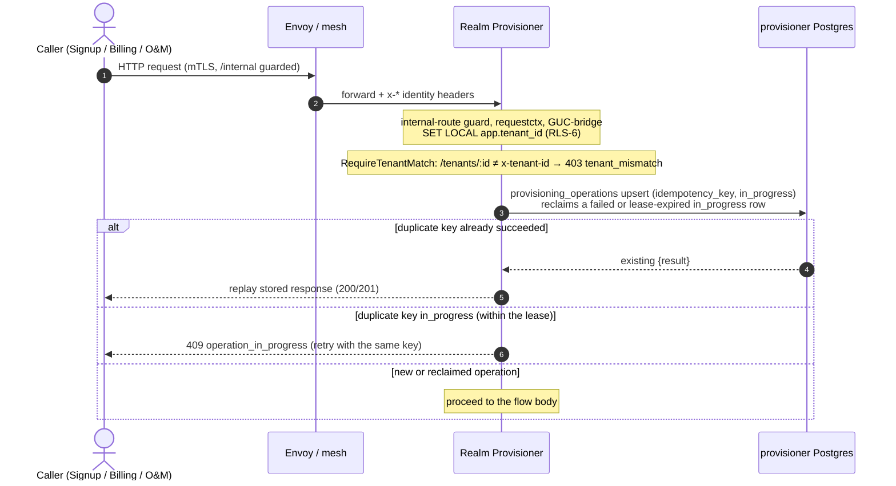

### 8.1 Trial provisioning (RP-1, HLD §8.2.1 / §8.10.1)

No dedicated realm is created (RP-INV-2). The trial user is created in the shared `trial` realm with the `tenant_id` attribute the protocol mapper injects as a JWT claim.

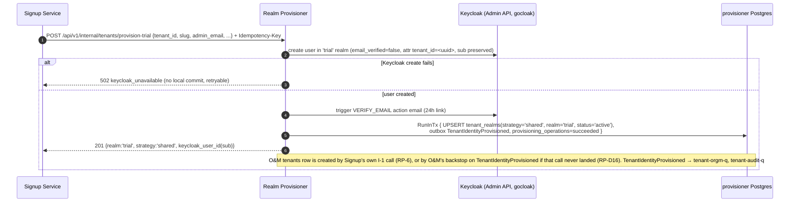

### 8.2 Direct paid signup (RP-2, HLD §8.10.6)

A dedicated realm is provisioned directly — no shared-realm intermediate, so the customer never experiences a URL change or a forced re-login.

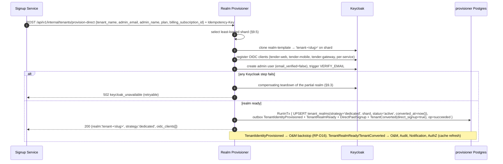

### 8.3 Trial → paid conversion with user migration (RP-3, HLD §8.10.2)

The hardest flow: it provisions a dedicated realm **and migrates every trial user** while preserving the `sub` UUID (so audit-log FKs and identities survive) and copying TOTP; WebAuthn credentials are realm-bound and cannot migrate, so those users re-enroll in the branded welcome step.

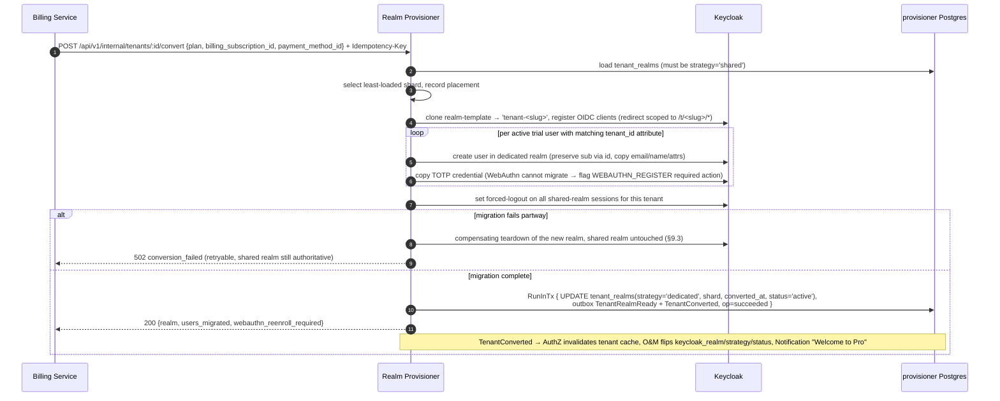

**Detached execution (rev 1.21).** The conversion runs on a context detached from the request, bounded by `CONVERT_TIMEOUT` (default 10m), not the 30s request deadline. The §11.1 budget (8s + ~0.3s/user) exceeds 30s at around 70 users, and canceling mid-migration would leave a half-built dedicated realm. If the request ends first (deadline or client disconnect), the caller gets `409 operation_in_progress` and retries with the same `Idempotency-Key`; once the conversion finishes, the retry replays its stored result. If the budget itself is exceeded, the key is recorded `failed` (retryable) and compensating teardown runs. A panic in the conversion goroutine is recovered and fails the key. At shutdown, `ProvisioningService.Drain` waits for in-flight conversions within the drain budget; one still running leaves its key `in_progress` until the ledger lease expires (§9.2), after which a retry resumes it as a reconcile.

**Reversibility (RP-4, HLD §8.10.2).** `POST /api/v1/internal/tenants/:id/revert-conversion` is the within-7-days undo: it recreates the tenant in the shared trial realm (with extended trial expiry), migrates users back, tears down the dedicated realm, and (rev 1.14) re-mints the tenant's `platform-automation` client back in the shared realm since the dedicated realm's client was just torn down with it (§2.5) — the mirror of §8.3, guarded by the same idempotency ledger. Beyond 7 days the endpoint returns `409 revert_window_expired` and reversion is an operator runbook (§24).

### 8.4 IdP configuration behind the §11.6 gate (RP-6, HLD §11.6)

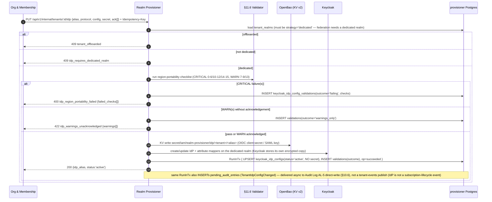

### 8.5 IdP validation detail (§11.6) and portability audit

**8.5.1 CRITICAL checks (block, `400`).** No config value contains an HTML/XML injection sequence (`check_0_config_safe`, scans every string value in the raw config map); SAML SSO/SLO URL hostnames carry no AWS-region substring (checks 1-2); customer-provided signing cert (3); ACS/SLO/EntityID point at the region-neutral `auth.bcbpsolutions.com/realms/<tenant>/...` (4-6); OIDC issuer/discovery region-neutral (10); OIDC redirect URIs region-neutral (11); OIDC audience matches the region-neutral client ID (12); an OIDC `client_id` is present (14); an OIDC `issuer` is a non-empty, valid HTTPS URL (15). 12 CRITICAL checks total.

**8.5.2 WARN checks (allow with recorded ack, `200`).** SAML NameID format `transient` (7); custom attribute-mapper URN region substrings (8); SAML signature algorithm ≥ RSA-SHA256 (9); OIDC PKCE `S256` (13). Acknowledgement is recorded with the admin's `user_id` and timestamp in `keycloak_idp_config_validations.acknowledgements`.

**8.5.3 Pre-migration portability audit (RP-13).** The operator-only `POST /api/v1/internal/audit/idp-region-portability` runs the full checklist against every tenant realm's live IdP configs and returns the HLD §11.6 report (`total_tenants`, `total_idp_configs`, `passing`, `warnings_only`, `failing`, `failing_tenants[]`). The Mumbai→UAE migration runbook requires zero failing tenants (or explicit waivers) before cutover.

### 8.6 MFA realm-role sync (inbound `membership-realm-q`, HLD §6.5) and MFA reset (RP-9)

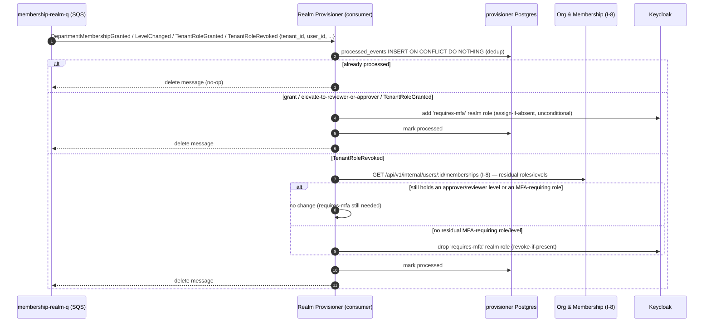

**Semantics (aligned to O&M's authoritative spec — O&M LLD §7.3.2 and `iam-org-membership` `api/asyncapi.yaml`, RP-1 confirmed).** The SNS filter policy on `membership-realm-q` is `EventType IN [DepartmentMembershipGranted, DepartmentMembershipLevelChanged, TenantRoleGranted, TenantRoleRevoked]` — **not** `DepartmentMembershipRevoked` (O&M does not route that here). `requires-mfa` is **added unconditionally** on `DepartmentMembershipGranted` at reviewer/approver level, on `DepartmentMembershipLevelChanged` that elevates to reviewer/approver, and on `TenantRoleGranted`. It is **dropped only on `TenantRoleRevoked`, and only after confirming no residual requirement**: because this service holds no membership state, it calls O&M's `GET /api/v1/internal/users/:id/memberships` (I-8) to see whether the user still holds an approver/reviewer department level or any other MFA-requiring role, and drops the realm role only if none remain (O&M's "drop … if the user no longer holds any other role/level that requires it"). All handling is idempotent (`processed_events` dedup) and order-insensitive — add is idempotent, and the drop path re-derives from I-8's current truth (RP-EVT-6). MFA reset is the separate synchronous RP-9 path below.

**MFA reset (RP-9) — now built both sides (F6 / OQ-8 closed).** O&M has scheduled the "Reset MFA" admin feature and built its half: the public endpoint **P-34** `POST /api/v1/tenants/:id/members/:user_id/reset-mfa` and the `RealmProvisionerClient.ResetMFA` call that fans out to this endpoint (verified against the O&M LLD — P-34 at §5.4, the flow at O&M §8's P-34 handler, the `MFAReset` audit event at O&M §7.3, and the fail-closed `realm_provisioner_unavailable` mapping at O&M §16 OQ-8). RP-9 is the receiving Keycloak-Admin-API operation and — by RP-INV-1 — the *only* place a user's MFA credentials may be cleared.

MFA reset is synchronous and **O&M-initiated** (F6). Per HLD §8.2.6 the tenant admin's "Reset MFA" action is a **user-management** operation — the same class as invite (P-6) and remove (P-8) — so it flows: **tenant admin → O&M P-34** (which authorizes the actor as `tenant_admin`/`tenant_owner`, treats the admin's own MFA step-up as a gateway/AuthZ-Enrichment concern, and writes the `MFAReset` audit with actor+target) **→ O&M `RealmProvisionerClient.ResetMFA(ctx, tenantID, keycloakUserID)` → RP-9** `POST /api/v1/internal/tenants/:id/users/:uid/mfa-reset`. RP makes no authz decision (§10.6) — the request is authorized on the O&M side first, which is why it never reaches RP directly.

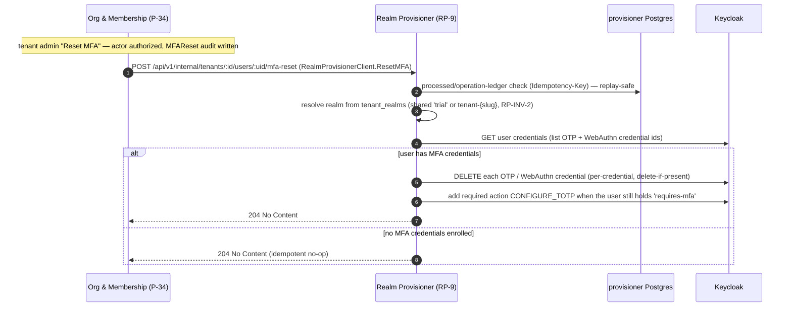

**RP-9 semantics.** RP resolves the target realm from `tenant_realms` (shared `trial` realm for a trial tenant, `tenant-<slug>` for a dedicated one — never the shared realm's own admin surface, RP-INV-2), lists the user's credentials via the Admin API, and **deletes every OTP and WebAuthn (passkey) credential** the user holds. It then **re-adds the `CONFIGURE_TOTP` required action** *only when the user still carries the `requires-mfa` realm role* (an Approver/admin/owner — HLD §6.5), so that user is forced to re-enroll a second factor on next login rather than being silently left MFA-less; a user with no MFA obligation is simply left without credentials and no forced action. The operation is **idempotent** — a reset on a user with no MFA credentials returns `204`, never `404` — and **persists nothing** in the `provisioner` DB (RP holds no per-user table, §5.4.1): it is a pure Keycloak effect, guarded by the idempotency ledger for replay safety (§9.2). **Fail-closed contract:** on a Keycloak Admin API `5xx`/timeout RP returns `502 keycloak_unavailable` (never a silent success), and O&M maps that to its own `503 realm_provisioner_unavailable` and does **not** emit `MFAReset` — there is no "eventually reset MFA" reconciler on either side (unlike RP-16's best-effort/fail-open posture), because a security-relevant credential reset must not appear to succeed when it did not. The reset does not by itself terminate the user's live sessions; when the admin action also needs the user logged out, O&M issues its separate `RevokeUserSessions` (RP-16). Metric: `iam_realm_provisioner_mfa_reset_total{result}` (§11.2).

### 8.7 Trial expiry (RP-C1 / RP-C2 crons, HLD §8.10.3)

`trial_expiry` runs daily at 02:00 UTC: it sweeps **this service's own `tenant_realms`** for `strategy='shared' AND status='active' AND trial_ends_at < now()` (using the local `trial_ends_at` recorded from O&M's `TrialStarted`, §7.1 / RP-4 — **it does not query O&M**; O&M exposes no batch "expired trials" endpoint and the design deliberately puts trial-expiry detection on the realm side). RP-12 (`ExpireTrial`) itself rejects a tenant that isn't a shared-strategy trial at all (`409 realm_already_dedicated` — already converted, nothing to expire), an already-offboarded tenant (`409 tenant_offboarded`), and a suspended tenant (`409 tenant_offboarded`, "tenant is suspended" — a billing-lapse or operator suspension takes precedence over trial-expiry bookkeeping). For each expired trial it disables the tenant's users in the shared realm, marks `tenant_realms.disabled_at`, and emits `TrialExpired` (which O&M consumes on `tenant-orgm-q` to flip its `subscription_status='trial_expired'` and Notification consumes to send the reactivation email). `trial_hard_delete` runs daily at 03:00 UTC: for trials past the grace window it hard-deletes the users from the shared realm and soft-deletes/scrubs the local row (§15); O&M runs its **own** trial-cleanup cron for the Phase-2 hard-`DELETE` of its `tenants` row (O&M LLD §15.3) — the two sides clean their own stores. Both jobs are batched (`batchLimit`), self-retrying, and idempotent per tenant via RP-12. Trial reactivation (§8.11) refreshes the local `trial_ends_at` so a reactivated trial is swept correctly on its new deadline.

**Orphaned signups (`orphaned-signup-reap`, hourly at `:17`, rev 1.37; Signup BFF open gap A-3).** RP-1 commits the Keycloak user and the `tenant_realms` row *before* O&M's I-1 creates the tenant. When I-1 never succeeds (the user abandons after `409 slug_already_taken`, or a validation failure that O&M's `TenantIdentityProvisioned` backstop dead-letters), the row never receives `trial_ends_at`, so neither job above ever selects it. The orphaned Keycloak user keeps the email, and every later signup with it fails RP-1 with `409 USER_EMAIL_CONFLICT`, because the new signup has a new `tenant_id`. `orphaned-signup-reap` selects rows that still have exactly RP-1's shape, older than `ORPHAN_SIGNUP_AFTER` (default **48h**, Go duration, floor 1h; an invalid value aborts the job): `strategy='shared' AND status='active' AND deleted_at IS NULL AND trial_ends_at IS NULL AND converted_at IS NULL AND disabled_at IS NULL AND suspension_source IS NULL AND exported_at IS NULL AND created_at < now() - ORPHAN_SIGNUP_AFTER`, oldest first, `batchLimit` rows. A direct-paid or converted tenant is `dedicated` (and has `converted_at`), and a reactivated or reverted trial has `trial_ends_at`, so none of them can match. For each candidate, one `sysPool` transaction re-checks the same predicate with `SELECT … FOR UPDATE`. If the row no longer matches, it is skipped. Otherwise the transaction calls `HardDeleteUsersInRealm` while holding the row lock, then runs RP-C2's erasure tail (`scrubAndTombstoneTenantRealm`: the §15.2 PII scrub plus the soft-delete) and commits. A Keycloak failure rolls back and leaves the row for the next run (`deferred`). **No event is emitted.** RP-C2 emits none, and O&M has no tenant to apply one to (its EVT-17 rule would retry it into its DLQ). This matches RP-C2, which gives Audit Log no event either. Each reap is logged at WARN with `tenant_id` only, never the email. **Race with a late I-1:** a `TrialStarted` that commits before the re-check makes the row fail it. A `TrialStarted` write that arrives during the reap blocks on the row lock, then loses its optimistic lock against the tombstone (`touch_row` bumps `record_version`). On redelivery the `tenant-realm-q` handler finds the row tombstoned and drops the event with a WARN (§7.1), so it never cycles into the DLQ. **Accepted residual risk:** an I-1 that first succeeds more than `ORPHAN_SIGNUP_AFTER` after RP-1 leaves O&M with a tenant whose identity has been erased. At 48h no live signup reaches that point (the BFF retries and the backstop act within minutes), and the dropped-`TrialStarted` WARN makes it visible. Metric: `iam_realm_provisioner_orphaned_signup_reap_total{result=reaped|skipped|deferred}`.

### 8.8 Subscription lapse (RP-C3 cron, HLD §8.10.7)

The daily sweep is **two independently-sourced phases sharing one `BatchLimit` budget** (`cmd/reconciler/jobs/subscription_lapse.go`), not a single pass over O&M-reported state.

**Timeline (CD-23, TL decision 2026-10-15): suspend at `cancelled_at + CANCELLED_GRACE_DAYS` (30 days); offboard at `suspended_at + RETENTION_DAYS` (60 days) — 90 days total from `cancelled_at`.** `RETENTION_DAYS` default was changed from 90 to 60 to reach the 90-day total. `CANCELLED_GRACE_DAYS` stays at 30 (must equal Core's `SUBSCRIPTION_GRACE_DAYS`). O&M owns the grace-period math and remains single-sourced. See **Rollout risk** note in §1 revision 1.28: tenants already suspended > 60 days at deploy time are immediately eligible for offboarding.

- **Suspend phase.** `port.SubscriptionLapseReader.ListLapsedSubscriptions` — implemented by `internal/adapter/outbound/orgmembership.Client` against O&M's **I-16** `GET /api/v1/internal/subscription-lapses` (`x-user-id=<system principal>`, `x-tenant-roles=iam-system`, deliberately **no** `x-tenant-id` since the call is cross-tenant by design) — returns every tenant already `cancelled` and past O&M's own grace-period math (`{tenants:[{tenant_id, realm_id, realm_type, cancelled_at}]}`); O&M owns the grace-period calculation so the 30-day rule stays single-sourced, and RP only ever sees tenants already due for suspension. Entries with `realm_type != "dedicated"` are skipped (a `"shared"` entry is a trial tenant, owned by RP-C1/RP-C2 instead, §8.7). For each remaining dedicated tenant, `suspendLapsedTenant` is a no-op (touches no idempotency key) if the realm is already `suspended`/`deleted`; otherwise it **disables the dedicated realm**, then commits `status='suspended'`, `disabled_at=now()`, `suspension_source='billing_lapse'` (§4.2) and emits `TenantSuspended(source=billing_lapse)`, idempotency key `lapse-suspend:<tenant_id>`. If `ORG_MEMBERSHIP_BASE_URL` is unset, `cmd/reconciler/main.go` never constructs a `SubscriptionLapseReader`, and this phase logs a WARN and is skipped entirely — the offboard phase below still runs.
- **Offboard phase.** Runs **unconditionally**, regardless of whether the suspend phase ran or found anything, and is sourced **purely locally**: `TenantRealmRepository.ListSuspendedPastRetention(ctx, retentionDays, limit)` selects `tenant_realms` rows with `status='suspended' AND suspension_source='billing_lapse' AND disabled_at < now() - retentionDays` (`RETENTION_DAYS` default **60**, CD-23), via the partial index `idx_tenant_realms_lapse_offboard` (§4.2). O&M's I-16 endpoint carries no signal for "already suspended, how long" — it only ever reports the cancel event — so this half never consults O&M at all. Per candidate, `offboardTenant` runs the same export-then-delete saga as before (§8.9): export the realm to S3 (encrypted), then hard-delete it, mark `status='deleted'`, scrub the local row, emit `TenantOffboarded` (terminal, RP-INV-5), idempotency key `offboard:<tenant_id>`.

**CD-22 (TL decision 2026-10-15): Seat overage after grace does not trigger an RP suspend.** Billing bills extra seats at renewal; no Billing-callable suspend route exists or is needed. RP-14 (`POST /tenants/:id/suspend`) remains strictly operator-only (`platform_operator` role required). A `commercial-system` caller (Billing) receives `403 insufficient_role` on RP-14 in all cases — this is verified by `TestSuspend_CommercialSystem_403`.

**Administrative suspensions are excluded from the auto-offboard leg — structurally, not just by convention.** A tenant suspended by an operator (RP-14 — `TenantSuspended.source=operator`, `tenant_realms.suspension_source='operator'`, and typically with no `cancelled_at`, since it may have gone `active → suspended` directly) can never match `ListSuspendedPastRetention`'s `suspension_source='billing_lapse'` predicate — the partial index itself only indexes billing-lapse rows, so an operator-suspended tenant is not merely skipped by an `if`, it is outside the query's result set by construction. An administrative suspension therefore remains `suspended` — and reversible (§8.11) — until an operator explicitly reactivates (RP-10, which clears `suspension_source` back to `NULL`) or explicitly offboards it. This is what guarantees an emergency suspension can always be reverted to active. **O&M enforces the same split on its side** via a `tenants.suspension_source` column (`billing_lapse | operator`, O&M LLD T-16 — resolves RP-11): its `chk_cancelled_at_required` exempts the `operator` branch (no `cancelled_at`) and `chk_subscription_started_required` exempts `suspended` (so a never-converted trial can be operator-suspended), so an operator suspension never enters the billing grace/retention/offboard clock; `TenantReactivated` clears `suspension_source` back to NULL on both sides.

### 8.9 Realm export and offboarding (RP-EVT-4, §15.5)

Offboarding is export-then-delete: `KeycloakAdmin.ExportRealm` streams the realm's partial export, `ObjectStore.Put` writes it encrypted to S3 (`export_s3_key`), and only after a durable-write confirmation does `KeycloakAdmin.DeleteRealm` run and `TenantOffboarded` get enqueued. If the export or S3 write fails, the sweep leaves the tenant `suspended` and retries next tick — a realm is never deleted without a confirmed export (RP-EVT-4).

### 8.10 Realm-config propagation (RP-8, HLD §5.2, RP-INV-6)

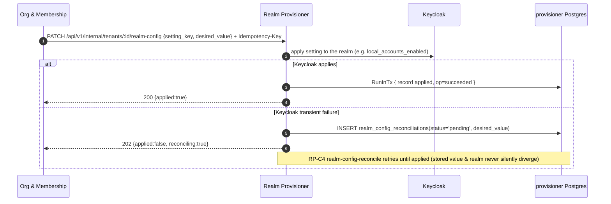

The call is synchronous and idempotent; the setting is effective immediately with no eventual-consistency window (HLD §5.2). A `202` tells O&M the value is durably queued and will land; RP-C4 retries the pending reconciliation on a `*/10 * * * *` schedule.

### 8.11 Reactivation (RP-10 / inbound `billing-realm-q`, HLD §8.10.4 / §8.10.7)

Two shapes. A **trial** reactivation (within the 30-day grace) re-enables the disabled trial user in the shared realm and emits `TrialReactivated` (O&M restores `trial` and extends `trial_ends_at`) — if the caller supplies no explicit `new_trial_ends_at`, RP-10 defaults it to **+30 days from now** rather than leaving it empty (a tenant that was never given an explicit extension still gets a well-formed `TrialReactivated.new_trial_ends_at`, matching the event schema's required-field contract). A **paid** reactivation arrives as the `TenantReactivated` billing event on `billing-realm-q`: if the tenant had reached `suspended`, this service re-enables the dedicated realm; if it was only `cancelled`/read-only, there is no Keycloak effect and the handler records the processed event and no-ops (RP-EVT-7). A tenant still in `provisioning` (never reached `active`) is rejected with `409 tenant_offboarded`, "tenant is still provisioning — cannot reactivate what was never active" — there is nothing to revert. Either way, `offboarded` is terminal and cannot be reactivated (RP-INV-5).

**Reverting an emergency (operator) suspension.** A tenant suspended via RP-14 sits in `suspended`, **not** `offboarded`, so it is fully reversible: an operator (or Billing, once the underlying issue is resolved) calls RP-10, which re-enables the dedicated realm — or, for a trial tenant, re-enables that tenant's users — the exact inverse of §8.12, and projects the tenant back to `active`/`trial`. Two properties make this revert reliable: (1) administrative suspensions are **excluded from the RP-C3 auto-offboard sweep** (§8.8), so an operator-suspended tenant never silently ages into the terminal `offboarded` state — it stays reversible indefinitely until an operator explicitly reactivates or offboards it; (2) RP-10 is idempotent, so a repeated reactivate is a safe no-op. For a trial tenant the projection event is the existing `TrialReactivated`; for a paid operator-suspended tenant RP-10 emits **`TenantReactivated(source=operator)`** on `iam.tenant.events`, which O&M consumes on `tenant-orgm-q` to set `subscription_status='active'` — the same event name Billing uses for a billing-lapse reactivation, disambiguated by `source` (RP-D13).

### 8.12 Emergency operator suspension (RP-14, RP-D12)

An operator-only, on-demand path for abuse response, a security incident, or a legal hold — the immediate-lockout case the billing-driven RP-C3 cron (§8.8) cannot serve. It applies only the Keycloak-side effect this service owns, then emits `TenantSuspended(source=operator, reason)` so O&M projects the status; it does not itself set `subscription_status`. Reversal is the existing RP-10 reactivation.

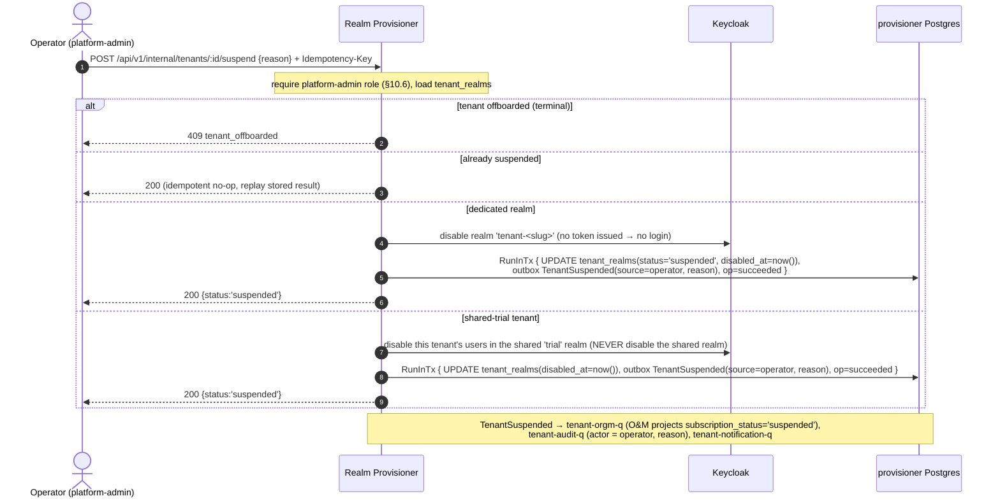

Two safeguards make this safe as an override: (1) it is **effect-only** — O&M remains the authority for `subscription_status`, and the `source=operator` flag on the event lets O&M (and Audit) distinguish an administrative suspension from a billing-lapse one; (2) the shared-`trial` branch **disables only the offending tenant's users**, never the shared realm, since that realm hosts every trial tenant (RP-INV-2). Reactivation later is RP-10, which re-enables the dedicated realm or the trial users symmetrically. O&M accepts the direct `active → suspended` (or `trial → suspended`) transition driven by an operator-sourced `TenantSuspended`: it distinguishes it via `tenants.suspension_source` (`billing_lapse | operator`) and exempts the operator branch from the `cancelled_at`/retention CHECKs so it never enters the offboard clock (O&M LLD T-16, **RP-11 resolved**). The payload field is `source`, always present, valued `billing_lapse` (§8.8) or `operator` (here).

### 8.13 User lifecycle — delete and session-revocation (RP-15 / RP-16, alignment F2/F3)

Two synchronous O&M-driven operations that were missing from earlier revisions but which O&M's `RealmProvisionerClient` already depends on. Both are Keycloak-Admin-API mutations, so — by RP-INV-1 — they **must** be RP endpoints; no other service may perform them. Both are per-user (keyed by the Keycloak user id, i.e. the `sub`) and **idempotent**.

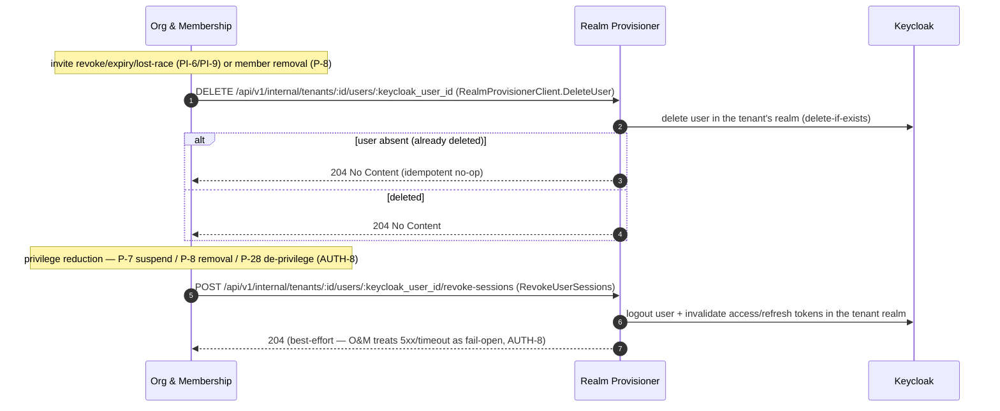

**RP-15 `DELETE …/users/:keycloak_user_id` (F2).** Deletes the Keycloak user in the tenant's realm. **Idempotent** — a delete of an already-absent user returns `204`, never `404`, because O&M's `invitation-kc-cleanup` reconciler (PI-9) retries it and must converge cleanly. O&M calls it on invite revoke (PI-6), invite expiry (PI-5), the seat-lost-race (PI-9), and member removal (P-8). Signature matches O&M's client exactly: `DeleteUser(ctx, tenantID, keycloakUserID)`. For a **shared-`trial`** tenant the target user lives in the shared realm; for a **dedicated** tenant, in `tenant-<slug>`; RP resolves the realm from `tenant_realms` (never the shared realm's own deletion — RP-INV-2).

**RP-16 `POST …/users/:keycloak_user_id/revoke-sessions` (F3).** Logs the user out and invalidates their access + refresh tokens for the tenant realm, so a still-live token cannot outlast a privilege reduction (AUTH-8). **Idempotent** (revoking with no active sessions is a `204` no-op). O&M treats it **best-effort / fail-open**: it commits its own state change first and calls RP after, and an RP `5xx`/timeout does **not** reverse or block that change — O&M increments `iam_session_revoke_failed_total` and relies on its TTL backstop (≤ access-token lifetime + the `om:memberships` cache TTL). RP therefore returns fast and never holds O&M's security-freeze path open; it does not need its own durable retry (the fallback is O&M's TTL floor, not an RP reconciler). Note RP-15's Keycloak **hard-delete** already terminates the user's sessions at the identity layer, so O&M does not additionally call RP-16 on the delete path (AUTH-8).

Neither operation writes the `provisioner` DB (RP holds no per-user table, §5.4.1); both are pure Keycloak effects guarded by the idempotency ledger for replay safety (§9.2). Errors: `keycloak_unavailable` (`502`, retryable) is the only non-success; "user not found" is a success (idempotent), never an error.

---

## 9. Concurrency, Consistency, and Failure Handling

The defining hard problem is that every mutation spans two stores this service cannot transact across — the `provisioner` Postgres DB and Keycloak. There is no distributed transaction; consistency is engineered through ordering, idempotency, compensation, and reconciliation.

### 9.1 The two-store consistency model

Two ordering disciplines, chosen per flow by which store's write is safe to lose on a crash:

- **Keycloak-effect-first, then local commit** (provisioning, migration, IdP, MFA, realm-config-apply). The Keycloak mutation runs first; only after it succeeds does the local `RunInTx` commit the `tenant_realms`/`keycloak_idp_configs` row **and** the outbox event atomically. A crash after the Keycloak effect but before the local commit leaves a real Keycloak state with no local record — recovered by idempotent replay (the retrying caller re-invokes with the same `Idempotency-Key`; the Keycloak step is a reconcile/no-op because the realm/user/role already exists, and the local commit then lands). A committed local row therefore **always** reflects a real Keycloak state (never a phantom).
- **Local-intent-first, then reconcile** (realm-config when Keycloak is transiently down, §8.10). The desired value is recorded `pending` in `realm_config_reconciliations` and RP-C4 applies it later. Used only where the caller can tolerate a short "durably queued, will land" window and immediate divergence detection matters more than immediate effect.

**Consistency invariants:**

| # | Invariant |
|---|-----------|
| CONS-1 | **Write + event are atomic.** A local business write and its integration event(s) are committed together through the transactional outbox — the domain row and its `outbox_events` row share one `RunInTx` (RP-EVT-1 / RP-INV-3). No event without its state change; no committed state change without its event. The Keycloak mutation sits *outside* that transaction (Keycloak-effect-first, §9.1). |
| CONS-2 | **A committed local row always reflects a real Keycloak state.** Because the local commit is the last step of the default ordering, a crash mid-flow never leaves a phantom `tenant_realms` row. The inverse (Keycloak state with no local row) is recovered by idempotent replay (§9.1). |
| CONS-3 | **Realm-config is the one exception** (RP-INV-6): a `pending` `realm_config_reconciliations` row is a durable, observable divergence, never a silent one. RP-C4 converges it. |

### 9.2 Idempotency ledger (`provisioning_operations`)

Every externally-triggered mutation (RP-1…RP-10, RP-12, RP-14, and the three SQS handlers) is keyed in `provisioning_operations`. On entry the handler upserts `(idempotency_key, in_progress)`; a key already `succeeded` replays the stored `result` without re-executing; a key `in_progress` (a concurrent duplicate) returns `409 operation_in_progress` (retryable). A key `failed`, or `in_progress` for longer than `IDEMPOTENCY_IN_PROGRESS_LEASE` (default 15m — the pod running it died, rev 1.21), is **reclaimed** by the upsert and re-executed; every operation behind the ledger is a Keycloak-effect-first reconcile, so re-running converges rather than duplicating. `Complete`/`Fail` write on a context detached from the request (10s), so a request deadline or client disconnect can never strand a key `in_progress`. Rows are pruned after `PROVISIONING_OPERATIONS_TTL_DAYS` (default 30) by the `ledger-prune` CronJob. Keys are caller-supplied via the `Idempotency-Key` header where the caller can generate one (Signup, Billing, O&M), or **derived** from the envelope `id` for the SQS-driven handlers. This makes every provisioning operation safe under HTTP retries and at-least-once event redelivery (RP-INV-3, §2.3).

**Idempotency invariants:**

| # | Invariant |
|---|-----------|
| IDEMP-1 | Every externally replayable operation is **convergent**: processing it more than once yields the same final state — no duplicate realms, no double-migration, no double-emit. |
| IDEMP-2 | `processed_events` (composite PK `(event_id, consumer)`) is the **canonical deduplication mechanism** for bus-event consumption, with `consumer ∈ {membership, tenant, billing}`. `provisioning_operations` is the canonical ledger for HTTP-triggered mutations. |
| IDEMP-3 | A key already `succeeded` **replays the stored `result`** without re-executing the Keycloak mutation. A key `in_progress` within its lease returns `409 operation_in_progress`; a `failed` or lease-expired key is reclaimed and re-executed. |
| IDEMP-4 | **`processed_events` dedup has a bounded window** (`PROCESSED_EVENTS_TTL_DAYS`, default 8 — strictly greater than the 7-day SQS lifetime). A beyond-window duplicate is backstopped by the value-level Keycloak reconcile (create-if-absent / delete-if-exists), so the 8-day window is a performance/space choice, not a correctness bound. |

### 9.3 Compensation on partial provisioning

Realm creation and user migration are multi-step Keycloak sequences that can fail partway (a realm created but OIDC clients half-registered, or 10 of 14 users migrated). Each provisioning flow has a **compensating teardown** that deletes the partially-created dedicated realm and returns a retryable error, leaving the pre-existing state authoritative (the shared trial realm at conversion; nothing at direct-paid). Because the local commit is the *last* step, a compensated failure leaves **no** local `tenant_realms` dedicated row — so a retry starts clean. Teardown itself is idempotent (delete-if-exists). Teardown (realm, service-account client, and the RP-6 OpenBao secret) runs on a context detached from the request with its own 30s budget (`compensationContext`, rev 1.21). On the request context it would usually fail exactly when it is needed most: after a deadline or client disconnect.

### 9.4 Keycloak Admin API resilience

The `keycloak` adapter wraps gocloak with: a shared admin-token cache with single-flight refresh (§6.2); bounded exponential-backoff retry on `5x`/timeout/connection errors (`429` honours `Retry-After`); a client-side **rate limiter** so a burst (mass user migration) does not overwhelm Keycloak's Admin API; and a per-operation timeout budget. All Keycloak errors surface as typed domain errors (`keycloak_unavailable`, `realm_already_exists`, `user_already_exists`) so flows can distinguish retryable transport failures from semantic conflicts (which are frequently idempotent no-ops).

### 9.5 Shard placement

At conversion / direct-paid signup the service places the tenant on the **least-loaded Keycloak shard** and records `keycloak_shard` in `tenant_realms` (HLD §8.10.2 step 3). Placement reads current per-shard realm counts (from the local mirror, refreshed opportunistically); a tie breaks deterministically by shard id so two concurrent placements do not thrash. Placement is fixed for the life of the tenant.

### 9.6 Concurrency control

Local rows use optimistic locking (`record_version`); a concurrent second mutation on the same tenant realm loses with `409 optimistic_lock_conflict` and retries. The idempotency ledger's `in_progress` state additionally serialises concurrent duplicates of the *same* operation. Distinct operations on distinct tenants are fully parallel (the 2 replicas + goroutine consumers process independently; RLS keeps them isolated).

**Concurrency invariants:**

| # | Invariant |
|---|-----------|
| CONC-1 | All mutable resources carrying `record_version` use optimistic locking on writes — `tenant_realms` and `keycloak_idp_configs` (TRG-1). |
| CONC-2 | A versioned mutation succeeds **only** when the stored `record_version` equals the expected value; on success the `touch_row` trigger increments `record_version` (TRG-1) — the client never sets it directly. |
| CONC-3 | `RowsAffected() == 0` on a versioned `UPDATE` returns **`409 optimistic_lock_conflict`**. |
| CONC-4 | The `409` response includes the **current `record_version`** so the client can re-read, reconcile, and retry (API-3). The idempotency ledger's `in_progress` state additionally serialises concurrent duplicates of the *same* operation. |

### 9.7 Failure taxonomy summary

| Failure | Detection | Handling |
|---|---|---|
| Keycloak transient (5xx/timeout) | typed `keycloak_unavailable` | retry with backoff; no local commit; caller retries with same key |
| Keycloak semantic conflict (realm/user exists) | typed conflict error | treated as idempotent success where the desired end-state matches; else surfaced |
| Partial provisioning crash | local row absent on retry | compensating teardown + clean retry (§9.3) |
| Realm-config Keycloak-down | apply step fails | record `pending`, reconcile via RP-C4 (§8.10) |
| DB down | `RunInTx` error | operation fails retryably; nothing published (outbox is in the same tx) |
| SNS publish failure | `outbox.Runner` attempts | retried; DLQ after `OUTBOX_MAX_ATTEMPTS`; alerted (`platform_dlq_messages_total{operation="outbox_publish",reason="max_attempts"}`) |
| Duplicate event redelivery | `processed_events` conflict | no-op |
| Export-before-delete failure | S3 write not confirmed | realm left `suspended`, retried; never deleted without a confirmed export (RP-EVT-4) |

**Failure invariants:**

| # | Invariant |
|---|-----------|
| FAIL-1 | **Dependency failures never leave partial *local* business state.** The Keycloak-effect-first ordering means a Keycloak failure aborts before `RunInTx`; a DB failure rolls back the outbox with the row. A partial *Keycloak* sequence is compensated (§9.3). |
| FAIL-2 | **Cache failures degrade latency only.** A miss, timeout, or Valkey outage falls through (CACHE-2 / CACHE-9). |
| FAIL-3 | **Outbox publication may repeat; effects are exactly-once at the consumer.** The publisher is at-least-once; consumers dedup on `processed_events` (RP-EVT-1 / IDEMP-2). |
| FAIL-4 | **Scheduled jobs are safe to restart and re-run.** The 8 CronJobs (`ledger-prune`, `trial-expiry`, `trial-hard-delete`, `orphaned-signup-reap`, `subscription-lapse`, `realm-config-reconcile`, `outbox-prune`, `processed-events-prune`) are idempotent — a re-run re-selects only still-eligible rows. |
| FAIL-5 | **Missing tenant context fails closed.** An unset or malformed `app.tenant_id` yields zero rows and permits no writes via RLS (RLS-2). |
| FAIL-6 | **A cross-service dependency being down never corrupts this service's local state, and never affects any other service's hot path.** This service sits on no request-path dependency for AuthZ Enrichment. O&M I-8 is consulted only on the `TenantRoleRevoked` drop path and fails by redelivery, never a silent MFA drop (§20.4). |

---

## 10. Security

### 10.1 Tenant isolation — three layers

**Layer 1** — Keycloak realm boundary (shared `trial` vs dedicated `tenant-<slug>`; RP-INV-2). **Layer 2** — PostgreSQL RLS with `app.tenant_id` GUC, `FORCE ROW LEVEL SECURITY`, `WITH CHECK` (`rls_check_tenant`, §4.3). **Layer 3** — audit-tagged cross-tenant detection via `rls_violation_log` (§4.2, §20.2). Identical mechanism to `iam-org-membership` (§10.1 of that LLD).

RLS (`FORCE`, fail-closed) on all six tenant-scoped tables; `SET LOCAL app.tenant_id` per transaction via `platform-pgcommon` (RLS-6, never a session-level `SET`); gateway identity (`x-*` headers via `pkg/requestctx`), never request-body-derived tenant/actor. CI greps for the forbidden non-`LOCAL` `SET app.tenant_id`. The RLS test matrix (§14.5) proves missing-GUC → 0 rows, cross-tenant read/write rejection, and no GUC leak across a pooled connection.

### 10.2 Network isolation

The provisioning API is entirely `/api/v1/internal/*` (mesh-only, mTLS, internal-route guard) except the health/docs routes — there is essentially no public tenant-user surface (§5.6). Cross-service calls (O&M) and the Keycloak Admin API run intra-mesh / over TLS. `/metrics` is on its own listener reachable only from the monitoring namespace (§3). Internal routes are protected by Kubernetes NetworkPolicy — only IAM-namespace service accounts may reach them. Public Envoy does not route `/internal/*`.

**Route-versioning note (alignment F8 — RESOLVED, both sides):** this service adopts **Org & Membership's `/api/v1/internal/...` convention** for all internal routes (RP-1…RP-16), so both services share one mesh-route form. **O&M side confirmed:** O&M has repointed its `RealmProvisionerClient` to the `/api/v1/internal` paths (`CreateInvitedUser` → `POST /api/v1/internal/tenants/:id/users`, `DeleteUser` → `DELETE /api/v1/internal/tenants/:id/users/:keycloak_user_id`, `PatchRealmConfig` → `PATCH /api/v1/internal/tenants/:id/realm-config`, and `ResetMFA`) — verified against the O&M LLD. Health/readiness/metrics/docs routes (`/healthz`, `/readyz`, `/metrics`, `/asyncapi`) remain **unversioned** (infra/docs endpoints), matching O&M.

### 10.3 Input validation

Mirrors the DB CHECKs and the domain invariants: `strategy` and `protocol` in enum; slug charset/length for realm naming; `Idempotency-Key` non-empty and ≤ 256 chars; IdP `config` validated by the §11.6 checklist before any Keycloak write (RP-INV-4); realm-config `setting_key` allow-listed (only realm-affecting settings are accepted; anything else is `400 unsupported_realm_setting`). No secret material (passwords, signing keys, client secrets) is ever accepted into or stored in Postgres — those flow to Keycloak/OpenBao directly. All UUID fields validated at the handler layer.

### 10.4 Authorization rules

| Action | Required roles |
|---|---|
| Provision trial / direct-paid (RP-1 / RP-2) | Internal service only (Signup, NetworkPolicy) |
| Convert / revert (RP-3 / RP-4) | Internal service only (Billing, NetworkPolicy) |
| Create invited user / delete user / revoke sessions / MFA reset (RP-5 / RP-15 / RP-16 / RP-9) | Internal service only (Org & Membership, NetworkPolicy) |
| Configure / remove IdP (RP-6 / RP-7) | Internal service only (Org & Membership) |
| Apply realm-config (RP-8) | Internal service only (Org & Membership) |
| Read realm view (RP-11) | Internal service only (O&M / operator) |
| Expire trial (RP-12) | This service's own reconciler (RP-C1) |
| IdP region-portability audit (RP-13) | `platform_operator` (AUTH-6) |
| Emergency suspend (RP-14) | `platform_operator` (AUTH-6) — `commercial-system` (Billing) must receive `403 insufficient_role` (CD-22: seat overage never triggers an RP suspend) |
| Reactivate (RP-10) | Internal service / operator / reconciler |

This service makes **no end-user authorization decision** (that is AuthZ Enrichment). Its callers are trusted mesh peers whose right to call is established by the internal-route guard + mTLS; the *content* of what they ask for (which tenant, which user) is scoped by the `x-tenant-id` header and enforced by RLS. Operator-only routes (RP-13, RP-14) additionally require the operator role asserted in `x-tenant-roles`, re-checked at the handler (`RequireOperatorRole`, AUTH-6) before any DB access.

### 10.5 Keycloak admin credential protection (the crown jewel)

The single most sensitive secret in the IAM subsystem is the Keycloak admin service-account credential, because this service can create/delete any realm and any user. Protections:

- The credential is an **OpenBao** secret surfaced into the pod by the External Secrets Operator (OpenBao/Vault provider) as an ephemeral volume — **never** an env var, a container-image layer, or a git artifact. This is per HLD §11.2 as amended in v1.42 (the platform's secrets backend is OpenBao; RP-D11, RP-10 closed).
- **RP-INV-1 makes this service the only holder.** No other repo has a gocloak admin client; the OpenBao policy grants `read` on the Keycloak-admin secret path to this service's OpenBao role (bound to its Kubernetes ServiceAccount) alone (`deploy/openbao/policy.hcl`).
- The admin access token derived from it is cached only in Valkey/in-process (§6.2), never logged, never written to Postgres, and scoped to the shortest practical lifetime.
- Admin operations are **least-privilege where Keycloak allows** — the service account holds far less than full master-realm `admin` (**RP-2, confirmed with Keycloak ops**):
  - **Master realm:** `create-realm` **only** — required for realm creation (`POST /admin/realms`), which the per-realm `manage-*` roles cannot do. **Not** master `admin`.
  - **Managed realms:** `realm-admin` (the composite covering `manage-realm`/`manage-users`/`manage-clients`/`manage-identity-providers`) — covers realm enable/disable, client registration, user create/update/delete (RP-15), IdP config (RP-6), realm-role assign/revoke (RP-1), credential reset (RP-9), and session/token revocation (RP-16).
  - **Why no per-realm bootstrap grant is needed:** Keycloak grants a principal holding `create-realm` **full administrative access to the realms it creates**. Because RP is the sole realm creator (RP-INV-1), it automatically administers every dedicated realm and the shared `trial` realm it provisions — including at future shard scale (HLD §14.5) — with no post-create role-assignment hook. (A hook would only be needed if realms could be created outside RP, which the single-writer invariant forbids.)
  - **Cross-realm conversion migration** (trial→dedicated) touches two realms in one flow; a **single** service account holds rights on both — source (`view-users`/`query-users`, via `realm-admin` on `trial`) and target (`manage-users`/`manage-realm`, via `realm-admin` on the new realm) — so no second account is required.
  - **Optional hardening (deferred):** a split model — a bootstrap account with `create-realm` only, plus a runtime account with `realm-admin` on managed realms — gives tighter blast-radius control at the cost of a second credential; not adopted for MVP (single account is simpler), recorded as a future option.

**Per-tenant IdP secrets** (SAML signing keys, OIDC brokered-client secrets) are the second sensitive class. Unlike the pod secrets above (deploy-time, ESO-mounted), these are dynamic and per-tenant, so they are read/written through the **OpenBao KV API** at runtime under the deterministic path `secret/data/iam/realm-provisioner/idp/<tenant_id>/<idp_alias>` (§4.2, RP-D10). They never touch Postgres and never appear in logs. Authorization is an **OpenBao policy bound via Kubernetes auth** (the pod's ServiceAccount token → OpenBao role → policy): the policy grants `create`/`read`/`update`/`delete` on `secret/data/iam/realm-provisioner/idp/*` and `read` on the Keycloak-admin path only, so a compromise of this service cannot read the DB password, another service's secrets, or anything outside its prefix. IdP secret material passes through this service transiently on the RP-6 request and goes straight to OpenBao + Keycloak — the HTTP handler never persists or echoes it.

### 10.6 Audit and non-repudiation

Every tenant-lifecycle mutation emits one of the 9 `iam-tenant-events` bus events (§7) through the transactional outbox, carrying `actor`, `trace_id`, and — for cron-origin operations — a system sentinel; Audit Log consumes them via `tenant-audit-q`.

**IdP configuration changes are the exception: `TenantIdpConfigChanged` is an Audit Log *entry type*, not a bus event** (HLD §9.4 "direct audit write" category; deliberately absent from the §25 event inventory, and no service subscribes to it). It reaches Audit Log through **AL-5**, Audit's direct-write ingest (`POST /api/v1/internal/audit-entries`, §18.7):

- **When.** Every successful RP-6 (`action=create` for a new alias, `update` otherwise) and RP-7 (`action=delete`). A rejected (`400`/`422`) or failed RP-6/RP-7 emits nothing — the append-only `keycloak_idp_config_validations` history (§4.2) is this service's own record of rejected validation runs.
- **Shape.** `entry_type=config.idp.changed`, `source_event_type=TenantIdpConfigChanged`, `source_service=iam-realm-provisioner`, `target={type:"idp", id:<idp_alias>}`, `occurred_at` = commit time, `trace_id` captured at enqueue (delivery runs later on an unrelated trace). `metadata` carries the full §11.6 validation result — `protocol`, `validator_version`, `validation_outcome`, per-check `checks`, `acknowledged_check_ids`, `secret_rotated` (a boolean — **never** the secret, which lives only in OpenBao). The retention tier (`security_3y`) is derived by Audit Log, never chosen here.
- **Actor.** The mesh caller from `x-user-id`: `iam_system`/`…00a1` for the system principal O&M normally calls as (RLS-5), otherwise `user`/`<uuid>`. The tenant admin who initiated the change in O&M is O&M's own audit record, not this entry's.
- **Durability (RP-D15).** The entry is inserted into `pending_audit_entries` (§4.2) **inside the same `RunInTx`** as the `keycloak_idp_configs` upsert/delete, so a committed IdP config change always carries its audit entry, and an enqueue failure fails the commit. A `cmd/server` drainer (`AuditDeliveryService`, BYPASSRLS `sysPool`) delivers it at-least-once; the row `id` is the AL-5 `Idempotency-Key`, so a retry after a lost response is a `200` replay, never a duplicate.

The single-writer invariant means Audit's realm-side coverage is complete by construction: nothing mutates Keycloak without passing through this service, and every such mutation leaves either an outbox event or a `pending_audit_entries` row in the same transaction as its local commit.

---

## 11. Observability

The implementation-level companion to this section — identity, tier construction, who counts what, CI enforcement, the generated metric inventory and a runbook per alert — is [`docs/observability/`](../observability/README.md), mirroring `iam-org-membership`'s.

### 11.1 SLOs (HLD §3.4)

This service has no user-facing latency hot path; its SLOs are about **operation success and freshness**, not p99 request latency. Availability target **99.9%** for the `/internal` provisioning API.

| Operation / scenario | Target | Notes |
|---|---|---|
| RP-1 trial provision | p95 ≤ 1.5 s | 1-2 Keycloak calls + email trigger + 1 tx |
| RP-2 direct-paid provision | p95 ≤ 4 s | realm clone + OIDC clients + admin user |
| RP-3 conversion | p95 ≤ 8 s + ~0.3 s/user migrated | dominated by per-user migration Keycloak calls |
| RP-6 IdP configure | p95 ≤ 2 s | validation + Keycloak IdP write |
| RP-8 realm-config apply | p95 ≤ 1 s | single Keycloak setting write |
| Membership→MFA-role effect | ≤ one SQS delivery (sub-second to low-seconds) | reconcile handler; freshness tracked by lag metric |
| Trial-expiry / lapse freshness | ≤ one cron tick (daily) + retry | tracked by `*_deferred_total` |
| Realm-config reconcile freshness | ≤ one RP-C4 tick (10 min) | `realm_config_pending_gauge` |

### 11.2 Prometheus metrics

Instruments follow the Enterprise Platform Observability Standard's three-tier hierarchy, all constructed in `adapter/outbound/metrics` and validated in CI against the central Platform Observability Registry (platform-gincommon `pkg/obsregistry`; the former local `registry.go` manifest was removed):

- **Tier 1 `platform_*`** — the Platform Observability Registry (platform-gincommon `pkg/obsregistry`) is the source of truth; every series carries `{domain="iam", service="iam-realm-provisioner", environment=<APP_ENV>}` (`gincommon.Config.Domain`/`Environment`, else `OBSERVABILITY_DOMAIN`/`APP_ENV`; `APP_ENV` ∈ `local|dev|test|staging|prod`). This service records one Tier 1 metric itself: `platform_dependency_request_seconds{dependency="keycloak", operation, outcome=success|error}` (registry status `proposed`), built from its registry entry and shared with platform-events' SNS/SQS/codec observations. The message-lifecycle metrics (`platform_messages_received/processed/failed_total`, `platform_dlq_messages_total`) are platform-events' own, by queue and event_type; the service's former per-`consumer` copies, `platform_duplicate_messages_total{consumer}` and the unregistered RLS candidate were removed (redeliveries and RLS-6 stay Tier 3).
- **Governance.** Several Tier 1 successors are still registry status `proposed`; with the pre-standard library names removed they are the only source for HTTP/SQS signals, so every alert reading one carries `metric_status: proposed` (enforced by `.github/scripts/metrics-registry-lint.sh` → `rules_test.go`, which also rejects any removed metric name in rule/HPA/adapter files). Drop the label when the registry approves the metric.
- **Tier 2 `iam_*` (domain-shared)**: none apply. RP-INV-1 (sole Keycloak Admin API caller in the platform) means every remaining metric represents a behavior no other IAM service can perform, failing the standard's "shared across IAM services" test.
- **Tier 3 `iam_realm_provisioner_*`** (§25 — frozen prefix, equal to the registry's `<domain>_<service>_` prefix; source of every business alert/SLO): `iam_realm_provisioner_provision_total{kind=trial|direct|convert, result}`, `iam_realm_provisioner_users_migrated_total`, `iam_realm_provisioner_audit_entry_delivery_total{result=delivered|retry|rejected}` + `iam_realm_provisioner_audit_entry_backlog_gauge{status=pending|failed}` (rev 1.19 — AL-5 `TenantIdpConfigChanged` delivery, §10.6), `iam_realm_provisioner_consumed_schema_violations_total{consumer,event_type}` (rev 1.18 — consumed payloads failing their consumed-message schema, once per handler delivery), `iam_realm_provisioner_realm_active_gauge{strategy}`, `iam_realm_provisioner_keycloak_call_duration_seconds{op}`, `iam_realm_provisioner_keycloak_call_failures_total{op}`, `iam_realm_provisioner_admin_token_refresh_total{trigger=proactive|401}`, `iam_realm_provisioner_idp_validation_total{result}`, `iam_realm_provisioner_mfa_role_sync_total{action=assign|revoke}`, `iam_realm_provisioner_realm_config_pending_gauge`, `iam_realm_provisioner_trial_expiry_processed_total`, `iam_realm_provisioner_trial_expiry_deferred_total`, `iam_realm_provisioner_orphaned_signup_reap_total{result=reaped|skipped|deferred}`, `iam_realm_provisioner_lapse_processed_total{transition=suspend|offboard}`, `iam_realm_provisioner_realm_export_total{result}`, `iam_realm_provisioner_user_delete_total{result}` (RP-15), `iam_realm_provisioner_session_revoke_total{result}` (RP-16 — O&M pairs its own `iam_session_revoke_failed_total` fail-open counter), `iam_realm_provisioner_mfa_reset_total{result}` (RP-9 — fail-closed; a `result="fail"` means the reset did not land and O&M returned `503`/emitted no `MFAReset`), `iam_realm_provisioner_template_drift{realm_version}` (RP-3 drift detection — realms whose recorded `realm_template_version` != current `REALM_TEMPLATE_VERSION`; report-only, no auto-remediation), `iam_realm_provisioner_rls_violations_total{violation_type}` (§20.2, §20.5 — a monotonic counter of `rls_violation_log` rows, incremented per trailing-window delta, not a live read of a gauge), `iam_realm_provisioner_unknown_event_acknowledged_total{topic,event_type}` (forward-compat silent-ack of inbound types with no handler, matching O&M — this is the standard's own worked Tier 3 example, so it is not a promotion candidate), `iam_realm_provisioner_processed_events_duplicates_total{consumer}` (SQS redeliveries filtered by the `processed_events` PK, IDEMP-4).

Plus the libraries' Tier 1 metrics: `platform_http_*`/`platform_build_info` (platform-gincommon), `platform_messages_*`/`platform_dlq_messages_total`/`platform_outbox_*`/`platform_dependency_request_seconds{sns,sqs,codec}` (platform-events, `events.InitMetrics`) and `platform_db_*` (platform-pgcommon, `pgmetrics.InitWithIdentity`, before `NewPool`). No projection-lag metric (this service is a producer of tenant state, not a projector). CI enforcement: `metrics_test.go`'s `TestNamingConvention_ConformsToPlatformObservabilityStandard` (`obsregistry.Validate` over everything actually registered), plus `.github/scripts/metrics-registry-lint.sh`.

**Instrumentation requirement:** the reconciler jobs must **increment** `*_deferred_total` on every defer, not merely register it — the §11.5 "deferred > 0 sustained" alert is unenforceable otherwise (the same gap-closure discipline the sibling LLDs record). Registering an instrument is not instrumenting it: an alert that keys on a collector no call site ever touches is silently dead, so every name above must have a producer before its alert is considered live.

**DB-state gauges.** `realm_active_gauge{strategy}`, `realm_config_pending_gauge`, and `template_drift{realm_version}` are counts of current table state, not event tallies, so no request or reconciler path can maintain them. They are refreshed by exporter goroutines started from `cmd/server/main.go` (`runBusinessExporters`, matching the sibling `iam-org-membership` `cmd/server/exporters.go` pattern): each polls `pgadapter.GaugeRepository` against the BYPASSRLS sysPool every 5 minutes, emitting once at startup so the gauges are populated before the first scrape. Query errors log at WARN and retain the previous value — a stale gauge beats a crashed pod. Two details are load-bearing and pinned by `test/postgres/gauge_repository_test.go`:

- `realm_active_gauge` is **not** `Reset()` between polls, and its query `LEFT JOIN`s `unnest(enum_range(NULL::realm_strategy))` so every strategy yields a row. A strategy that drops to zero must report `0`; a plain `GROUP BY` would emit no row and leave the last non-zero value exported forever.
- `template_drift` **is** `Reset()`, because its label set shrinks as realms are upgraded and a version that no longer drifts must stop being reported rather than freeze at its last count. Its query uses `IS DISTINCT FROM` so never-stamped realms surface under `realm_version="unset"`, and excludes `provisioning` (mid-signup flapping) and `exported`/`deleted` (terminal) while keeping `suspended`/`disabled` — a lapsed tenant on an old template is real drift.

A **4th** exporter goroutine, added alongside the three above in `cmd/server/exporters.go`'s `runBusinessExporters`, keeps `rls_violations_total` fresh. Unlike the three gauges it is a **monotonic counter**: each 5-minute tick calls `GaugeRepository.RLSViolationCounts(ctx, window)` (grouping `rls_violation_log` by `violation_type` over the trailing window, §20.2) and `.Add()`s the delta rather than `.Set()`ing an absolute value — which is why its two alerts (§11.5) use `rate()`/`increase()` rather than reading the counter directly. **This exporter has a known, currently-open deployment gap:** it queries `rls_violation_log` on the `sysPool` as `realm_provisioner_migrator`, but that role's privileges are entirely Terraform-provisioned outside this repo — the domain migration itself grants it nothing (`GRANT ... ON rls_violation_log TO realm_provisioner_migrator` does not appear anywhere in `000000_initial_schema.up.sql`). Until Terraform adds that grant, this exporter fails every tick with a permission-denied error (logged at WARN, non-fatal — the same "stale gauge beats a crashed pod" posture as the other three) and both new alerts stay dark (§20.5).

**Known instrumentation gap.** One category is registered but not scrapable, and its alerts must be read as not-yet-armed rather than healthy:

| Instrument | Why it is dark | What closing it needs |
|---|---|---|
| `trial_expiry_processed_total`, `trial_expiry_deferred_total`, `lapse_processed_total{transition}`, `realm_export_total{result}` | Incremented correctly, but only inside `cmd/reconciler`, which is a CronJob: the pod exits long before a scrape lands, and it exposes no `/metrics` listener. | A Pushgateway (or converting the counters to DB-backed state the server exports). This is an infrastructure decision, not a code gap — the sibling `iam-user-profile` reconciler records the same limitation. |

### 11.3 OpenTelemetry tracing

`gincommon.InitTracingWithConfig()` installs the tracer provider and the W3C propagator in **both** binaries unconditionally, with the same identity as the metrics (in-process spans get valid trace IDs even without a collector; `OTEL_EXPORTER_OTLP_ENDPOINT=none` disables export). `pgcommon.Config.Tracer` (`gincommon.NewSpanTracer`) is set on the app pool and the sysPool, giving a `db.query` span per query.

Every outbound HTTP call is built on the shared `internal/adapter/outbound/httpx` transport, which injects `traceparent` from the caller's context: O&M's I-8 check, OpenBao's KV/auth calls, and — via `RestyClient().SetTransport` on gocloak's own client — every Keycloak Admin API call. SNS is the one hop that carries the trace in the payload rather than a header: the outbox stamps `trace_id` on the envelope, so provision → event → O&M projection is still one trace.

Keycloak call spans are named `keycloak.<op>` (e.g. `keycloak.create_realm`, `keycloak.migrate_user`), opened per logical operation by the adapter's `begin` helper — the same helper that records `keycloak_call_duration_seconds{op}` and `keycloak_call_failures_total{op}`, so a span and its metrics can never disagree. A reconciler run is rooted at `reconciler.<job>`.

### 11.4 Structured logs

Zap-backed via `platform-gincommon/pkg/logger`. Structured logs carry `tenant_id`, `operation`, `idempotency_key`, `keycloak_realm`, `actor`, and — critically — **never** the admin token, any password seed, or any IdP secret. Slow queries (> 200 ms) logged at WARN with `tenant_id` redacted. RLS violations at ERROR (1% sampled, §4.3).

### 11.5 Dashboards and alerts

Grafana "IAM — Realm Provisioner": provision throughput/success by kind, conversion duration and users-migrated, Keycloak call latency/error by op, admin-token refresh rate, IdP validation outcomes, MFA-role sync rate, realm-config pending gauge, trial-expiry/lapse processed & deferred, realm-export success, outbox/SQS/DLQ depths.

**Alerts** (`deploy/monitoring/app-alerts.yml`, identically in `deploy/helm/templates/prometheusrule.yaml`): Keycloak Admin API failure rate > 5% for 5 m (warning — Keycloak dependency; reads the Tier 3 `keycloak_call_failures_total`/`keycloak_call_duration_seconds_count`); `trial_expiry_deferred_total > 0` in the last pushed `trial-expiry` run, `for: 5m` (warning — rev 1.21: reconciler series are per-run values pushed to the Pushgateway, read by `service`/`cronjob`, not `increase()` over a daily step); `realm_config_pending_gauge > 0` sustained 30 m (warning — settings not landing, RP-INV-6 risk); `realm_export_total{result="fail"} > 0` (**critical** — offboarding blocked, compliance); `platform_dlq_messages_total{operation="outbox_publish",reason="max_attempts"}` increase > 0 over 30 m (warning — `platform-events`' own dead-letter metric, per `{domain, service, environment}`); SQS `receive_message` errors (`platform_dependency_request_seconds_count{dependency="sqs",outcome="error"}`, `metric_status: proposed`, no queue label); HTTP 5xx ratio and p99 latency on `platform_http_requests_total`/`platform_http_request_duration_seconds` (`metric_status: proposed`); `membership-realm-q`/`billing-realm-q`/`tenant-realm-q` DLQ depth > 0 (warning); admin-token refresh storm (`admin_token_refresh_total{trigger="401"}` spike — possible credential rotation issue); `unknown_event_acknowledged_total` rate > 0 sustained 30 m (ticket — a producer added a type this consumer does not handle, matching O&M's `IAMUnknownEventType`); `IAMRealmProvisionerConsumedSchemaViolation` — `consumed_schema_violations_total` rate > 0 for 5 m, by `consumer`/`event_type` (**critical** — a producer broke its contract or `api/asyncapi.yaml` is stale; every event of that type is being forwarded to its `-dlq` on first delivery). A rule group, `iam_realm_provisioner_tenant_isolation`, carries two RLS alerts (§20.2, §20.5), both reading the Tier 3 `iam_realm_provisioner_rls_violations_total` (the registry has no platform-wide RLS metric): `IAMRealmProvisionerRLSCrossTenantAccess` — `increase(iam_realm_provisioner_rls_violations_total{violation_type="cross_tenant_access"}[5m]) > 0`, **critical**, no `for` clause (one occurrence pages) — and `IAMRealmProvisionerRLSMissingGUC` — `rate(iam_realm_provisioner_rls_violations_total{violation_type="missing_or_invalid_guc"}[5m]) > 0`, warning, `for: 10m`. Both are currently dark pending the Terraform grant gap in §20.5 (the exporter increments the counter on each tick, so the grant fixes both at once). A third group, `iam_realm_provisioner_platform_libraries` (rev 1.21, ported from `iam-org-membership` plus AL-5 delivery), carries eight alerts on the platform libraries' own metrics: outbox backlog age, DLQ depth, a consumer whose polling has stopped (`platform_dependency_request_seconds_count{dependency="sqs",operation="receive_message"}` rate 0 over 10m), DB pool saturation, DB acquire errors, DB retries exhausted, and AL-5 audit entries rejected or undelivered. Every alert has a `runbook` annotation pointing at its `docs/observability/runbooks.md` entry.

---

## 12. Configuration

```yaml
# values-prod.yaml (excerpt)
realmProvisioner:
  database: { logicalName: provisioner, appRole: provisioner_app }
  keycloak:
    baseUrl: https://auth.bcbpsolutions.com           # region-neutral (HLD §15.1)
    adminRealm: master
    adminClientId: iam-realm-provisioner
    # adminClientSecret comes from OpenBao via ESO (OpenBao/Vault provider) — never here (§10.5)
    sharedTrialRealm: trial
    realmTemplateVersion: "v3"                          # versioned realm-template.json (§8.3)
    timeoutMs: 8000
    rateLimitRps: 20                                    # client-side Admin API limiter (§9.4)
  openbao:
    address: https://openbao.iam.svc.cluster.local:8200
    authMethod: kubernetes                              # pod ServiceAccount token → OpenBao role → policy
    authRole: iam-realm-provisioner
    kvMount: secret                                      # KV v2 engine
    idpSecretPathPrefix: iam/realm-provisioner/idp       # per-tenant IdP secrets (§4.2)
    keycloakAdminSecretPath: iam/realm-provisioner/keycloak-admin
  orgMembership: { baseUrl: http://iam-org-membership.iam.svc.cluster.local, timeoutMs: 3000 }
  objectStore: { bucket: iam-realm-exports, kmsKeyAlias: alias/iam-realm-export }   # S3 SSE-KMS (export at rest); unrelated to the OpenBao secrets store
  cache: { keyspace: "rp:", adminTokenSafetyMarginSeconds: 30, idempotencyTtlSeconds: 86400 }
  events: { topic: iam-tenant-events, source: iam-realm-provisioner, glueRegistry: iam-tenant-events }
  crons:
    trialExpirySchedule:      "0 2 * * *"
    trialHardDeleteSchedule:  "0 3 * * *"
    subscriptionLapseSchedule:"0 2 * * *"
    realmConfigReconcile:     "*/10 * * * *"
    batchLimit: 100
  lifecycle: { trialGraceDays: 30, cancelledGraceDays: 30, retentionDays: 60 }  # CD-23: suspend at cancelled_at+30d; offboard at suspended_at+60d (90d total)
  docs: { enabled: false, authToken: "" }              # /asyncapi gating (§12.1)
```

Key env vars (non-secret in the Helm `env`, secrets via ESO into `envFromSecret`), mirroring the sibling `.env-example` conventions:

| Var | Meaning |
|---|---|
| `APP_ENV`, `APP_PORT`, `METRICS_PORT` | environment; API + dedicated metrics ports |
| `PG_HOST/PORT/USER/DBNAME/SSLMODE`, `PG_MAX_CONNS`, `PG_BOUNCER_MODE`, `PG_STATEMENT_TIMEOUT`, `PG_LOCK_TIMEOUT` (Helm `2s`, rev 1.21), `PG_SLOW_QUERY_THRESHOLD` | `platform-pgcommon` DB config; a statement or lock timeout surfaces as `503 request_timeout` (§17) |
| `IDEMPOTENCY_IN_PROGRESS_LEASE` | how long an `in_progress` ledger row is protected before a retry may reclaim it (default `15m`, rev 1.21, §9.2) — longer than any single operation, `CONVERT_TIMEOUT` included |
| `CONVERT_TIMEOUT` | detached RP-3 conversion budget (default `10m`, rev 1.21, §8.3); size it above 8s + ~0.3s × the largest trial's user count |
| `PROVISIONING_OPERATIONS_TTL_DAYS`, `RLS_VIOLATION_LOG_TTL_DAYS` | `ledger-prune` retention (defaults 30 / 90, rev 1.21, §15.7) |
| `AWS_REGION`, `GLUE_REGISTRY_TENANT_NAME` (`iam-tenant-events`) | region + shared Glue registry (§7.3.1) |
| `SCHEMA_GOV_IMAGE` (`ghcr.io/bcbp-solutions-fzc-llc/platform-schemagov:0.4`), `PROMETHEUS_URL` | schema-governance pipeline (§19.4) — `PROMETHEUS_URL` is deliberately unset in every environment today (dormant usage-check/lifecycle-enforcement, §19.4) |
| `OUTBOX_POLL_INTERVAL/BATCH_SIZE/MAX_ATTEMPTS/DRAIN_TIMEOUT/PUBLISH_CONCURRENCY/PUBLISH_TIMEOUT/STARTUP_JITTER/CLAIM_LEASE_DURATION/RETRY_BACKOFF/MAX_RETRY_BACKOFF/GAUGE_INTERVAL` | `platform-events` outbox runner, read by `eventcfg.LoadOutbox` (library defaults apply when unset; Helm/.env-example pin 500ms / 4 publishers / 2s jitter / 10m lease) |
| `SQS_MAX_RECEIVE_COUNT`, `SQS_VISIBILITY_TIMEOUT`, `SQS_WAIT_SECONDS`, `SQS_MAX_MESSAGES`, `SQS_HANDLER_TIMEOUT`, `SQS_DRAIN_TIMEOUT`, `SQS_QUEUE_DEPTH_INTERVAL` | shared inbound-consumer tuning, read by `eventcfg.LoadSQS` for all three queues; unset max-receive / handler / drain / depth-interval get this service's defaults (4 / 20s / 15s / 60s, `sqspipeline.EnvForQueue`) |
| `RUN_MIGRATIONS` | `false` on every Kubernetes replica (the migrate hook Job owns the schema); unset/true migrates at startup (local dev, tests) |
| `MIGRATE_TIMEOUT` | `cmd/migrate` whole-run bound, lock wait included (default `10m`; below the Job's `activeDeadlineSeconds`) |
| `PROMETHEUS_PUSHGATEWAY_URL` | reconciler CronJobs push each run's metrics here, grouped by `cronjob`; empty = no push |
| `LOG_LEVEL`, `LOG_SAMPLING` | platform-gincommon logger level / Zap sampling (all binaries) |
| `PROCESSED_EVENTS_TTL_DAYS` | consumer dedup retention (> 7-day SQS lifetime) |
| `KEYCLOAK_BASE_URL`, `KEYCLOAK_ADMIN_REALM`, `KEYCLOAK_ADMIN_CLIENT_ID`, `KEYCLOAK_ADMIN_CLIENT_SECRET` (from OpenBao via ESO), `KEYCLOAK_RATE_LIMIT_RPS`, `KEYCLOAK_TIMEOUT_MS` | Keycloak Admin API client |
| `BAO_ADDR`, `BAO_AUTH_ROLE`, `BAO_KV_MOUNT`, `BAO_IDP_PATH_PREFIX`, `BAO_KEYCLOAK_ADMIN_PATH` | OpenBao address + Kubernetes-auth role + KV mount and paths (§4.2, §10.5). No AWS credentials are used for secrets — OpenBao auth is via the pod ServiceAccount token |
| `SHARED_TRIAL_REALM`, `REALM_TEMPLATE_VERSION` | trial realm name + versioned template |
| `ORG_MEMBERSHIP_BASE_URL` | O&M client (I-8 residual-MFA check, §8.6; also gates RP-C3's suspend phase via O&M's I-16 lapsed-subscriptions endpoint, §8.8 — unset means `cmd/reconciler/main.go` never constructs a `SubscriptionLapseReader` and that phase WARN-skips) — fail-fast on dev default outside `APP_ENV=dev` |
| `TOKEN_SERVICE_BASE_URL` | Token Service client (TS-1/TS-4 mint/rotate handshake, §2.5) — required for every RP-1/RP-2/RP-3 call and RP-17; fail-fast like `KEYCLOAK_BASE_URL`/`ORG_MEMBERSHIP_BASE_URL`, no optional-degrade path (unlike `ORG_MEMBERSHIP_BASE_URL`'s reconciler-only usage) |
| `AUDIT_LOG_BASE_URL` | Audit Log client (AL-5 direct-write ingest for `TenantIdpConfigChanged`, §10.6/§18.7). **Optional, not fail-fast** — unset WARN-disables the drainer and entries accumulate durably in `pending_audit_entries` (visible on `audit_entry_backlog_gauge`) until it is set, so an environment without Audit Log deployed loses nothing |
| `AUDIT_DELIVERY_INTERVAL`, `AUDIT_DELIVERY_BATCH_SIZE` | drainer poll interval (default `5s`) and claim batch (default `50`); a full batch re-drains immediately |
| `REALM_EXPORT_BUCKET`, `REALM_EXPORT_KMS_KEY` | offboarding realm-export target |
| `TRIAL_GRACE_DAYS`, `CANCELLED_GRACE_DAYS`, `RETENTION_DAYS` | lifecycle timers (§8.7–§8.9); `RETENTION_DAYS` default **60** (CD-23, was 90): suspend at `cancelled_at + CANCELLED_GRACE_DAYS` (30 days); offboard at `suspended_at + RETENTION_DAYS` (60 days); 90 days total from `cancelled_at` |
| `ORPHAN_SIGNUP_AFTER` | `orphaned-signup-reap` window (§8.7, rev 1.37): default `48h`, Go duration, floor `1h`. An invalid value aborts that job (no silent fallback — the job is destructive); other jobs ignore it |
| `DOCS_ENABLED`, `DOCS_AUTH_TOKEN` | AsyncAPI/Swagger viewer gating |
| `SYSTEM_DATABASE_URL` | BYPASSRLS pool for reconciler jobs + cross-tenant metric exporters (RLS-4) |
| `MIGRATION_DATABASE_URL` | Direct Postgres DSN for migrations, bypassing PgBouncer (and the app role, which has no `CREATE` on `public`) |
| `SNS_TOPIC_TENANT_ARN` | SNS ARN for `iam.tenant.events` |
| `SQS_MEMBERSHIP_REALM_QUEUE_URL` / `SQS_TENANT_REALM_QUEUE_URL` / `SQS_BILLING_REALM_QUEUE_URL` | The three inbound queues |
| `SQS_MEMBERSHIP_REALM_CONCURRENCY` / `SQS_TENANT_REALM_CONCURRENCY` / `SQS_BILLING_REALM_CONCURRENCY` | Per-queue `events.WithConcurrency` (defaults 4 / 4 / 2) |
| `OTEL_EXPORTER_OTLP_ENDPOINT`, `OTEL_EXPORTER_OTLP_INSECURE`, `OTEL_TRACES_SAMPLER_RATIO`, `OTEL_PROPAGATOR_BAGGAGE`, `OTEL_TRACES_IGNORE_REMOTE_PARENT_SAMPLED` | platform-gincommon tracing (`InitTracingWithConfig`); `none` disables export. The service name is `APP_NAME` — `OTEL_SERVICE_NAME` is not read (rev 1.20 removed it from this table) |
| `SNS_TOPIC_TENANT_ARN`, `SQS_*_REALM_QUEUE_URL` in Helm | carried in `envFromSecret` (rev 1.20, as in iam-org-membership), so the chart refuses to render without them rather than producing a pod that panics (`SNS_TOPIC_TENANT_ARN`) or silently drops a consumer (empty queue URL) |

**Configuration invariants:**

| # | Invariant |
|---|-----------|
| CONFIG-1 | All infrastructure endpoints — Keycloak, OpenBao, O&M, SNS/SQS, S3 — are environment-supplied; no environment-specific value is compiled into the binary (only `BUILD_VERSION`). The same image runs everywhere. |
| CONFIG-2 | Migrations use `MIGRATION_DATABASE_URL` and bypass PgBouncer (DDL is incompatible with transaction pooling). The app role cannot `CREATE` on `public`; only `provisioner_migrator` runs `outbox.ApplySchema` and the domain migration. |
| CONFIG-3 | A Valkey operation error or timeout is treated as a **cache miss** (CACHE-*) — never an error surfaced to the caller. There is no dedicated `VALKEY_TIMEOUT_MS` env var. |
| CONFIG-4 | Outbox publisher behaviour is fully runtime-configurable via `OUTBOX_*` (Go duration strings, not bare integers); `OUTBOX_MAX_ATTEMPTS` is the DLQ threshold. |
| CONFIG-5 | Glue registry name maps 1:1 to the SNS-topic ownership model — one registry for `iam.tenant.events`, shared with O&M (§7.3); an unset name falls back to `NoopCodec`. |
| CONFIG-6 | Each cross-service client has an independent timeout (`KEYCLOAK_TIMEOUT_MS`, `ORG_MEMBERSHIP` timeout, OpenBao client timeout). A misconfigured or slow dependency fails the admin/lifecycle write that needs it (fail-closed on Keycloak, fail-open-via-redelivery on I-8), never a request-path read — this service has no hot read. |

### 12.1 Docs gating and fail-fast

`DocsConfig` (`Environment`/`Enabled`/`AuthToken`) gates `/asyncapi` and the OpenAPI viewer exactly as the siblings do — always mounted outside `APP_ENV=production`, opt-in via `DOCS_ENABLED` in production, optionally bearer-token-gated via `DOCS_AUTH_TOKEN`. `cmd/server/config.go` fail-fast-validates on startup: empty `KEYCLOAK_BASE_URL`/`KEYCLOAK_ADMIN_CLIENT_SECRET`/`ORG_MEMBERSHIP_BASE_URL` (or dev defaults) outside `APP_ENV=dev` panics rather than starting a mis-wired provisioner.

### 12.2 Realm template — source of truth, promotion, drift (RP-3, confirmed)

The realm template that RP clones to create each dedicated realm (authenticators incl. the conditional-MFA flow, client scopes/mappers, token lifetimes, MFA config, themes, required actions) has a confirmed lifecycle (IAM Platform + SRE):

- **Source of truth:** an **in-repo versioned `realm-template.json` under `deploy/`** (owned by IAM Platform; changes reviewed via IAM-Platform + SRE PR). `REALM_TEMPLATE_VERSION` (e.g. `"v3"`) selects the active version; it is embedded/mounted at deploy time — not an S3 or external artifact.
- **Promotion:** standard CI/CD dev → staging → prod, gated by **Keycloak import validation** (the template must import cleanly) and **realm-creation smoke tests** (a provisioned realm from the new template passes the smoke suite) before it reaches prod.
- **Retroactive application: no.** A template version bump applies **only to newly provisioned realms**; already-provisioned dedicated realms are left untouched. A bulk re-template / reconcile job is **not in MVP scope** (if ever needed it is a new, separately-scoped operator job — it does not exist today).
- **Drift detection: yes (detect + report, no auto-remediation in MVP).** Each realm records the template version it was created from in `tenant_realms.realm_template_version` (§4.2). A drift check compares each live realm's recorded version against the current `REALM_TEMPLATE_VERSION` and **reports** mismatches — surfaced as `iam_realm_provisioner_template_drift{realm_version}` (§11.2) and/or an operator report (same pattern as the RP-13 portability audit); it does **not** re-template automatically. This makes "which realms predate template vN" answerable without touching Keycloak.

---

## 13. Deployment and Scaling

### 13.1 Kubernetes resources

EKS namespace `iam` (AWS Mumbai `ap-south-1`); RDS PostgreSQL `provisioner` (Multi-AZ, PgBouncer transaction pooling); ElastiCache Valkey (`rp:` keyspace); the shared SNS topic `iam-tenant-events` + the three consumer SQS queues (`membership-realm-q`, `billing-realm-q`, `tenant-realm-q`) each with a DLQ; the Glue registry `iam-tenant-events`; an S3 bucket for realm exports; and one Envoy upstream (mesh-internal only — there is no public route). Keycloak is reached at the region-neutral `auth.bcbpsolutions.com` over TLS.

Three workloads from one image (the `iam-org-membership` pattern): a **`server` Deployment** (`/iam-realm-provisioner-server`) serving the `/internal` provisioning API + the three SQS consumers + the outbox runner + the AL-5 audit drainer, with `RUN_MIGRATIONS=false`; a **migrate hook Job** (`/migrate`, `cmd/migrate`, Helm `pre-install,pre-upgrade`) that applies the outbox and domain schema before replicas roll; and a **`reconciler`** run as Kubernetes CronJobs (`/iam-realm-provisioner-reconciler --job=<name>`), each run pushing its metrics to the Pushgateway. The hook ordering is the Secret (weight -10), a hook-scoped NetworkPolicy for DNS + Postgres egress (weight -5 — the namespace is default-deny), then the Job (weight 0). The Job runs as the namespace `default` ServiceAccount with no token mounted, because the chart's own ServiceAccount does not exist yet during a first install's pre-install hooks. Helm: `terminationGracePeriodSeconds: 75` (rev 1.21), covering the shutdown sequence: HTTP, consumers and in-flight RP-3 conversions drained in parallel (30s), then the outbox, then both pools (10s); HPA 2–4 replicas on CPU (`targetCPUUtilizationPercentage: 70`) + memory (`targetMemoryUtilizationPercentage: 80`); PDB `minAvailable: 1`.

**Exactly 8 CronJobs** (rev 1.21 added `ledger-prune`, rev 1.37 `orphaned-signup-reap`). Schedules below are taken from `deploy/helm/values.yaml`'s `cronjobs:` map, matched 1:1 to `cmd/reconciler/jobs/*.go`:

| CronJob | Schedule | Purpose |
|---|---|---|
| `trial-expiry` | `0 2 * * *` | RP-C1 (§8.7): sweep local `tenant_realms` for expired shared-realm trials; call RP-12 per tenant |
| `trial-hard-delete` | `0 3 * * *` | RP-C2 (§8.7): past `TRIAL_GRACE_DAYS`, hard-delete shared-realm trial users and scrub the local row |
| `orphaned-signup-reap` | `17 * * * *` | §8.7 (rev 1.37, Signup BFF gap A-3): reap RP-1 signups that never received `TrialStarted` once older than `ORPHAN_SIGNUP_AFTER` (48h). Hard-delete their shared-realm users and scrub/soft-delete the row like RP-C2. No event (chart's own schedule; not LLD-pinned) |
| `subscription-lapse` | `0 2 * * *` | RP-C3 (§8.8/§8.9): two-phase sweep — suspend (O&M's I-16, dedicated tenants only) then offboard (purely local, `tenant_realms.suspension_source='billing_lapse'` past retention); `cancelled → suspended → offboarded` |
| `realm-config-reconcile` | `*/10 * * * *` | RP-C4 (§8.10): retry every `realm_config_reconciliations` row in `status='pending'` |
| `outbox-prune` | `0 4 * * *` | Prune published `outbox_events` past `OUTBOX_RETENTION_DAYS` (chart's own schedule; not LLD-pinned) |
| `processed-events-prune` | `30 4 * * *` | Prune `processed_events` past `PROCESSED_EVENTS_TTL_DAYS` |
| `ledger-prune` | `0 5 * * *` | Prune `provisioning_operations` past `PROVISIONING_OPERATIONS_TTL_DAYS` (30) and `rls_violation_log` past `RLS_VIOLATION_LOG_TTL_DAYS` (90), in batched deletes on the `sysPool` (§15.7) |

| Resource | Request | Limit |
|---|---|---|
| CPU (server) | 250m | 1 |
| Memory (server) | 256Mi | 512Mi |
| CPU (CronJobs) | 100m | 500m |
| Memory (CronJobs) | 128Mi | 256Mi |

### 13.2 Scaling

Per HLD §5.2 this service is **low-volume, manually scaled**: `replicaCount: 2` (Deployment), which also gives HA for the SQS consumers and outbox runner. An HPA is defined but conservative (min 2 / max 4, CPU + memory targets) — bursts are coarse tenant-lifecycle operations, not sustained QPS, and the Keycloak Admin API (not this service's CPU) is the real bottleneck during a mass migration, which the client-side rate limiter (§9.4) governs. The SQS consumers process membership/billing events well within a 2-replica budget at platform volume. The Helm `values.yaml` shape matches the siblings (`replicaCount`, `image` from `ghcr.io/bcbp-solutions-fzc-llc/iam-realm-provisioner`, `service` with `port: 8080`/`metricsPort: 9090`, `autoscaling`, `resources`, `env`, `envFromSecret`).

### 13.3 Migration safety

Rolling deploy, 2 replicas. `migrate.Runner` with `lock_timeout=30s`. Additive changes are zero-downtime. `UNIQUE` additions use `CREATE UNIQUE INDEX CONCURRENTLY` + `ALTER TABLE … ADD CONSTRAINT … USING INDEX` in separate releases (MIG-8). Because nothing is deployed, the initial schema is a single consolidated `000000_initial_schema` — covered in §19. Future (post-launch) migrations follow MIG-1/MIG-6/MIG-9.

### 13.4 Helm chart (`deploy/helm/`)

Templates mirror the sibling charts: `deployment.yaml`, `cronjobs.yaml` (the four reconciler jobs + the three prune jobs), `migrate-job.yaml` (the migrate hook Job + its hook NetworkPolicy), `hpa.yaml`, `pdb.yaml`, `service.yaml` (+ metrics port), `serviceaccount.yaml` (IRSA annotation for the pod IAM role, §13.6), `servicemonitor.yaml`, `prometheusrule.yaml`, `networkpolicy.yaml` (monitoring-namespace scrape + mesh egress to Keycloak/O&M/OpenBao/AWS, Postgres on every `databasePorts` entry — 5432 and PgBouncer 6432 — and the Pushgateway on `pushgatewayPort` 9091), `securitypolicy.yaml` (Envoy internal-route auth), `secret.yaml` (ESO `ExternalSecret` refs against the OpenBao `ClusterSecretStore` for the deploy-time pod secrets), and `httproute.yaml` for the mesh upstream. `deploy/iam/` carries the pod IAM policy (`policy.json` + `policy.tf.example`) for the **AWS resources only**: `sns:Publish` to `iam-tenant-events`, `sqs:*` on the three queues + DLQs, `glue:GetSchemaByDefinition` (startup version resolution, §7.3) plus the read-only `GetRegistry`/`GetSchema`/`GetSchemaVersion`/`ListSchemas`/`QuerySchemaVersionMetadata` on the `iam-tenant-events` registry, `s3:PutObject`/`GetObject` on the export bucket, and `kms:` on the export key. **Secret access is not in the IAM policy** — it is governed by OpenBao (Kubernetes auth + an OpenBao policy scoped to `secret/data/iam/realm-provisioner/idp/*` and the Keycloak-admin path, §4.2/§10.5); the OpenBao role and policy (HCL) live in `deploy/openbao/` (`policy.hcl` + `role.tf.example`), not `deploy/iam/`. `deploy/monitoring/` carries `app-alerts.yml`, `slo-rules.yml`, and `prometheus-adapter-rule.yaml` (for the RPS custom metric).

### 13.5 CI/CD (`.github/workflows/`)

The same pipeline set every sibling ships, so this repo drops into the existing platform CI conventions:

- **`validate-test.yml`** — unit + integration (`go test`, race detector, coverage gate via `.github/scripts/coverage-gate.sh`); Postgres + Keycloak testcontainers (§14); `.go-arch-lint.yml` architecture check plus the no-gocloak-outside-`adapter/keycloak` grep (RP-INV-1) (`.github/scripts/arch-lint.sh` — matching the sibling IAM services' `arch-lint.sh`, which does only the `go-arch-lint` check; RLS-6 is not duplicated here); the Enterprise Platform Observability Standard's registry-compliance check (`.github/scripts/metrics-registry-lint.sh` — no unratified `platform_*` metric may source a live alert/recording-rule/SLO, §11.2). A separate **`e2e` job** in the same reusable workflow runs `make test-e2e` in parallel with `test` (as `iam-authz-enrichment` does): the production router over real HTTP against its own Postgres and Keycloak 26 testcontainers, with both images pre-pulled. Callers (`ci.yml`, `release.yml`) gate on both jobs.
- **`validate-quality.yml`** — `golangci-lint` (`.golangci.yml`), an inline no-transaction-local-`SET`-GUC check (RLS-6 — not a standalone script, matching the sibling IAM services' convention of inlining this gate directly in the workflow), the Enterprise Platform Observability Standard's naming/suffix/label/registry-compliance check (`.github/scripts/check-metric-naming.sh`, §11.2 — mirroring the sibling IAM services' identically-named step, though those run a static source-regex scan since only this service has a Proposed/Canonical registry-ratification model to check dynamically), `gofmt`/`go mod tidy`/`go vet`/`govulncheck`, and a Dockerfile digest-pin check.
- **`ci.yml`** — orchestrates `validate-test` + `validate-quality`, then `build-image` (multi-stage `Dockerfile`, pinned base, provenance via `.github/scripts/export-image-provenance.sh` / `log-image-digest.sh`), `trivy` scan, `smoke` (`.github/scripts/smoke-tests.sh` — `/healthz` 200, `/asyncapi.yaml` serves the real spec), `pr-summary`, and `push` to GHCR on the default branch.
- **`release.yml`** — tag-triggered (`v[0-9]*.[0-9]*.[0-9]*`): re-runs `validate-test`/`validate-quality` at the tag, then `build` (`.github/scripts/verify-release-tag.sh`, a `CHANGELOG.md` entry gate, and cross-compiled release binaries for **both** `iam-realm-provisioner-server` and `iam-realm-provisioner-reconciler` across 5 platforms — this service ships two binaries from one image, §13.1), `docker` (build/push to GHCR, Trivy scan, SBOM, provenance, Cosign signing), `deploy-gate` (skipped unless `vars.DEPLOY_GATE_ENABLED=='true'`; when enabled, an HTTP 5xx-rate health check — `sum(rate(platform_http_requests_total{domain="iam",service="iam-realm-provisioner",status_class="5xx"}[2m]))/sum(rate(platform_http_requests_total{...}[2m]))` via `platform-gincommon`'s Gin metrics, since this service has no gRPC surface), and `publish` (GitHub Release). `VERSIONING.md` policy.
- **`changelog-check.yml`** — enforces a `CHANGELOG.md` `[Unreleased]` entry per PR (`.github/scripts/verify-changelog-entry.sh`).
- **`schema-registry.yml`** — the schema-governance pipeline's PR-time drift gate (`pr-check` job: validate + diff against the staging Glue registry, read-only, fails the PR on drift — this is where the AsyncAPI-vs-Glue check actually lives, **not** a step in `validate-quality.yml`) plus a full staging/production registration pipeline on push-to-main/release. Full detail in §19.4.
- **`schema-prune.yml`** — monthly dry-run orphan report against the shared `iam-tenant-events` Glue registry, plus a manual `workflow_dispatch` execute path; hard-guarded against ever running `--execute` while O&M's `TenantCreated`/`TrialStarted` are present (§19.4).
- **`schema-health-quarterly.yml`** — read-only quarterly lifecycle-lint + Glue schema-version-accumulation report (§19.4).
- **`freeze-watchdog.yml`** — daily cron watchdog for a forgotten `SCHEMA_FREEZE` GitHub Environment variable left active on staging/production (a stale freeze silently blocks all schema registration with no CI failure to surface it); three-tier escalation (quiet below `warn_hours`, `::warning` at `warn_hours` default 24h, `::error` + job failure at `fail_hours` default 72h) plus optional Slack webhook escalation.

Plus `.github/CODEOWNERS`, `dependabot.yml`, `ISSUE_TEMPLATE/`, `SECURITY.md`, and `pull_request_template.md`, matching the sibling repos.

**Local commit gate.** `.githooks/pre-commit` runs `make tidy` → `fmt-check` → `vet` → `lint` before every commit; installed via `make install-hooks` (also run automatically by `make setup`).

### 13.6 Environments and rollout

`golang-migrate` pre-deploy Job (transaction-wrapped) via `platform-pgcommon/pkg/migrate` with the `provisioner_migrator` role. Graceful shutdown drains the HTTP server, lets each SQS consumer finish its in-flight message (at-least-once + `processed_events` make redelivery safe), and lets the outbox runner finish its current batch (`OUTBOX_DRAIN_TIMEOUT`). Pod access to AWS resources (SNS/SQS/Glue/S3/KMS) is via IRSA (ServiceAccount annotation), so no static AWS keys; secret access is via OpenBao Kubernetes auth using that same ServiceAccount's projected token (no AWS credentials involved in reaching secrets). Because the platform is pre-production, there is no blue/green realm-migration posture yet — deploys are rolling.

---

## 14. Testing Strategy

**Coverage (rev 1.21).** With every suite passing, merged coverage is **97.2%**. The drop from 97.8% at rev 1.17 is new code (rev 1.20–1.21: library incorporation, AL-5 audit delivery, production-readiness fixes), not lost tests. Per package: `core/service`, `core/domain`, HTTP, consumers and most outbound adapters 100%; Keycloak adapter and `cmd/reconciler/jobs` 99.6%; `postgres` 94.7%; the composition roots 82–88% (their startup `panic()` branches). `cmd/migrate` joined `TEST_POSTGRES_PKGS`, so its real-Postgres test runs in `make test-postgres`/`test-ci`. The `test/integration/` Keycloak tests share **one** Keycloak 26 container per package run, started lazily on first use and terminated by `TestMain` (`keycloak_test.go`). Keycloak's `start-dev` spends ~60s on Quarkus augmentation on a CI runner; when each test booted its own container, starts under `make test-ci` load exceeded the wait and the package hit `go test`'s 10-minute timeout. Every test works in its own uuid-named realm, so sharing is isolation-safe. The start wait is 300s.

**Coverage (rev 1.17, historical).** `make test-ci` merges unit + Postgres + integration suites (`scripts/merge_coverage.py`, max-count strategy) into one `coverage.out` measured over `./cmd/...`, `./internal/...`, `./pkg/...` (`COVER_PKG_LIST`) — currently **97.8%**, up from 92.2% before rev 1.17. Rev 1.16 judged `cmd/server/main.go`'s and `cmd/reconciler/main.go`'s `run()`/`main()` composition-root bodies unreachable without a live Postgres/Keycloak/AWS connection; new `cmd/server/main_integration_test.go` and `cmd/reconciler/main_integration_test.go` (`//go:build integration`, real Postgres testcontainers) proved otherwise by exploiting `signal.Notify`'s pre-empt-default-terminate behavior: sending a real `SIGINT` to the test process's own PID drives the exact same graceful-shutdown path production uses, safely and in-process, closing most of the previously-declared-unreachable gap; `cmd/server/exporters_integration_test.go` closes the matching `runBusinessExporters` gap the same way. `.github/scripts/coverage-gate.sh`'s own default and `validate-test.yml`'s `COVERAGE_THRESHOLD` are now both `95` (up from `90`) — a buffer below the measured 97.8% for testcontainer-run variance, per this repo's standing ratchet policy of never setting the floor at or above the measured ceiling. The remaining ~2% is a residual mix of the same categories rev 1.15/1.16 already characterized: a handful of single-branch slivers in `internal/adapter/outbound/postgres` (a `rows.Err()`/mid-scan-error path repeated across several `List*`/`groupedCounts`-backed methods, not cheaply fault-injectable against a healthy testcontainer), a couple of provably-dead defensive branches (verified against the vendored `gocloak`/`resty` source and the concrete Go types actually passed to `json.Marshal`), and the thin slice of `main()`/`run()` genuinely reachable only via a live Keycloak/Token Service/AWS connection (`test/e2e`, out of scope for this coverage measurement).

**A package present in `COVER_PKG_LIST` is not necessarily exercised.** `TEST_INTERNAL_PKGS` (the Makefile's explicit list of white-box test packages `make test-ci`/`_test-unit` actually runs) and `COVER_PKG_LIST` (derived via `go list ./cmd/... ./internal/... ./pkg/...` for `-coverpkg`) are two independent lists that must be kept in sync by hand — a new `internal/adapter/outbound/<name>` directory is automatically picked up by the latter but NOT the former, so its tests silently stop running as part of `make test-ci` (they still pass if invoked directly, `go test ./internal/adapter/outbound/<name>/...`, which is exactly how `tokenservice`'s complete, correct `client_test.go` went unnoticed at 0% measured coverage for as long as it did). Check `TEST_INTERNAL_PKGS` whenever a new outbound/inbound adapter package is added.

### 14.1 Unit tests

Provisioning-flow branches (trial vs. direct vs. convert vs. revert); the Keycloak-effect-first ordering (local commit only after the Keycloak step; compensating teardown on partial failure); idempotency-ledger replay (same key → stored result, no second Keycloak call); the reconcile-based MFA-role handler (assign-if-absent/revoke-if-present converges under redelivery and reordering — RP-EVT-6); the `TenantReactivated` handler no-ops on a non-suspended tenant (RP-EVT-7); the §11.6 validator (each CRITICAL blocks with `400`, each WARN allows only with a recorded ack); realm-config apply → reconcile-on-Keycloak-failure; shard-placement tie-break determinism. The `KeycloakAdmin` port is mocked; assert exact gocloak call shapes (realm clone, `sub`-preserving user create, TOTP copy, WebAuthn required-action flag, forced-logout).

### 14.2 Integration tests (testcontainers-go)

Postgres testcontainer with RLS (repository CRUD, the RLS matrix §14.5, `processed_events` dedup — including a handler's follow-on event enqueued inside the claim transaction and never twice on redelivery — outbox enqueue/publish/prune, `realm_config_reconciliations` retry; rev 1.21: ledger `Complete`/`Fail` on a canceled context, lease reclaim of a stale `in_progress` key, `ledger-prune` retention and cancellation, `pending_audit_entries.last_error` staying valid UTF-8, the RLS-violation counter exporter, and `cmd/migrate` on a fresh database plus a no-op re-run) **and a Keycloak testcontainer** for the `keycloak` adapter: real realm clone, user create with `sub` preservation, TOTP copy, IdP create with attribute mappers, `requires-mfa` role assign/revoke, realm disable/enable, realm export. Assert admin-token caching + single-flight refresh against the real token endpoint, and the rate limiter under a simulated migration burst.

**And an OpenBao testcontainer** for the `openbao` adapter: a real `openbao/openbao` container, its actual Kubernetes-auth login/role-matching/token-issuance code driven by a genuinely RS256-signed ServiceAccount JWT, with only the live cluster's TokenReview response stubbed (no real Kubernetes cluster is available to a testcontainer). Covers the real KV v2 write→read round trip against the exact deterministic secret path (§4.2), a real not-found → `ErrIdpConfigNotFound` mapping, real delete + idempotent re-delete, and a real permission-denied case.

**And floci (Glue + SQS), rev 1.18:** `test/integration/glue_codec_test.go` — a codec built from the v1 embedded schema still stamps v1's UUID after a BACKWARD-compatible v2 is registered (never latest), all nine produced schemas resolve by definition, and an unregistered or different definition fails startup; `cmd/server/consumer_dlq_integration_test.go` (rev 1.20) — the real `sqspipeline` pipeline with platform-events' SQS DLQ publisher on queues with `maxReceiveCount = 5`: `RequireDLQ` resolves the DLQ and fails for a queue with no RedrivePolicy; a schema violation lands in `-dlq` on its first delivery without reaching the handler; an always-failing handler sees exactly 4 deliveries and the library forwards the 5th to `-dlq`. Queue setup drives floci's SQS JSON API over plain HTTP; `internal/adapter/inbound/sqspipeline`'s unit tests cover the same paths in-process over a fake SQS transport (raw SDK types allowed in test files, matching `iam-org-membership`).

### 14.3 Contract tests

O&M `OrgMembershipClient` mock (I-8 residual-MFA-check shape) + a test that trial-expiry sweeps only local `tenant_realms.trial_ends_at` and never calls O&M (RP-4), and that the `TrialStarted` consumer upserts `trial_ends_at`; the nine published-event payloads validated against `internal/eventschema/*.json` and `api/asyncapi.yaml` (incl. `direct_signup` on `TenantConverted`, `export_s3_key` on `TenantOffboarded`, `source` on `TenantSuspended`/`TenantReactivated`); the consumed-event decodes (`DepartmentMembership*`, Billing's `TenantReactivated`) against the producers' published schemas, plus a test that the operator-produced and Billing-consumed `TenantReactivated` are distinguished by `source` (RP-D13); the §11.6 report shape (RP-13) matches the HLD verbatim. AsyncAPI: validate all thirteen messages and the two-producer registry-sharing (no schema-name collision with O&M's `TenantCreated`/`TrialStarted`).

### 14.4 E2E / smoke tests

Trial provision → Signup's I-1 creates the O&M `tenants` row (RP-6) → `TenantIdentityProvisioned` (O&M backstop no-op when the row exists); convert → users migrated (TOTP copied, WebAuthn flagged) → shared sessions force-logged-out → `TenantConverted` → AuthZ cache invalidated + O&M flips realm/strategy/status; IdP configure with a region-pinned URL → `400` blocked, then region-neutral → `200`; approver grant → `membership-realm-q` → `requires-mfa` assigned; billing lapse crons → `TenantSuspended` (realm disabled) → past retention → realm exported to S3 → `TenantOffboarded` (terminal); `TenantReactivated` on a suspended tenant re-enables the realm, on a cancelled tenant no-ops.

**What `test/e2e/` (`-tags=e2e`) actually implements today** is the subset of the above reachable from this service alone, against the real production router (`internal/adapter/inbound/http.NewRouter`, wired the same way `cmd/server/wiring.go` wires it) fronting real Postgres + Keycloak testcontainers: trial provision → convert with `sub`-preserving user migration, asserted via a `TenantConverted` row in `outbox_events`; the region-pinned-vs-region-neutral IdP gate; operator suspend → reactivate, checked against the live Keycloak realm state; and idempotency-key replay (same key → no second Keycloak user). The cross-service legs — Signup's I-1 tenant creation, AuthZ cache invalidation, the billing-lapse cron chain through S3 export, and TOTP-credential migration (blocked by a known upstream Keycloak gap, see `test/integration/keycloak_migrate_credentials_test.go`) — need Org & Membership/Billing/AuthZ Enrichment's own test harnesses or a cross-repo suite, not something this repo can exercise alone.

### 14.5 RLS test cases (canonical)

```sql
-- Case 1: Missing GUC → 0 rows
RESET app.tenant_id;
SELECT count(*) FROM tenant_realms;                                   -- expect: 0

-- Case 2: Cross-tenant write rejected
SET LOCAL app.tenant_id = 'aaaaaaaa-...';
INSERT INTO keycloak_idp_configs (tenant_id, idp_alias, protocol, display_name, config)
VALUES ('bbbbbbbb-...', 'acme', 'saml', 'Acme', '{}');               -- expect: ERROR

-- Case 3: Cross-tenant read isolation
SET LOCAL app.tenant_id = 'aaaaaaaa-...';
SELECT count(*) FROM tenant_realms WHERE tenant_id = 'bbbbbbbb-...'; -- expect: 0

-- Case 4: Cross-tenant update rejected
SET LOCAL app.tenant_id = 'aaaaaaaa-...';
UPDATE tenant_realms SET status = 'disabled' WHERE tenant_id = 'bbbbbbbb-...';  -- expect: 0 rows
```

**Case 5 — no GUC leak across a pooled connection** (`TestRLS_NoGUCLeakageAcrossPooledConnection`, RLS-6): pin one backend (`MaxConns=1`); tenant A writes under `SET LOCAL`; tenant B reads and sees only B's rows; tenant B on the same backend with no GUC set reads 0 (fail-closed via `NULLIF`). Applies to all five tenant-scoped tables and to the reconciler/consumer write paths (a missing binding silently no-ops the row, never crosses tenants). CI greps for the forbidden non-`LOCAL` `SET app.tenant_id`.

### 14.6 Load tests

A migration load test (the sibling `test/load/` convention): convert a synthetic tenant with N users (e.g. 500) and assert the client-side rate limiter keeps Keycloak Admin API call rate within budget while total conversion time scales linearly; report p50/p95/p99 per-user migration latency with the loopback-network/mock-Keycloak caveat preserved.

---

## 15. GDPR, Data Lifecycle, and Compliance

§15 covers the data-lifecycle and compliance behaviour for the resources Realm Provisioner **owns**: the Keycloak-side identity (realms, users, IdPs, MFA credentials) and the local `provisioner` mirror (`tenant_realms`, IdP configs, validation history, reconciliation ledger, operational ledgers). Org & Membership's `tenants` row, User Profile PII, and Audit Log retention live in those services' LLDs. It is organized by scenario; each scenario's authoritative cross-service flow lives in a companion workflow doc. Realm-side mechanics for each scenario are specified in §8.

### 15.1 Scenario → workflow reference

| Scenario | RP subsection | Authoritative flow |
|---|---|---|
| User deletion & role demotion | §15.2 | RP-15 / RP-16 (§8.13); O&M `DeleteUser` / `RevokeUserSessions`; `IAM HLD/user-deletion-role-demotion-workflow.md` |
| Trial expiry & cleanup | §15.3 | RP-C1 / RP-C2 (§8.7); `IAM HLD/trial-expiry-cleanup-workflow.md` |
| Trial reactivation | §15.4 | RP-10 trial path (§8.11); `IAM HLD/trial-reactivation-workflow.md` |
| Tenant offboarding (paid) | §15.5 | RP-C3 + export-then-delete (§8.8 / §8.9); `IAM HLD/tenant-offboarding-workflow.md` |

### 15.2 User deletion & role demotion

The cross-service flow — active-workflow detection, Impact Review, coordinated cascade — is specified in `IAM HLD/user-deletion-role-demotion-workflow.md`. This subsection states Realm Provisioner's own behaviour.

**This service has no per-user table** (§5.4.1). User identity, credentials, and sessions live in Keycloak. Org & Membership owns the membership row (`status='left'`). This service's job is the Keycloak-side hard-delete and session revocation that O&M requests.

**Trigger:** O&M's `DeleteUser` / `RevokeUserSessions` (F2 / F3) map to RP-15 / RP-16 (§8.13, §18.3):

```
O&M (membership left / invite cleanup / privilege reduction)
  ▼
RP-15 DELETE /api/v1/internal/tenants/:id/users/:keycloak_user_id
  1. Resolve realm from tenant_realms (shared `trial` or dedicated `tenant-<slug>`)
  2. KeycloakAdmin.DeleteUser — hard-delete the identity (email/name/credentials gone)
  3. Idempotent: user-not-found → 204, never 404
  ▼
RP-16 POST …/users/:keycloak_user_id/revoke-sessions  (O&M fail-open)
  1. KeycloakAdmin.LogoutUser — terminate SSO sessions / tokens
  2. Idempotent: user-not-found → 204
```

Neither call writes `provisioner` Postgres (no local user row to scrub). The immutable Keycloak `sub` UUID is retained on O&M's soft-deleted membership for audit (O&M LLD §15.2); this service does not store it.

**Same user registers again later.** A re-registered user gets a new `sub` UUID from Keycloak; RP-5 creates a new user. Identities are never linked at this service's DB layer because there is no user table.

### 15.3 Trial expiry & cleanup

Realm Provisioner owns the **realm-side sweep** (RP-4: O&M exposes no batch "expired trials" endpoint). RP-C1 (`trial-expiry`, `0 2 * * *`) detects `strategy='shared' AND status='active' AND trial_ends_at < now()` on local `tenant_realms`, disables the tenant's users in the shared `trial` realm, stamps `disabled_at`, and emits `TrialExpired`. O&M consumes that for the Phase-1 `status='trial_expired'` flip (O&M LLD §15.3).

RP-C2 (`trial-hard-delete`, `0 3 * * *`) is the Phase-2 Keycloak wipe after `TRIAL_GRACE_DAYS` (default 30): the trial user is **hard-deleted from the shared `trial` realm** via the Admin API (removing email/name/profile/credentials from Keycloak), and the local `tenant_realms` row is soft-deleted with any residual PII scrubbed, retaining only `tenant_id` for audit-FK integrity. **PII erasure is performed atomically via `NewGDPRScrubFn`** (rev 1.23, `cmd/reconciler/jobs/gdpr.go`): a single BYPASSRLS `sysPool` transaction deletes rows from `keycloak_idp_configs`, `keycloak_idp_config_validations`, `realm_config_reconciliations`, `provisioning_operations`, and `pending_audit_entries` for the tenant. The scrub function is a hard dependency — RP-C2 fails the tenant step if `GDPRScrubFn` is nil (no soft-skip). O&M runs its **own** `trial-cleanup` cron for the Phase-2 hard-`DELETE` of its `tenants` row (O&M LLD §15.3) — the two sides clean their own stores. Both jobs are batched, self-retrying, and idempotent per tenant via RP-12.

### 15.4 Trial reactivation

Within the grace window a `trial_expired` tenant may reactivate **once** via a single-use signed link (HLD §8.10.4). This service re-enables the previously-disabled shared-realm user (RP-10), refreshes local `trial_ends_at` so RP-C1 sweeps the new deadline, and emits `TrialReactivated`. O&M consumes that and applies `status='trial'`, `trial_ends_at = now() + plan.trial_duration_days`, `trial_reactivation_count++` (O&M LLD §15.4). One-time guarantee is layered (single-use token + O&M counter + `processed_events` dedup). Past grace, RP-C2 has already hard-deleted the Keycloak user — reactivation is impossible.

### 15.5 Tenant offboarding (paid)

Billing owns the status machine (`cancelled → suspended → offboarded`); this service applies the Keycloak-side effect (HLD §8.10.7). RP-C3 (`subscription-lapse`)'s suspend phase, sourced from O&M's I-16 endpoint, disables the dedicated realm and emits `TenantSuspended(source=billing_lapse)` after the cancelled grace; its offboard phase, sourced purely from `tenant_realms.suspension_source='billing_lapse'` past the retention window (§8.8), runs the export-then-delete saga (§8.9):

1. `KeycloakAdmin.ExportRealm` streams the realm's partial export.
2. `ObjectStore.Put` writes it encrypted (SSE-KMS) to S3; `export_s3_key` is recorded.
3. Only after durable-write confirmation does `KeycloakAdmin.DeleteRealm` run (all users/credentials gone).
4. **`NewGDPRScrubFn`** (rev 1.23, `cmd/reconciler/jobs/gdpr.go`) atomically deletes rows from `keycloak_idp_configs`, `keycloak_idp_config_validations`, `realm_config_reconciliations`, `provisioning_operations`, and `pending_audit_entries` for the tenant via a BYPASSRLS `sysPool` transaction. `offboardTenant` hard-fails if `GDPRScrubFn` is nil — `TenantOffboarded` is never emitted with PII intact.
5. Local `tenant_realms` is soft-deleted/scrubbed; `TenantOffboarded{export_s3_key}` is enqueued (terminal, RP-INV-5 / RP-EVT-4).

If the export or S3 write fails, the sweep leaves the tenant `suspended` and retries next tick — a realm is **never deleted without a confirmed export**. O&M consumes `TenantOffboarded` for its own GDPR wipe (O&M LLD §15.5). Operator-sourced suspensions (`source=operator`, RP-14) are **excluded** from this auto-offboard clock — structurally, via the offboard query's own `suspension_source='billing_lapse'` predicate, not a runtime check (§8.8).

This path is fully wired (§8.8, §20.3): the suspend phase runs whenever `ORG_MEMBERSHIP_BASE_URL` is configured, and the offboard phase runs unconditionally off this service's own `tenant_realms`. The RP-14 emergency-suspend path plus the offboarding runbook (§24) remain available for manual intervention outside the automatic sweep (e.g. an operator acting ahead of the grace/retention timers).

### 15.6 Audit requirements

All tenant-lifecycle state changes are captured as outbox events on `iam.tenant.events` and persisted by Audit Log. Retention schedule 7 y (approval/signature-adjacent, including the S3 realm export) / 3 y (security) / 90 d (access logs); S3 with cross-region compliance-account replication; security/financial records override GDPR erasure per jurisdiction. `keycloak_idp_config_validations` is this service's own append-only audit history of the §11.6 gate. IdP changes reach Audit Log as `TenantIdpConfigChanged` AL-5 direct writes (§10.6); their `pending_audit_entries` rows (which carry the caller's IP/user-agent) are deleted on delivery, so this service retains no copy.

### 15.7 Data retention (operational)

| Table / store | Retention | Mechanism |
|---|---|---|
| `processed_events` | 8 days (`PROCESSED_EVENTS_TTL_DAYS`) | `processed-events-prune` CronJob, daily `30 4 * * *` |
| `outbox_events` (published) | 8 days (`OUTBOX_RETENTION_DAYS`) | `outbox-prune` CronJob, daily `0 4 * * *` |
| `rls_violation_log` | 90 days (`RLS_VIOLATION_LOG_TTL_DAYS`) | `ledger-prune` CronJob, daily `0 5 * * *` (rev 1.21), batched deletes on `idx_rls_violation_log_occurred_at`; long enough for incident triage (§20.2) |
| `provisioning_operations` | 30 days (`PROVISIONING_OPERATIONS_TTL_DAYS`) — far beyond any client retry window; `result` can carry `admin_email` (§15.8) | `ledger-prune` CronJob (rev 1.21), batched deletes on `idx_provops_created_at` |
| `pending_audit_entries` | Deleted on delivery; `failed` rows kept until an operator resolves them | AL-5 drainer (§10.6) — never pruned automatically; `failed` rows alert |
| `tenant_realms` (live) | Tenant lifetime | Soft-deleted at trial hard-delete / paid offboard; `tenant_id` retained for audit-FK |
| `keycloak_idp_config_validations` | Append-only audit | No prune CronJob |
| Realm exports (S3) | Compliance schedule (7 y for approval/signature-adjacent) | SSE-KMS; never deleted by this service's CronJobs |

### 15.8 PII & data-ownership boundary

The `provisioner` DB holds **minimal PII**: `keycloak_idp_configs.config` may contain a customer IdP's admin-facing URLs and entity IDs (organisational, not personal), and `provisioning_operations.result` transiently mirrors a provisioning response (which can include an `admin_email`). The real PII (names, emails, credentials) lives in **Keycloak**, which this service mutates but does not mirror in Postgres. `tenant_realms` references only `tenant_id` and realm metadata — no personal fields. IdP secrets live in OpenBao, never in this database (§4.2, §10.5). Credential material on RP-1/RP-2 (`hashed_password_seed`) is written to Keycloak and **never** persisted here (§5.4.1).

**Residency.** Single-region RDS / ElastiCache / S3 in `ap-south-1` (HLD §7.1). The §11.6 region-portability gate exists precisely so the *customer-side* IdP configuration does not pin the platform to a region, keeping a future Mumbai→UAE migration feasible (HLD §11.6, §15.1).

---

## 16. Open Questions and Sign-off Register

`RP-#` prefix (distinct from the sibling registers' `A#`/`AE-#`/`DLG-#`/`TAC-#` to avoid cross-document ID collision). Items are decisions taken in this LLD, plus the genuine cross-team confirmations this service cannot close alone. None blocks starting implementation.

**Status vocabulary — read this before treating a row as work-outstanding.** This register is a governance ledger, not a to-do list. Every row here has been signed off; the `Status` value records *how* it was closed:

- **Decision (…)** — a design choice was made and recorded here so future readers do not re-litigate it. **No code work outstanding.** The parenthetical names the chosen path (e.g. `local mirror` = the code already reads its own `tenant_realms`; `out of scope; enabled here` = this service does the technical enablement, another team owns the surrounding concern; `runbook, §24` = the procedure is operator-side, not code). A row stays in the register even though it needs no follow-up so a maintainer can see *why* a plausible alternative was rejected.
- **Resolved (…)** — a real cross-team gap that has been closed on both sides. The parenthetical names who confirmed (e.g. `O&M-confirmed, both sides`, `Keycloak-ops-confirmed`, `built both sides`, `frozen, v1.0`, `HLD v1.42`, `RP-D13`). **No code work outstanding.**
- **Open** — a genuine outstanding item still under discussion. Currently **none** in this register (see the trailing sentence).

A row's owner column names the party who signed off on the Status, not who needs to still do something.

| # | Item | Status | Owner |
|---|---|---|---|
| RP-1 | **Role-event routing to `membership-realm-q`. RESOLVED — confirmed by O&M** (verified against O&M LLD §7.3.2 and `iam-org-membership` `api/asyncapi.yaml`). O&M **does** route the tenant-role events to `membership-realm-q`; the authoritative filter is `[DepartmentMembershipGranted, DepartmentMembershipLevelChanged, TenantRoleGranted, TenantRoleRevoked]`. Two corrections applied to this LLD to match: **removed `DepartmentMembershipRevoked`** from the filter (O&M does not route it here) and **added `TenantRoleGranted`/`TenantRoleRevoked`**. MFA semantics aligned: unconditional add on grant/elevate/`TenantRoleGranted`; drop only on `TenantRoleRevoked` after an I-8 residual-requirement check (§7.1, §8.6, RP-EVT-6). | **Resolved (O&M-confirmed)** | O&M team ✓ |
| RP-2 | **Minimal Keycloak service-account role set. RESOLVED — confirmed with Keycloak ops.** The set is **master `create-realm` + `realm-admin` on managed realms**, not full master `admin` (§10.5). Correction vs. the earlier draft: `create-realm` (master) is **required for realm creation** and was missing from the original list (the per-realm `manage-*` roles cannot create a realm). Cross-realm migration is served by one account holding `realm-admin` on both source and target; and because `create-realm` auto-confers admin on realms the account creates, **no per-realm bootstrap grant/hook is needed** (RP is the sole creator, RP-INV-1) — this also covers future sharded realms. Optional bootstrap/runtime split recorded as deferred hardening. | **Resolved (Keycloak-ops-confirmed)** | Keycloak operators / SRE ✓ |
| RP-3 | **Realm-template versioning source of truth. RESOLVED — confirmed (IAM Platform + SRE).** Template is an **in-repo versioned `realm-template.json` under `deploy/`** (IAM-Platform-owned, IAM-Platform+SRE PR review); promoted via standard CI/CD dev→staging→prod gated by Keycloak import validation + realm-creation smoke tests. **Retroactive application: no** — a version bump affects only newly provisioned realms; bulk re-template is not in MVP scope. **Drift detection: yes** (detect+report, no auto-remediation) — each realm records its `realm_template_version` at creation (§4.2, now `text`), surfaced via `iam_realm_provisioner_template_drift`. Applied to §4.2, §12.2, §3.2 (`deploy/keycloak/`), §11.2. | **Resolved (IAM-Platform + SRE-confirmed)** | IAM platform + SRE ✓ |
| RP-4 | **Trial-expiry tenant source. RESOLVED — confirmed by O&M.** O&M exposes **no** batch "expired trials" endpoint (its internal catalogue is closed: I-1..5, I-8..11, I-13..15) and never will; by design trial-expiry detection is **realm-side**. This service tracks `trial_ends_at` **locally** on `tenant_realms` (recorded from O&M's `TrialStarted{tenant_id, plan, trial_ends_at}` consumed on `tenant-realm-q`), runs its own sweep (§8.7), emits `TrialExpired`, and O&M only *consumes* that to flip `status='trial_expired'` — neither side polls the other. §4.2/§7.1/§8.7 updated to match; the LLD's earlier "query O&M" direction is removed. **Coordination follow-up closed:** O&M added this service as the `tenant-realm-q` / `TrialStarted` consumer in its own `api/asyncapi.yaml` (`sqsTenantRealm` / `tenantRealmQueue` / `receiveTenantRealm`) and LLD §7.3/§18.3 — no outstanding item. | **Resolved (O&M-confirmed, both sides)** | O&M team ✓ |
| RP-5 | **Shard-load signal.** §9.5 places tenants on the least-loaded shard from a locally-mirrored realm count. Confirm whether a platform-level shard-inventory service exists, or whether per-shard counts are derived from this service's own `tenant_realms` (single writer → complete count). **Rationale for the local-mirror decision:** RP-INV-1 makes this service the *sole* writer to Keycloak realms, so `tenant_realms` is by construction the authoritative, complete count of realms per shard — no external service could produce a more accurate number, and a separate shard-inventory service would duplicate what RP already knows while adding a cross-service dependency to the RP-2 provisioning hot path. The RP-2 shard-placement query is a small `GROUP BY keycloak_shard` on this service's own table. No code work outstanding; IAM platform approved the local mirror. | **Decision (local mirror)** | IAM platform |
| RP-6 | **Direct-paid `tenant_id` allocation. RESOLVED — confirmed by O&M** (verified against O&M LLD §I-1 contract + I1-1 + the §8.1 trial-signup flow diagram). Signup **pre-allocates** the `tenant_id` (client-generated UUIDv4/v7) and passes the **same** value to both the Keycloak `tenant_id` attribute (via RP) and O&M's **I-1 `id`**; O&M accepts it verbatim as the PK and is **idempotent on `id`** (I1-1: `INSERT … ON CONFLICT (id) DO NOTHING`), so a retry returns the existing tenant. `tenants.id`'s `DEFAULT gen_random_uuid()` is a direct-SQL/test fallback only, never used on the I-1 write path. **Consequences applied to this LLD:** the `tenants` row is created by **I-1** (not by RP's events); RP's `TrialTenantProvisioned`/`DirectPaidSignup` **settle/reconcile** it and no longer relay tenant metadata (§5.3/§5.4.1, §7.4/§7.5, §8.1, §18.1/§18.3 corrected). *(Superseded in part by rev 1.32/1.33, RP-D16: `TenantIdentityProvisioned` now relays slug/name/plan as the BFF-2 backstop, and `TrialTenantProvisioned` is removed.)* One O&M-acknowledged **doc-gap follow-up** (not a blocker): O&M's LLD has no dedicated direct-paid flow diagram — worth an O&M doc pass to pin the exact direct-paid I-1 caller/ordering. | **Resolved (O&M-confirmed); 1 O&M doc follow-up** | Signup / O&M teams ✓ |
| RP-7 | **WebAuthn re-enrollment UX ownership.** §8.3 flags WebAuthn users for `WEBAUTHN_REGISTER`; the branded "finish setting up your upgraded workspace" framing (HLD §8.10.2 Conversion UX) is a Keycloak-theme + web-team concern this service enables but does not own. **Rationale for the split:** WebAuthn credentials are bound to the shared-realm's origin and cannot be migrated to the dedicated realm at conversion — every affected user must physically re-enroll their authenticator on the new realm's origin. This service's job ends at the technical enablement (setting the `WEBAUTHN_REGISTER` required-action on each migrated Keycloak user during `Convert`/`ProvisionDirect`, §8.3); the copy, brand voice, and layout of the screen Keycloak renders when it surfaces that action are owned by the web team's Keycloak theme (HLD §8.10.2). Clean split at the Keycloak-required-action boundary — no code work outstanding on either side of that line. | **Decision (out of scope; enabled here)** | Web team |
| RP-8 | **`revert-conversion` beyond 7 days.** §8.3 returns `409` past the window; the operator runbook for late reversion (§24) is referenced but authored separately. | **Decision (runbook, §24)** | SRE |
| RP-12 | **Status-projection event for a paid operator-reactivation. RESOLVED (RP-D13):** reuse `TenantReactivated` with a `source(operator\|billing)` field rather than minting a new event — this service *produces* `TenantReactivated(source=operator)` on `iam.tenant.events` for the operator un-suspend, and still *consumes* Billing's `TenantReactivated(source=billing)` on `billing-realm-q`. Trial reactivation keeps the distinct `TrialReactivated`. Remaining cross-team confirmation folded into **RP-11** (O&M accepting the transition + `source`). | **Resolved (RP-D13)** | IAM platform (with O&M/Billing on the `source` field) |
| RP-11 | **O&M state-machine acceptance of operator-sourced suspension. RESOLVED — O&M made a real schema change** (verified against `iam-org-membership` LLD §4.1/§4.2 + `api/asyncapi.yaml`). O&M added a `tenants.suspension_source` enum (`billing_lapse \| operator`, invariant **T-16**), reworked `chk_cancelled_at_required` to a CASE that exempts the `operator` branch, and exempted `suspended` from `chk_subscription_started_required` — so a direct `active/trial → suspended` operator jump is accepted and, crucially, **never enters the billing grace/retention/offboard clock** (matching this LLD's §8.8 exclusion); `TenantReactivated` clears `suspension_source` to NULL so RP-10 reactivation works from either path. **OQ-7 answered (RP side):** the `TenantSuspended` payload field is named **`source`**, is present on **every** emission, and is exactly `billing_lapse` (RP-C3 lapse sweep, §8.8) or `operator` (RP-14, §8.12) — O&M's "default `billing_lapse` when absent" is a backward-compat safety net RP never relies on. §7.5/§8.8/§8.12 corrected from `lapse` to `billing_lapse` to match O&M's enum. **Contract locked:** O&M's `api/asyncapi.yaml` now declares `TenantSuspendedPayload.source` as `required: [source]`, `enum: [billing_lapse, operator]` — this service must therefore set `source` on every `TenantSuspended` (it does), and O&M's absent-field default is a defensive fallback only. OQ-7 closed on both sides. | **Resolved (O&M-confirmed, both sides)** | O&M team ✓ |
| RP-10 | **Secrets backend is OpenBao, not AWS Secrets Manager (RP-D11). RESOLVED:** the HLD was amended to OpenBao in **v1.42** (§11.2 rewritten; §17.1 decision "Secrets backend — OpenBao (supersedes AWS Secrets Manager)"; topology/cost/CI/dev updated), so this LLD no longer diverges from its parent. Remaining is operational confirmation of the exact OpenBao topology (address, KV mount, auth-role naming, `ClusterSecretStore`) with Security/SRE at implementation time — not a design blocker. | **Resolved (HLD v1.42)** | IAM platform + Security/SRE |
| AL-Q12 | **`TenantIdpConfigChanged` producer/transport — Resolved from this side (rev 1.19).** Raised by the Audit Log LLD (AL-Q12, "assumed direct-write"): §10.6 named a "dedicated audit event" with no transport. Confirmed **AL-5 direct-write**, not a bus event — HLD §9.4 lists it as a direct-write entry type, and adding it to `iam-tenant-events` would break the frozen 9-event inventory (§25) and the AsyncAPI drift test. Specified in §10.6/§18.7: `config.idp.changed` / `TenantIdpConfigChanged`, emitted on RP-6 and RP-7, delivered at-least-once from `pending_audit_entries` (RP-D15). Audit Log to mark AL-Q12 resolved on its side. | **Resolved (RP side; Audit to confirm)** | IAM platform + Audit Log |
| F6 / OQ-8 | **MFA reset (RP-9) — built both sides.** RP-9 was confirmed O&M-initiated (F6) and held pending scheduling as O&M's OQ-8. O&M has now scheduled the "Reset MFA" admin feature and built its half — public **P-34** `POST /api/v1/tenants/:id/members/:user_id/reset-mfa`, the `RealmProvisionerClient.ResetMFA(ctx, tenantID, keycloakUserID)` fan-out, and the `MFAReset` audit event — verified against the O&M LLD (P-34 §5.4, `MFAReset` §7.3, fail-closed mapping §16 OQ-8, marked Resolved there). RP-9 is fully specified on this side (§8.6): resolve realm → clear OTP/WebAuthn credentials → re-add `CONFIGURE_TOTP` when the user still holds `requires-mfa`; **idempotent**, persists nothing locally, **fail-closed** (`502 keycloak_unavailable` → O&M `503`, no `MFAReset`), metric `iam_realm_provisioner_mfa_reset_total`. §5.1/§8.6/§11.2/§18.3 updated. O&M's published `port.RealmProvisionerClient` code block now declares `ResetMFA(ctx, tenantID, keycloakUserID uuid.UUID) error` (O&M §18.3, verified) — signature matches RP-9 exactly. No outstanding follow-up. | **Resolved (built both sides)** | IAM platform + O&M ✓ |
| F5 | **Invite `required_actions` ownership — Resolved both sides.** RP-5 has always specified that O&M computes `required_actions` and RP applies them **verbatim** (RP does not re-derive — only O&M holds the invite's `initial_tenant_roles`/`initial_dept_mappings`, so only O&M can decide whether `CONFIGURE_TOTP` belongs in the set). An interim O&M revision sent only `{email, full_name}`; O&M has since resolved it — its `CreateInvitedUser` now sends `{email, full_name, required_actions}`, computed from the invite's roles/dept-mappings (verified against the O&M LLD: §8.2.2 step 2, the P-6 flow diagram, and its own "F5, resolved" note). RP-5, §5.4.1, and §18.3 already describe this exact contract — no RP-side change needed; divergence closed. | **Resolved (O&M-confirmed, both sides)** | O&M team ✓ |
| RP-9 | **Name freeze — DONE (v1.0 sign-off).** All schema/table/column names, enum spellings, event `type` names + payload field names, endpoint paths, queue names, the `processed_events.consumer` discriminator, and the `iam_realm_provisioner_*` metric prefix are frozen. The authoritative frozen inventory is **§25**; post-freeze changes are breaking and follow §7.3.1's evolution discipline. Freeze-time correction applied: `processed_events.consumer` extended from `{membership, billing}` to `{membership, tenant, billing}` (the `tenant-realm-q`/RP-4 consumer was missing a discriminator value) — §4.5, ER diagram. | **Resolved (frozen, v1.0)** | IAM platform ✓ |

The one hard cross-team dependency for correct MFA behaviour is **RP-1** (role-event routing); it is a routing confirmation, not a design question, and does not block building the membership-driven MFA reconcile.

**Register-wide status (as of rev 1.22):** every row in this register is either `Decision (…)` (design choice recorded, no follow-up) or `Resolved (…)` (real gap closed on both sides). There are no `Open` rows. In particular, RP-5 and RP-7 are frequently misread as outstanding work because their `Status` starts with a non-"Resolved" verb — they are governance artifacts recording the *why* of a resolved-by-design choice (RP is Keycloak-INV-1 sole writer so its own `tenant_realms` is the shard-load source of truth; RP does the technical WEBAUTHN_REGISTER flag while the web team owns the branded conversion-UX theme), not tasks. Any new outstanding item should be added as a new row with `Status: Open` and an owner name explicitly assigned to close it.

---

## 17. Appendix — Error Taxonomy

`platform-RFC 9457 Problem Details (`gincommon.AbortWithProblem`)` flat wire shape:

```json
{ "error": "idp_region_portability_failed", "status": 400, "trace_id": "abc123", "request_id": "req-xyz", "details": { "failed_checks": ["check_1_sso_url_region"] } }
```

`details` is a free-form map included whenever it carries actionable context. Canonical codes:

| `code` | HTTP | Meaning | `details` |
|---|---|---|---|
| `invalid_realm_strategy` | 400 | `strategy` not in `{shared, dedicated}` | — |
| `invalid_idp_protocol` | 400 | `protocol` not in `{saml, oidc}` | — |
| `unsupported_realm_setting` | 400 | `setting_key` not in the realm-affecting allow-list (§10.4) | `details.allowed[]` |
| `idp_region_portability_failed` | 400 | one or more §11.6 CRITICAL checks failed | `details.failed_checks[]` |
| `missing_idempotency_key` | 400 | mutating call without an `Idempotency-Key` | — |
| `idp_warnings_unacknowledged` | 422 | §11.6 WARN item(s) not acknowledged | `details.warnings[]` |
| `tenant_realm_not_found` | 404 | no `tenant_realms` row for the tenant in caller scope | — |
| `idp_config_not_found` | 404 | no such `(tenant, idp_alias)` | — |
| `idp_requires_dedicated_realm` | 409 | IdP configuration attempted on a shared-realm (trial) tenant (federation is dedicated-only) | — |
| `realm_already_dedicated` | 409 | convert/direct-provision on a tenant already on a dedicated realm | — |
| `revert_window_expired` | 409 | `revert-conversion` more than 7 days after conversion (§8.3) | `details.converted_at` |
| `tenant_offboarded` | 409 | any mutation on an `offboarded` (terminal) tenant (RP-INV-5) | — |
| `operation_in_progress` | 409 | a concurrent duplicate of the same `Idempotency-Key` is running (§9.2) | — |
| `optimistic_lock_conflict` | 409 | `record_version` mismatch on a `tenant_realms`/`idp_config` update; also surfaced (rev 1.14) when Token Service's TS-1 409 body names this cause explicitly (§2.5) | `details.record_version` |
| `service_account_rotation_in_flight` | 409 | Token Service TS-1 rejected concurrent issue/rotate for the principal (§2.5) — also the safe default for any other/unparseable TS-1 409 body (rev 1.14) | — |
| `credential_replay_revoked` | 409 | Token Service TS-1 (TS-D13) rejected a replayed `rotation_id` whose credential has since been revoked; distinct from `service_account_rotation_in_flight` so callers can tell "a live rotation race" from "your stored rotation_id is stale" | — |
| `credential_replay_expired` | 409 | Additive (rev 1.23) — Token Service TS-1 (TS-D22) rejected a replayed `rotation_id` whose credential has since expired (distinct from `credential_replay_revoked` TS-D13 where the credential was explicitly revoked); the caller should issue a fresh `rotation_id` | — |
| `service_account_not_provisioned` | 422 | RP-17 keys-refresh attempted before the tenant's `platform-automation` principal was ever minted | — |
| `keycloak_unavailable` | 502 | Keycloak Admin API 5xx/timeout; no local commit; retryable | — |
| `conversion_failed` | 502 | partial provisioning compensated; shared realm still authoritative; retryable | — |
| `org_membership_unavailable` | 503 | O&M query (trial-expiry) 5xx/timeout; retryable | — |
| `object_store_unavailable` | 503 | realm-export S3 write failed; offboarding deferred, retried (RP-EVT-4) | — |
| `db_unavailable` | 503 | Postgres connectivity / resource SQLSTATE (08/53/57/58); retryable | — |
| `token_service_unavailable` | 503 | Token Service TS-1/TS-4 5xx/timeout; retryable (§2.5) | — |
| `request_timeout` | 503 | **Additive (rev 1.21, matching iam-org-membership).** A Postgres `statement_timeout` (57014, `PG_STATEMENT_TIMEOUT`) or `lock_timeout` (55P03, `PG_LOCK_TIMEOUT`) fired — contention/slow query, not an outage; retry with the same `Idempotency-Key` | — |
| `tenant_mismatch` | 403 | **Additive (rev 1.21).** The request's target tenant (`/tenants/:id`, or the provision body's `tenant_id`) is not the caller's `x-tenant-id` (RLS-5). Rejected before any Keycloak call | `details.reason` |

---

## 18. Integration Details

### 18.1 Signup Service (edge BFF → this service)

Signup (outside the IAM stack, HLD §10.8) calls **RP-1** (`provision-trial`) and **RP-2** (`provision-direct`). **Signup pre-allocates the `tenant_id` UUID (client-generated) and is the caller that creates O&M's `tenants` row via O&M's I-1 (`POST /api/v1/internal/tenants`, `id` = that same UUID) — passing the identical value to both the Keycloak `tenant_id` attribute (via RP) and O&M's I-1 `id`, which O&M accepts verbatim and treats idempotently on `id` (O&M invariant I1-1, RP-6 confirmed).** So the Keycloak side and O&M's row agree by construction. Signup tokenizes payment in the browser so no PAN reaches any IAM service (HLD §8.10.6), and owns the signup-form rate limiting (3/IP/hour); this service enforces idempotency so a Signup retry is safe.

### 18.2 Billing Service (→ this service, and → this service via the bus)

Billing calls **RP-3** (`convert`) on successful payment (HLD §8.10.2 step 2) and may call **RP-4** (`revert-conversion`) on chargeback within 7 days. Billing also **produces `TenantReactivated`** on `billing.events`, which this service consumes on `billing-realm-q` (§8.11). Billing is the authority for `subscription_status`; this service only performs the Keycloak-side effect (HLD §8.10.7).

### 18.3 Org & Membership (bidirectional)

O&M's `RealmProvisionerClient` maps to this service's endpoints as follows (all synchronous, mesh-mTLS, sent with the **system principal** `x-user-id=…00a1` + the target `x-tenant-id`, per O&M RLS-5 / **F10**; all on the `/api/v1/internal` base now that RP adopts O&M's route convention — O&M has repointed its client base URL, **F8 resolved both sides**, verified against the O&M LLD):

| O&M `RealmProvisionerClient` method | RP endpoint | Notes |
|---|---|---|
| `CreateInvitedUser(ctx, req)` | **RP-5** `POST …/users` | O&M sends `{email, full_name, required_actions}`; RP applies `required_actions` **verbatim** (F5) |
| `DeleteUser(ctx, tenantID, keycloakUserID)` | **RP-15** `DELETE …/users/:keycloak_user_id` | idempotent; F2 (§8.13) |
| `RevokeUserSessions(ctx, tenantID, keycloakUserID)` | **RP-16** `POST …/users/:keycloak_user_id/revoke-sessions` | best-effort/fail-open on O&M's side; F3 (§8.13) |
| `PatchRealmConfig(...)` | **RP-8** `PATCH …/realm-config` | 200/202 + `realm_sync_pending` reconcile |
| `ResetMFA(ctx, tenantID, keycloakUserID)` | **RP-9** `POST …/:uid/mfa-reset` | **built both sides** (O&M P-34, F6/OQ-8); O&M's interface now declares this signature (verified, matches exactly); clears OTP/WebAuthn, re-adds `CONFIGURE_TOTP` if `requires-mfa`; idempotent; **fail-closed** (RP `502` → O&M `503`, no `MFAReset`) — §8.6 |

O&M **produces** the `DepartmentMembershipGranted`/`LevelChanged` and `TenantRoleGranted`/`TenantRoleRevoked` events this service consumes on `membership-realm-q` for MFA-role sync (§8.6, RP-1), and exposes **I-8** (`GET /api/v1/internal/users/:id/memberships`) that this service calls on the `TenantRoleRevoked` drop path to confirm no residual MFA-requiring role/level. O&M **consumes** all nine of this service's `iam.tenant.events` on `tenant-orgm-q` to project the `tenants` row (`keycloak_realm`, `keycloak_realm_strategy`, `subscription_status`, `converted_at`) — including the operator-sourced `TenantReactivated{source=operator}` that flips `subscription_status` back to `active` (RP-D13; **F1 resolved** — O&M added the `tenant-orgm-q` subscription for it). **Realm-id/shard projection (F4, RP-D14):** O&M's `realm_id`/`realm_type`/`keycloak_shard` are set by O&M **consuming this service's `TenantRealmReady`/`TenantConverted` events** (their payloads carry `realm`/`keycloak_shard`); this service does **not** call O&M's I-2 — the event path is the authoritative projection mechanism, and O&M's I-2 is left for operator/reconcile use only (recommend O&M reclassify it as such). O&M also **produces `TrialStarted`** (with `trial_ends_at`), which this service consumes on `tenant-realm-q` to track the trial timer locally; this service runs its own realm-side expiry sweep and **does not query O&M for expired trials** (RP-4). **Tenant-row creation is O&M's I-1 (`POST /api/v1/internal/tenants`), called by Signup (or, for direct-paid, by the Signup→RP orchestration) with the caller-supplied `id` (RP-6); O&M is idempotent on `id` (I1-1).** RP's `DirectPaidSignup` event **settles/reconciles** that already-created row, and RP never calls O&M's I-1. Since rev 1.32/1.33 (RP-D16) RP does relay `slug`/`name`/`plan` + the owner `sub` on `TenantIdentityProvisioned` — only so O&M can run I-1 itself when Signup's call never landed (BFF-2 backstop). RP's only synchronous read of O&M is I-8 (§8.6). Neither writes the other's store (the two-records-two-owners split). *(O&M's own LLD lacks a dedicated direct-paid flow diagram — a documented gap on O&M's side, RP-6; it does not change this contract.)*

### 18.4 Keycloak (the external system of record)

All realm/user/IdP/MFA-role/credential mutations via gocloak against `auth.bcbpsolutions.com` (region-neutral), behind `port.KeycloakAdmin` (RP-INV-1). This service configures the realm template, OIDC clients, IdPs, MFA realm-role, required actions, and session force-logout; it never sits in the login/token path (that is Keycloak serving users directly, via Envoy `jwt_authn`). The `keycloak-events` webhook (Keycloak → **Event Consumer**) is a separate, opposite-direction integration this service is not part of.

### 18.5 AuthZ Enrichment (event consumer of this service)

AuthZ Enrichment consumes **`TenantConverted`** on `tenant-authz-q` to invalidate its realm→tenant cache so post-conversion requests resolve to the new dedicated realm (HLD §8.10.2 step 7, §5.4). This service makes no request-path decision itself.

### 18.6 Event Consumer (no direct coupling)

The Event Consumer handles Keycloak's *outbound* webhook events (`REGISTER`, `IDENTITY_PROVIDER_FIRST_LOGIN`, …) and performs JIT user creation on federated first login (HLD §5.3, §8.2.4). This service only *configures the IdP* that makes federated login possible; the two are complementary and never overlap.

### 18.7 Audit Log Service (this service → AL-5 direct-write; bus consumer of this service)

Two edges. **(1) Bus:** Audit Log consumes all 9 `iam-tenant-events` via `tenant-audit-q` — no coupling beyond the §7 event contract. **(2) Direct write:** this service POSTs the non-bus `TenantIdpConfigChanged` entry to Audit's **AL-5** `POST /api/v1/internal/audit-entries` (Audit LLD §5.4, AL-D1) from the `pending_audit_entries` drainer (§10.6, RP-D15). Client: `internal/adapter/outbound/auditlog` (`port.AuditLogClient`), built on `httpx` (W3C `traceparent`), 5 s timeout, headers `Idempotency-Key: <pending_audit_entries.id>`, `x-user-id: …00a1`, `x-tenant-id: <entry.tenant_id>`, `x-tenant-roles: iam-system`. Response handling: `201`/`200` (idempotent replay) → row deleted; `429`/`5xx`/timeout → transient, retried with backoff; any other `4xx` (`400 invalid_request`, `422 unknown_entry_type`/`metadata_too_large`, `403 forbidden_peer`) → `port.ErrAuditEntryRejected`, row parked `failed`. Audit Log's retry buffer recommendation is satisfied by the Postgres table rather than an in-memory queue, so a pod restart loses nothing.

### 18.10 Cross-service dependency table

Every synchronous edge this service participates in, with its budget and failure posture (mirrors §20.4):

| Contract | Caller → Callee | Path | Latency budget (p99) | Posture on failure | Ref |
|---|---|---|---|---|---|
| RP-1 / RP-2 provision-trial / provision-direct | Signup → This | §18.1 | enclosing signup SLO (seconds, not hot-path ms) | Fail-closed (`502 keycloak_unavailable`); retry with same `Idempotency-Key` | §8.1, §8.2, §9.1 |
| RP-3 / RP-4 convert / revert | Billing → This | §18.2 | `p95 ≤ 8s + ~0.3s/user` (RP-3, §11.1) | Fail-closed; no local commit until Keycloak succeeds | §8.3 |
| `CreateInvitedUser` / `DeleteUser` / `PatchRealmConfig` / `RevokeUserSessions` / `ResetMFA` | O&M → This | §18.3 | 100 ms (invite/MFA-reset) / async (config, sessions) | Fail-closed on invite and MFA-reset; fail-open + durable reconcile on config/session | §8.6, §8.10, §8.13 |
| I-8 residual-MFA check | This → O&M | §18.3 | 3 s (`ORG_MEMBERSHIP` timeout) | Fail-open via SQS redelivery — never a silent MFA drop | §8.6 |
| Keycloak Admin API (gocloak) | This → Keycloak | §18.4 | per-op timeout `KEYCLOAK_TIMEOUT_MS` (default 8 s), rate-limited | Fail-closed, retryable; `/readyz` reflects token bootstrap | RP-INV-1, §9.4, §10.5 |
| OpenBao KV (IdP secrets) | This → OpenBao | RP-6 / RP-7 | OpenBao client timeout | Fail-closed; no partial `keycloak_idp_configs` row | §4.2, §8.4 |
| S3 realm export | This → S3 | §8.9 | object-store timeout | Fail-closed; tenant stays `suspended` until export confirms | RP-EVT-4, §15.5 |
| AL-5 audit direct-write (`TenantIdpConfigChanged`) | This → Audit Log | §18.7 | 5 s client timeout, off the request path | Fail-open for the caller (RP-6/RP-7 never wait on it) but **durable**: the entry is committed with the IdP change and retried from `pending_audit_entries` until delivered | §10.6, RP-D15 |

**No synchronous dependency of this service sits on AuthZ Enrichment's I-8 hot read** — AuthZ consumes `TenantConverted` asynchronously (§18.5). This service itself has no user-facing hot path (§1).

---

## 19. Migration Strategy

**Dev-stage note — not a production expand/contract plan.** The IAM subsystem is in development; **nothing is deployed to any environment and there is no live data or traffic to preserve**. The service therefore reached its end-state by **outright construction on a coordinated development branch**, not the expand/contract waves a live system would need. There is no `410 Gone` deprecation window, no dual-write soak, and no backup/replay rollback posture — **rollback is reverting the branch.**

### 19.1 What is already in the code

The consolidated `000000_initial_schema` migration (`internal/adapter/outbound/postgres/migrations/000000_initial_schema.{up,down}.sql`) creates the six tenant-scoped tables (five at v1.0 + `pending_audit_entries`, rev 1.19) plus `processed_events` and `rls_violation_log`. `outbox.ApplySchema` creates `outbox_events` **before** the domain migration (MIG-2 inverted vs Core: this service `ALTER`s `outbox_events.payload`). Going forward, schema changes append new numbered migrations after `000000_initial_schema`, following MIG-1's additive-then-destructive discipline.

The `/internal` provisioning API (RP-1…RP-16), the `keycloak` adapter (gocloak), the nine produced-event schemas under `internal/eventschema/`, the three SQS consumers, and the six reconciler jobs are all present. RP-C3's O&M dependency (`port.SubscriptionLapseReader`) is fully wired against O&M's real I-16 endpoint (§8.8, §20.3).

### 19.2 FK replacements

This service never held foreign keys into sibling databases. Cross-service identity is the `tenant_id` UUID (Signup-allocated, RP-6), not a DB FK:

| Relationship | Replacement |
|---|---|
| `tenant_realms.tenant_id` ↔ O&M `tenants.id` | Same UUID by construction (Signup passes it to RP and to O&M I-1). No cross-database FK. |
| Keycloak user `sub` ↔ O&M `user_id` | Same UUID; this service has no local user table to constrain. |
| IdP secret path ↔ `keycloak_idp_configs` | Deterministic OpenBao path `secret/data/iam/realm-provisioner/idp/<tenant_id>/<idp_alias>` (§4.2) — application-level, not a FK. |

### 19.3 Initial deployment & rolling upgrades (retained)

Stand-up order (the one real sequencing constraint is Keycloak-effect-first, §9.1):

1. **Stand up the Realm Provisioner** — the `provisioner` DB, the `/internal` API, the `keycloak` adapter, the `iam-tenant-events` publisher (registering the nine schemas in the shared Glue registry alongside O&M's two), and the three SQS consumers.
2. **Wire the callers** — Signup → RP-1/RP-2; Billing → RP-3/RP-4 + `TenantReactivated` producer; O&M → RP-5/8/9/15/16 + `DepartmentMembership*` producer + `tenant-orgm-q` consumer of the nine events.
3. **Wire AuthZ Enrichment** — subscribe `tenant-authz-q` to `TenantConverted` (cache invalidation).
4. **Provision the infra** — the shared `iam-tenant-events` topic + Glue registry (coordinate schema-name ownership with O&M: two producers, disjoint schema names, RP-D5), the three consumer queues + DLQs, the realm-export S3 bucket + KMS key, and the Keycloak admin service account with the RP-2 minimal role set.

`provisioner_migrator` Job runs before first pod start; `outbox.ApplySchema` **before** business migrations (MIG-2). Rolling upgrades keep the zero-downtime contract (§13.3): additive changes only; `UNIQUE` additions use `CREATE UNIQUE INDEX CONCURRENTLY` (MIG-8). These mechanics apply to **future** changes; the initial schema, being dev-stage, is the single consolidated `000000`.

**Provisioning-ordering invariant:** because every flow is *Keycloak-effect-first, then local commit* (§9.1), a crash mid-flow never leaves a phantom local row; the retrying caller (same `Idempotency-Key`) re-drives the flow, the Keycloak step reconciles to a no-op, and the local commit lands.

### 19.4 Schema governance

Glue Schema Registry / `platform-schemagov`: this service registers **nine** subjects on the shared `iam-tenant-events` registry (O&M registers `TenantCreated` / `TrialStarted` on the same registry — disjoint names, RP-D5). `api/asyncapi.yaml` must land in the same PR as any Glue version bump — the CI gate (§13.5) fails the PR on drift. Evolution follows §7.3.1 (additive fields, new versioned event types — never rename a frozen name, §25).

The governance surface built around this is a full pipeline, not a single CI step (§7.3.1, §13.5): `schema-registry.yml` runs a PR-time drift gate (`pr-check`: validate + diff against staging, read-only) plus a full staging/production registration pipeline on push-to-main/release (validate → freeze-check → credentials → orphan-detect → usage-assess → lifecycle-enforce → diff → register → changelog → metrics); `schema-prune.yml` runs a monthly dry-run orphan report with a manual `workflow_dispatch` execute path (archive to `docs/schema-archive/` then delete); `schema-health-quarterly.yml` runs a read-only quarterly lifecycle-lint + Glue version-accumulation report; and `freeze-watchdog.yml` runs daily to catch a forgotten `SCHEMA_FREEZE` left active. All four are driven by the `platform-schemagov` Docker CLI (`ghcr.io/bcbp-solutions-fzc-llc/platform-schemagov:0.4`, `SCHEMA_GOV_IMAGE`), wrapped locally by the Makefile's `schema-pull`/`extract-schemas`/`schema-validate`/`schema-diff`/`schema-register`/`schema-verify`/`schema-prune` targets. Because `iam-tenant-events` is shared with O&M's `TenantCreated`/`TrialStarted`, and the CLI has no schema-name-exclusion flag while `--execute` deletes every orphan it finds, `schema-prune.yml` carries a hard "Guard" step that inspects the live registry and refuses `--execute` outright while either O&M name is present — which, since those two schemas are permanent residents of the shared registry, means **automated `--execute` pruning is permanently blocked** for this service today (a deliberate, current-state fact, not a placeholder). The pipeline's usage-check/lifecycle-enforcement steps are wired but dormant: `PROMETHEUS_URL` is deliberately unset in every environment (this service is pre-production and its nine events are frozen at v1.0 sign-off, so auto-deprecating an unpublished-but-frozen event would be wrong), which makes `usage-check` run with `--source disabled` and `enforce-lifecycle` a no-op by construction. `internal/eventschema/asyncapi_drift_test.go` (the pre-existing local, no-AWS drift check run in `make test`) is unchanged and complements this pipeline rather than being superseded by it.

### 19.5 Rollback

Revert the branch. Because nothing is deployed, there is no snapshot/replay concern; a dev environment holding throwaway data would re-seed from a one-time export if needed. There is no production realm/data posture to preserve.

---

## 20. Operational Considerations

This service has no user-facing hot path (§1), so its operational risk is concentrated in three places: whether a committed local change actually reaches the consumers that depend on it (the outbox), whether tenant isolation is actually holding (RLS), and whether each of its downstream dependencies degrades safely when unavailable. This section is the day-2 companion to §9 (Concurrency, Consistency, and Failure Handling) and §11 (Observability) — it restates their mechanisms in "what does an operator actually see and do" terms.

### 20.1 Outbox health

`outbox.Runner` (`platform-events`, wired in `cmd/server/main.go`, §3.1) polls `outbox_events` at `OUTBOX_POLL_INTERVAL` (default 500 ms) in batches of `OUTBOX_BATCH_SIZE` (default 50), publishes to SNS, and retries a failing row up to `OUTBOX_MAX_ATTEMPTS` (default 5) before it is dead-lettered (`platform_dlq_messages_total{operation="outbox_publish",reason="max_attempts"}`) — an increase over 30 m is a warning alert (§11.5). Because every published event is written to `outbox_events` **in the same transaction** as the local state change that caused it (RP-INV-3 / RP-EVT-1), a stalled or crashed runner is a **propagation delay, not a correctness or data-loss risk**: the Keycloak-effect-first commit has already landed locally and the event row already exists durably, at-least-once delivery guarantees it will still publish once the runner resumes. What a stalled runner actually costs is freshness for every consumer of `iam.tenant.events` — Org & Membership's `tenants` projection, Notification, Audit, and AuthZ Enrichment's cache invalidation on `TenantConverted` all lag behind real Keycloak state until the runner catches up. The separate `outbox-prune` CronJob (§13.1) trims published rows past `OUTBOX_RETENTION_DAYS` (default 8); a stalled prune job only grows `outbox_events`, it does not affect publishing. Runbook procedure (§24, "Outbox relay lag"): inspect a dead-lettered row's payload and `last_error`, then either manually republish via `platform-events` tooling or document why the event is unrecoverable.

### 20.2 RLS violation monitoring

`public.rls_violation_log` (`internal/adapter/outbound/postgres/migrations/000000_initial_schema.up.sql`) is a sampled (1%, `random() > 0.01 THEN RETURN`) audit trail written by `log_rls_violation()`, which `rls_check_tenant()` calls on every RLS policy evaluation failure across the six tenant-scoped tables. Rows are pruned after 90 days by `ledger-prune` (§15.7, rev 1.21). It records one of two `violation_type` values — `missing_or_invalid_guc` (no, or an invalid, `app.tenant_id` GUC bound to the transaction) or `cross_tenant_access` (a GUC is bound but does not match the row's `tenant_id`) — plus `table_name`, `session_role`, `client_addr`, `application_name`, and `query_text`. RLS is deliberately **disabled** on this one table so the logging function cannot recurse into its own policy check, and the insert is wrapped in `EXCEPTION WHEN OTHERS THEN NULL` so a logging failure can never abort the caller's transaction. Under normal operation this table should see **zero** `cross_tenant_access` rows: RLS itself already blocked the read/write from returning or mutating any data (the fail-closed `NULLIF` policy + `FORCE ROW LEVEL SECURITY`, §10.1), so a row here is a near-miss worth investigating (a mesh peer or reconciler path constructing a request with a missing or mismatched tenant scope), not an active data breach. No dedicated Prometheus/CloudWatch alert rule currently ships in `deploy/monitoring/app-alerts.yml` or `slo-rules.yml` for this signal — operators should query `rls_violation_log` directly (`WHERE violation_type = 'cross_tenant_access'`) as part of incident triage.

### 20.3 RP-C3 (subscription-lapse) — resolved, plus one residual operational nuance

**Resolved.** This was previously recorded here as an open wiring gap (the O&M read-dependency port was unimplemented and the concrete O&M endpoint contract was unconfirmed). It is now closed: `port.SubscriptionLapseReader` is implemented by `internal/adapter/outbound/orgmembership.Client` against O&M's real **I-16** `GET /api/v1/internal/subscription-lapses`, and `cmd/reconciler/main.go` constructs it whenever `ORG_MEMBERSHIP_BASE_URL` is set (§8.8, §12). The `subscription-lapse` job (`cmd/reconciler/jobs/subscription_lapse.go`) is a two-phase sweep — suspend (O&M-sourced) and offboard (purely local, off `tenant_realms.suspension_source`, §4.2) — sharing one `BatchLimit` budget; the billing-lapse lifecycle transition (`cancelled → suspended → offboarded`, HLD §8.10.7) now fires automatically end to end, and `iam_realm_provisioner_lapse_processed_total{transition}` increments on both legs.

**One residual operational nuance, not a gap:** if `ORG_MEMBERSHIP_BASE_URL` is left unset in some environment, `jctx.SubscriptionLapses` is `nil` and the suspend phase alone WARN-skips (the offboard phase still runs unconditionally, since it has no O&M dependency) — the job still exits `0` on schedule, so a Kubernetes `lastSuccessfulTime` view alone cannot distinguish "the suspend phase ran and found nothing" from "the suspend phase was skipped because the env var is unset." An operator checking why no tenant is transitioning through a billing lapse should first confirm `ORG_MEMBERSHIP_BASE_URL` is configured in that environment before assuming the sweep itself is broken. The manual RP-14 emergency-suspend path (§8.12) plus the offboarding runbook (§24) remain available regardless, for cases an operator wants to act on ahead of the automatic sweep.

### 20.4 Cross-service dependency and degradation matrix

This service sits on no synchronous request-path dependency for any *other* service's hot path (it is not consulted by AuthZ Enrichment at request time), so every row below is about what happens to **this service's own** operations when one of its dependencies is unavailable — derived from the failure-taxonomy in §9.7 and the resilience behavior in §9.4.

| Dependency | Used by | Posture | On failure |
|---|---|---|---|
| Keycloak Admin API | every RP-1…RP-16 mutation (RP-INV-1) | fail-closed, retryable | `502 keycloak_unavailable`; no local commit (Keycloak-effect-first, §9.1); bounded backoff + rate limiter (§9.4); caller retries with the same `Idempotency-Key`; `/readyz` reflects Keycloak's admin-token bootstrap |
| `provisioner` Postgres (app role) | every RunInTx write, RLS reads | fail-closed, retryable | `RunInTx` fails; operation fails retryably; nothing is published (the outbox row is in the same transaction, §9.7); `/readyz` checks Postgres reachability |
| `provisioner` Postgres (sys/migrator role, `BYPASSRLS`) | reconciler cross-tenant sweeps (§13.1), shard-count query (§9.5, §21.3) | fail-closed | reconciler job run fails/retries next tick; does not affect the API server's per-tenant RLS-scoped path |
| OpenBao (KV v2, per-tenant IdP secrets) | RP-6/RP-7 (configure/remove IdP) | fail-closed | the OpenBao write/delete step returns `500`; no partial `keycloak_idp_configs` row is committed (documented open item, §16/runbook) |
| OpenBao (Keycloak admin credential) | pod bootstrap via ESO, deploy-time only | fail-closed at deploy | not a per-request dependency once mounted; a runtime OpenBao outage does not affect the already-cached admin token (§6.2) |
| Org & Membership (I-8 residual-MFA check) | `membership-realm-q`'s `TenantRoleRevoked` drop path only (§8.6) | fail-open via redelivery, never silent | the grant/elevate path never calls O&M and is unaffected; on I-8 unavailability the SQS message is not deleted and redelivers until it succeeds or exhausts `maxReceiveCount=5` into `membership-realm-q-dlq` — no silent drop of an MFA-revoke decision |
| SNS (outbox publish) | every produced event (§7.4) | retried, then DLQ | retried up to `OUTBOX_MAX_ATTEMPTS`; `platform_dlq_messages_total{operation="outbox_publish"}` increments; local commit already happened, so this delays propagation, it never loses the operation (§20.1) |
| SQS consumers (`membership-realm-q`, `tenant-realm-q`, `billing-realm-q`) | inbound event handling | independent per queue | one queue's backlog/outage does not block the others or the HTTP API (separate goroutines, §3.1); each has its own `-dlq` at `maxReceiveCount=5` |
| S3 (realm export) | offboarding (RP-C3 / RP-EVT-4, §8.9) | fail-closed, retryable | `object_store_unavailable`; the tenant stays `suspended`, never deleted without a confirmed export; `realm_export_total{result="fail"}` is a **critical** alert |

### 20.5 Open item — `rls_violations_total` exporter has no Terraform-side grant yet

The 4th `runBusinessExporters` goroutine (§11.2) that keeps `iam_realm_provisioner_rls_violations_total{violation_type}` fresh queries `rls_violation_log` on the `sysPool` as `realm_provisioner_migrator`. That role's privileges are entirely Terraform-provisioned outside this repo — the domain migration itself (`000000_initial_schema.up.sql`) grants `realm_provisioner_migrator` nothing on `rls_violation_log`; it relies on the role already holding `BYPASSRLS` for its other cross-tenant reads (§9.6, RLS-4), which is a different privilege from an explicit table `GRANT`. Until Terraform adds `GRANT SELECT ON rls_violation_log TO realm_provisioner_migrator`, this exporter fails every 5-minute tick with a permission-denied error — logged at WARN, non-fatal, same posture as the other three exporters on a query failure — and both of the new tenant-isolation alerts (`IAMRealmProvisionerRLSCrossTenantAccess`, `IAMRealmProvisionerRLSMissingGUC`, §11.5) stay dark: the counter never advances, so `increase()`/`rate()` against it reads as a permanent zero rather than triggering. This is a real, currently-open deployment gap (mirrored honestly in `.claude/operations.md`'s Open Items and `CHANGELOG.md`'s Known gaps) — not a design flaw in the exporter or the alert rules, which are otherwise correct and will start working the moment the grant lands.

---

## 21. Performance Considerations

This service is deliberately **not** engineered for request-path latency (§1, §11.1's SLOs are success/freshness targets, not p99 numbers) — its real performance question is throughput under a burst, principally at trial→dedicated conversion (RP-3). The four subsections below are the mechanisms that actually govern that throughput.

### 21.1 The Keycloak Admin API rate limiter is the dominant constraint

Every `gocloak` call in the `keycloak` adapter passes through a client-side token-bucket limiter (`internal/adapter/outbound/keycloak/ratelimit.go`, `rate.NewLimiter(rate.Limit(rps), rps)` — burst equals the configured rate) governed by `KEYCLOAK_RATE_LIMIT_RPS` (default 20, §12, §9.4/RP-D9). `Wait()` **blocks** until a token is available rather than rejecting the call, so a burst is smoothed, not failed — but that smoothing is exactly why this limiter, not this service's CPU or replica count, is the real ceiling on how fast a mass migration or realm clone can complete (§13.2 already states horizontal scaling does not help here). Realm creation, per-user creation, TOTP copy, IdP writes, and MFA-role assign/revoke all draw from the same budget, so raising `KEYCLOAK_RATE_LIMIT_RPS` only helps up to whatever Keycloak's own Admin API can actually absorb (the runbook, §24, calls out raising it only after confirming Keycloak can take the increased load).

### 21.2 Conversion's per-user migration cost at scale

The RP-3 migration loop (§8.3) issues roughly two Keycloak calls per migrated trial user (create user + copy TOTP), making conversion an O(n) operation in the trial user count — the reason §11.1's SLO for RP-3 is stated as `p95 ≤ 8s + ~0.3s/user migrated` rather than a flat number. `test/load/` (§14.6) is the harness purpose-built to measure this: it converts a synthetic tenant with N users (e.g. 500), asserts the rate limiter keeps the Admin API call rate within budget while total conversion time scales linearly, and reports p50/p95/p99 per-user migration latency. Re-run it whenever `KEYCLOAK_RATE_LIMIT_RPS` changes or the per-user migration step count grows (e.g. a future WebAuthn-migration capability) — it is the authoritative place to re-validate the §11.1 constant, not a one-time number to trust indefinitely.

Since rev 1.21 the conversion runs detached from the 30s request deadline, bounded by `CONVERT_TIMEOUT` (default 10m, §8.3). Size it from this same budget: 8s + ~0.3s × the largest trial's user count, with headroom; at 10m that is roughly 1,900 users. Keep `IDEMPOTENCY_IN_PROGRESS_LEASE` above it, so a live conversion's key is never reclaimed under it.

### 21.3 Shard-placement query cost (§9.5)

`TenantRealmRepository.CountsByShard` (`internal/adapter/outbound/postgres/tenant_realm_repository.go`) runs one `GROUP BY keycloak_shard, count(*)` query against `tenant_realms WHERE strategy = 'dedicated' AND deleted_at IS NULL AND keycloak_shard IS NOT NULL`, against the `BYPASSRLS` sys-pool (placement is a cross-tenant read by design). Its cost scales with the **number of live dedicated realms**, not with the number of shards: the only supporting index, `idx_tenant_realms_strategy (strategy) WHERE deleted_at IS NULL` (§4.2), is a partial index on `strategy` alone, so the query still visits every dedicated row to read `keycloak_shard` and aggregate — there is no covering `(strategy, keycloak_shard)` index. At the volumes this service is designed for ("tens-to-hundreds [of provisioning operations] per day", §1), that scan is cheap in absolute terms, but every RP-2/RP-3 placement decision re-scans the whole live-dedicated-realm set — worth revisiting (e.g. a maintained per-shard counter) only if that population grows by orders of magnitude.

### 21.4 The admin-token cache amortizes the OIDC round-trip (§6.2)

Without the Valkey-backed `rp:kcadmin:token` cache (§6.2, RP-D4), every one of the O(n) per-user `gocloak` calls in §21.2 would first mint a fresh admin token via Keycloak's client-credentials grant — an extra OIDC round-trip on every call, multiplying conversion latency and hammering Keycloak's token endpoint during precisely the kind of burst the rate limiter (§21.1) is trying to protect it from. The cache amortizes that round-trip to roughly once per token lifetime per replica, shared across the 2 replicas via Valkey with single-flight refresh (so a token expiry mid-burst triggers exactly one refresh, not one per in-flight call) — the performance payoff of a design otherwise framed in §10.1 as a credential-protection concern.

---

## 22. Decision Register

`RP-D#` — decisions taken while writing this LLD (as distinct from the `RP-#` sign-off items, which include cross-team open questions).

| # | Decision | Rationale |
|---|---|---|
| RP-D1 | **All logs/metrics/traces through `platform-gincommon`.** No service-local logger, metrics registry, or trace exporter. | Platform-mandated pass-through; uniform observability across the seven services. |
| RP-D2 | **All DB access through `platform-pgcommon`; all events/outbox/dedup through `platform-events`.** | Platform-mandated pass-through; the outbox + `processed_events` + Glue codec come from `platform-events`, the GUC/RLS bridge + pool from `pgcommon`. |
| RP-D3 | **MFA-role assignment is event-driven (`membership-realm-q`), not a synchronous O&M→RP call; only MFA *reset* is synchronous.** | Decouples the membership write from the Keycloak effect; the bus retries. Reset is a user-facing admin action needing inline confirmation. |
| RP-D4 | **Admin token cached in Valkey with single-flight refresh.** | Avoids a token-endpoint round-trip per Keycloak call and a token storm during migration bursts. |
| RP-D5 | **Publish into the *shared* `iam-tenant-events` Glue registry alongside O&M** (two producers, nine + two disjoint schema names). | `iam.tenant.events` is the one two-producer IAM topic (HLD §9.1.1); sharing the registry with disjoint schema names is the established convention and avoids a collision. |
| RP-D6 | **`provisioner` DB is a Keycloak-side mirror + operational metadata, not a copy of O&M's `tenants` row.** | Preserves the two-records-two-owners split; this service records only what it is the writer for. |
| RP-D7 | **Every externally-triggered mutation is idempotency-ledgered (`provisioning_operations`).** | Provisioning arrives from at-least-once delivery and retrying HTTP callers; the single external writer must be replay-safe (§2.3). |
| RP-D8 | **Export-before-delete for offboarding, gated on a confirmed S3 write.** | A realm's users/credentials are irrecoverable after delete; compliance requires the encrypted export to exist first (RP-EVT-4). |
| RP-D9 | **Client-side Keycloak Admin API rate limiter + backoff.** | The Admin API — not this service's CPU — is the bottleneck during mass migration; protect Keycloak and keep the burst bounded (§9.4). |
| RP-D10 | **Per-tenant IdP secrets mapped by deterministic OpenBao KV path (`secret/data/iam/realm-provisioner/idp/<tenant_id>/<idp_alias>`), accessed via the OpenBao KV API at runtime (not ESO); authorization via OpenBao policy + Kubernetes auth; no secret reference stored in Postgres.** | Per-tenant IdP secrets are dynamic and unbounded, so ESO's static-mount model doesn't fit; deriving the path from the row's own identifiers avoids storing a pointer that could go stale and keeps the DB free of any secret-location hint. OpenBao policy + k8s auth replaces AWS-IAM scoping for least privilege (§4.2, §10.5). |
| RP-D16 | **Signup backstop (BFF-2): one generic `TenantIdentityProvisioned` event from both RP-1 and RP-2, carrying the I-1 inputs verbatim, rather than adding fields to `TrialTenantProvisioned`/`DirectPaidSignup` or a per-journey event; rev 1.33 then removed `TrialTenantProvisioned`, whose payload the new event subsumes.** Enqueued first in the same `RunInTx` as the `tenant_realms` write (exists iff RP-1/RP-2 succeeded); payload `tenant_id, owner_user_id, slug, name, plan, signup_type, realm, realm_type`; no admin email/name. RP-1 gains RP-2's `plan` whitelist so both feed the same enum. | Adding required fields to two frozen payloads would be a breaking §25 change for every consumer; one event gives O&M a single recovery path for trial and paid onboarding (the BFF team's amendment). Verbatim values matter because O&M's I-1 keeps whichever of the BFF's call or this event lands first. Keeping PII off the bus avoids a new GDPR erasure path. Ordering is outbox-only (non-FIFO topic), so O&M's consumer tolerates any arrival order. |
| RP-D15 | **`TenantIdpConfigChanged` reaches Audit Log via AL-5 direct-write from a transactional `pending_audit_entries` table, not the bus and not fire-and-forget.** RP-6/RP-7 enqueue the entry in the same `RunInTx` as the `keycloak_idp_configs` write; a `cmd/server` drainer on the BYPASSRLS `sysPool` delivers it at-least-once with the row id as the AL-5 `Idempotency-Key`, backing off on transient failures and parking permanent 4xx rejections as `failed` (§4.2, §10.6, §18.7). | HLD §9.4 classes the entry as a direct audit write, and the bus is closed to it (§25 frozen 9-event inventory, AsyncAPI drift test). Fire-and-forget with an in-memory retry would lose the entry on a crash between commit and POST — and it could never be re-emitted, because a replayed `succeeded` RP-6 key returns its stored result without re-executing (§9.2). Committing the entry with the change mirrors the outbox guarantee every other mutation already has. |
| RP-D14 | **Realm-id/shard reach O&M via the `TenantRealmReady`/`TenantConverted` events (their payloads carry `realm`/`keycloak_shard`), not via a synchronous RP→O&M I-2 call (alignment F4).** This service does not call O&M's I-2; O&M projects `realm_id`/`realm_type`/`keycloak_shard` by consuming those events on `tenant-orgm-q`. | Keeps RP effect-first + outbox-only for O&M-facing state (RP never writes O&M's store), consistent with the two-records split and every other RP→O&M interaction being read-only (I-8) or event-driven. Avoids a dual-write (event **and** I-2) race. Recommend O&M reclassify I-2 as operator/reconcile-only rather than an RP hot path. |
| RP-D13 | **Paid operator-reactivation reuses `TenantReactivated` with a `source(operator\|billing)` field, not a new event type.** RP produces `TenantReactivated(source=operator)` on `iam.tenant.events` (re-enabling a `suspended` dedicated realm on operator un-suspend) and continues to consume Billing's `TenantReactivated(source=billing)` on `billing-realm-q`. Brings this service's tenant-event count to nine. | Keeps one semantic event ("tenant is active again") rather than fragmenting into `TenantResumed`; the `source` field is the same disambiguation pattern already used on `TenantSuspended`. O&M projects `subscription_status='active'` from either source; the two ride different topics so there is no self-consumption (§7.5, RP-12). |
| RP-D12 | **Emergency operator suspension (RP-14) is an effect-only override, not status authority.** An operator-only endpoint disables the tenant's Keycloak access immediately (dedicated realm → disable realm; trial tenant → disable that tenant's users, never the shared realm) and emits `TenantSuspended(source=operator, reason)`; O&M still owns/projects `subscription_status`. No operator "force cancel" endpoint exists — `cancelled` has no RP effect (AuthZ/O&M concern). | The billing-driven RP-C3 cron can't serve immediate abuse/security/legal-hold lockout, but making RP the status authority would break the ownership model (HLD §8.10.7). An effect-only override with a `source` flag gives operators the immediate action without moving authority. Reversal reuses RP-10 (§8.12). |
| RP-D11 | **The platform secrets backend is OpenBao, not AWS Secrets Manager** — for both the deploy-time pod secrets (via ESO's OpenBao/Vault provider) and the dynamic per-tenant IdP secrets (via the OpenBao KV API). AWS IAM no longer grants any secret access; `deploy/iam/` covers AWS resources (SNS/SQS/Glue/S3/KMS) only. | Team direction, now **ratified in HLD v1.42** (§11.2 / §17.1) — this LLD is aligned with its parent, not divergent (RP-10 closed). S3 realm-export SSE-KMS is unaffected (a separate at-rest concern, not the secrets store). |

---

## 23. Appendix — Glossary

| Term | Meaning |
|---|---|
| Shared `trial` realm | The single Keycloak realm all trial tenants live in; tenants are distinguished by the `tenant_id` JWT claim (RP-INV-2). |
| Dedicated realm | Per-paid-tenant Keycloak realm `tenant-<slug>`, created at conversion or direct-paid signup. |
| `sub` | The immutable Keycloak user UUID; preserved across trial→dedicated migration so identities and audit FKs survive (HLD §8.10.2). |
| `requires-mfa` realm role | The Keycloak realm role whose presence makes the conditional authenticator force MFA enrollment; assigned/revoked by this service (HLD §6.5). |
| Realm template | The in-repo versioned `realm-template.json` (under `deploy/`, selected by `REALM_TEMPLATE_VERSION`) cloned to create a dedicated realm (clients, authenticators, MFA config, themes). New realms only; drift is detected/reported, not auto-remediated (RP-3, §12.2). |
| Region-portability gate | The §11.6 checklist every IdP config must pass so customer-side IdP configuration doesn't pin the platform to a region. |
| Outbox | `outbox_events` — events written in the state-change transaction and published asynchronously by `outbox.Runner` (`platform-events`). |
| `processed_events` | The consumer dedup ledger keyed `(event_id, consumer)` giving idempotent at-least-once consumption. |
| Shard | A Keycloak deployment unit; a dedicated realm is placed on the least-loaded shard at creation (§9.5). |
| OpenBao | The platform's secrets store (open-source, Vault-API-compatible). Holds the Keycloak admin credential and the per-tenant IdP secrets; accessed via Kubernetes auth + OpenBao policies. Replaces AWS Secrets Manager (RP-D11, RP-10). |

---

## 24. Appendix — Operational Runbooks

Full procedures live in `docs/runbook.md`; the headline ones:

- **Keycloak Admin API degraded.** Symptom: `keycloak_call_failures_total` alert, provisioning `502`s. Provisioning is retryable and idempotent — callers retry with the same key once Keycloak recovers; no manual reconciliation needed for the Keycloak-effect-first flows. Check the admin-token (`admin_token_refresh_total{trigger="401"}` spike ⇒ credential rotation) and the client-side rate limiter budget.
- **Realm-config not landing.** Symptom: `realm_config_pending_gauge > 0` sustained. Inspect `realm_config_reconciliations` for `status='failed'` + `last_error`; RP-C4 retries `pending` automatically. A persistent failure is a Keycloak-side or setting-validity issue, not data divergence — the stored value and realm are known-divergent-and-flagged, never silently so (RP-INV-6).
- **Offboarding export failed.** Symptom: `realm_export_total{result="fail"}` (critical). The tenant stays `suspended`; the realm is **not** deleted (RP-EVT-4). Fix the S3/KMS access, re-run the lapse sweep (or RP-10-adjacent operator trigger); the realm deletes only after a confirmed export.
- **Late conversion reversal (> 7 days).** `revert-conversion` returns `409`; the manual runbook recreates the shared-realm tenant, migrates users back, and tears down the dedicated realm using the same `KeycloakAdmin` primitives, then emits a corrective audit trail (RP-8).
- **Stuck `in_progress` idempotency key.** A crashed mid-flow operation leaves `provisioning_operations.status='in_progress'`; because flows are Keycloak-effect-first, the safe recovery is to let the caller retry (the Keycloak step reconciles) — the runbook covers force-clearing a key only after confirming no Keycloak partial state remains.
- **Pre-migration IdP portability audit.** Run RP-13 (`POST /api/v1/internal/audit/idp-region-portability`); the report must show zero failing tenants (or waivers) before a regional cutover (HLD §11.6).

---

## 25. Appendix — Frozen Name Inventory (sign-off)

At **v1.0 sign-off (RP-9)** the identifiers below are **frozen**: schema/table/column names, enum spellings, event `type` names and payload field names, endpoint paths, queue names, the `consumer` discriminator, and the metric-name prefix. A change to any of these after sign-off is a **breaking change** and follows the schema-evolution discipline in §7.3.1 (new Glue schema name/version + AsyncAPI message + major version bump for events; a reviewed migration for DB names). This appendix is the single authoritative list; where it and body text ever disagree, this appendix governs.

**Postgres — tables (8).** `tenant_realms`, `keycloak_idp_configs`, `keycloak_idp_config_validations`, `realm_config_reconciliations`, `provisioning_operations`, `pending_audit_entries` (six tenant-scoped, `FORCE` RLS on `app.tenant_id` — `pending_audit_entries` added in rev 1.19, an additive post-freeze table that renames nothing); `outbox_events` (schema owned by `platform-events` via `outbox.ApplySchema`), `processed_events` (service DDL) — both RLS-exempt.

**Postgres — enum types + values (7).**

| Enum type | Frozen values |
|---|---|
| `realm_strategy` | `shared`, `dedicated` |
| `realm_status` | `provisioning`, `active`, `disabled`, `suspended`, `exported`, `deleted` |
| `idp_protocol` | `saml`, `oidc` |
| `idp_config_status` | `active`, `disabled`, `pending_validation` |
| `validation_outcome` | `pass`, `warnings_only`, `failing` |
| `recon_status` | `pending`, `applied`, `failed` |
| `op_status` | `in_progress`, `succeeded`, `failed` |

**String-valued discriminators (not DB enums, but frozen).** `processed_events.consumer` ∈ {`membership`, `tenant`, `billing`} (one per inbound queue). `provisioning_operations.operation` ∈ {`provision_trial`, `provision_direct`, `convert`, `revert`, `mfa_reset`, …} (the set of externally-triggered mutations; additive-only). `TenantSuspended.source` / `TenantReactivated.source` ∈ {`billing_lapse`, `operator`} and {`billing`, `operator`} respectively (§7.5, RP-D13 — matches O&M's `suspension_source` enum, RP-11/T-16).

**Published events (9) on `iam-tenant-events`, with frozen payload fields.** (`TenantIdentityProvisioned` added in rev 1.32, RP-D16; `TrialTenantProvisioned` removed in rev 1.33 — a pre-deployment exception to this freeze, coordinated with O&M, Audit Log and the HLD.)

| Event `type` | Frozen payload fields |
|---|---|
| `TenantIdentityProvisioned` | `tenant_id`, `owner_user_id`, `slug`, `name`, `plan`, `signup_type`, `realm`, `realm_type` |
| `TenantRealmReady` | `tenant_id`, `realm`, `keycloak_shard`, `oidc_clients` |
| `TenantConverted` | `tenant_id`, `realm`, `plan`, `billing_subscription_id`, `users_migrated`, `direct_signup` |
| `DirectPaidSignup` | `tenant_id`, `realm`, `direct_signup` |
| `TrialExpired` | `tenant_id`, `trial_ends_at`, `grace_ends_at` |
| `TrialReactivated` | `tenant_id`, `new_trial_ends_at` |
| `TenantSuspended` | `tenant_id`, `realm`, `cancelled_at`, `suspended_at`, `source`, `reason` |
| `TenantOffboarded` | `tenant_id`, `realm`, `export_s3_key`, `offboarded_at` |
| `TenantReactivated` | `tenant_id`, `realm`, `source`, `reason` |

Envelope fields (frozen, shared with every sibling): `id` (UUID v7), `type`, `source` (`iam-realm-provisioner`), `specversion` (`"1"`), `time`, `data`, `tenant_id`, `trace_id`, optional `subject`/`actor`/`dataschema`/`ip_address`/`user_agent`. SNS `MessageAttributes`: `EventType`, `TenantID`, `Source`, `EventID`, `Subject`.

**Consumed events / queues (frozen).** `membership-realm-q` (filter `[DepartmentMembershipGranted, DepartmentMembershipLevelChanged, TenantRoleGranted, TenantRoleRevoked]`), `tenant-realm-q` (filter `[TrialStarted]`), `billing-realm-q` (filter `[TenantReactivated]`); each with its `-dlq` and `maxReceiveCount=5`.

**Endpoint paths (frozen) — all under `/api/v1/internal`.** RP-1 `POST …/tenants/provision-trial`, RP-2 `POST …/tenants/provision-direct`, RP-3 `POST …/tenants/:id/convert`, RP-4 `POST …/tenants/:id/revert-conversion`, RP-5 `POST …/tenants/:id/users`, RP-6 `PUT …/tenants/:id/idp`, RP-7 `DELETE …/tenants/:id/idp/:alias`, RP-8 `PATCH …/tenants/:id/realm-config`, RP-9 `POST …/tenants/:id/users/:uid/mfa-reset`, RP-10 `POST …/tenants/:id/reactivate`, RP-11 `GET …/tenants/:id/realm`, RP-12 `POST …/tenants/:id/expire-trial`, RP-13 `POST …/audit/idp-region-portability`, RP-14 `POST …/tenants/:id/suspend`, RP-15 `DELETE …/tenants/:id/users/:keycloak_user_id`, RP-16 `POST …/tenants/:id/users/:keycloak_user_id/revoke-sessions`. Unversioned infra/docs routes (`/healthz`, `/readyz`, `/metrics`, `/asyncapi`, `/asyncapi.yaml`) stay unversioned.

**Metric prefix (frozen).** All service-specific (Tier 3) metrics are `iam_realm_provisioner_*` (§11.2), and remain the source of every business alert/SLO. Adding a new metric under the prefix is additive; renaming an existing one is breaking. The only Tier 1 metric this service records itself is `platform_dependency_request_seconds{dependency="keycloak"}` (§11.2) — a separate namespace, not a rename, so it does not touch this freeze. The one Tier 3 label change (`idp_validation_total`'s `outcome` → `result`, because the registry reserves `outcome` for `success|failure|error`) keeps the frozen name.

**OpenBao secret path convention (frozen, RP-D10).** `secret/data/iam/realm-provisioner/idp/<tenant_id>/<idp_alias>` (KV v2) — deterministic, never persisted as a reference in Postgres.

---

*End of document.*
