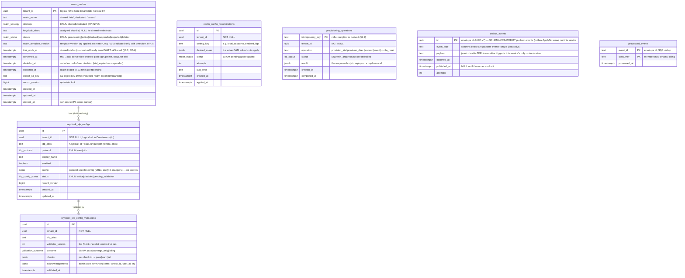
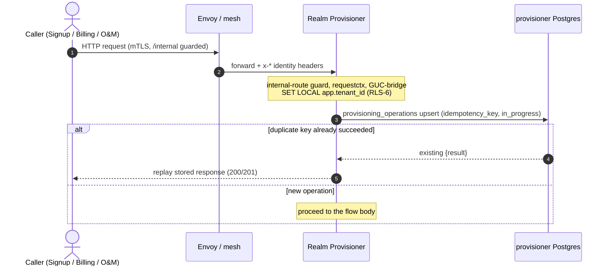
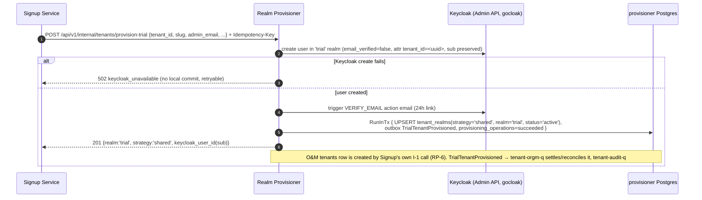
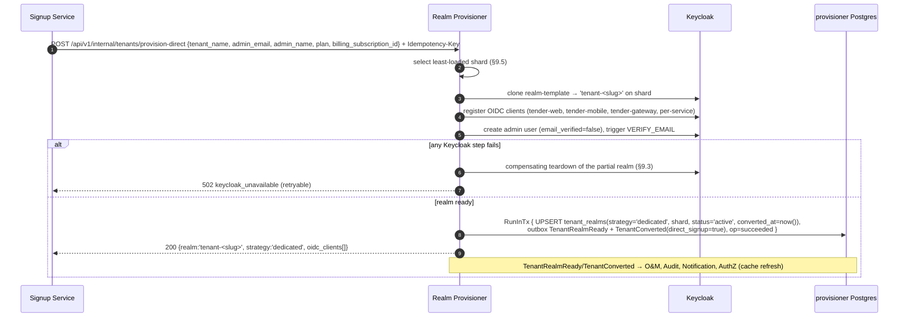
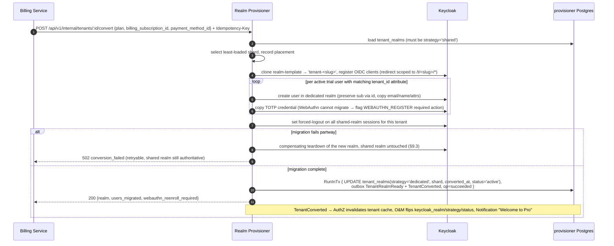
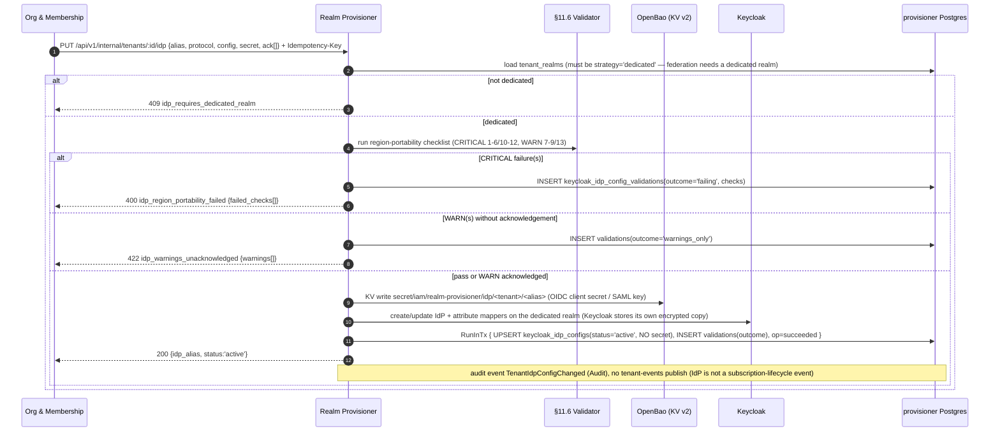
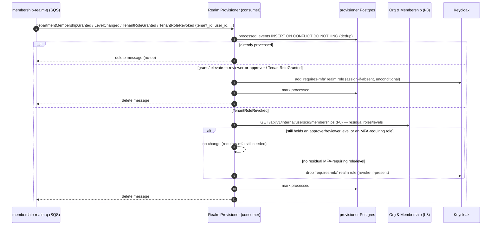
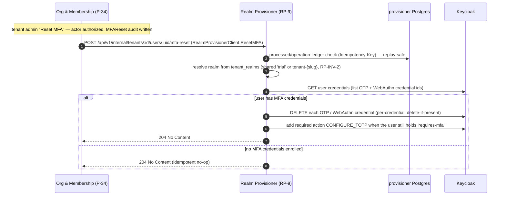
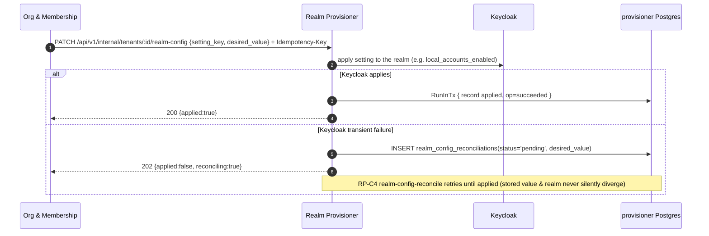
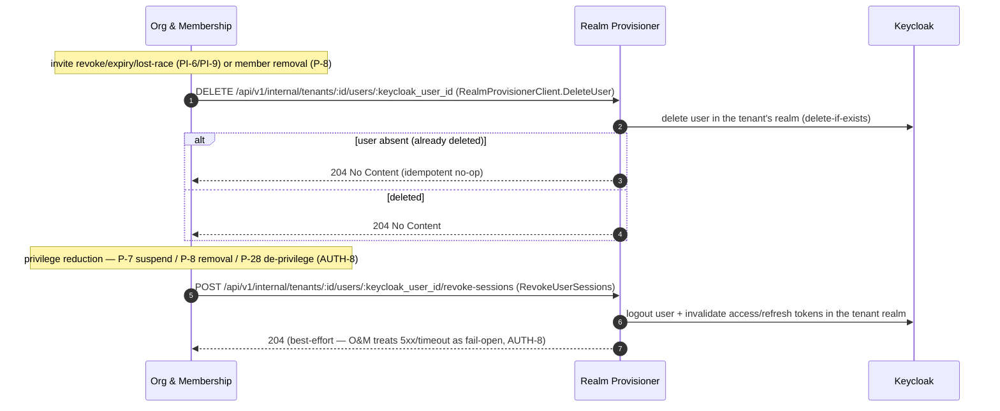

# Realm Provisioner Service — Low-Level Design

## Tender Management SaaS Platform — IAM Subsystem

| Field | Value |
|---|---|
| Document Type | Low-Level Design (LLD) |
| Service | Realm Provisioner Service (`iam-realm-provisioner`) |
| Parent design | IAM High-Level Design v1.42 (Approved for LLD), **§5.2** (service definition), §4.2/§4.3 (topology, two request paths), §8.2.1/§8.2.2/§8.2.6 (signup, invitation, MFA), §8.10 (subscription lifecycle), §9 (event architecture), §11.2/§11.6 (secrets — OpenBao per the v1.42 amendment, region-agnostic IdP checklist) |
| Subsystem | Identity & Access Management |
| Version | 1.0 (Approved — signed off) |
| Date | 2026-08-31 |
| Status | **Approved** — names frozen, all cross-team alignment items resolved (§16, §25) |
| Audience | IAM platform engineering (owner), Signup Service / web team (trial + direct-paid callers), Billing (conversion caller, `TenantReactivated` producer), Core Org & Membership (realm-config caller, `iam.membership.events` producer, `iam.tenant.events` co-producer and consumer), AuthZ Enrichment (realm→tenant map consumer of `TenantConverted`), SRE / Security |
| Owner database | RDS PostgreSQL `provisioner` (Multi-AZ, PgBouncer transaction pooling) |
| Go module | `github.com/BCBP-SOLUTIONS-FZC-LLC/iam-realm-provisioner` |
| External system of record | Keycloak (realms, users, IdPs, MFA realm-roles) — mutated exclusively through this service via gocloak |

### Revision history

| Version | Date | Notes |
|---|---|---|
| **1.1** | **2026-09-01** | **Structural realignment to the org-membership LLD template.** Restructured section numbering/organization to match `iam-lld-org-membership-service.md`: renamed §1 "Service Overview" → "Document Overview" (added §1.1 "Relationship to the HLD"); split §3.3 "Shared-library integration" into one #### subsection per library; restructured §4 "Data Model" into a single "### 4.2 Tables" heading with one #### per table (renumbering the old §4.6 "Data ownership summary" to §4.3); inserted **new §20 "Operational Considerations"** (outbox health, RLS violation monitoring, the RP-C3 open-item's operational impact, a cross-service dependency/degradation matrix) and **new §21 "Performance Considerations"** (Keycloak Admin API rate limiter as the migration-throughput constraint, conversion per-user migration cost, shard-placement query cost, admin-token cache amortization); renumbered the former §20–§23 (Decision Register, Appendix — Glossary, Appendix — Operational Runbooks, Appendix — Frozen Name Inventory) to §22–§25 and updated every internal cross-reference accordingly. No content removed; no behavioral or design change. |
| **1.0** | **2026-08-31** | **Signed off — names frozen, Status → Approved.** All cross-team alignment items are resolved both sides (F1–F6, F8, F10; RP-1/2/3/4/6/10/11/12; OQ-7/OQ-8). Executed the **RP-9 name freeze**: added **§25 Frozen Name Inventory** (tables, enums + values, 9 event names + payload fields, endpoint paths, queue names, `consumer` discriminator, metric prefix, OpenBao path). One freeze-time correction: `processed_events.consumer` `{membership, billing}` → **`{membership, tenant, billing}`** (the RP-4 `tenant-realm-q` consumer had no discriminator value) — fixed the ER diagram and §4.5. Bumped the header from 0.9 (stale) to **1.0 / Approved**. No behavioral change beyond the consumer-enum correction. |
| 0.26 | 2026-08-31 | **F5 (invite `required_actions`) confirmed resolved both sides.** O&M's `CreateInvitedUser` now sends `{email, full_name, required_actions}` — `required_actions` computed by O&M from the invite's `initial_tenant_roles`/`initial_dept_mappings` and applied verbatim by RP-5 (verified against the O&M LLD §8.2.2 + P-6 flow diagram + its own "F5, resolved" note). RP-5/§5.2.1/§18.3 already specified exactly this contract, so no RP-side change was needed; added a §16 F5 Resolved row. This clears the last open cross-team divergence — the only remaining sign-off item is the RP-9 name-freeze. |
| 0.25 | 2026-08-31 | **O&M interface doc-sync closed.** O&M updated its published `port.RealmProvisionerClient` code block to declare `ResetMFA(ctx, tenantID, keycloakUserID uuid.UUID) error` (O&M §18.3, verified) — signature matches RP-9 exactly, so the last non-blocking follow-up from 0.24 is closed. Updated the §16 F6/OQ-8 row and the §18.3 mapping note; no functional change. |
| 0.24 | 2026-08-31 | **RP-9 (MFA reset) built out — F6 / OQ-8 closed both sides.** O&M scheduled the "Reset MFA" admin feature and built its half (public **P-34** `POST /api/v1/tenants/:id/members/:user_id/reset-mfa`, `RealmProvisionerClient.ResetMFA`, `MFAReset` audit event — verified against the O&M LLD). Completed the RP half: **§8.6** now carries the full RP-9 flow (sequence diagram + Keycloak-op detail) — resolve realm from `tenant_realms`, delete all OTP/WebAuthn credentials, re-add `CONFIGURE_TOTP` when the user still holds `requires-mfa`; **idempotent** (absent-credential reset → `204`), persists nothing locally, **fail-closed** (`502 keycloak_unavailable` → O&M `503`, no `MFAReset` emitted — no reconciler, unlike RP-16's fail-open). Updated §5.1 (RP-9 catalogue note), §11.2 (new `iam_realm_provisioner_mfa_reset_total{result}` metric), §18.3 (client-mapping row: ResetMFA "built both sides", removed the "coordinated future build" note), and §16 (new F6/OQ-8 Resolved row). **Flagged (non-blocking):** O&M's own `port.RealmProvisionerClient` code block still omits the `ResetMFA` signature its prose says is interface-promoted — an O&M doc-sync item. |
| 0.23 | 2026-08-31 | **F8 confirmed resolved both sides.** Verified against the O&M LLD that O&M has repointed its `RealmProvisionerClient` to the `/api/v1/internal` paths (`CreateInvitedUser` → `POST /api/v1/internal/tenants/:id/users`, `DeleteUser` → `DELETE …/users/:keycloak_user_id`, `PatchRealmConfig` → `PATCH …/realm-config`, future `ResetMFA`). Updated the §10.3 route-versioning note and §18.3 intro to "resolved both sides" and closed the coordinated O&M follow-up. **Flagged (not F8):** O&M currently sends only `{email, full_name}` on `CreateInvitedUser` (O&M LLD ~line 1485) — `required_actions` is not yet sent, which touches the F5 resolution (§18.3 RP-5 note); tracked separately for reconciliation. |
| 0.22 | 2026-08-28 | **F8 resolved — adopted O&M's `/api/v1/internal` route convention.** All internal routes (RP-1…RP-16) now carry the `/api/v1/internal/...` prefix, matching Org & Membership; health/readiness/metrics/docs routes stay unversioned. Fixed the O&M endpoint references (I-1/I-2/I-8) to their real `/api/v1/internal` paths. **Coordinated follow-up flagged:** O&M's `RealmProvisionerClient` must repoint its base URL to `/api/v1/internal` (§10.3, §18.3). |
| 0.21 | 2026-08-28 | **RP-3 closed — realm-template lifecycle confirmed (IAM Platform + SRE).** In-repo versioned `realm-template.json` under `deploy/keycloak/` (IAM-Platform-owned, PR-reviewed), promoted via CI/CD with Keycloak import validation + realm-creation smoke tests; **no retroactive application** (new realms only, bulk re-template out of MVP scope); **drift detection** report-only. Added §12.2; changed `tenant_realms.realm_template_version` from `uuid` to **`text`** (version tag, e.g. `v3`) for drift recording (§4.2); added `deploy/keycloak/` to §3.2, the `iam_realm_provisioner_template_drift` metric to §11.2, and updated the glossary. §16 RP-3 → Resolved. |
| 0.20 | 2026-08-28 | **RP-2 closed — Keycloak admin role set confirmed.** Keycloak ops confirmed the service account holds **master `create-realm` + `realm-admin` on managed realms**, not full master `admin`. Correction applied to §10.2: `create-realm` (master) is required for realm creation and was missing from the earlier `manage-*`-only list. Documented that `create-realm` auto-confers admin on RP-created realms (so no per-realm bootstrap grant is needed — RP is the sole creator, RP-INV-1), the single-account cross-realm migration model, and the optional bootstrap/runtime split as deferred hardening. §16 RP-2 → Resolved; fixed the stale `RP-Q2` reference. |
| 0.19 | 2026-08-28 | **Resolved the RP-side alignment blockers (F2/F3/F4) + F5/F8/F10; F1 confirmed closed both sides.** Added **RP-15** `DELETE /api/v1/internal/tenants/:id/users/:keycloak_user_id` (idempotent — O&M `DeleteUser`, invite-cleanup/removal, F2) and **RP-16** `POST …/users/:keycloak_user_id/revoke-sessions` (idempotent, O&M-fail-open — `RevokeUserSessions`, AUTH-8, F3), with the §8.13 flow, §2.1 scope, §5.2.1 disposition, metrics, and the §18.3 client mapping. **F4 (RP-D14):** realm-id/shard reach O&M via the `TenantRealmReady`/`TenantConverted` events, not a synchronous I-2 call — RP never calls O&M's I-2 (recommend O&M reclassify I-2 as operator/reconcile-only). **F5:** RP-5 applies O&M's `required_actions` verbatim. **F8:** documented the prefix-less internal-route convention vs O&M's `/api/v1/internal` (platform decision). **F10:** RP→O&M calls carry the system principal `x-user-id=…00a1` + target `x-tenant-id`. **F1:** confirmed O&M added `TenantReactivated{source=operator}` to `tenant-orgm-q` (line 316) — "consumes all nine" is now accurate on both sides. |
| 0.18 | 2026-08-28 | **F6 cross-referenced to O&M OQ-8.** O&M recorded the RP-9-is-O&M-initiated confirmation as its register item **OQ-8** (Open, scheduling-gated) with a `.claude/CLAUDE.md` "not yet added" pointer; no code/spec change either side, held until the "Reset MFA" admin feature is scheduled. Added the reciprocal OQ-8 pointer in §8.6 so both registers link. |
| 0.17 | 2026-08-28 | **F6 answered — RP-9 (MFA reset) confirmed O&M-initiated.** Per HLD §8.2.6 the tenant-admin "Reset MFA" action is a user-management operation (like invite/remove) that must be authorized on the O&M side (tenant_admin + MFA step-up + `MFAReset` audit) before reaching RP, which makes no authz decision (§10.6). Chain: admin → O&M public reset-mfa endpoint → O&M `RealmProvisionerClient.ResetMFA` → RP-9. Made the caller chain explicit in §5.1/§8.6/§18.3 and flagged the O&M-side additions (new public endpoint + `ResetMFA` client method) as a coordinated joint build — RP-9 already exists here, so it is not an RP gap. |
| 0.16 | 2026-08-28 | **RP-6 closed (O&M-confirmed) + corrected the tenant-row creation model.** O&M confirmed Signup pre-allocates `tenant_id` and passes the same value to both the Keycloak attribute and O&M's I-1 `id` (idempotent on `id`, I1-1). Verifying this surfaced a real model error: the LLD said RP's `TrialTenantProvisioned`/`DirectPaidSignup` events *create* O&M's `tenants` row — but O&M creates it via **I-1** (Signup-called) and those events only **settle/reconcile** it. Corrected throughout: §5.2/§5.2.1 field disposition (tenant metadata → O&M via Signup's I-1, not RP's event), §7.4/§7.5 (events "settle", payloads trimmed to `tenant_id`/`realm`/`keycloak_user_id`(+`direct_signup`)), §8.1 diagram note, §14.4 E2E, §18.1/§18.3. §16 RP-6 → Resolved (one O&M-side doc-gap follow-up: no direct-paid flow diagram). |
| 0.15 | 2026-08-28 | **OQ-7 contract locked.** O&M made `TenantSuspendedPayload.source` a `required` field (`enum: [billing_lapse, operator]`) in its `api/asyncapi.yaml` and marked OQ-7/T-16 resolved. Recorded in the §16 RP-11 entry that `source` is now contractually mandatory on every `TenantSuspended` — no behavior change here (this service already always sets it); confirmation only. |
| 0.14 | 2026-08-28 | **RP-11 closed (O&M schema change) + `source` value corrected.** O&M added `tenants.suspension_source` (`billing_lapse\|operator`, T-16) and reworked its CHECK constraints so an operator-sourced `active/trial → suspended` transition is accepted and stays out of the billing offboard clock — matching this LLD's §8.8 auto-offboard exclusion. Corrected this LLD's `TenantSuspended.source` value from `lapse` to **`billing_lapse`** (§7.5, §8.8) to match O&M's enum; made the lapse path emit `source=billing_lapse` explicitly; answered O&M's OQ-7 (field is `source`, always present, values `billing_lapse`/`operator`); updated §8.8/§8.12 notes and §16 RP-11 → Resolved. |
| 0.13 | 2026-08-28 | **RP-4 follow-up closed both sides.** O&M added Realm Provisioner as the `tenant-realm-q` / `TrialStarted` consumer in its own `api/asyncapi.yaml` (`sqsTenantRealm`/`tenantRealmQueue`/`receiveTenantRealm`, filter `EventType IN [TrialStarted]`) and LLD §7.3/§18.3. Verified against `iam-org-membership`; updated §7.1 and the §16 RP-4 entry to record the follow-up as closed (no outstanding cross-team catalogue item). |
| 0.12 | 2026-08-28 | **RP-4 closed (O&M-confirmed) — trial-expiry is realm-side, no O&M query.** O&M exposes no batch "expired trials" endpoint by design; this service tracks `trial_ends_at` locally and sweeps its own data. Added `trial_ends_at` to `tenant_realms` (§4.2) + a sweep index; added a new inbound consumer **`tenant-realm-q`** for O&M's `TrialStarted` (§7.1) that records the local timer; rewrote §8.7 to sweep local `tenant_realms` (removed the O&M query); consumer count 2 → **3** throughout (§1/§2.1/§3/§4/§7/§9.2/§11.5/§13/§14/§19); `OrgMembershipClient` now serves only the I-8 MFA check. Flagged one coordination follow-up: O&M §7.3 + HLD §9.1 must list this service as a `TrialStarted` consumer. §16 RP-4 → Resolved. |
| 0.11 | 2026-08-28 | **RP-1 closed (O&M-confirmed) + two filter corrections.** Verified against O&M LLD §7.3.2 and `iam-org-membership` `api/asyncapi.yaml`: O&M routes tenant-role events to `membership-realm-q`. Corrected this LLD's `membership-realm-q` filter to the authoritative `[DepartmentMembershipGranted, DepartmentMembershipLevelChanged, TenantRoleGranted, TenantRoleRevoked]` — **removed `DepartmentMembershipRevoked`** (O&M does not route it here) and **added `TenantRoleGranted`/`TenantRoleRevoked`**. Aligned MFA semantics (§7.1, §8.6, RP-EVT-6, RP-D3, §18.3): unconditional add on grant/elevate/`TenantRoleGranted`; drop only on `TenantRoleRevoked` after an O&M I-8 residual-requirement check (RP holds no membership state). §8.6 diagram gains the I-8 query + grant/revoke branches; `org_membership_client` port now also serves the I-8 MFA check. §16 RP-1 → Resolved. |
| 0.10 | 2026-08-28 | **HLD aligned to OpenBao — RP-10 closed.** The parent HLD was amended to **v1.42**: §11.2 rewritten from AWS Secrets Manager to OpenBao, a §17.1 resolved-decision added ("Secrets backend — OpenBao (supersedes AWS Secrets Manager)"), and the topology (§4.2), cost (§14.4), CI OIDC scope (§15.5.3), and local-dev compose (§15.5.1) updated to match. This LLD's parent-design reference bumped to v1.42; §4.3/§10.2 "divergence" language replaced with "per HLD §11.2 as amended"; §16 RP-10 and §22 RP-D11 marked Resolved (design no longer contradicts its parent — the only remaining piece is operational OpenBao-topology confirmation at implementation time). |
| 0.9 | 2026-08-28 | **Mermaid render fix.** Removed all semicolons from the nine diagram blocks — Mermaid treats `;` as a statement terminator, so a label like `(mTLS; /internal guarded)` broke the §8.0 sequence diagram parse. Replaced with commas (e.g. `(mTLS, /internal guarded)`); verified every diagram's `alt`/`loop`/`par` blocks are balanced. No content change. |
| 0.8 | 2026-08-28 | **Reconciled response fields with the data model.** Clarified that §5.2.1 maps request (input) fields, and added an **RP-3 response-field provenance** table resolving the apparent mismatch: realm-identity fields (`realm`/`strategy`/`keycloak_shard`) are read back from `tenant_realms`; `oidc_clients` is Keycloak state this service registers but does not mirror in a column; `users_migrated`/`webauthn_reenroll_required`/`shared_sessions_terminated` are per-operation summaries carried on the `TenantConverted` event + `provisioning_operations.result`, not durable columns. Same three provenances (persisted row / Keycloak effect / computed summary) stated to cover every endpoint's response. |
| 0.7 | 2026-08-28 | **Extended field disposition to all endpoints.** Added §5.2.1 — a consolidated field-disposition table for RP-1…RP-14 (field → Keycloak / O&M / OpenBao / `provisioner` DB / event / ignored, and whether it persists here), making explicit that no request carries user PII or credentials into Postgres and that the service has no per-user table (RP-5/RP-9 persist nothing locally). Notes `payment_method_id` (RP-3) is ignored/Billing-domain (PCI scope-out). |
| 0.6 | 2026-08-28 | **Clarified request-field disposition + completed the trial/direct-paid event payloads.** Added a "Field disposition (RP-1)" table to §5.2 making explicit that the provisioner persists only `tenant_id` + realm metadata: identity fields (`admin_email`/`admin_name`/`hashed_password_seed`) go to Keycloak, tenant/plan fields (`tenant_name`/`tenant_slug`/`plan`) are relayed to O&M via the event, and no request field except `tenant_id` maps to a `provisioner` column (credential material never touches Postgres, §10.4/§15.1). Fixed a real gap: `TrialTenantProvisioned` and `DirectPaidSignup` payloads (§7.5) now carry `tenant_name`, `tenant_slug`, and `admin_name` so O&M can actually build the `tenants` row and owner membership (HLD §8.2.1 step 7 / §8.10.6 step 5). |
| 0.5 | 2026-08-28 | **Resolved RP-12 (paid operator-reactivation event) as RP-D13.** The operator un-suspend of a paid tenant (RP-10, §8.11) emits **`TenantReactivated` with a `source(operator\|billing)` field** rather than a new event type — this service now *produces* `TenantReactivated(source=operator)` on `iam.tenant.events` and continues to *consume* Billing's `TenantReactivated(source=billing)` on `billing-realm-q` (different topics → no self-consumption). This brings the service's published tenant-event count to **nine**; updated §1/§2.1/§7.1/§7.3/§7.3.1 (Glue table)/§7.4 (fan-out)/§7.5 (catalogue + note 0)/RP-EVT-2, §14.3 tests, §18.3, §19, RP-D5 count, and added RP-D13; RP-12 marked Resolved. |
| 0.4 | 2026-08-28 | **Reversibility of emergency suspension.** Clarified that an RP-14 operator-suspended tenant is fully revertible to active via RP-10 (it is `suspended`, not the terminal `offboarded`): §8.11 gains the operator-reactivation path (inverse of §8.12); §8.8 now **excludes** administrative/operator suspensions (`source=operator`, no `cancelled_at`) from the auto-offboard sweep so they never silently age into `offboarded`; RP-10's catalogue row is broadened to name the operator-revert case. Added **RP-12** to resolve the status-projection event for a paid operator-reactivation (reuse `TenantReactivated(source)` vs a new `TenantResumed`). No "emergency cancel" exists to revert — `cancelled` has no RP effect (§2.2). |
| 0.3 | 2026-08-28 | **Added emergency operator suspension (RP-14, RP-D12).** New operator-only `POST /api/v1/internal/tenants/:id/suspend` for immediate abuse/security/legal-hold lockout outside the billing-driven lifecycle — effect-only (disables the dedicated realm, or a trial tenant's users, never the shared realm), emitting `TenantSuspended(source=operator, reason)` so O&M still owns/projects `subscription_status`; reversible via RP-10. Added the §8.12 flow, extended the `TenantSuspended` payload (`source`, `reason`), a §2.1 scope bullet, RP-D12, and RP-11 (O&M state-machine acceptance of a direct operator-sourced `active/trial → suspended` transition). No operator "force cancel" endpoint added — `cancelled` has no Realm-Provisioner effect (AuthZ/O&M concern, §2.2). |
| 0.2 | 2026-08-28 | **Secrets backend switched to OpenBao (RP-D11, RP-10) + review corrections.** Replaced AWS Secrets Manager with OpenBao throughout: per-tenant IdP secrets now map to the deterministic OpenBao KV v2 path `secret/data/iam/realm-provisioner/idp/<tenant_id>/<idp_alias>`, read/written via the OpenBao KV API at runtime, authorized by an OpenBao policy bound through Kubernetes auth (replacing AWS-IAM `secretsmanager:*` scoping); the Keycloak admin credential comes from OpenBao via ESO's OpenBao/Vault provider. Updated §4.3, §8.4 (sequence diagram), §10.2, §12 (new `openbao` config + `BAO_*` env), §13.2/§13.3/§13.5 (`deploy/openbao/` policy.hcl + role; `deploy/iam/` now AWS-resources-only), §22 (RP-D10 reworded, RP-D11 added), §16 (RP-10 added — flags the divergence from HLD §11.2 for platform-wide/HLD alignment), and §23 glossary. S3 realm-export SSE-KMS is unchanged (a separate at-rest concern). Also folded in two earlier review corrections: §3.1 clarified that `outbox.Runner` is `platform-events`' own runner (not bespoke); §4.5/§4.6 corrected that the `outbox_events` **schema is created/owned by `platform-events`** (`outbox.ApplySchema`), the service only customizing the payload column + grants, while `processed_events` is service-owned DDL. |
| 0.1 | 2026-08-28 | Initial draft. Written against IAM HLD v1.41 §5.2 (service definition — "the only service that calls Keycloak's Admin API"), §4.2/§4.3 (topology, sync vs. async paths), §8.2.1 (self-serve trial signup), §8.2.2 (user invitation), §8.2.6 (MFA enrollment/management), §8.10.1–§8.10.7 (trial provisioning, conversion, expiry, reactivation, direct-paid signup, lapse/suspension/offboarding), §9.1/§9.1.1 (`iam.tenant.events` two-producer topic, `membership-realm-q`/`billing-realm-q` subscriptions), §9.2/§9.3 (outbox + consumer idempotency), §9.4 (event catalogue), §11.2 (secrets), and §11.6 (Region-Agnostic IdP Configuration Checklist). Structure and depth follow the frozen sibling LLDs — `iam-lld-delegation-service.md` (producer-and-consumer template) and `iam-lld-org-membership-service.md` (outbox + `iam-tenant-events` co-producer, Glue Schema Registry) — and the shared-library conventions all seven IAM services already implement (`platform-gincommon`, `platform-pgcommon`, `platform-events`). Points the HLD and sibling LLDs leave silent are resolved here as new decisions under the `RP-#` register prefix (§16), distinct from the sibling registers' `A#`/`AE-#`/`DLG-#`/`TAC-#` prefixes to avoid cross-document ID collision. |

---

## Table of Contents

1. [Document Overview](#1-document-overview)
2. [Service Responsibilities and Boundaries](#2-service-responsibilities-and-boundaries)
3. [Architecture and Package Layout](#3-architecture-and-package-layout)
4. [Data Model](#4-data-model)
5. [API Contract](#5-api-contract)
6. [Caching Design](#6-caching-design)
7. [Event Architecture](#7-event-architecture)
8. [Key Request Flows](#8-key-request-flows)
9. [Concurrency, Consistency, and Failure Handling](#9-concurrency-consistency-and-failure-handling)
10. [Security](#10-security)
11. [Observability](#11-observability)
12. [Configuration](#12-configuration)
13. [Deployment and Scaling](#13-deployment-and-scaling)
14. [Testing Strategy](#14-testing-strategy)
15. [GDPR, Data Lifecycle, and Compliance](#15-gdpr-data-lifecycle-and-compliance)
16. [Open Questions and Sign-off Register](#16-open-questions-and-sign-off-register)
17. [Appendix — Error Taxonomy](#17-appendix--error-taxonomy)
18. [Integration Details](#18-integration-details)
19. [Migration and Provisioning-Ordering Plan](#19-migration-and-provisioning-ordering-plan)
20. [Operational Considerations](#20-operational-considerations)
21. [Performance Considerations](#21-performance-considerations)
22. [Decision Register](#22-decision-register)
23. [Appendix — Glossary](#23-appendix--glossary)
24. [Appendix — Operational Runbooks](#24-appendix--operational-runbooks)
25. [Appendix — Frozen Name Inventory (sign-off)](#25-appendix--frozen-name-inventory-sign-off)

---

## 1. Document Overview

### 1.1 Relationship to the HLD

This document refines the IAM High-Level Design **v1.42 (Approved for LLD)** — specifically **§5.2** (service definition), **§4.2/§4.3** (topology, the two request paths), **§8.2.1/§8.2.2/§8.2.6** (signup, invitation, MFA), **§8.10** (subscription lifecycle), **§9** (event architecture), and **§11.2/§11.6** (secrets — OpenBao per the v1.42 amendment, and the region-agnostic IdP checklist), per the "Parent design" field in the header table above. **Where this LLD and the HLD disagree, the HLD is authoritative** — no such disagreement remains open as of the v1.0 sign-off (§16); the one prior divergence (the pre-v1.42 secrets backend) was resolved by amending the HLD itself rather than by this document overriding its parent (RP-D11/RP-10, §22).

The Realm Provisioner Service (`iam-realm-provisioner`) is the **single writer to Keycloak's Admin API** and the system of record for **tenant identity lifecycle on the Keycloak side**. Every realm, user, identity-provider, and MFA-realm-role mutation on Keycloak flows through this one service via [gocloak](https://github.com/Nerzal/gocloak); no other service in the platform is permitted to reach Keycloak's `/admin/*` endpoints (HLD §4.2, §5.2). This is the load-bearing architectural constraint of the whole document: because exactly one service holds the Keycloak admin credential and issues every admin mutation, the admin path is auditable, idempotent, rate-limitable, replay-safe, and independently replaceable — and every guarantee in this LLD depends on that invariant (**RP-INV-1**, §2.4).

Its responsibilities span the entire subscription lifecycle described in HLD §8.10:

- **Trial provisioning** (§8.10.1 / §8.2.1) — create the tenant's user inside the shared `trial` realm, stamp the `tenant_id` Keycloak user attribute, trigger the Keycloak-managed verification email, and emit `TrialTenantProvisioned`. **No dedicated realm is created at trial signup.**
- **User invitation** (§8.2.2) — create invited users in the appropriate realm with the correct Keycloak required actions (`VERIFY_EMAIL`, `UPDATE_PASSWORD`, and `CONFIGURE_TOTP` when the invite carries an MFA-triggering grant), on behalf of Org & Membership.
- **Trial → paid conversion** (§8.10.2) — place the tenant on a Keycloak shard, clone the versioned realm template into a dedicated realm `tenant-<slug>`, register the standard OIDC clients, **migrate every trial user** into the dedicated realm (preserving the `sub` UUID, copying TOTP; WebAuthn re-enrolls), force-logout the shared-realm sessions, and emit `TenantRealmReady` + `TenantConverted`.
- **Direct paid signup** (§8.10.6) — provision the dedicated realm straight away with no shared-realm intermediate, and emit `TenantRealmReady` + `TenantConverted` (`direct_signup=true`).
- **Federated SSO / IdP brokering** (§5.1, §8.2.4) — configure per-tenant SAML 2.0 and OIDC identity providers on the dedicated realm, **gated by the §11.6 Region-Agnostic IdP Configuration Checklist**, which this service owns and enforces.
- **MFA lifecycle** (§6.5, §8.2.6) — assign and revoke the `requires-mfa` realm role as users gain or lose Approver level or the `tenant_owner`/`tenant_admin` roles (driven by Org & Membership's membership events), and perform admin-initiated MFA resets.
- **Realm-config propagation** (§5.2) — apply realm-affecting tenant settings (`local_accounts_enabled`, IdP/federation config) via a **synchronous** Org & Membership → Realm Provisioner internal call, never a bus event, so the setting is effective immediately with no eventual-consistency window.
- **Lifecycle reconcilers** — daily jobs for trial expiry (§8.10.3), trial hard-delete after grace, subscription lapse `cancelled → suspended → offboarded` (§8.10.7), and realm-config reconciliation of any setting whose Keycloak mutation has not yet succeeded.
- **Reactivation** (§8.10.4 / §8.10.7) — re-enable a disabled trial user or a suspended tenant's dedicated realm.

The service is **low-volume and admin-driven** — it sits on neither of the platform's two hot paths (HLD §4.3). It never appears in the synchronous request path (that is AuthZ Enrichment) and it is not a high-throughput event projector (that is Org & Membership / User Profile). Its work is bursty, coarse-grained tenant-lifecycle operations measured in the tens-to-hundreds per day, each of which may make several Keycloak Admin API round-trips. Correctness, auditability, and idempotency matter far more here than latency or QPS; the design optimises accordingly (2-replica Deployment, manual scaling — HLD §5.2).

The service **owns the `provisioner` RDS PostgreSQL database** — its own authoritative record of what it has created in Keycloak (realm placement, IdP configurations, validation results, and the reconciliation ledger), plus the transactional outbox and the consumer idempotency ledger. It is a **dual role** on the event bus: it **publishes** nine tenant-lifecycle events on `iam.tenant.events` (the one IAM topic with two producers — this service and Org & Membership, HLD §9.1.1) and it **consumes** membership/role events (`membership-realm-q`), O&M's `TrialStarted` (`tenant-realm-q`, RP-4), and one billing event (`billing-realm-q`).

Two records, two owners (the same "system of record vs. projection" split the sibling services use): **this service** owns the Keycloak-side realm reality and its own `tenant_realms` mirror; **Org & Membership** owns the application-side `tenants` row and its `keycloak_realm` / `keycloak_realm_strategy` / `subscription_status` projection, updated by consuming this service's events on `tenant-orgm-q` (HLD §9.1.1). Neither writes the other's store.

---

## 2. Service Responsibilities and Boundaries

### 2.1 In scope

- **Sole Keycloak Admin API client** (RP-INV-1) — all realm/user/IdP/MFA-role/credential mutations via gocloak, behind a single outbound port so the Keycloak dependency is mockable and swappable.
- **Realm lifecycle** — create the shared-realm trial user (no dedicated realm), clone the versioned realm template into `tenant-<slug>` at conversion / direct-paid signup, disable/enable realms, and export-then-delete realms at offboarding.
- **User lifecycle on Keycloak** — create trial and invited users with correct required actions; migrate users trial→dedicated at conversion (preserve `sub`, copy TOTP, force WebAuthn re-enroll); disable/enable/hard-delete users; **per-user delete (RP-15) and session/token revocation (RP-16)** on O&M's invite-cleanup and privilege-reduction paths; scrub PII on trial expiry.
- **IdP / federation** — configure and update per-tenant SAML/OIDC identity providers on the dedicated realm, **behind the §11.6 validation gate**; store the validation results; run the operator-only pre-migration portability audit.
- **MFA realm-role management** — assign/revoke `requires-mfa` driven by Org & Membership membership events; admin-initiated MFA credential reset.
- **Realm-config propagation** — apply realm-affecting tenant settings synchronously on behalf of Org & Membership; flag any setting whose realm mutation has not yet landed for reconciliation.
- **Own `provisioner` database** — `tenant_realms`, `keycloak_idp_configs`, `keycloak_idp_config_validations`, `realm_config_reconciliations`, `provisioning_operations` (admin-op idempotency ledger), `outbox_events`, `processed_events` — all tenant-scoped and RLS-protected (except the operational ledgers, §4.5).
- **Produce nine tenant-lifecycle events** on `iam.tenant.events` through the transactional outbox (§7.4) — including the operator-sourced `TenantReactivated` (RP-D13).
- **Consume** `membership-realm-q` (MFA-role sync), `tenant-realm-q` (O&M's `TrialStarted` → record `trial_ends_at` locally, RP-4), and `billing-realm-q` (`TenantReactivated` → re-enable realm), idempotently via `processed_events`.
- **Run the lifecycle reconcilers** — trial-expiry, trial-hard-delete, subscription-lapse, and realm-config-reconciliation CronJobs.
- **Emergency operator suspension** — an operator-only path (RP-14, §8.12) to immediately apply the Keycloak-side suspension effect (disable the dedicated realm, or a trial tenant's users) outside the billing-driven lifecycle, for abuse/security/legal-hold response; reversible via reactivation (RP-10). This service applies the effect only — O&M remains the authority for `subscription_status`.

### 2.2 Out of scope (owned elsewhere)

| Concern | Owner | Why not here |
|---|---|---|
| Authentication, token issuance, JWKS, brute-force lockout | **Keycloak** | Realm Provisioner configures Keycloak; it never sits in the login/token path (HLD §5.1, §11.3, §11.4). |
| The application-side `tenants` row, `subscription_status`, `plan`, `feature_flags`, seat cap | **Org & Membership** | This service emits lifecycle events; O&M owns and projects the row (HLD §5.6, §8.10). |
| Deciding *when* to convert / cancel / reactivate | **Billing** | Billing is the authority for subscription-status transitions; IAM reacts (HLD §8.10.7). This service performs the Keycloak-side effect only. |
| Receiving raw Keycloak webhook events (`LOGIN`, `REGISTER`, `IDENTITY_PROVIDER_FIRST_LOGIN`, …) | **Event Consumer** | Realm Provisioner writes *to* Keycloak; the Event Consumer reads Keycloak's event webhook (HLD §5.3). The two never overlap. |
| JIT user creation on federated first login | **Event Consumer** | Driven by the `IDENTITY_PROVIDER_FIRST_LOGIN` webhook, not by an admin mutation (HLD §5.3, §8.2.4). This service only *configures* the IdP that makes federated login possible. |
| Header injection / policy decisions / realm→tenant resolution on the hot path | **AuthZ Enrichment** | This service produces `TenantConverted` so AuthZ can refresh its realm→tenant map; it makes no request-path decision (HLD §5.4). |
| Signup form, rate-limiting, payment tokenization | **Signup Service (edge BFF)** | Outside the IAM stack (HLD §10.8); it calls this service's provisioning endpoints. |
| Plan-tier changes between paid tiers | **Billing + Org & Membership** | A tier change does **not** touch the realm (HLD §8.10.5). This service is uninvolved unless the change adds/removes an IdP (which routes through the §11.6-gated IdP endpoint). |

### 2.3 The single-writer distinction (design note)

Unlike the config/overlay/coordinator siblings, this service's defining property is that it is the **exclusive gateway to an external stateful system** (Keycloak). That has three consequences the rest of the design keeps returning to:

1. **Every mutation is a distributed operation** spanning two stores it does not co-own transactionally — the `provisioner` Postgres DB and Keycloak. There is no cross-store transaction, so every flow is designed as *Keycloak-effect-first, then local commit* or *local-intent-first, then Keycloak-effect with reconciliation*, and every operation is idempotent and compensatable (§9).
2. **Keycloak is the source of truth for the realm/user/credential reality; the `provisioner` DB is an authoritative mirror plus operational metadata** the Admin API cannot itself hold (validation history, reconciliation flags, idempotency ledger, the outbox). On any disagreement, Keycloak wins for realm existence and user credentials; the DB wins for "did we intend this and has it reconciled."
3. **Idempotency is mandatory, not optional.** Provisioning calls arrive from at-least-once event delivery (billing/membership) and from retrying HTTP callers (Signup, Billing, O&M). Every externally-triggered mutation carries an idempotency key and is guarded by the `provisioning_operations` ledger (§4.4, §9.2).

### 2.4 Core invariants

| # | Invariant |
|---|---|
| RP-INV-1 | **Single writer.** Every Keycloak `/admin/*` mutation in the platform originates in this service. No other service holds a Keycloak admin credential. Enforced operationally (secrets scoping, §10.2) and by convention (no gocloak admin client exists in any other repo). |
| RP-INV-2 | **No dedicated realm at trial.** Trial tenants live in the shared `trial` realm and are identified by the `tenant_id` JWT claim (protocol-mapper-injected from the verified user attribute), never by `iss`. A dedicated realm is created only at conversion (§8.10.2) or direct-paid signup (§8.10.6). |
| RP-INV-3 | **Events via outbox only.** Every published event is written to `outbox_events` in the same transaction as the local state change that caused it; publishing is at-least-once (outbox → SNS → SQS), consumers idempotent (§7). |
| RP-INV-4 | **IdP behind the gate.** No SAML/OIDC IdP configuration reaches Keycloak without passing the §11.6 checklist; CRITICAL failures block (`400`), WARN items require recorded admin acknowledgement. |
| RP-INV-5 | **`offboarded` is terminal** (HLD Invariant PAID-1). Once a tenant is offboarded — dedicated realm exported to S3 and deleted, row PII-scrubbed — no transition out is permitted; a returning customer onboards fresh. |
| RP-INV-6 | **Realm-config is synchronous, not evented.** Realm-affecting settings arrive via `PATCH /api/v1/internal/tenants/:id/realm-config` and are applied to Keycloak before the caller's success ack — never propagated over the bus (HLD §5.2, §9.4). |

---

## 3. Architecture and Package Layout

**Stack:** Go 1.26, Gin via `platform-gincommon` (router, `ErrorResponse`, request-context/gateway-identity middleware, internal-route guard, structured `logger`), pgx v5 over `platform-pgcommon` (pool lifecycle, `DSNFromEnv`/`MigrationDSNFromEnv`, the RLS/GUC bridge, statement-timeout and slow-query wrapping), `platform-events` (transactional outbox publisher to `iam-tenant-events` **and** the three SQS consumers), [gocloak](https://github.com/Nerzal/gocloak) for the Keycloak Admin API, AWS SNS/SQS + Glue Schema Registry, ElastiCache Valkey (`rp:` keyspace — admin-token and idempotency caches only), and RDS PostgreSQL `provisioner`. Clean Architecture / ports-and-adapters, identical layer rules and shared-library conventions to the existing IAM services (HLD §15.3/§15.4). Two process entry points — a `server` (HTTP API + the three SQS consumers) and a `reconciler` (the lifecycle CronJobs) — mirroring `iam-org-membership`'s `cmd/server` + `cmd/reconciler` split.

### 3.1 Runtime shape

The `server` process runs one Gin HTTP server on the API port (`APP_PORT`, default 8080) and a **dedicated metrics listener** on `METRICS_PORT` (default 9090) — the same split every sibling uses so a NetworkPolicy can grant the monitoring namespace scrape access to `/metrics` without exposing the API surface. The Gin server serves three kinds of route: the public/edge provisioning API behind Envoy, the mesh-only `/api/v1/internal/*` API (guarded by `platform-gincommon`'s internal-route guard, mTLS), and the health/docs routes (`/healthz`, `/readyz`, `/asyncapi`, `/asyncapi.yaml`). Alongside the HTTP server the `server` process runs, as background goroutines: the three SQS consumers (`membership-realm-q`, `billing-realm-q`, `tenant-realm-q`), the **`platform-events` `outbox.Runner`** (the library's own runner — not a bespoke one — polling this service's local `outbox_events` table, publishing to SNS, and marking rows published), and a ticker that calls the same runner's `PrunePublished`. The `outbox_events` table is local to the `provisioner` DB not because the outbox is reimplemented here, but because the transactional-outbox pattern requires the event row to be written in the same DB transaction as the state change that caused it (RP-EVT-1); `platform-events` supplies the enqueue helper, the runner, and the prune call, and this service only wires them (§3.3, §7.4). A native `grpc.health.v1`-style readiness signal is not needed — this service exposes no gRPC surface; readiness is HTTP `/readyz`, tied to DB reachability, the Keycloak admin-token bootstrap, and the Glue schema-version resolution (§7.3.1).

The `reconciler` process is a thin `--job=<name>` dispatcher (the same convention as `iam-org-membership`'s `cmd/reconciler`), invoked by Kubernetes CronJobs; each job binds the DB, runs one sweep, emits metrics, and exits.

### 3.2 Package layout

> As-built layout, kept in sync with `ARCHITECTURE.md`'s layer model and `docs/architecture/*.mmd`. `internal/core/*` imports no adapter, Gin, pgx, gocloak, or AWS SDK; adapters depend inward; `cmd/*` wires concretes. CI-enforced by `.go-arch-lint.yml` (§3.4).

```
iam-realm-provisioner/
├── api/
│   ├── asyncapi.yaml                         -- hand-authored AsyncAPI 3.0.0 event contract (§7.3)
│   └── embed.go                              -- //go:embed asyncapi.yaml (served at /asyncapi)
├── cmd/
│   ├── server/                               -- HTTP + SQS-consumers + outbox composition root
│   │   ├── main.go                           -- wiring: router, consumers, outbox.Runner, prune ticker
│   │   ├── config.go                         -- env → typed config (§12), fail-fast validation
│   │   ├── observability.go                  -- logger/metrics/traces bootstrap (platform-gincommon)
│   │   └── swagger_info.go                   -- OpenAPI metadata for the provisioning API
│   └── reconciler/
│       ├── main.go                           -- --job=<name> dispatch
│       └── jobs/
│           ├── trial_expiry.go               -- RP-C1 (0 2 * * *, §8.7): mark trial_expired, disable users
│           ├── trial_hard_delete.go          -- RP-C2 (0 3 * * *, §8.7): hard-delete past 30-day grace
│           ├── subscription_lapse.go         -- RP-C3 (0 2 * * *, §8.9): cancelled→suspended→offboarded
│           ├── realm_config_reconcile.go     -- RP-C4 (*/10 * * * *, §8.10): retry unlanded realm-config
│           ├── outbox_prune.go               -- prune published outbox rows (retention)
│           └── processed_events_prune.go     -- prune processed_events past TTL
├── internal/
│   ├── core/
│   │   ├── domain/
│   │   │   ├── tenant_realm.go               -- TenantRealm, RealmStrategy (shared|dedicated), RealmStatus
│   │   │   ├── idp_config.go                 -- IdpConfig, IdpProtocol (saml|oidc), IdP field shapes
│   │   │   ├── idp_validation.go             -- ValidationResult, CheckOutcome (pass|warn|fail), §11.6 checks
│   │   │   ├── provisioning_op.go            -- ProvisioningOperation (idempotency ledger record)
│   │   │   ├── event.go / event_payloads.go  -- outbound envelope + the 8 tenant-event payload shapes
│   │   │   └── errors.go                     -- realm_* / idp_* sentinel error taxonomy (§17)
│   │   ├── port/
│   │   │   ├── keycloak_admin.go             -- KeycloakAdmin (the sole Keycloak seam, RP-INV-1)
│   │   │   ├── tenant_realm_repository.go
│   │   │   ├── idp_config_repository.go
│   │   │   ├── reconciliation_repository.go
│   │   │   ├── idempotency_store.go           -- provisioning_operations ledger
│   │   │   ├── org_membership_client.go       -- OrgMembershipClient (I-8 residual-MFA check §8.6)
│   │   │   ├── object_store.go                -- ObjectStore (realm export to S3, §15.2)
│   │   │   ├── event_publisher.go
│   │   │   └── tx_runner.go
│   │   └── service/
│   │       ├── provisioning_service.go       -- trial / direct-paid / convert / revert (§8.1–§8.4)
│   │       ├── migration_service.go          -- trial→dedicated user migration (§8.3)
│   │       ├── idp_service.go                -- IdP configure/update + §11.6 gate (§8.5)
│   │       ├── mfa_service.go                -- requires-mfa role assign/revoke, MFA reset (§8.6)
│   │       ├── realm_config_service.go       -- realm-affecting settings apply + reconcile (§8.10)
│   │       └── lifecycle_service.go          -- trial-expiry / lapse / reactivation business logic
│   └── adapter/
│       ├── inbound/
│       │   ├── http/                         -- provisioning + /internal routes, health, /asyncapi, router
│       │   └── consumer/                      -- membership-realm-q + billing-realm-q + tenant-realm-q handlers
│       └── outbound/
│           ├── keycloak/                      -- gocloak-backed KeycloakAdmin: realms, users, IdPs, roles,
│           │                                     admin-token cache, retry/backoff, rate limiter
│           ├── postgres/                      -- repositories, migrations, RLS, processed_events, outbox
│           ├── orgmembership/                 -- OrgMembershipClient HTTP impl
│           ├── s3/                            -- ObjectStore impl (realm export)
│           ├── eventbus/                      -- SNS publisher (iam-tenant-events) + Glue codec + schemas/
│           └── metrics/                       -- iam_realm_provisioner_* Prometheus instruments
├── internal/eventschema/                     -- embedded JSON Schemas for the 8 published events
├── pkg/requestctx/                           -- gateway-identity / tenant-actor extraction helpers
├── deploy/
│   ├── helm/realm-provisioner/               -- this service's independent Helm chart (§13)
│   ├── iam/                                   -- pod IAM policy (SNS/SQS/Glue/S3/KMS) — policy.json + .tf.example
│   ├── openbao/                               -- OpenBao policy.hcl + k8s-auth role.tf.example (secret access, §10.2)
│   ├── keycloak/                              -- realm-template.json (in-repo, versioned by REALM_TEMPLATE_VERSION; RP-3, §12.2)
│   └── monitoring/                           -- app-alerts.yml, slo-rules.yml, prometheus-adapter-rule.yaml
├── test/                                      -- fixtures/, integration/ (Keycloak+PG testcontainers), load/
├── docs/
│   ├── lld/                                   -- this document
│   ├── architecture/                          -- ARCHITECTURE.md render + *.mmd sources
│   └── runbook.md                             -- on-call procedures (§24)
├── scripts/init-localstack.sh                 -- SNS/SQS/Glue/S3 bootstrap for local dev
├── .github/                                   -- workflows + scripts (§13.4)
├── .go-arch-lint.yml / .golangci.yml
├── Dockerfile / Makefile / docker-compose.yml
├── ARCHITECTURE.md / CHANGELOG.md / CONTRIBUTING.md / README.md / VERSIONING.md
└── go.mod / go.sum
```

`api` is a pure `//go:embed` leaf outside the `domain → usecase → adapter → cmd` layer set (depended on only by `adapter/inbound/http`), the same explicit `.go-arch-lint.yml` exception the sibling services carve out for their embedded AsyncAPI spec.

### 3.3 Shared-library integration (the three platform libraries)

This is the load-bearing wiring the parent brief mandates; every observability, database, and event concern passes through the platform libraries, never a bespoke implementation.

#### 3.3.1 `platform-gincommon`

**All logs, metrics, and traces.** The Gin engine, `ErrorResponse` wire shape (§17), request-context middleware (gateway `x-*` identity extraction, `pkg/requestctx`), the internal-route guard for `/api/v1/internal/*`, and structured logging (`platform-gincommon/pkg/logger.NewLogger`) all come from gincommon. Prometheus metrics exposition and the OpenTelemetry trace provider are bootstrapped in `cmd/server/observability.go` through gincommon's helpers, and every HTTP handler is wrapped by gincommon's instrumentation middleware so `http_*` request metrics and W3C `traceparent` propagation are automatic. No service-local logger, metrics registry, or trace exporter is constructed anywhere in this repo (**RP-D1**, §22).

#### 3.3.2 `platform-pgcommon`

**All database connections, configuration, and operations.** The pgx pool is built from `pgcommon` (`DSNFromEnv` for the app role, `MigrationDSNFromEnv` for the migrator role); `PG_STATEMENT_TIMEOUT`, `PG_SLOW_QUERY_THRESHOLD`, and PgBouncer transaction-pooling mode are pgcommon knobs (§12). Every write runs inside `pgcommon.RunInTx`, and every tenant-scoped statement binds `app.tenant_id` transaction-locally through `pgcommon.GUCSetFromContext` — never a session-level `SET` (RLS-6; CI greps for the forbidden non-`LOCAL` form, §10.1). Migrations run through `pgcommon/pkg/migrate` (golang-migrate) as a pre-deploy Job. Repositories in `adapter/outbound/postgres` use only pgcommon-provided primitives.

#### 3.3.3 `platform-events`

**All events, outbox, deduplication, and processed-event tracking.** Outbound: `events.NewEnvelope` builds the CloudEvents-style envelope; `outbox.Enqueue` writes it to `outbox_events` inside the state-change transaction; `outbox.Runner` (a `cmd/server` goroutine) polls, publishes to SNS via `events.NewSNSPublisher` (with the Glue `ValidatingCodec`, §7.3.1), marks rows published, and DLQs after `OUTBOX_MAX_ATTEMPTS`. Inbound: the three SQS consumers use `platform-events`' consumer runtime with a decode-capable codec and the `processed_events` idempotency ledger (`INSERT … ON CONFLICT DO NOTHING`) — the standard dedup pattern (HLD §9.3). This service is **both producer and consumer**, so it wires the full `platform-events` surface (**RP-D2**, §22).

### 3.4 Dependency rules (enforced in CI)

- `internal/core/*` imports no adapter, Gin, pgx, gocloak, or AWS SDK — verified by `.go-arch-lint.yml` (`arch-lint.sh` in CI).
- The Keycloak Admin API is reachable **only** through `port.KeycloakAdmin` and its single `adapter/outbound/keycloak` implementation (RP-INV-1); no other package imports gocloak. CI greps enforce this.
- No session-scoped `SET app.tenant_id` — only `SET LOCAL` via `pgcommon.GUCSetFromContext` (RLS-6).
- Every outbound dependency (Keycloak, Postgres, O&M, S3, SNS) sits behind a port interface so it is swappable and mockable.
- Every event publish goes through the outbox, atomic with the DB write (RP-INV-3).

---

## 4. Data Model

The `provisioner` database is this service's **authoritative mirror of the Keycloak-side reality it created**, plus the operational metadata Keycloak's Admin API cannot itself hold: the IdP validation history the §11.6 gate produces, the reconciliation ledger for settings whose realm mutation has not yet landed, the admin-operation idempotency ledger, the transactional outbox, and the consumer dedup ledger. It is **not** a copy of the application-side `tenants` row — that is Org & Membership's (HLD §5.6). It records only what this service is the writer for.

Five tenant-scoped tables (RLS via the `app.tenant_id` GUC) plus two operational tables (`outbox_events`, `processed_events`, exempt from RLS — §4.5). New RDS PostgreSQL logical database `provisioner` on the shared Multi-AZ instance, PgBouncer transaction pooling. **No cross-database foreign keys** — `tenant_id` is a logical reference to Core `tenants(id)` with no local FK, the same discipline the sibling extractions use.



### 4.1 Extensions and enums

```sql
CREATE TYPE realm_strategy       AS ENUM ('shared', 'dedicated');
CREATE TYPE realm_status         AS ENUM ('provisioning', 'active', 'disabled', 'suspended', 'exported', 'deleted');
CREATE TYPE idp_protocol         AS ENUM ('saml', 'oidc');
CREATE TYPE idp_config_status    AS ENUM ('active', 'disabled', 'pending_validation');
CREATE TYPE validation_outcome   AS ENUM ('pass', 'warnings_only', 'failing');
CREATE TYPE recon_status         AS ENUM ('pending', 'applied', 'failed');
CREATE TYPE op_status            AS ENUM ('in_progress', 'succeeded', 'failed');
```

### 4.2 Tables

#### 4.2.1 `tenant_realms`

One row per tenant, created at the first provisioning touch (trial signup, direct-paid signup, or — for a tenant that somehow reaches conversion without a trial row — lazily at conversion). It records **what this service created in Keycloak**, so the Keycloak-side realm/user reality can be reconciled against intent without re-querying Keycloak on every read.

```sql
CREATE TABLE tenant_realms (
  tenant_id             uuid PRIMARY KEY,                      -- logical ref to Core tenants(id); no FK
  realm_name            text NOT NULL,                         -- 'trial' (shared) or 'tenant-<slug>' (dedicated)
  strategy              realm_strategy NOT NULL,               -- 'shared' at trial; 'dedicated' from conversion (RP-INV-2)
  keycloak_shard        text,                                  -- assigned shard; NULL for shared-realm trials
  status                realm_status NOT NULL DEFAULT 'provisioning',
  realm_template_version text,                                 -- template version tag applied at creation (e.g. 'v3'); recorded for drift detection (RP-3), dedicated only
  trial_ends_at         timestamptz,                           -- shared-trial only; set from O&M's TrialStarted event (§8.7, RP-4); NULL for dedicated
  converted_at          timestamptz,                           -- conversion / direct-paid signup; NULL for trial
  disabled_at           timestamptz,
  exported_at           timestamptz,
  export_s3_key         text,
  record_version        bigint NOT NULL DEFAULT 1 CHECK (record_version > 0),
  created_at            timestamptz NOT NULL DEFAULT now(),
  updated_at            timestamptz NOT NULL DEFAULT now(),
  deleted_at            timestamptz,
  CONSTRAINT chk_shard_dedicated  CHECK (strategy = 'shared' OR keycloak_shard IS NOT NULL),
  CONSTRAINT chk_shared_is_trial  CHECK (strategy = 'dedicated' OR realm_name = 'trial')
);

CREATE INDEX idx_tenant_realms_status   ON tenant_realms (status)         WHERE deleted_at IS NULL;
CREATE INDEX idx_tenant_realms_trial_exp ON tenant_realms (trial_ends_at)  WHERE strategy = 'shared' AND status = 'active';  -- RP-C1 local expiry sweep (§8.7)
CREATE INDEX idx_tenant_realms_strategy ON tenant_realms (strategy)       WHERE deleted_at IS NULL;
CREATE UNIQUE INDEX uq_tenant_realms_dedicated_name ON tenant_realms (realm_name) WHERE strategy = 'dedicated' AND deleted_at IS NULL;
```

`chk_shared_is_trial` encodes RP-INV-2 at the schema level: a `shared`-strategy row must name the `trial` realm, and a dedicated realm name is unique across live tenants. The `status` lifecycle is `provisioning → active → (disabled|suspended) → exported → deleted`, mirroring HLD §8.10's `subscription_status` transitions on the Keycloak side (this table tracks the *realm's* state, which O&M's `subscription_status` projection reflects one-for-one via the events in §7).

#### 4.2.2 `keycloak_idp_configs`

The IdP config row is this service's record of a per-tenant SAML/OIDC federation that has been configured on the dedicated realm. **Secrets never live here** — SAML signing keys and OIDC brokered-client secrets are in **OpenBao** (the platform's secrets store, per HLD §11.2 as amended in v1.42; see §10.2); `config` holds only non-secret protocol parameters (URLs, entity IDs, attribute mappers, NameID format).

**How a row maps to its OpenBao secret (RP-D10).** The mapping is a **deterministic path convention, not a stored reference**. For an IdP keyed `(tenant_id, idp_alias)`, its secret material lives in the OpenBao KV v2 engine at the logical path `iam/realm-provisioner/idp/<tenant_id>/<idp_alias>` (API path `secret/data/iam/realm-provisioner/idp/<tenant_id>/<idp_alias>` under the `secret/` KV mount) — a single JSON secret bundling whatever the protocol needs (the OIDC brokered-client secret; the SAML SP/metadata signing key). Because that path is computed from the two identifiers already on the row, **no secret reference (path, version, or lease) is persisted in Postgres** — the DB holds nothing that points at, or even hints at the location of, the secret, and there is no stale-pointer failure mode. Three consequences follow:

- **Access is via the OpenBao KV API at runtime, not the External Secrets Operator.** ESO (backed by the OpenBao/Vault provider) suits *deploy-time* secrets known ahead of time — the DB password and the single Keycloak admin credential. Per-tenant IdP secrets are created *dynamically* at IdP-configuration time (RP-6, §8.4) and are unbounded in number, so they cannot be pre-mounted; the `keycloak` adapter (via an OpenBao API client) **writes** them with a KV write at configure time and **reads** them with a KV read when (re-)applying an IdP to Keycloak, and **deletes** them on IdP removal (RP-7).
- **Authorization is an OpenBao policy bound via Kubernetes auth, not an AWS IAM policy.** The pod authenticates to OpenBao with its ServiceAccount token (OpenBao Kubernetes auth method → an OpenBao role → an OpenBao policy). That policy grants `create`/`read`/`update`/`delete` on `secret/data/iam/realm-provisioner/idp/*` plus `read` on the Keycloak-admin-credential path and nothing else — so a compromise of this service cannot read the DB password of another service or any secret outside its prefix. (The AWS IAM `secretsmanager:*` scoping the previous revision described is removed; secret access no longer flows through AWS IAM at all — §10.2, §13.3.)
- **Keycloak keeps its own encrypted copy** of the secret in the realm config once the IdP is created (Keycloak's own store, used at federated-login time). OpenBao is the platform *system-of-record* that lets the provisioner re-apply or rotate the secret — on a realm rebuild or DR restore — without the customer re-submitting it. On IdP removal (RP-7) all copies are deleted: the Keycloak IdP and the `secret/data/iam/realm-provisioner/idp/<tenant_id>/<idp_alias>` KV entry.

```sql
CREATE TABLE keycloak_idp_configs (
  id             uuid PRIMARY KEY DEFAULT gen_random_uuid(),
  tenant_id      uuid NOT NULL,
  idp_alias      text NOT NULL,
  protocol       idp_protocol NOT NULL,
  display_name   text NOT NULL,
  enabled        boolean NOT NULL DEFAULT true,
  config         jsonb NOT NULL,                               -- non-secret protocol params only
  status         idp_config_status NOT NULL DEFAULT 'pending_validation',
  record_version bigint NOT NULL DEFAULT 1 CHECK (record_version > 0),
  created_at     timestamptz NOT NULL DEFAULT now(),
  updated_at     timestamptz NOT NULL DEFAULT now(),
  CONSTRAINT uq_idp_tenant_alias UNIQUE (tenant_id, idp_alias)
);
```

#### 4.2.3 `keycloak_idp_config_validations`

This is the `keycloak_idp_config_validations` table the HLD §11.6 explicitly calls for ("stored in a new `keycloak_idp_config_validations` table in the `provisioner` database, with one row per (tenant, idp_alias, validation_run) tuple recording timestamp, validator version, per-check pass/fail/warn, and any acknowledgement notes"). Every insert/update to `keycloak_idp_configs` is preceded by a §11.6 validation run whose full result is persisted here (one row per validation run, append-only) so the audit trail and the pre-migration portability audit (§8.5.3) have the complete history.

```sql
CREATE TABLE keycloak_idp_config_validations (
  id                uuid PRIMARY KEY DEFAULT gen_random_uuid(),
  tenant_id         uuid NOT NULL,
  idp_alias         text NOT NULL,
  validator_version int  NOT NULL,
  outcome           validation_outcome NOT NULL,
  checks            jsonb NOT NULL,                            -- {check_id: 'pass'|'warn'|'fail'}
  acknowledgements  jsonb NOT NULL DEFAULT '[]',               -- [{check_id, user_id, at}] for WARN acks
  validated_at      timestamptz NOT NULL DEFAULT now()
);
CREATE INDEX idx_idp_validations_tenant ON keycloak_idp_config_validations (tenant_id, idp_alias, validated_at DESC);
```

#### 4.2.4 `realm_config_reconciliations`

`realm_config_reconciliations` backs RP-INV-6: when a synchronous `PATCH /api/v1/internal/tenants/:id/realm-config` cannot land its Keycloak mutation immediately (transient Keycloak failure), the desired value is recorded `pending` so the stored value and the realm never silently diverge (HLD §5.2), and the `realm-config-reconcile` CronJob (RP-C4) retries it.

```sql
CREATE TABLE realm_config_reconciliations (
  id            uuid PRIMARY KEY DEFAULT gen_random_uuid(),
  tenant_id     uuid NOT NULL,
  setting_key   text NOT NULL,                                 -- e.g. 'local_accounts_enabled', 'idp:acme-azuread'
  desired_value jsonb NOT NULL,
  status        recon_status NOT NULL DEFAULT 'pending',
  attempts      int NOT NULL DEFAULT 0,
  last_error    text,
  created_at    timestamptz NOT NULL DEFAULT now(),
  applied_at    timestamptz
);
CREATE INDEX idx_recon_pending ON realm_config_reconciliations (created_at) WHERE status = 'pending';
```

#### 4.2.5 `provisioning_operations`

`provisioning_operations` is the **idempotency ledger** (§9.2): every externally-triggered mutation (from Signup, Billing, O&M, and the three SQS consumers) is keyed here, so a retry or an at-least-once redelivery replays the stored result instead of re-executing the Keycloak mutation.

```sql
CREATE TABLE provisioning_operations (
  idempotency_key text PRIMARY KEY,
  tenant_id       uuid NOT NULL,
  operation       text NOT NULL,
  status          op_status NOT NULL DEFAULT 'in_progress',
  result          jsonb,                                       -- response body to replay on duplicate
  created_at      timestamptz NOT NULL DEFAULT now(),
  completed_at    timestamptz
);
CREATE INDEX idx_provops_tenant ON provisioning_operations (tenant_id, created_at DESC);
```

#### 4.2.6 `outbox_events`

`outbox_events` is the transactional outbox (HLD §9.2), but — unlike every other table in this section — **its schema is created and owned by `platform-events`, not by this service's migrations**. `platform-events`' `outbox.ApplySchema` runs at startup (in `cmd/server/main.go`) *before* the domain migration, creating `outbox_events` with the library's own column shape; `outbox.Enqueue` writes rows into it inside the state-change transaction, and `outbox.Runner` publishes/marks/prunes them (§7.4). This service's migration therefore does **not** define `outbox_events` — it only (a) grants the `provisioner_app` role `SELECT/INSERT/UPDATE/DELETE` on it (guarded by an `IF EXISTS` check, since the table is created out-of-band), and (b) applies the same small customization the sibling services apply: `ALTER TABLE outbox_events ALTER COLUMN payload TYPE text` plus a `BEFORE INSERT` normalize-payload trigger, both working around pgx encoding `[]byte` as bytea-hex under PgBouncer SimpleProtocol mode. The columns shown in the ER diagram above are `platform-events`' shape, reproduced for reference only.

#### 4.2.7 `processed_events`

`processed_events`, by contrast, **is** this service's own DDL — the consumer dedup ledger (HLD §9.3), keyed `(event_id, consumer)` with `consumer ∈ {membership, tenant, billing}` — one discriminator per inbound SQS queue (`membership-realm-q`, `tenant-realm-q`, `billing-realm-q`), so the same envelope `id` redelivered to two different consumers dedups independently. Both tables are **operational and exempt from RLS** (they are not tenant-query surfaces) and are pruned past their retention (`PROCESSED_EVENTS_TTL_DAYS`, strictly greater than the 7-day SQS message lifetime; published `outbox_events` rows via the runner's `PrunePublished`).

The five tenant-scoped tables carry `FORCE` RLS with a fail-closed `NULLIF`-based policy on `app.tenant_id`, bound transaction-locally per §10.1. The app role (`provisioner_app`) has no `BYPASSRLS`; the migrator role (`provisioner_migrator`) does. `provisioning_operations` is RLS-scoped like the rest even though it is an idempotency ledger, because its `result` payloads can embed tenant data.

### 4.3 Data ownership summary

| Table | System of record | Read path | Write path | Note |
|---|---|---|---|---|
| `tenant_realms` | Realm Provisioner | provisioning flows, reconcilers | all provisioning flows | Keycloak-side mirror; **O&M owns the `tenants` projection** |
| `keycloak_idp_configs` | Realm Provisioner | IdP GET, realm-config apply | IdP configure/update/disable | secrets excluded (OpenBao) |
| `keycloak_idp_config_validations` | Realm Provisioner | audit, portability audit | on every §11.6 validation run | append-only |
| `realm_config_reconciliations` | Realm Provisioner | RP-C4 reconciler | realm-config apply / reconcile | RP-INV-6 durability |
| `provisioning_operations` | Realm Provisioner | idempotency guard | every externally-triggered mutation | §9.2 |
| `outbox_events` | **`platform-events`** (schema via `outbox.ApplySchema`); rows written by this service | `outbox.Runner` | every state change (`outbox.Enqueue`) | HLD §9.2; service only customizes payload column + grants (§4.5) |
| `processed_events` | Realm Provisioner (service DDL) | consumer dedup | the three SQS consumers | HLD §9.3; operational |

---

## 5. API Contract

All routes are versioned under `/api/v1` where public, or under `/internal` where mesh-only. This service exposes **almost no tenant-user-facing surface** — its callers are other services (Signup, Billing, Org & Membership) and its own reconcilers. Public routes are reached through Envoy with the standard gateway identity headers (§8.0); `/api/v1/internal/*` routes are mesh-only, mTLS, and pass the `platform-gincommon` internal-route guard. Every mutating route accepts an `Idempotency-Key` header and is guarded by the `provisioning_operations` ledger (§9.2).

### 5.1 Endpoint catalogue

| # | Method + Path | Caller | Purpose | Idempotent |
|---|---|---|---|---|
| RP-1 | `POST /api/v1/internal/tenants/provision-trial` | Signup Service | Create the trial user in the shared `trial` realm; stamp `tenant_id` attribute; trigger verification email; emit `TrialTenantProvisioned` (§8.1) | key |
| RP-2 | `POST /api/v1/internal/tenants/provision-direct` | Signup Service | Provision a dedicated realm directly (no shared-realm intermediate); create admin user; emit `TenantRealmReady`+`TenantConverted(direct_signup=true)` (§8.2) | key |
| RP-3 | `POST /api/v1/internal/tenants/:id/convert` | Billing Service | Trial→paid: clone dedicated realm, register OIDC clients, migrate users, force-logout shared sessions; emit `TenantRealmReady`+`TenantConverted` (§8.3) | key |
| RP-4 | `POST /api/v1/internal/tenants/:id/revert-conversion` | Billing / operator | Reversible-within-7-days conversion undo: recreate shared-realm tenant, tear down dedicated realm, migrate users back (§8.4) | key |
| RP-5 | `POST /api/v1/internal/tenants/:id/users` | Org & Membership | Create an invited user in the tenant's realm. Body `{email, full_name, required_actions}`; RP applies O&M's `required_actions` **verbatim** (O&M decides them — `VERIFY_EMAIL`, `UPDATE_PASSWORD`, conditional `CONFIGURE_TOTP`), does not re-derive (§8.2.2 HLD; alignment **F5**) | key |
| RP-6 | `PUT /api/v1/internal/tenants/:id/idp` | Org & Membership | Configure/update a SAML/OIDC IdP on the dedicated realm — **runs the §11.6 gate** (§8.5) | key |
| RP-7 | `DELETE /api/v1/internal/tenants/:id/idp/:alias` | Org & Membership | Remove an IdP from the dedicated realm | yes |
| RP-8 | `PATCH /api/v1/internal/tenants/:id/realm-config` | Org & Membership | Apply realm-affecting settings synchronously (RP-INV-6); reconcile if Keycloak transiently fails (§8.10) | yes |
| RP-9 | `POST /api/v1/internal/tenants/:id/users/:uid/mfa-reset` | Org & Membership (admin → O&M **P-34** `POST …/members/:user_id/reset-mfa` → `RealmProvisionerClient.ResetMFA` → RP-9; F6/OQ-8, **built both sides**) | Remove the user's TOTP/WebAuthn credentials; re-add `CONFIGURE_TOTP` if the user still holds `requires-mfa`, so next login forces re-enroll. Idempotent (absent-credential reset → `204`); **fail-closed** (`502 keycloak_unavailable` on outage, no silent success). Keycloak-admin op (RP-INV-1); §8.6, HLD §8.2.6 | yes (idempotent) |
| RP-10 | `POST /api/v1/internal/tenants/:id/reactivate` | Billing / operator / reconciler | Re-enable a disabled trial user or a suspended tenant's dedicated realm — **including reverting an operator-suspended tenant (RP-14) back to active** (§8.11); rejected only if `offboarded` (RP-INV-5) | yes |
| RP-11 | `GET /api/v1/internal/tenants/:id/realm` | O&M / operator | Read this service's `tenant_realms` view of the tenant (strategy, status, shard, realm name) | read |
| RP-12 | `POST /api/v1/internal/tenants/:id/expire-trial` | reconciler (RP-C1) | Idempotent per-tenant trial-expiry effect (mark disabled, disable users, emit `TrialExpired`) — the cron calls this per row | yes |
| RP-13 | `POST /api/v1/internal/audit/idp-region-portability` | operator only | Run the §11.6 checklist across every tenant realm's IdP configs; return the portability report (HLD §11.6) | read |
| RP-14 | `POST /api/v1/internal/tenants/:id/suspend` | operator only | **Emergency / administrative suspension** — immediately disable the tenant's Keycloak access (dedicated realm → disable the realm; shared-`trial` tenant → disable that tenant's users, never the shared realm), emit `TenantSuspended(source=operator, reason)`; reversible via RP-10 (§8.12). Outside the billing-driven lifecycle — for abuse response, security incident, or legal hold | key |
| RP-15 | `DELETE /api/v1/internal/tenants/:id/users/:keycloak_user_id` | Org & Membership | **Delete a Keycloak user** — invite revoke/expiry/seat-lost-race and member removal (O&M `RealmProvisionerClient.DeleteUser`, PI-6/PI-9, P-8). Idempotent: deleting an absent user succeeds (`204`). The single Keycloak-admin delete path (RP-INV-1); alignment review **F2** (§8.13, §18.3) | yes (idempotent) |
| RP-16 | `POST /api/v1/internal/tenants/:id/users/:keycloak_user_id/revoke-sessions` | Org & Membership | **Revoke a user's Keycloak sessions + tokens** for the tenant realm on privilege reduction (O&M `RealmProvisionerClient.RevokeUserSessions`, AUTH-8: P-7 suspend / P-8 removal / P-28 de-privilege). Idempotent; O&M treats it **best-effort/fail-open** (a `5xx`/timeout does not block the O&M state change). Keycloak-admin op (RP-INV-1); alignment review **F3** (§8.13, §18.3) | yes (idempotent) |
| RP-H | `GET /healthz`, `GET /readyz` | k8s probes | Liveness / readiness (DB + Keycloak-admin-token + Glue resolution) | read |
| RP-D | `GET /asyncapi`, `GET /asyncapi.yaml` | humans / CI | Rendered + raw AsyncAPI event contract (§7.3) | read |

**Design note (RP-D12, §22): emergency operator suspension vs. the billing-driven lifecycle.** The normal `active → cancelled → suspended → offboarded` progression is billing-driven and reached via the RP-C3 cron (§8.8) — never an on-demand operator action. RP-14 is the one deliberate exception: an **operator-only override** that applies *only the Keycloak-side effect this service owns* (disable the realm / trial users) immediately, for cases where cron latency is unacceptable — abuse, a security incident, or a legal hold. It does **not** make this service the authority for `subscription_status` (Org & Membership still owns and projects that from the emitted `TenantSuspended(source=operator)` event); it only lets an operator trigger the effect now instead of at the next tick. There is deliberately **no** operator "force cancel" endpoint here, because `cancelled` has no Realm-Provisioner effect — it is a read-only flag owned by AuthZ Enrichment + O&M (§2.2, HLD §8.10.7).

**Design note (RP-D3, §22): why the MFA-role assignment is *not* an endpoint.** The `requires-mfa` realm-role assign/revoke driven by Approver grants and admin/owner role grants is handled by **consuming `membership-realm-q`** (O&M routes `DepartmentMembershipGranted`/`LevelChanged` and `TenantRoleGranted`/`TenantRoleRevoked` there — RP-1), not by a synchronous O&M→RP call, so that a membership change and its downstream MFA effect are decoupled and retried by the bus rather than blocking the membership write. The one MFA operation that *is* synchronous is the admin-initiated **MFA reset** (RP-9), because it is a user-facing admin action whose success the admin UI must confirm inline (HLD §8.2.6).

### 5.2 Request/response shapes (representative)

**RP-1 `POST /api/v1/internal/tenants/provision-trial`** — body per HLD §8.2.1 (`{tenant_name, admin_email, admin_name, hashed_password_seed, plan}` plus the caller-assigned `tenant_id`):

```json
// Request
{
  "tenant_id": "3fa85f64-5717-4562-b3fc-2c963f66afa6",
  "tenant_name": "Acme Bidding Co",
  "tenant_slug": "acme",
  "admin_email": "owner@acme.example",
  "admin_name": "Dana Owner",
  "hashed_password_seed": "…",
  "plan": "pro"
}
// Response 201
{
  "tenant_id": "3fa85f64-5717-4562-b3fc-2c963f66afa6",
  "realm": "trial",
  "strategy": "shared",
  "keycloak_user_id": "5717...-...",     // == the JWT `sub`, preserved across a later conversion
  "email_verification_sent": true
}
```

**Field disposition (RP-1) — where each request field actually goes.** This service persists **only** `tenant_id` and the realm metadata it creates; every other field is transient and routed to its true owner. Nothing here is a black hole — but nothing except `tenant_id` lands in a `provisioner` column either. This is the two-records-two-owners split (§1): Keycloak owns user identity/credentials, Org & Membership owns the `tenants` row (name/slug/plan), and this service owns only the Keycloak-side realm reality. **Crucially (RP-6, O&M-confirmed): O&M's `tenants` row is created by Signup's own call to O&M's I-1 (`POST /api/v1/internal/tenants`, caller-supplied `id`), *not* by RP relaying fields.** RP's `TrialTenantProvisioned` event only **settles/reconciles** that already-created row (it does not create it), so RP does not relay tenant metadata to O&M.

| RP-1 field | Disposition | Persisted in `provisioner`? |
|---|---|---|
| `tenant_id` | PK of `tenant_realms`; **also** set as the Keycloak trial user's `tenant_id` attribute (protocol-mapper → JWT claim, RP-INV-2). Signup passes this **same** value to O&M's I-1 `id` (RP-6) | **Yes** — `tenant_realms.tenant_id` |
| `tenant_slug` | Not used by RP at trial (shared realm; slug derives the dedicated realm name only at conversion). O&M receives slug via **Signup's I-1**, not RP's event | No at trial (`realm_name` is stored at conversion, §4.2) |
| `tenant_name` | Not used or stored by RP; O&M receives it via **Signup's I-1** call, not RP's event (RP-6) | No |
| `admin_email` | Written to the **Keycloak** trial user (`email`); O&M gets the owner reference via its own I-1 call | No — Keycloak is SoR for user identity (§15.1) |
| `admin_name` | Written to the **Keycloak** trial user (`firstName`/`lastName`) | No — Keycloak |
| `hashed_password_seed` | Passed to **Keycloak** to seed the credential | **Never** — no credential material is accepted into or stored in Postgres (§10.4) |
| `plan` | O&M owns `tenants.plan` (set via I-1); RP may carry it on the settle event for audit only | No |

So the only durable provisioner-owned fact from an RP-1 call is "tenant `X` has a `shared`/`trial` realm" (one `tenant_realms` row); the identity fields live in Keycloak and the tenant/plan fields are forwarded to O&M in the `TrialTenantProvisioned` payload (§7.5), which must therefore carry `tenant_name`, `tenant_slug`, `plan`, `admin_email`, and `admin_name` for O&M to build the `tenants` row and the owner membership. The same pattern holds for RP-2 (direct-paid) and RP-5 (invited user): request fields flow to Keycloak and/or O&M; only realm metadata persists here.

**RP-3 `POST /api/v1/internal/tenants/:id/convert`** — body per HLD §8.10.2 (`{plan, billing_subscription_id, payment_method_id}`); response carries the new dedicated realm and the migration summary:

```json
// Response 200
{
  "tenant_id": "3fa85f64-...",
  "realm": "tenant-acme",
  "strategy": "dedicated",
  "keycloak_shard": "kc-shard-2",
  "oidc_clients": ["tender-web", "tender-mobile", "tender-gateway"],
  "users_migrated": 14,
  "webauthn_reenroll_required": 3,        // WebAuthn cannot migrate across realms (HLD §8.10.2)
  "shared_sessions_terminated": true
}
```

**RP-3 response-field provenance** (reconciling the response above with §4 and §5.2.1 — these are *outputs*, so they add no stored state):

| Response field | Provenance | Backed by a `provisioner` column? |
|---|---|---|
| `tenant_id`, `realm`, `strategy`, `keycloak_shard` | read back from the persisted `tenant_realms` row (§4.2) | **Yes** (`tenant_id`, `realm_name`, `strategy`, `keycloak_shard`) |
| `oidc_clients` | reported from the Keycloak effect — the standard client set registered on the new realm from the template; **Keycloak state, not mirrored in a `provisioner` column** | No (KC state) |
| `users_migrated`, `webauthn_reenroll_required`, `shared_sessions_terminated` | per-operation migration summary, computed during this call; carried on the `TenantConverted` event and mirrored into `provisioning_operations.result` for idempotent replay (§9.2) — not a durable domain field | No (transient / ledger) |

So the response does not contradict the data model: the realm-identity fields come from `tenant_realms`, `oidc_clients` is Keycloak-side state this service registered but does not re-store, and the migration counts are per-operation values (event payload + idempotency ledger). The RP-1/RP-2 responses follow the same rule — `keycloak_user_id`/`email_verification_sent` are the Keycloak effect and a computed flag, not stored `provisioner` columns.

**RP-6 `PUT /api/v1/internal/tenants/:id/idp`** — the §11.6-gated IdP configuration. On CRITICAL failure the response is `400` with the structured per-check result (§8.5.1); on WARN-only it is `200` but the response echoes the warnings requiring acknowledgement:

```json
// Response 400 (CRITICAL failures block)
{
  "error": "idp_region_portability_failed",
  "status": 400,
  "trace_id": "…",
  "details": {
    "validator_version": 3,
    "failed_checks": ["check_1_sso_url_region", "check_4_acs_url_region"],
    "warnings": []
  }
}
```

**RP-13 `POST /api/v1/internal/audit/idp-region-portability`** returns the report shape the HLD §11.6 specifies verbatim (`total_tenants`, `total_idp_configs`, `passing`, `warnings_only`, `failing`, `failing_tenants[]`).

### 5.2.1 Field disposition — all endpoints

The same "where does each field actually go" mapping shown for RP-1 above, for every endpoint. The rule holds across all of them: **the only durable provisioner-owned facts are `tenant_realms` (realm reality), `keycloak_idp_configs` / `keycloak_idp_config_validations` (IdP metadata + validation history), `realm_config_reconciliations` (unlanded settings), and the operational ledgers.** User identity and credentials live in Keycloak; the `tenants` row and its name/plan live in Org & Membership; IdP secrets live in OpenBao. Nothing else in a request body persists here.

This table maps **request (input)** fields only. **Response (output)** fields are not new stored state — each one is either read back from a persisted row (`tenant_realms` / `keycloak_idp_configs`), reported directly from the Keycloak effect just applied (e.g. `oidc_clients`, `keycloak_user_id`), or a per-operation computed summary mirrored transiently into `provisioning_operations.result` for idempotent replay (e.g. `users_migrated`). The RP-3 response is worked through below as the representative case; the same three provenances cover every endpoint's response.

Legend — **KC** Keycloak (Admin API) · **OM** Org & Membership (relayed via the emitted event, or the caller's own store) · **OB** OpenBao · **PG** the `provisioner` DB (table.column) · **event/audit** carried on the emitted event for O&M/Audit only · **ignored** received but neither used nor stored here.

| Endpoint | Field | → Destination | In `provisioner`? |
|---|---|---|---|
| **RP-1** provision-trial | `tenant_id` | PG `tenant_realms.tenant_id` (PK) + KC user `tenant_id` attribute; same value as O&M I-1 `id` (RP-6) | **Yes** |
| | `tenant_name` | OM **via Signup's I-1** (not RP's event) | No |
| | `tenant_slug` | OM **via Signup's I-1** (not RP's event) | No |
| | `admin_email` | KC user `email` (O&M owner ref via I-1) | No (KC is SoR) |
| | `admin_name` | KC user `firstName`/`lastName` | No |
| | `hashed_password_seed` | KC credential seed | **Never** (§10.4) |
| | `plan` | OM via I-1 (audit-only on RP's settle event) | No |
| **RP-2** provision-direct | `tenant_id` | PG `tenant_realms.tenant_id` (PK); same value as O&M I-1 `id` (RP-6) | **Yes** |
| | `tenant_slug` | derives PG `tenant_realms.realm_name` = `tenant-<slug>`; O&M gets slug **via I-1** | **Yes** (as `realm_name`) |
| | `tenant_name` | OM **via I-1** (not RP's event) | No |
| | `admin_email` / `admin_name` | KC admin user (O&M owner ref via I-1) | No (KC is SoR) |
| | `plan` | OM via I-1 | No |
| | `billing_subscription_id` | OM (via I-1 and/or the `DirectPaidSignup` settle) | No (Billing/O&M own it) |
| **RP-3** convert | `tenant_id` (path) | PG `tenant_realms` update (strategy, shard, `realm_name`, `converted_at`) | **Yes** (update) |
| | `plan` | OM (`TenantConverted` event) | No |
| | `billing_subscription_id` | OM (event) | No |
| | `payment_method_id` | **ignored** — Billing-domain; never stored (keeps IAM out of PCI scope, §18.1) | No |
| **RP-4** revert-conversion | `tenant_id` (path) | KC (recreate shared user, tear down dedicated realm) + PG `tenant_realms` update (back to `shared`) | **Yes** (update) |
| | `reason` (opt) | event/audit | No |
| **RP-5** create invited user | `tenant_id` (path) | KC realm scope | No |
| | `email` / `full_name` | KC user | No (KC is SoR) |
| | `required_actions` | applied to the KC user **verbatim** — O&M computes them, RP does not re-derive (F5) | No — used, not stored |
| **RP-15** delete user | `tenant_id` (path) + `keycloak_user_id` (path) | KC (delete user, idempotent) | No (no per-user table) |
| **RP-16** revoke sessions | `tenant_id` (path) + `keycloak_user_id` (path) | KC (logout + invalidate tokens, idempotent) | No |
| **RP-6** configure IdP | `tenant_id` (path) | PG `keycloak_idp_configs.tenant_id` | **Yes** |
| | `idp_alias` | PG `keycloak_idp_configs.idp_alias` + KC IdP alias | **Yes** |
| | `protocol` | PG + KC | **Yes** |
| | `config` (non-secret) | PG `keycloak_idp_configs.config` + KC IdP config | **Yes** |
| | `secret` | OB `secret/data/iam/realm-provisioner/idp/<tenant_id>/<alias>` + KC encrypted copy | **Never** in PG (§4.3) |
| | `ack[]` | PG `keycloak_idp_config_validations.acknowledgements` | **Yes** |
| | *(validation result)* | PG `keycloak_idp_config_validations` (append-only) | **Yes** |
| **RP-7** remove IdP | `tenant_id` + `alias` (path) | KC (delete IdP) + OB (delete secret) + PG (delete `keycloak_idp_configs` row) | delete |
| **RP-8** realm-config | `tenant_id` (path) | KC realm | — |
| | `setting_key` / `desired_value` | KC realm setting; on transient KC failure → PG `realm_config_reconciliations` (`pending`) | **Transient** — only if unlanded (RP-INV-6) |
| **RP-9** MFA reset | `tenant_id` + `user_id` (path) | KC (remove TOTP/WebAuthn credentials) | No (event/audit only) |
| | `reason` (opt) | event/audit | No |
| **RP-10** reactivate | `tenant_id` (path) | KC (re-enable realm/users) + PG `tenant_realms` (clear `disabled_at`, set `status`) | **Yes** (update) |
| | `source` / `reason` | event (`TrialReactivated` / `TenantReactivated(source)`) + audit | No |
| **RP-11** get realm | `tenant_id` (path) | reads PG `tenant_realms` | read-only |
| **RP-12** expire-trial | `tenant_id` (path) | KC (disable the tenant's trial users) + PG `tenant_realms.disabled_at` | **Yes** (update) |
| **RP-13** portability audit | *(none — operator, whole-estate scan)* | reads PG `keycloak_idp_configs` + KC | read-only |
| **RP-14** suspend | `tenant_id` (path) | KC (disable dedicated realm, or trial users) + PG `tenant_realms` (`status='suspended'`, `disabled_at`) | **Yes** (update) |
| | `reason` | event (`TenantSuspended`, `source=operator`) + audit | No |

Two patterns fall straight out of this table: (1) **no request carries user PII or credentials into Postgres** — those go to Keycloak (identity) or OpenBao (secrets), and at most a response snapshot lands transiently in `provisioning_operations.result` for idempotent replay (§9.2, §15.1); (2) **the provisioner has no per-user table** — RP-5 and RP-9 operate entirely on Keycloak and persist nothing locally, because individual users are Keycloak's records, not this service's (`tenant_realms` is per-tenant, not per-user).

### 5.3 Errors

All errors use the `platform-gincommon` `ErrorResponse` flat wire shape (§17): `{error, status, trace_id, request_id, details?}`. The full code taxonomy is in §17.

### 5.4 What this service does NOT expose

- No login, token, logout, or JWKS route — those are Keycloak's (HLD §5.1).
- No public tenant-user CRUD — user management is Org & Membership's public surface; this service only performs the Keycloak-side effect of O&M's decisions via `/api/v1/internal/*`.
- No Swagger business-API browser is mounted for a large public surface (there is barely a public surface); the OpenAPI metadata in `cmd/server/swagger_info.go` documents the `/internal` provisioning contract for service developers, gated identically to the AsyncAPI docs (§12).

---

## 6. Caching Design

Valkey `rp:` keyspace. This service is **not on a hot path**, so caching is deliberately minimal — there is no request-path lookup cache to keep warm. Two operational caches only:

| Key | Value | TTL | Invalidated by |
|---|---|---|---|
| `rp:kcadmin:token` | The Keycloak admin service-account access token (gocloak client-credentials grant) | token `expires_in` minus a 30 s safety margin | TTL only; refreshed on 401 from Keycloak |
| `rp:idem:{key}` | `{operation, status, result_ref}` fast-path mirror of a `provisioning_operations` row | 24 h | TTL only |

### 6.1 Keycloak admin-token cache (RP-D4)

Every Keycloak Admin API call needs a bearer token from the admin service account's client-credentials grant. Minting one per call would add a round-trip to Keycloak's token endpoint on every gocloak operation and hammer it during a burst (e.g. migrating dozens of users at conversion). The `keycloak` adapter caches the token in Valkey keyed `rp:kcadmin:token`, shared across the 2 replicas, and refreshes it proactively before `expires_in` and reactively on any `401` (single-flight, so a token expiry during a burst triggers exactly one refresh). The token is a **secret in transit only** — it is never logged and never persisted to Postgres. When Valkey is unavailable the adapter falls back to an in-process per-replica token cache; correctness is unaffected, only the token-endpoint call rate rises.

### 6.2 Idempotency fast-path

`provisioning_operations` (§4.4) is the durable idempotency source of truth; `rp:idem:{key}` is an advisory read-through cache so a rapid duplicate (a retrying caller, an at-least-once redelivery) can be recognised without a Postgres round-trip. A cache miss always falls through to the ledger; the cache never decides correctness (§9.2).

### 6.3 Failure mode

Nothing here is on a hot path and correctness never depends on the cache. Valkey down means one extra Keycloak token mint per replica per token lifetime and one extra Postgres read per idempotent-replay check — both negligible at this service's volume.

---

## 7. Event Architecture

This service is **both a producer and a consumer**. It **publishes nine tenant-lifecycle events** on `iam.tenant.events` — the one IAM topic with two producers (this service and Org & Membership, HLD §9.1.1) — through the transactional outbox, and it **consumes** membership/role events on `membership-realm-q`, O&M's `TrialStarted` on `tenant-realm-q` (RP-4), and one billing event on `billing-realm-q`. Note that `TenantReactivated` is a name this service both **produces** (on `iam.tenant.events`, for the operator un-suspend, `source=operator`) and **consumes** (Billing's, on `billing-realm-q`, `source=billing`) — the two ride different topics, so there is no self-consumption (RP-D13, §7.5). Every published event is written to `outbox_events` in the same transaction as the local state change that caused it (RP-INV-3 / RP-EVT-1); publishing is at-least-once (outbox → SNS → SQS fan-out), and every consumer is idempotent via `processed_events` (HLD §9.3).

### 7.1 Inbound — SQS consumers

Two active inbound subscriptions:

| Source topic | Event type(s) | SQS queue | DLQ | `maxReceiveCount` | Filter policy | Dispatched to |
|---|---|---|---|---|---|---|
| `iam.membership.events` | `DepartmentMembershipGranted` | `membership-realm-q` | `membership-realm-q-dlq` | 5 | `EventType IN [DepartmentMembershipGranted, DepartmentMembershipLevelChanged, TenantRoleGranted, TenantRoleRevoked]` | `MfaService.SyncRequiresMfa` (§8.6) |
| `iam.membership.events` | `DepartmentMembershipLevelChanged` | `membership-realm-q` | `membership-realm-q-dlq` | 5 | (same policy) | `MfaService.SyncRequiresMfa` (§8.6) |
| `iam.membership.events` | `TenantRoleGranted` | `membership-realm-q` | `membership-realm-q-dlq` | 5 | (same policy) | `MfaService.SyncRequiresMfa` (§8.6) |
| `iam.membership.events` | `TenantRoleRevoked` | `membership-realm-q` | `membership-realm-q-dlq` | 5 | (same policy) | `MfaService.SyncRequiresMfa` (§8.6) |
| `billing.events` | `TenantReactivated` | `billing-realm-q` | `billing-realm-q-dlq` | 5 | `EventType IN [TenantReactivated]` | `LifecycleService.ReactivateFromBilling` (§8.11) |
| `iam.tenant.events` | `TrialStarted` | `tenant-realm-q` | `tenant-realm-q-dlq` | 5 | `EventType IN [TrialStarted]` | `LifecycleService.RecordTrialTimer` — stores `trial_ends_at` on `tenant_realms` (§8.7, RP-4) |

**`membership-realm-q` (MFA-role sync, HLD §6.5/§8.2.6).** When a user gains or loses an Approver/Reviewer department level or an MFA-requiring tenant role, Keycloak's `requires-mfa` realm role must be assigned or revoked so the conditional authenticator inserts (or stops inserting) the `CONFIGURE_TOTP`/`WEBAUTHN_REGISTER` required action on next login. **The filter policy — confirmed against O&M's authoritative spec (O&M LLD §7.3.2 + `iam-org-membership` `api/asyncapi.yaml`, register RP-1) — is `[DepartmentMembershipGranted, DepartmentMembershipLevelChanged, TenantRoleGranted, TenantRoleRevoked]`.** O&M routes the tenant-role events to this queue, so Realm Provisioner does **not** derive owner/admin MFA solely from department events. Note two deliberate points of that spec: (1) `DepartmentMembershipRevoked` is **not** routed here (a full membership removal is handled elsewhere in O&M's fan-out); (2) the only **drop** trigger is `TenantRoleRevoked`, on which this service must consult O&M's I-8 (`GET /api/v1/internal/users/:id/memberships`) to confirm the user holds no other MFA-requiring role/level before revoking the realm role — adds are unconditional. Handling is idempotent and order-insensitive (RP-EVT-6), see §8.6 for the exact grant-vs-revoke logic.

**`tenant-realm-q` (`TrialStarted`, RP-4).** O&M owns and computes `trial_ends_at` at trial-signup time and publishes it in `TrialStarted{tenant_id, plan, trial_ends_at}` on `iam.tenant.events`. This service subscribes a dedicated `tenant-realm-q` (filter `EventType IN [TrialStarted]`) and stores `trial_ends_at` onto its own `tenant_realms` row, so its trial-expiry sweep (§8.7) runs entirely off local data — **it never queries O&M for expired trials, and O&M never polls or queries this service** (RP-4, confirmed by O&M). The handler is an idempotent upsert of `trial_ends_at` keyed by `tenant_id`; the row already exists (created synchronously at RP-1 before `TrialTenantProvisioned`, which O&M consumes before emitting `TrialStarted`), so ordering is safe. **Cross-team status: closed.** O&M has documented this service as the `tenant-realm-q` / `TrialStarted` consumer in its own spec — `iam-org-membership` `api/asyncapi.yaml` (server `sqsTenantRealm`, channel `tenantRealmQueue`, operation `receiveTenantRealm`, filter `EventType IN [TrialStarted]`) and LLD §7.3 (the `iam.tenant.events` consumer table) / §18.3 (the "This → (events) → RP" integration direction). The queue subscription is this service's to own; the producer-side catalogue entry is in place.

**`billing-realm-q` (`TenantReactivated`, HLD §8.10.7).** Reactivation after a lapse is Billing-driven: on `TenantReactivated`, if the tenant had reached `suspended` (its dedicated realm disabled), this service **re-enables the dedicated realm**. If the tenant never reached `suspended` (was only `cancelled`/read-only), there is no realm effect and the handler is a no-op on the Keycloak side — it still records the processed event. This is the only billing event routed to this service (HLD §9.1.1: `TenantReactivated → billing-realm-q`); `cancelled`/`past_due` carry no Realm-Provisioner effect (they are AuthZ read-only / no-op).

Idempotency is via `processed_events` keyed on the envelope `id` (§4.5); a redelivery is a no-op. A message whose payload fails schema-decode is routed to the DLQ rather than retried indefinitely.

**Wire-format note.** Org & Membership and Billing Glue-encode their events in their committed deployment configuration, so both SQS consumers configure a decode-capable codec (`events.WithConsumerCodec`) regardless of this service's own publish-side Glue configuration; the Glue wire header is self-describing and needs no registry lookup to strip.

### 7.2 Serialization format

Event payloads are serialized as **JSON** (UTF-8) — the format registered in the AWS Glue Schema Registry (§7.3.1), referenced in `api/asyncapi.yaml` (§7.3), and carried on the wire in SNS/SQS behind the 18-byte Glue wire-format header (header version, compression, 16-byte schema-version UUID), byte-identical to the framing Org & Membership documents for the shared `iam-tenant-events` registry.

### 7.3 AsyncAPI contract

The JSON envelope carries `id` (UUID v7, consumer dedup key), `type` (PascalCase event name, e.g. `TenantConverted`), `source` (`iam-realm-provisioner`), `specversion` (`"1"` — `events.WithSchemaVersion("1")`, matching every sibling), `time` (RFC 3339), `data` (the payload), `tenant_id`, `trace_id`, plus optional `subject`, `actor` (who caused it — the billing/signup caller, or a system sentinel on cron-origin events), `dataschema` (Glue schema-version UUID), and `ip_address`/`user_agent` (system sentinels on cron-origin events). SNS `MessageAttributes`: `EventType` (PascalCase, used by consumer filter policies), `TenantID`, `Source`, `EventID`, `Subject`.

The full machine-readable contract lives in `api/asyncapi.yaml` (AsyncAPI 3.0.0, hand-authored), served at `GET /asyncapi` (HTML viewer) and `GET /asyncapi.yaml` (raw), embedded via `//go:embed`, following the identical convention `iam-org-membership`/`iam-user-profile`/`iam-tender-acl` established:

> Current file: [`api/asyncapi.yaml`](../../api/asyncapi.yaml)

It declares all nine published events as `send` operations on `iam-tenant-events`, plus the four consumed events (`DepartmentMembership*`, and Billing's `TenantReactivated`) as `receive` operations for documentation completeness, each with an `EventEnvelope` `allOf` per-payload schema. `TenantReactivated` therefore appears twice — as a `send` on `iam.tenant.events` (`source=operator`) and a `receive` on `billing.events` (`source=billing`) — which is intentional (RP-D13). `api/asyncapi.yaml` must be updated in the same PR as any Glue registry version bump — the CI gate (§13.4) fails the PR on drift between this file and the Glue registry.

#### 7.3.1 AWS Glue Schema Registry and the shared `iam-tenant-events` registry

Because `iam.tenant.events` is a **two-producer topic**, this service publishes into the **same** Glue registry Org & Membership already uses for the topic — `iam-tenant-events` (`GLUE_REGISTRY_TENANT_NAME`, ap-south-1, JSON data format). O&M registers two schemas there (`TenantCreated`, `TrialStarted`); this service registers the other nine. The two producers share the registry and the topic but never the schema names, so there is no collision (**RP-D5**, §22 — the nine event-type names are this service's alone within this registry). One of the nine, `TenantReactivated`, shares its *name* with Billing's own event, but Billing's lives in the separate `billing.events` topic/registry; within `iam-tenant-events` the name is unique, and the `source` field disambiguates the two at the consumer (RP-D13).

| Glue registry | Glue schema name | Glue data format | Version |
|---|---|---|---|
| `iam-tenant-events` | `TrialTenantProvisioned` | JSON | 1 |
| `iam-tenant-events` | `TenantRealmReady` | JSON | 1 |
| `iam-tenant-events` | `TenantConverted` | JSON | 1 |
| `iam-tenant-events` | `DirectPaidSignup` | JSON | 1 |
| `iam-tenant-events` | `TrialExpired` | JSON | 1 |
| `iam-tenant-events` | `TrialReactivated` | JSON | 1 |
| `iam-tenant-events` | `TenantSuspended` | JSON | 1 |
| `iam-tenant-events` | `TenantOffboarded` | JSON | 1 |
| `iam-tenant-events` | `TenantReactivated` | JSON | 1 |

Schema-evolution rules (identical discipline to the sibling services): **additive** (new optional field, new enum value) → register a new Glue schema version, bump `dataschema`, update `api/asyncapi.yaml` in the same PR; **breaking** (remove/rename a field, change a type) → new Glue schema name + new AsyncAPI message + major version bump. Encoding is split between enqueue time (plain JSON into the outbox, validated against the embedded JSON Schema under `internal/eventschema/`) and publish time (the Glue `ValidatingCodec` resolves and stamps the schema-version UUID into `dataschema`), exactly as `platform-events` wires it:

```go
// Enqueue time (service layer) — plain JSON, no Glue codec, inside the state-change tx:
return pgcommon.RunInTx(ctx, pool, pgx.TxOptions{}, func(ctx context.Context, tx pgx.Tx) error {
    if err := realmRepo.UpsertDedicated(ctx, tx, tenantID, realm); err != nil { return err }   // tenant_realms
    payload, _ := json.Marshal(tenantConvertedPayload)                                         // self-contained snapshot
    if err := validator.Validate(ctx, "TenantConverted", payload); err != nil { return err }
    env := events.NewEnvelope("TenantConverted", "iam-realm-provisioner", json.RawMessage(payload),
        events.WithTenantID(tenantID), events.WithTraceID(rc.TraceID), events.WithActor(rc.CallerID),
        events.WithSchemaVersion("1"))
    return outbox.Enqueue(ctx, tx, env)                                                        // atomic (RP-EVT-1)
})

// Publish time (cmd/server outbox.Runner) — Glue encoding happens here, not above:
publisher := events.NewSNSPublisher(snsConfig, events.WithCodec(glueCodec)) // registry "iam-tenant-events"
```

The `ValidatingCodec` loads every schema under `internal/eventschema/` at startup (embedded via `//go:embed`) and resolves the corresponding Glue schema-version UUIDs in a single startup pass; if any lookup fails, `cmd/server/main.go` fails readiness (the pod restarts) — a pod that cannot reach the Glue registry would otherwise silently produce malformed events. In dev/test (`NoopCodec`) there is no Glue header and `dataschema` is absent. AWS Glue Schema Registry is free in all regions including ap-south-1.

### 7.4 Outbound — `iam.tenant.events` via the outbox

A single SNS topic (`iam-tenant-events`), `events.NewSNSPublisher` (no `RoutingPublisher` — this service publishes to exactly one topic; the routing to per-event consumer queues is by SNS filter-policy subscription, HLD §9.1.1). Every state change writes to `outbox_events` in the same transaction; the `outbox.Runner` polls at `OUTBOX_POLL_INTERVAL` (default 500 ms; `OUTBOX_BATCH_SIZE 50`, `OUTBOX_MAX_ATTEMPTS 5`, DLQ on exhaustion) — all `OUTBOX_*` tunables env-configurable, matching the sibling surface. A `cmd/server` background goroutine calls `outbox.Runner.PrunePublished` on a retention ticker so published rows do not accumulate forever. Fan-out to consumer queues (each with a DLQ, `maxReceiveCount=5`) is exactly the HLD §9.1.1 mapping:

| Event type | Consuming queue(s) | Consumer purpose |
|---|---|---|
| `TrialTenantProvisioned` | `tenant-orgm-q`, `tenant-audit-q` | O&M **settles/reconciles** the trial `tenants` row (idempotent) — the row itself is created via O&M's **I-1** (`POST /api/v1/internal/tenants`, caller-supplied `id`) by the Signup BFF (RP-6); this event confirms `keycloak_realm='trial'` and links the Keycloak user; Audit |
| `TenantRealmReady` | `tenant-orgm-q`, `tenant-audit-q` | O&M sets `keycloak_realm='tenant-<slug>'`, `keycloak_realm_strategy='dedicated'`; Audit |
| `TenantConverted` | `tenant-orgm-q`, `tenant-audit-q`, `tenant-notif-q`, `tenant-authz-q` | O&M updates `subscription_status='active'`, `converted_at`; Notification "Welcome to Pro"; **AuthZ Enrichment invalidates the tenant's cache** so subsequent requests pick up the new realm→tenant mapping; Audit |
| `DirectPaidSignup` | `tenant-orgm-q`, `tenant-audit-q`, `tenant-notif-q` | O&M **settles** the (I-1-created) `tenants` row to `subscription_status='active'`; Notification; Audit (`direct_signup=true`) |
| `TrialExpired` | `tenant-orgm-q`, `tenant-audit-q`, `tenant-notif-q` | O&M sets `subscription_status='trial_expired'`; Notification "trial expired" reactivation email; Audit |
| `TrialReactivated` | `tenant-orgm-q`, `tenant-audit-q` | O&M restores `subscription_status='trial'`, extends `trial_ends_at`; Audit |
| `TenantSuspended` | `tenant-orgm-q`, `tenant-audit-q`, `tenant-notif-q` | O&M sets `subscription_status='suspended'`; Notification; Audit |
| `TenantOffboarded` | `tenant-orgm-q`, `tenant-audit-q` | O&M sets `subscription_status='offboarded'` (terminal, RP-INV-5); Audit |
| `TenantReactivated` (`source=operator`) | `tenant-orgm-q`, `tenant-audit-q`, `tenant-notif-q` | O&M sets `subscription_status='active'` from an operator un-suspend (§8.11); Notification; Audit. (Billing's own `source=billing` reactivation rides `billing.events`, not this topic.) |

### 7.5 Published events (HLD §9.4)

| Event Type | Emitted when | Payload (key fields) | Consumers |
|---|---|---|---|
| `TrialTenantProvisioned` | RP-1 trial user created in the shared realm (§8.1) — **settles** O&M's I-1-created row | `tenant_id, realm('trial'), keycloak_user_id(sub)` (tenant metadata reaches O&M via Signup's I-1, not this event — RP-6/§18.3) | O&M, Audit |
| `TenantRealmReady` | Dedicated realm + OIDC clients ready — at conversion (RP-3) or direct-paid signup (RP-2); **never for a trial tenant** | `tenant_id, realm, keycloak_shard, oidc_clients[]` | O&M, Audit |
| `TenantConverted` | Trial→paid conversion (RP-3) or direct-paid signup (RP-2, with `direct_signup=true`) | `tenant_id, realm, plan, billing_subscription_id, users_migrated, direct_signup` | O&M, Audit, Notification, **AuthZ Enrichment** |
| `DirectPaidSignup` | RP-2 direct-paid provisioning completes (§8.2) — **settles** O&M's I-1-created row to `active` | `tenant_id, realm, direct_signup` (tenant/plan/billing metadata reaches O&M via I-1, not this event) | O&M, Audit, Notification |
| `TrialExpired` | RP-C1 trial-expiry sweep marks a trial past `trial_ends_at` (§8.7) | `tenant_id, trial_ends_at, grace_ends_at` | O&M, Audit, Notification |
| `TrialReactivated` | RP-10 reactivation of an in-grace trial user (§8.11) | `tenant_id, new_trial_ends_at` | O&M, Audit |
| `TenantSuspended` | RP-C3 lapse sweep disables a dedicated realm after the grace period (§8.9), **or** an operator emergency suspend (RP-14, §8.12) | `tenant_id, realm, cancelled_at, suspended_at, source(billing_lapse\|operator), reason` | O&M, Audit, Notification |
| `TenantOffboarded` | RP-C3 offboarding — realm exported to S3 then deleted, row scrubbed (§8.9) | `tenant_id, realm, export_s3_key, offboarded_at` | O&M, Audit |
| `TenantReactivated` | RP-10 reactivation of a **paid** tenant that was `suspended` — re-enabling the dedicated realm, whether the suspension came from a billing lapse or an operator (RP-14). Carries `source(operator\|billing)` (RP-D13, §8.11) | `tenant_id, realm, source(operator\|billing), reason` | O&M, Audit, Notification |

Notes: (0) `TenantReactivated` is a name this service now **both produces and consumes**: it *produces* it on `iam.tenant.events` (for the operator/RP-driven un-suspend, `source=operator`) and separately *consumes* Billing's own `TenantReactivated` on `billing-realm-q` (`billing.events`, `source=billing`) to re-enable a realm after a billing-lapse reactivation (§7.1, §8.11). The two ride different topics/registries, so there is no collision; the `source` field disambiguates them for O&M and Audit (RP-D13). Trial reactivation stays on the distinct `TrialReactivated` event. (1) cron-origin events (`TrialExpired`, `TenantSuspended`, `TenantOffboarded`) carry system sentinels — `ip_address:"system"`, `user_agent:"iam-realm-provisioner/<job-name>-cron"`, `actor: SystemActorID`. (2) `TenantConverted` is the authoritative signal AuthZ Enrichment acts on to invalidate its realm→tenant cache (HLD §8.10.2 step 7); its delivery on `tenant-authz-q` is why the realm move is safe. (3) The naming of the daily-cron events is deliberately distinct from Org & Membership's own `TenantCreated`/`TrialStarted` (which O&M produces on the same topic) — the produce sets are disjoint, so there is no self-consumption and no loop (HLD §9.1.1 "No self-consumption").

### 7.6 Idempotency and ordering

Publishing is at-least-once (outbox + SNS); every consumer is idempotent via `processed_events` keyed on the envelope `id` (UUID v7). Payloads are **self-contained snapshots** (the full current value of the changed fields, not deltas), so a consumer applying them out of order converges to the correct latest state on the next event. The inbound MFA-role handler is written as a **reconcile** (recompute the desired realm-role state and assign-if-absent/revoke-if-present) rather than an apply-delta, precisely so redelivery and reordering are safe (RP-EVT-6). Consumers that reject a Glue-decode failure route the message to their DLQ rather than retrying indefinitely.

### 7.7 Event invariants

| # | Invariant |
|---|---|
| RP-EVT-1 | Every published event is written to the transactional outbox atomically with the DB write that caused it — a committed lifecycle change and its event are all-or-nothing (HLD §9.2). |
| RP-EVT-2 | The nine event `type` names and payload `data` shapes match HLD §9.4 (plus the added operator-sourced `TenantReactivated`, RP-D13); consumers dispatch by `type` on `iam.tenant.events`. The nine names are disjoint from O&M's two on the same topic; `TenantReactivated` also exists as Billing's event on a *different* topic, disambiguated by `source`. |
| RP-EVT-3 | `TenantRealmReady` and `TenantConverted` are emitted **only** for dedicated-realm tenants (conversion or direct-paid); a trial tenant emits `TrialTenantProvisioned` and never a realm-ready/converted event (RP-INV-2). |
| RP-EVT-4 | `TenantOffboarded` is emitted only after the realm export to S3 has succeeded and the realm has been deleted; its `export_s3_key` always references a durable object (compliance, §15.2). |
| RP-EVT-5 | Cron-origin events carry system sentinels (`ip_address:"system"`, job-named `user_agent`, `SystemActorID`); event and DB effect are traceable via the shared `trace_id` (§11.3). |
| RP-EVT-6 | Inbound membership/role-driven MFA-role handling is idempotent and order-insensitive: adds (`DepartmentMembershipGranted`/`LevelChanged`-elevate, `TenantRoleGranted`) are unconditional assign-if-absent; the drop (`TenantRoleRevoked`) re-derives residual requirement from O&M's I-8 before revoke-if-present — so a redelivered or out-of-order event converges to the correct `requires-mfa` state (§8.6, RP-1). |
| RP-EVT-7 | The one consumed billing event (`TenantReactivated`) has a Keycloak effect **only** when the tenant's realm was `suspended`; otherwise the handler records the processed event and no-ops on Keycloak (§8.11). |

---

## 8. Key Request Flows

One sequence diagram per meaningful path. §8.0 is the shared preamble every route runs; §8.1–§8.11 are the provisioning, IdP, MFA, realm-config, and lifecycle flows. Because this service is the single writer to an external system it does not transact with (Keycloak), every flow is designed **Keycloak-effect-first, then local commit** (so a committed DB row always reflects a real Keycloak state) or, where the Keycloak effect can be deferred, **local-intent-first, then reconcile** — and every flow is idempotent via the `provisioning_operations` ledger (§9.2).

### 8.0 Request preamble (shared by every route)



### 8.1 Trial provisioning (RP-1, HLD §8.2.1 / §8.10.1)

No dedicated realm is created (RP-INV-2). The trial user is created in the shared `trial` realm with the `tenant_id` attribute the protocol mapper injects as a JWT claim.



### 8.2 Direct paid signup (RP-2, HLD §8.10.6)

A dedicated realm is provisioned directly — no shared-realm intermediate, so the customer never experiences a URL change or a forced re-login.



### 8.3 Trial → paid conversion with user migration (RP-3, HLD §8.10.2)

The hardest flow: it provisions a dedicated realm **and migrates every trial user** while preserving the `sub` UUID (so audit-log FKs and identities survive) and copying TOTP; WebAuthn credentials are realm-bound and cannot migrate, so those users re-enroll in the branded welcome step.



**Reversibility (RP-4, HLD §8.10.2).** `POST /api/v1/internal/tenants/:id/revert-conversion` is the within-7-days undo: it recreates the tenant in the shared trial realm (with extended trial expiry), migrates users back, and tears down the dedicated realm — the mirror of §8.3, guarded by the same idempotency ledger. Beyond 7 days the endpoint returns `409 revert_window_expired` and reversion is an operator runbook (§24).

### 8.4 IdP configuration behind the §11.6 gate (RP-6, HLD §11.6)



### 8.5 IdP validation detail (§11.6) and portability audit

**8.5.1 CRITICAL checks (block, `400`).** SAML SSO/SLO URL hostnames carry no AWS-region substring (checks 1-2); customer-provided signing cert (3); ACS/SLO/EntityID point at the region-neutral `auth.bcbpsolutions.com/realms/<tenant>/...` (4-6); OIDC issuer/discovery region-neutral (10); OIDC redirect URIs region-neutral (11); OIDC audience matches the region-neutral client ID (12).

**8.5.2 WARN checks (allow with recorded ack, `200`).** SAML NameID format `transient` (7); custom attribute-mapper URN region substrings (8); SAML signature algorithm ≥ RSA-SHA256 (9); OIDC PKCE `S256` (13). Acknowledgement is recorded with the admin's `user_id` and timestamp in `keycloak_idp_config_validations.acknowledgements`.

**8.5.3 Pre-migration portability audit (RP-13).** The operator-only `POST /api/v1/internal/audit/idp-region-portability` runs the full checklist against every tenant realm's live IdP configs and returns the HLD §11.6 report (`total_tenants`, `total_idp_configs`, `passing`, `warnings_only`, `failing`, `failing_tenants[]`). The Mumbai→UAE migration runbook requires zero failing tenants (or explicit waivers) before cutover.

### 8.6 MFA realm-role sync (inbound `membership-realm-q`, HLD §6.5) and MFA reset (RP-9)



**Semantics (aligned to O&M's authoritative spec — O&M LLD §7.3.2 and `iam-org-membership` `api/asyncapi.yaml`, RP-1 confirmed).** The SNS filter policy on `membership-realm-q` is `EventType IN [DepartmentMembershipGranted, DepartmentMembershipLevelChanged, TenantRoleGranted, TenantRoleRevoked]` — **not** `DepartmentMembershipRevoked` (O&M does not route that here). `requires-mfa` is **added unconditionally** on `DepartmentMembershipGranted` at reviewer/approver level, on `DepartmentMembershipLevelChanged` that elevates to reviewer/approver, and on `TenantRoleGranted`. It is **dropped only on `TenantRoleRevoked`, and only after confirming no residual requirement**: because this service holds no membership state, it calls O&M's `GET /api/v1/internal/users/:id/memberships` (I-8) to see whether the user still holds an approver/reviewer department level or any other MFA-requiring role, and drops the realm role only if none remain (O&M's "drop … if the user no longer holds any other role/level that requires it"). All handling is idempotent (`processed_events` dedup) and order-insensitive — add is idempotent, and the drop path re-derives from I-8's current truth (RP-EVT-6). MFA reset is the separate synchronous RP-9 path below.

**MFA reset (RP-9) — now built both sides (F6 / OQ-8 closed).** O&M has scheduled the "Reset MFA" admin feature and built its half: the public endpoint **P-34** `POST /api/v1/tenants/:id/members/:user_id/reset-mfa` and the `RealmProvisionerClient.ResetMFA` call that fans out to this endpoint (verified against the O&M LLD — P-34 at §5.4, the flow at O&M §8's P-34 handler, the `MFAReset` audit event at O&M §7.3, and the fail-closed `realm_provisioner_unavailable` mapping at O&M §16 OQ-8). RP-9 is the receiving Keycloak-Admin-API operation and — by RP-INV-1 — the *only* place a user's MFA credentials may be cleared.

MFA reset is synchronous and **O&M-initiated** (F6). Per HLD §8.2.6 the tenant admin's "Reset MFA" action is a **user-management** operation — the same class as invite (P-6) and remove (P-8) — so it flows: **tenant admin → O&M P-34** (which authorizes the actor as `tenant_admin`/`tenant_owner`, treats the admin's own MFA step-up as a gateway/AuthZ-Enrichment concern, and writes the `MFAReset` audit with actor+target) **→ O&M `RealmProvisionerClient.ResetMFA(ctx, tenantID, keycloakUserID)` → RP-9** `POST /api/v1/internal/tenants/:id/users/:uid/mfa-reset`. RP makes no authz decision (§10.6) — the request is authorized on the O&M side first, which is why it never reaches RP directly.



**RP-9 semantics.** RP resolves the target realm from `tenant_realms` (shared `trial` realm for a trial tenant, `tenant-<slug>` for a dedicated one — never the shared realm's own admin surface, RP-INV-2), lists the user's credentials via the Admin API, and **deletes every OTP and WebAuthn (passkey) credential** the user holds. It then **re-adds the `CONFIGURE_TOTP` required action** *only when the user still carries the `requires-mfa` realm role* (an Approver/admin/owner — HLD §6.5), so that user is forced to re-enroll a second factor on next login rather than being silently left MFA-less; a user with no MFA obligation is simply left without credentials and no forced action. The operation is **idempotent** — a reset on a user with no MFA credentials returns `204`, never `404` — and **persists nothing** in the `provisioner` DB (RP holds no per-user table, §5.2.1): it is a pure Keycloak effect, guarded by the idempotency ledger for replay safety (§9.2). **Fail-closed contract:** on a Keycloak Admin API `5xx`/timeout RP returns `502 keycloak_unavailable` (never a silent success), and O&M maps that to its own `503 realm_provisioner_unavailable` and does **not** emit `MFAReset` — there is no "eventually reset MFA" reconciler on either side (unlike RP-16's best-effort/fail-open posture), because a security-relevant credential reset must not appear to succeed when it did not. The reset does not by itself terminate the user's live sessions; when the admin action also needs the user logged out, O&M issues its separate `RevokeUserSessions` (RP-16). Metric: `iam_realm_provisioner_mfa_reset_total{result}` (§11.2).

### 8.7 Trial expiry (RP-C1 / RP-C2 crons, HLD §8.10.3)

`trial_expiry` runs daily at 02:00 UTC: it sweeps **this service's own `tenant_realms`** for `strategy='shared' AND status='active' AND trial_ends_at < now()` (using the local `trial_ends_at` recorded from O&M's `TrialStarted`, §7.1 / RP-4 — **it does not query O&M**; O&M exposes no batch "expired trials" endpoint and the design deliberately puts trial-expiry detection on the realm side). For each expired trial it disables the tenant's users in the shared realm, marks `tenant_realms.disabled_at`, and emits `TrialExpired` (which O&M consumes on `tenant-orgm-q` to flip its `subscription_status='trial_expired'` and Notification consumes to send the reactivation email). `trial_hard_delete` runs daily at 03:00 UTC: for trials past the grace window it hard-deletes the users from the shared realm and soft-deletes/scrubs the local row (§15); O&M runs its **own** trial-cleanup cron for the Phase-2 soft-delete/PII-scrub of its `tenants` row (O&M LLD §15.3) — the two sides clean their own stores. Both jobs are batched (`batchLimit`), self-retrying, and idempotent per tenant via RP-12. Trial reactivation (§8.11) refreshes the local `trial_ends_at` so a reactivated trial is swept correctly on its new deadline.

### 8.8 Subscription lapse (RP-C3 cron, HLD §8.10.7)

A single daily sweep evaluates every dedicated tenant's `subscription_status` + timestamps (read from O&M) and drives the Keycloak-side effects: `cancelled` past its grace period → **disable the dedicated realm**, mark `status='suspended'`, emit `TenantSuspended(source=billing_lapse)`; a suspended tenant past the full retention window → **export the realm to S3 (encrypted), then hard-delete it**, mark `status='exported'`/`deleted`, scrub the local row, emit `TenantOffboarded` (terminal, RP-INV-5). `past_due` and `cancelled`-within-grace carry no Realm-Provisioner effect (those are AuthZ read-only / banner concerns).

**Administrative suspensions are excluded from the auto-offboard leg.** A tenant suspended by an operator (RP-14 — `TenantSuspended.source=operator`, and typically with no `cancelled_at`, since it may have gone `active → suspended` directly) is **not** eligible for the retention-window offboard above. Auto-offboard targets only tenants that reached `suspended` through the billing lapse path (a real `cancelled_at` plus elapsed retention). An administrative suspension is a human decision, so it remains `suspended` — and therefore reversible (§8.11) — until an operator explicitly reactivates (RP-10) or explicitly offboards it. This is what guarantees an emergency suspension can always be reverted to active. **O&M enforces the same split on its side** via a `tenants.suspension_source` column (`billing_lapse | operator`, O&M LLD T-16 — resolves RP-11): its `chk_cancelled_at_required` exempts the `operator` branch (no `cancelled_at`) and `chk_subscription_started_required` exempts `suspended` (so a never-converted trial can be operator-suspended), so an operator suspension never enters the billing grace/retention/offboard clock; `TenantReactivated` clears `suspension_source` back to NULL.

### 8.9 Realm export and offboarding (RP-EVT-4, §15.2)

Offboarding is export-then-delete: `KeycloakAdmin.ExportRealm` streams the realm's partial export, `ObjectStore.Put` writes it encrypted to S3 (`export_s3_key`), and only after a durable-write confirmation does `KeycloakAdmin.DeleteRealm` run and `TenantOffboarded` get enqueued. If the export or S3 write fails, the sweep leaves the tenant `suspended` and retries next tick — a realm is never deleted without a confirmed export (RP-EVT-4).

### 8.10 Realm-config propagation (RP-8, HLD §5.2, RP-INV-6)



The call is synchronous and idempotent; the setting is effective immediately with no eventual-consistency window (HLD §5.2). A `202` tells O&M the value is durably queued and will land; RP-C4 retries the pending reconciliation on a `*/10 * * * *` schedule.

### 8.11 Reactivation (RP-10 / inbound `billing-realm-q`, HLD §8.10.4 / §8.10.7)

Two shapes. A **trial** reactivation (within the 30-day grace) re-enables the disabled trial user in the shared realm and emits `TrialReactivated` (O&M restores `trial` and extends `trial_ends_at`). A **paid** reactivation arrives as the `TenantReactivated` billing event on `billing-realm-q`: if the tenant had reached `suspended`, this service re-enables the dedicated realm; if it was only `cancelled`/read-only, there is no Keycloak effect and the handler records the processed event and no-ops (RP-EVT-7). Either way, `offboarded` is terminal and cannot be reactivated (RP-INV-5).

**Reverting an emergency (operator) suspension.** A tenant suspended via RP-14 sits in `suspended`, **not** `offboarded`, so it is fully reversible: an operator (or Billing, once the underlying issue is resolved) calls RP-10, which re-enables the dedicated realm — or, for a trial tenant, re-enables that tenant's users — the exact inverse of §8.12, and projects the tenant back to `active`/`trial`. Two properties make this revert reliable: (1) administrative suspensions are **excluded from the RP-C3 auto-offboard sweep** (§8.8), so an operator-suspended tenant never silently ages into the terminal `offboarded` state — it stays reversible indefinitely until an operator explicitly reactivates or offboards it; (2) RP-10 is idempotent, so a repeated reactivate is a safe no-op. For a trial tenant the projection event is the existing `TrialReactivated`; for a paid operator-suspended tenant RP-10 emits **`TenantReactivated(source=operator)`** on `iam.tenant.events`, which O&M consumes on `tenant-orgm-q` to set `subscription_status='active'` — the same event name Billing uses for a billing-lapse reactivation, disambiguated by `source` (RP-D13).

### 8.12 Emergency operator suspension (RP-14, RP-D12)

An operator-only, on-demand path for abuse response, a security incident, or a legal hold — the immediate-lockout case the billing-driven RP-C3 cron (§8.8) cannot serve. It applies only the Keycloak-side effect this service owns, then emits `TenantSuspended(source=operator, reason)` so O&M projects the status; it does not itself set `subscription_status`. Reversal is the existing RP-10 reactivation.


Two safeguards make this safe as an override: (1) it is **effect-only** — O&M remains the authority for `subscription_status`, and the `source=operator` flag on the event lets O&M (and Audit) distinguish an administrative suspension from a billing-lapse one; (2) the shared-`trial` branch **disables only the offending tenant's users**, never the shared realm, since that realm hosts every trial tenant (RP-INV-2). Reactivation later is RP-10, which re-enables the dedicated realm or the trial users symmetrically. O&M accepts the direct `active → suspended` (or `trial → suspended`) transition driven by an operator-sourced `TenantSuspended`: it distinguishes it via `tenants.suspension_source` (`billing_lapse | operator`) and exempts the operator branch from the `cancelled_at`/retention CHECKs so it never enters the offboard clock (O&M LLD T-16, **RP-11 resolved**). The payload field is `source`, always present, valued `billing_lapse` (§8.8) or `operator` (here).

### 8.13 User lifecycle — delete and session-revocation (RP-15 / RP-16, alignment F2/F3)

Two synchronous O&M-driven operations that were missing from earlier revisions but which O&M's `RealmProvisionerClient` already depends on. Both are Keycloak-Admin-API mutations, so — by RP-INV-1 — they **must** be RP endpoints; no other service may perform them. Both are per-user (keyed by the Keycloak user id, i.e. the `sub`) and **idempotent**.



**RP-15 `DELETE …/users/:keycloak_user_id` (F2).** Deletes the Keycloak user in the tenant's realm. **Idempotent** — a delete of an already-absent user returns `204`, never `404`, because O&M's `invitation-kc-cleanup` reconciler (PI-9) retries it and must converge cleanly. O&M calls it on invite revoke (PI-6), invite expiry (PI-5), the seat-lost-race (PI-9), and member removal (P-8). Signature matches O&M's client exactly: `DeleteUser(ctx, tenantID, keycloakUserID)`. For a **shared-`trial`** tenant the target user lives in the shared realm; for a **dedicated** tenant, in `tenant-<slug>`; RP resolves the realm from `tenant_realms` (never the shared realm's own deletion — RP-INV-2).

**RP-16 `POST …/users/:keycloak_user_id/revoke-sessions` (F3).** Logs the user out and invalidates their access + refresh tokens for the tenant realm, so a still-live token cannot outlast a privilege reduction (AUTH-8). **Idempotent** (revoking with no active sessions is a `204` no-op). O&M treats it **best-effort / fail-open**: it commits its own state change first and calls RP after, and an RP `5xx`/timeout does **not** reverse or block that change — O&M increments `iam_session_revoke_failed_total` and relies on its TTL backstop (≤ access-token lifetime + the `om:memberships` cache TTL). RP therefore returns fast and never holds O&M's security-freeze path open; it does not need its own durable retry (the fallback is O&M's TTL floor, not an RP reconciler). Note RP-15's Keycloak **hard-delete** already terminates the user's sessions at the identity layer, so O&M does not additionally call RP-16 on the delete path (AUTH-8).

Neither operation writes the `provisioner` DB (RP holds no per-user table, §5.2.1); both are pure Keycloak effects guarded by the idempotency ledger for replay safety (§9.2). Errors: `keycloak_unavailable` (`502`, retryable) is the only non-success; "user not found" is a success (idempotent), never an error.

---

## 9. Concurrency, Consistency, and Failure Handling

The defining hard problem is that every mutation spans two stores this service cannot transact across — the `provisioner` Postgres DB and Keycloak. There is no distributed transaction; consistency is engineered through ordering, idempotency, compensation, and reconciliation.

### 9.1 The two-store consistency model

Two ordering disciplines, chosen per flow by which store's write is safe to lose on a crash:

- **Keycloak-effect-first, then local commit** (provisioning, migration, IdP, MFA, realm-config-apply). The Keycloak mutation runs first; only after it succeeds does the local `RunInTx` commit the `tenant_realms`/`keycloak_idp_configs` row **and** the outbox event atomically. A crash after the Keycloak effect but before the local commit leaves a real Keycloak state with no local record — recovered by idempotent replay (the retrying caller re-invokes with the same `Idempotency-Key`; the Keycloak step is a reconcile/no-op because the realm/user/role already exists, and the local commit then lands). A committed local row therefore **always** reflects a real Keycloak state (never a phantom).
- **Local-intent-first, then reconcile** (realm-config when Keycloak is transiently down, §8.10). The desired value is recorded `pending` in `realm_config_reconciliations` and RP-C4 applies it later. Used only where the caller can tolerate a short "durably queued, will land" window and immediate divergence detection matters more than immediate effect.

### 9.2 Idempotency ledger (`provisioning_operations`)

Every externally-triggered mutation (RP-1…RP-10, RP-12, RP-14, and the three SQS handlers) is keyed in `provisioning_operations`. On entry the handler upserts `(idempotency_key, in_progress)`; a key already `succeeded` replays the stored `result` without re-executing; a key `in_progress` (a concurrent duplicate) returns `409 operation_in_progress` (retryable). Keys are caller-supplied via the `Idempotency-Key` header where the caller can generate one (Signup, Billing, O&M), or **derived** from the envelope `id` for the SQS-driven handlers. This makes every provisioning operation safe under HTTP retries and at-least-once event redelivery (RP-INV-3, §2.3).

### 9.3 Compensation on partial provisioning

Realm creation and user migration are multi-step Keycloak sequences that can fail partway (a realm created but OIDC clients half-registered, or 10 of 14 users migrated). Each provisioning flow has a **compensating teardown** that deletes the partially-created dedicated realm and returns a retryable error, leaving the pre-existing state authoritative (the shared trial realm at conversion; nothing at direct-paid). Because the local commit is the *last* step, a compensated failure leaves **no** local `tenant_realms` dedicated row — so a retry starts clean. Teardown itself is idempotent (delete-if-exists).

### 9.4 Keycloak Admin API resilience

The `keycloak` adapter wraps gocloak with: a shared admin-token cache with single-flight refresh (§6.1); bounded exponential-backoff retry on `5x`/timeout/connection errors (`429` honours `Retry-After`); a client-side **rate limiter** so a burst (mass user migration) does not overwhelm Keycloak's Admin API; and a per-operation timeout budget. All Keycloak errors surface as typed domain errors (`keycloak_unavailable`, `realm_already_exists`, `user_already_exists`) so flows can distinguish retryable transport failures from semantic conflicts (which are frequently idempotent no-ops).

### 9.5 Shard placement

At conversion / direct-paid signup the service places the tenant on the **least-loaded Keycloak shard** and records `keycloak_shard` in `tenant_realms` (HLD §8.10.2 step 3). Placement reads current per-shard realm counts (from the local mirror, refreshed opportunistically); a tie breaks deterministically by shard id so two concurrent placements do not thrash. Placement is fixed for the life of the tenant.

### 9.6 Concurrency control

Local rows use optimistic locking (`record_version`); a concurrent second mutation on the same tenant realm loses with `409 optimistic_lock_conflict` and retries. The idempotency ledger's `in_progress` state additionally serialises concurrent duplicates of the *same* operation. Distinct operations on distinct tenants are fully parallel (the 2 replicas + goroutine consumers process independently; RLS keeps them isolated).

### 9.7 Failure taxonomy summary

| Failure | Detection | Handling |
|---|---|---|
| Keycloak transient (5xx/timeout) | typed `keycloak_unavailable` | retry with backoff; no local commit; caller retries with same key |
| Keycloak semantic conflict (realm/user exists) | typed conflict error | treated as idempotent success where the desired end-state matches; else surfaced |
| Partial provisioning crash | local row absent on retry | compensating teardown + clean retry (§9.3) |
| Realm-config Keycloak-down | apply step fails | record `pending`, reconcile via RP-C4 (§8.10) |
| DB down | `RunInTx` error | operation fails retryably; nothing published (outbox is in the same tx) |
| SNS publish failure | `outbox.Runner` attempts | retried; DLQ after `OUTBOX_MAX_ATTEMPTS`; alerted (`outbox_dead_letters_total`) |
| Duplicate event redelivery | `processed_events` conflict | no-op |
| Export-before-delete failure | S3 write not confirmed | realm left `suspended`, retried; never deleted without a confirmed export (RP-EVT-4) |

---

## 10. Security

### 10.1 Tenant isolation — three layers

RLS (`FORCE`, fail-closed `NULLIF` policy) on all five tenant-scoped tables; `SET LOCAL app.tenant_id` per transaction via `platform-pgcommon` (RLS-6, never a session-level `SET`); gateway identity (`x-*` headers via `pkg/requestctx`), never request-body-derived tenant/actor. CI greps for the forbidden non-`LOCAL` `SET app.tenant_id`. The RLS test matrix (§14.5) proves missing-GUC → 0 rows, cross-tenant read/write rejection, and no GUC leak across a pooled connection.

### 10.2 Keycloak admin credential protection (the crown jewel)

The single most sensitive secret in the IAM subsystem is the Keycloak admin service-account credential, because this service can create/delete any realm and any user. Protections:

- The credential is an **OpenBao** secret surfaced into the pod by the External Secrets Operator (OpenBao/Vault provider) as an ephemeral volume — **never** an env var, a container-image layer, or a git artifact. This is per HLD §11.2 as amended in v1.42 (the platform's secrets backend is OpenBao; RP-D11, RP-10 closed).
- **RP-INV-1 makes this service the only holder.** No other repo has a gocloak admin client; the OpenBao policy grants `read` on the Keycloak-admin secret path to this service's OpenBao role (bound to its Kubernetes ServiceAccount) alone (`deploy/openbao/policy.hcl`).
- The admin access token derived from it is cached only in Valkey/in-process (§6.1), never logged, never written to Postgres, and scoped to the shortest practical lifetime.
- Admin operations are **least-privilege where Keycloak allows** — the service account holds far less than full master-realm `admin` (**RP-2, confirmed with Keycloak ops**):
  - **Master realm:** `create-realm` **only** — required for realm creation (`POST /admin/realms`), which the per-realm `manage-*` roles cannot do. **Not** master `admin`.
  - **Managed realms:** `realm-admin` (the composite covering `manage-realm`/`manage-users`/`manage-clients`/`manage-identity-providers`) — covers realm enable/disable, client registration, user create/update/delete (RP-15), IdP config (RP-6), realm-role assign/revoke (RP-1), credential reset (RP-9), and session/token revocation (RP-16).
  - **Why no per-realm bootstrap grant is needed:** Keycloak grants a principal holding `create-realm` **full administrative access to the realms it creates**. Because RP is the sole realm creator (RP-INV-1), it automatically administers every dedicated realm and the shared `trial` realm it provisions — including at future shard scale (HLD §14.5) — with no post-create role-assignment hook. (A hook would only be needed if realms could be created outside RP, which the single-writer invariant forbids.)
  - **Cross-realm conversion migration** (trial→dedicated) touches two realms in one flow; a **single** service account holds rights on both — source (`view-users`/`query-users`, via `realm-admin` on `trial`) and target (`manage-users`/`manage-realm`, via `realm-admin` on the new realm) — so no second account is required.
  - **Optional hardening (deferred):** a split model — a bootstrap account with `create-realm` only, plus a runtime account with `realm-admin` on managed realms — gives tighter blast-radius control at the cost of a second credential; not adopted for MVP (single account is simpler), recorded as a future option.

**Per-tenant IdP secrets** (SAML signing keys, OIDC brokered-client secrets) are the second sensitive class. Unlike the pod secrets above (deploy-time, ESO-mounted), these are dynamic and per-tenant, so they are read/written through the **OpenBao KV API** at runtime under the deterministic path `secret/data/iam/realm-provisioner/idp/<tenant_id>/<idp_alias>` (§4.3, RP-D10). They never touch Postgres and never appear in logs. Authorization is an **OpenBao policy bound via Kubernetes auth** (the pod's ServiceAccount token → OpenBao role → policy): the policy grants `create`/`read`/`update`/`delete` on `secret/data/iam/realm-provisioner/idp/*` and `read` on the Keycloak-admin path only, so a compromise of this service cannot read the DB password, another service's secrets, or anything outside its prefix — the same least-privilege intent the previous AWS-IAM scoping had, now enforced by OpenBao instead of IAM. IdP secret material passes through this service transiently on the RP-6 request and goes straight to OpenBao + Keycloak — the HTTP handler never persists or echoes it.

### 10.3 Network isolation

The provisioning API is entirely `/api/v1/internal/*` (mesh-only, mTLS, internal-route guard) except the health/docs routes — there is essentially no public tenant-user surface (§5.4). Cross-service calls (O&M) and the Keycloak Admin API run intra-mesh / over TLS. `/metrics` is on its own listener reachable only from the monitoring namespace (§3.1). **Route-versioning note (alignment F8 — RESOLVED, both sides):** this service adopts **Org & Membership's `/api/v1/internal/...` convention** for all internal routes (RP-1…RP-16), so both services share one mesh-route form. **O&M side confirmed:** O&M has repointed its `RealmProvisionerClient` to the `/api/v1/internal` paths (`CreateInvitedUser` → `POST /api/v1/internal/tenants/:id/users`, `DeleteUser` → `DELETE /api/v1/internal/tenants/:id/users/:keycloak_user_id`, `PatchRealmConfig` → `PATCH /api/v1/internal/tenants/:id/realm-config`, and the future `ResetMFA` path) — verified against the O&M LLD. Health/readiness/metrics/docs routes (`/healthz`, `/readyz`, `/metrics`, `/asyncapi`) remain **unversioned** (infra/docs endpoints), matching O&M.

### 10.4 Input validation

Mirrors the DB CHECKs and the domain invariants: `strategy` and `protocol` in enum; slug charset/length for realm naming; `Idempotency-Key` non-empty and ≤ 256 chars; IdP `config` validated by the §11.6 checklist before any Keycloak write (RP-INV-4); realm-config `setting_key` allow-listed (only realm-affecting settings are accepted; anything else is `400 unsupported_realm_setting`). No secret material (passwords, signing keys, client secrets) is ever accepted into or stored in Postgres — those flow to Keycloak/OpenBao directly.

### 10.5 Audit and non-repudiation

Every mutation emits an event (or a dedicated audit event for IdP changes, `TenantIdpConfigChanged`) carrying `actor`, `trace_id`, and — for cron-origin operations — a system sentinel, so Audit Log has an immutable record of every realm/user/IdP/MFA mutation with its cause. The single-writer invariant means Audit's realm-side coverage is complete by construction: nothing mutates Keycloak without passing through this service and its outbox.

### 10.6 Authorization

This service makes **no end-user authorization decision** (that is AuthZ Enrichment). Its callers are trusted mesh peers whose right to call is established by the internal-route guard + mTLS; the *content* of what they ask for (which tenant, which user) is scoped by the `x-tenant-id` header and enforced by RLS. Operator-only routes (RP-13 portability audit) additionally require the operator role asserted in `x-tenant-roles`/a platform-admin claim.

---

## 11. Observability

### 11.1 SLOs

This service has no user-facing latency hot path; its SLOs are about **operation success and freshness**, not p99 request latency. Availability target **99.9%** for the `/internal` provisioning API.

| Operation / scenario | Target | Notes |
|---|---|---|
| RP-1 trial provision | p95 ≤ 1.5 s | 1-2 Keycloak calls + email trigger + 1 tx |
| RP-2 direct-paid provision | p95 ≤ 4 s | realm clone + OIDC clients + admin user |
| RP-3 conversion | p95 ≤ 8 s + ~0.3 s/user migrated | dominated by per-user migration Keycloak calls |
| RP-6 IdP configure | p95 ≤ 2 s | validation + Keycloak IdP write |
| RP-8 realm-config apply | p95 ≤ 1 s | single Keycloak setting write |
| Membership→MFA-role effect | ≤ one SQS delivery (sub-second to low-seconds) | reconcile handler; freshness tracked by lag metric |
| Trial-expiry / lapse freshness | ≤ one cron tick (daily) + retry | tracked by `*_deferred_total` |
| Realm-config reconcile freshness | ≤ one RP-C4 tick (10 min) | `realm_config_pending_gauge` |

### 11.2 Metrics

All via `platform-gincommon` instrumentation plus service-specific `iam_realm_provisioner_*` instruments (`adapter/outbound/metrics`):

`iam_realm_provisioner_provision_total{kind=trial|direct|convert, result}`, `iam_realm_provisioner_users_migrated_total`, `iam_realm_provisioner_realm_active_gauge{strategy}`, `iam_realm_provisioner_keycloak_call_duration_seconds{op}`, `iam_realm_provisioner_keycloak_call_failures_total{op}`, `iam_realm_provisioner_admin_token_refresh_total{trigger=proactive|401}`, `iam_realm_provisioner_idp_validation_total{outcome}`, `iam_realm_provisioner_mfa_role_sync_total{action=assign|revoke}`, `iam_realm_provisioner_realm_config_pending_gauge`, `iam_realm_provisioner_trial_expiry_processed_total`, `iam_realm_provisioner_trial_expiry_deferred_total`, `iam_realm_provisioner_lapse_processed_total{transition=suspend|offboard}`, `iam_realm_provisioner_realm_export_total{result}`, `iam_realm_provisioner_user_delete_total{result}` (RP-15), `iam_realm_provisioner_session_revoke_total{result}` (RP-16 — O&M pairs its own `iam_session_revoke_failed_total` fail-open counter), `iam_realm_provisioner_mfa_reset_total{result}` (RP-9 — fail-closed; a `result="fail"` means the reset did not land and O&M returned `503`/emitted no `MFAReset`), `iam_realm_provisioner_template_drift{realm_version}` (RP-3 drift detection — realms whose recorded `realm_template_version` != current `REALM_TEMPLATE_VERSION`; report-only, no auto-remediation), plus passthrough `http_*` / `events_*` (incl. `outbox_dead_letters_total`) / `sqs_*`. No projection-lag metric (this service is a producer of tenant state, not a projector).

**Instrumentation requirement:** the reconciler jobs must **increment** `*_deferred_total` on every defer, not merely register it — the §11.5 "deferred > 0 sustained" alert is unenforceable otherwise (the same gap-closure discipline the sibling LLDs record).

### 11.3 Tracing and logging

W3C `traceparent` propagated on every outbound call (O&M, Keycloak, SNS); the outbox stamps `trace_id` so provision → event → O&M projection is one trace. Structured logs (`platform-gincommon/pkg/logger`) carry `tenant_id`, `operation`, `idempotency_key`, `keycloak_realm`, `actor`, and — critically — **never** the admin token, any password seed, or any IdP secret. Keycloak call spans are named `keycloak.<op>` (e.g. `keycloak.create_realm`, `keycloak.migrate_user`).

### 11.4 Dashboards

Grafana "IAM — Realm Provisioner": provision throughput/success by kind, conversion duration and users-migrated, Keycloak call latency/error by op, admin-token refresh rate, IdP validation outcomes, MFA-role sync rate, realm-config pending gauge, trial-expiry/lapse processed & deferred, realm-export success, outbox/SQS/DLQ depths.

### 11.5 Alerts (`deploy/monitoring/app-alerts.yml`)

`keycloak_call_failures_total` rate > 5% for 5 m (warning — Keycloak dependency); `trial_expiry_deferred_total > 0` sustained 1 h (warning); `realm_config_pending_gauge > 0` sustained 30 m (warning — settings not landing, RP-INV-6 risk); `realm_export_total{result="fail"} > 0` (**critical** — offboarding blocked, compliance); `outbox_dead_letters_total` increase > 0 over 30 m (warning — `platform-events`' own dead-letter metric); `membership-realm-q`/`billing-realm-q`/`tenant-realm-q` DLQ depth > 0 (warning); admin-token refresh storm (`admin_token_refresh_total{trigger="401"}` spike — possible credential rotation issue).

---

## 12. Configuration

```yaml
# values-prod.yaml (excerpt)
realmProvisioner:
  database: { logicalName: provisioner, appRole: provisioner_app }
  keycloak:
    baseUrl: https://auth.bcbpsolutions.com           # region-neutral (HLD §15.1)
    adminRealm: master
    adminClientId: iam-realm-provisioner
    # adminClientSecret comes from OpenBao via ESO (OpenBao/Vault provider) — never here (§10.2)
    sharedTrialRealm: trial
    realmTemplateVersion: "v3"                          # versioned realm-template.json (§8.3)
    timeoutMs: 8000
    rateLimitRps: 20                                    # client-side Admin API limiter (§9.4)
  openbao:
    address: https://openbao.iam.svc.cluster.local:8200
    authMethod: kubernetes                              # pod ServiceAccount token → OpenBao role → policy
    authRole: iam-realm-provisioner
    kvMount: secret                                      # KV v2 engine
    idpSecretPathPrefix: iam/realm-provisioner/idp       # per-tenant IdP secrets (§4.3)
    keycloakAdminSecretPath: iam/realm-provisioner/keycloak-admin
  orgMembership: { baseUrl: http://iam-org-membership.iam.svc.cluster.local, timeoutMs: 3000 }
  objectStore: { bucket: iam-realm-exports, kmsKeyAlias: alias/iam-realm-export }   # S3 SSE-KMS (export at rest); unrelated to the OpenBao secrets store
  cache: { keyspace: "rp:", adminTokenSafetyMarginSeconds: 30, idempotencyTtlSeconds: 86400 }
  events: { topic: iam-tenant-events, source: iam-realm-provisioner, glueRegistry: iam-tenant-events }
  crons:
    trialExpirySchedule:      "0 2 * * *"
    trialHardDeleteSchedule:  "0 3 * * *"
    subscriptionLapseSchedule:"0 2 * * *"
    realmConfigReconcile:     "*/10 * * * *"
    batchLimit: 100
  lifecycle: { trialGraceDays: 30, cancelledGraceDays: 30, retentionDays: 90 }
  docs: { enabled: false, authToken: "" }              # /asyncapi gating (§12.1)
```

Key env vars (non-secret in the Helm `env`, secrets via ESO into `envFromSecret`), mirroring the sibling `.env-example` conventions:

| Var | Meaning |
|---|---|
| `APP_ENV`, `APP_PORT`, `METRICS_PORT` | environment; API + dedicated metrics ports |
| `PG_HOST/PORT/USER/DBNAME/SSLMODE`, `PG_MAX_CONNS`, `PG_BOUNCER_MODE`, `PG_STATEMENT_TIMEOUT`, `PG_SLOW_QUERY_THRESHOLD` | `platform-pgcommon` DB config |
| `AWS_REGION`, `GLUE_REGISTRY_TENANT_NAME` (`iam-tenant-events`) | region + shared Glue registry (§7.3.1) |
| `OUTBOX_POLL_INTERVAL/BATCH_SIZE/MAX_ATTEMPTS/DRAIN_TIMEOUT/PUBLISH_CONCURRENCY/PUBLISH_TIMEOUT/PRUNE_*` | `platform-events` outbox runner |
| `PROCESSED_EVENTS_TTL_DAYS` | consumer dedup retention (> 7-day SQS lifetime) |
| `KEYCLOAK_BASE_URL`, `KEYCLOAK_ADMIN_REALM`, `KEYCLOAK_ADMIN_CLIENT_ID`, `KEYCLOAK_ADMIN_CLIENT_SECRET` (from OpenBao via ESO), `KEYCLOAK_RATE_LIMIT_RPS`, `KEYCLOAK_TIMEOUT_MS` | Keycloak Admin API client |
| `BAO_ADDR`, `BAO_AUTH_ROLE`, `BAO_KV_MOUNT`, `BAO_IDP_PATH_PREFIX`, `BAO_KEYCLOAK_ADMIN_PATH` | OpenBao address + Kubernetes-auth role + KV mount and paths (§4.3, §10.2). No AWS credentials are used for secrets — OpenBao auth is via the pod ServiceAccount token |
| `SHARED_TRIAL_REALM`, `REALM_TEMPLATE_VERSION` | trial realm name + versioned template |
| `ORG_MEMBERSHIP_BASE_URL` | O&M client (I-8 residual-MFA check, §8.6) — fail-fast on dev default outside `APP_ENV=dev` |
| `REALM_EXPORT_BUCKET`, `REALM_EXPORT_KMS_KEY` | offboarding realm-export target |
| `TRIAL_GRACE_DAYS`, `CANCELLED_GRACE_DAYS`, `RETENTION_DAYS` | lifecycle timers (§8.7–§8.9) |
| `DOCS_ENABLED`, `DOCS_AUTH_TOKEN` | AsyncAPI/Swagger viewer gating |

### 12.1 Docs gating and fail-fast

`DocsConfig` (`Environment`/`Enabled`/`AuthToken`) gates `/asyncapi` and the OpenAPI viewer exactly as the siblings do — always mounted outside `APP_ENV=production`, opt-in via `DOCS_ENABLED` in production, optionally bearer-token-gated via `DOCS_AUTH_TOKEN`. `cmd/server/config.go` fail-fast-validates on startup: empty `KEYCLOAK_BASE_URL`/`KEYCLOAK_ADMIN_CLIENT_SECRET`/`ORG_MEMBERSHIP_BASE_URL` (or dev defaults) outside `APP_ENV=dev` panics rather than starting a mis-wired provisioner.

### 12.2 Realm template — source of truth, promotion, drift (RP-3, confirmed)

The realm template that RP clones to create each dedicated realm (authenticators incl. the conditional-MFA flow, client scopes/mappers, token lifetimes, MFA config, themes, required actions) has a confirmed lifecycle (IAM Platform + SRE):

- **Source of truth:** an **in-repo versioned `realm-template.json` under `deploy/`** (owned by IAM Platform; changes reviewed via IAM-Platform + SRE PR). `REALM_TEMPLATE_VERSION` (e.g. `"v3"`) selects the active version; it is embedded/mounted at deploy time — not an S3 or external artifact.
- **Promotion:** standard CI/CD dev → staging → prod, gated by **Keycloak import validation** (the template must import cleanly) and **realm-creation smoke tests** (a provisioned realm from the new template passes the smoke suite) before it reaches prod.
- **Retroactive application: no.** A template version bump applies **only to newly provisioned realms**; already-provisioned dedicated realms are left untouched. A bulk re-template / reconcile job is **not in MVP scope** (if ever needed it is a new, separately-scoped operator job — it does not exist today).
- **Drift detection: yes (detect + report, no auto-remediation in MVP).** Each realm records the template version it was created from in `tenant_realms.realm_template_version` (§4.2). A drift check compares each live realm's recorded version against the current `REALM_TEMPLATE_VERSION` and **reports** mismatches — surfaced as `iam_realm_provisioner_template_drift{realm_version}` (§11.2) and/or an operator report (same pattern as the RP-13 portability audit); it does **not** re-template automatically. This makes "which realms predate template vN" answerable without touching Keycloak.

---

## 13. Deployment and Scaling

### 13.1 Topology

EKS namespace `iam` (AWS Mumbai `ap-south-1`); RDS PostgreSQL `provisioner` (Multi-AZ, PgBouncer transaction pooling); ElastiCache Valkey (`rp:` keyspace); the shared SNS topic `iam-tenant-events` + the three consumer SQS queues (`membership-realm-q`, `billing-realm-q`, `tenant-realm-q`) each with a DLQ; the Glue registry `iam-tenant-events`; an S3 bucket for realm exports; and one Envoy upstream (mesh-internal only — there is no public route). Keycloak is reached at the region-neutral `auth.bcbpsolutions.com` over TLS.

Two workloads from one image (the `iam-org-membership` pattern): a **`server` Deployment** serving the `/internal` provisioning API + the three SQS consumers + the outbox runner, and a **`reconciler`** run as Kubernetes CronJobs (`cmd/reconciler --job=<name>`).

### 13.2 Scaling

Per HLD §5.2 this service is **low-volume, manually scaled**: `replicaCount: 2` (Deployment), which also gives HA for the SQS consumers and outbox runner. An HPA is defined but conservative (min 2 / max 4, CPU + memory targets) — bursts are coarse tenant-lifecycle operations, not sustained QPS, and the Keycloak Admin API (not this service's CPU) is the real bottleneck during a mass migration, which the client-side rate limiter (§9.4) governs. The SQS consumers process membership/billing events well within a 2-replica budget at platform volume. The Helm `values.yaml` shape matches the siblings (`replicaCount`, `image` from `ghcr.io/bcbp-solutions-fzc-llc/iam-realm-provisioner`, `service` with `port: 8080`/`metricsPort: 9090`, `autoscaling`, `resources`, `env`, `envFromSecret`).

### 13.3 Helm chart (`deploy/helm/realm-provisioner/`)

Templates mirror the sibling charts: `deployment.yaml`, `cronjobs.yaml` (the four reconciler jobs + the two prune jobs), `hpa.yaml`, `pdb.yaml`, `service.yaml` (+ metrics port), `serviceaccount.yaml` (IRSA annotation for the pod IAM role, §13.5), `servicemonitor.yaml`, `prometheusrule.yaml`, `networkpolicy.yaml` (monitoring-namespace scrape + mesh egress to Keycloak/O&M/OpenBao/AWS), `securitypolicy.yaml` (Envoy internal-route auth), `secret.yaml` (ESO `ExternalSecret` refs against the OpenBao `ClusterSecretStore` for the deploy-time pod secrets), and `httproute.yaml` for the mesh upstream. `deploy/iam/` carries the pod IAM policy (`policy.json` + `policy.tf.example`) for the **AWS resources only**: `sns:Publish` to `iam-tenant-events`, `sqs:*` on the three queues + DLQs, `glue:GetSchemaVersion` on the `iam-tenant-events` registry, `s3:PutObject`/`GetObject` on the export bucket, and `kms:` on the export key. **Secret access is not in the IAM policy** — it is governed by OpenBao (Kubernetes auth + an OpenBao policy scoped to `secret/data/iam/realm-provisioner/idp/*` and the Keycloak-admin path, §4.3/§10.2); the OpenBao role and policy (HCL) live in `deploy/openbao/` (`policy.hcl` + `role.tf.example`), not `deploy/iam/`. `deploy/monitoring/` carries `app-alerts.yml`, `slo-rules.yml`, and `prometheus-adapter-rule.yaml` (for the RPS custom metric).

### 13.4 CI/CD (`.github/workflows/`)

The same pipeline set every sibling ships, so this repo drops into the existing platform CI conventions:

- **`validate-test.yml`** — unit + integration (`go test`, race detector, coverage gate via `.github/scripts/coverage-gate.sh`); Postgres + Keycloak testcontainers (§14).
- **`validate-quality.yml`** — `golangci-lint` (`.golangci.yml`), `.go-arch-lint.yml` architecture check (`.github/scripts/arch-lint.sh`), the no-session-`SET`-GUC grep, and the no-gocloak-outside-`adapter/keycloak` grep (RP-INV-1).
- **`ci.yml`** — orchestrates `validate-test` + `validate-quality`, then `build-image` (multi-stage `Dockerfile`, pinned base, provenance via `.github/scripts/export-image-provenance.sh` / `log-image-digest.sh`), `trivy` scan, `smoke` (`.github/scripts/smoke-tests.sh` — `/healthz` 200, `/asyncapi.yaml` serves the real spec), `pr-summary`, and `push` to GHCR on the default branch.
- **`release.yml`** — semver tag → release binary + image (`.github/scripts/verify-release-tag.sh`, `extract-release-notes.sh`, `create-github-release.sh`), `VERSIONING.md` policy.
- **`changelog-check.yml`** — enforces a `CHANGELOG.md` `[Unreleased]` entry per PR (`.github/scripts/verify-changelog-entry.sh`).
- **AsyncAPI drift gate** — a step (in `validate-quality.yml`) runs the pinned `platform-schemagov` validation of `api/asyncapi.yaml` against the `iam-tenant-events` Glue registry, failing the PR on drift (§7.3).

Plus `.github/CODEOWNERS`, `dependabot.yml`, `ISSUE_TEMPLATE/`, `SECURITY.md`, and `pull_request_template.md`, matching the sibling repos.

### 13.5 Environments and rollout

`golang-migrate` pre-deploy Job (transaction-wrapped) via `platform-pgcommon/pkg/migrate` with the `provisioner_migrator` role. Graceful shutdown drains the HTTP server, lets each SQS consumer finish its in-flight message (at-least-once + `processed_events` make redelivery safe), and lets the outbox runner finish its current batch (`OUTBOX_DRAIN_TIMEOUT`). Pod access to AWS resources (SNS/SQS/Glue/S3/KMS) is via IRSA (ServiceAccount annotation), so no static AWS keys; secret access is via OpenBao Kubernetes auth using that same ServiceAccount's projected token (no AWS credentials involved in reaching secrets). Because the platform is pre-production, there is no blue/green realm-migration posture yet — deploys are rolling.

---

## 14. Testing Strategy

### 14.1 Unit

Provisioning-flow branches (trial vs. direct vs. convert vs. revert); the Keycloak-effect-first ordering (local commit only after the Keycloak step; compensating teardown on partial failure); idempotency-ledger replay (same key → stored result, no second Keycloak call); the reconcile-based MFA-role handler (assign-if-absent/revoke-if-present converges under redelivery and reordering — RP-EVT-6); the `TenantReactivated` handler no-ops on a non-suspended tenant (RP-EVT-7); the §11.6 validator (each CRITICAL blocks with `400`, each WARN allows only with a recorded ack); realm-config apply → reconcile-on-Keycloak-failure; shard-placement tie-break determinism. The `KeycloakAdmin` port is mocked; assert exact gocloak call shapes (realm clone, `sub`-preserving user create, TOTP copy, WebAuthn required-action flag, forced-logout).

### 14.2 Integration

Postgres testcontainer with RLS (repository CRUD, the RLS matrix §14.5, `processed_events` dedup, outbox enqueue/publish/prune, `realm_config_reconciliations` retry) **and a Keycloak testcontainer** for the `keycloak` adapter: real realm clone, user create with `sub` preservation, TOTP copy, IdP create with attribute mappers, `requires-mfa` role assign/revoke, realm disable/enable, realm export. Assert admin-token caching + single-flight refresh against the real token endpoint, and the rate limiter under a simulated migration burst.

### 14.3 Contract

O&M `OrgMembershipClient` mock (I-8 residual-MFA-check shape) + a test that trial-expiry sweeps only local `tenant_realms.trial_ends_at` and never calls O&M (RP-4), and that the `TrialStarted` consumer upserts `trial_ends_at`; the nine published-event payloads validated against `internal/eventschema/*.json` and `api/asyncapi.yaml` (incl. `direct_signup` on `TenantConverted`, `export_s3_key` on `TenantOffboarded`, `source` on `TenantSuspended`/`TenantReactivated`); the consumed-event decodes (`DepartmentMembership*`, Billing's `TenantReactivated`) against the producers' published schemas, plus a test that the operator-produced and Billing-consumed `TenantReactivated` are distinguished by `source` (RP-D13); the §11.6 report shape (RP-13) matches the HLD verbatim. AsyncAPI: validate all thirteen messages and the two-producer registry-sharing (no schema-name collision with O&M's `TenantCreated`/`TrialStarted`).

### 14.4 E2E

Trial provision → Signup's I-1 creates the O&M `tenants` row (RP-6) → `TrialTenantProvisioned` settles/reconciles it; convert → users migrated (TOTP copied, WebAuthn flagged) → shared sessions force-logged-out → `TenantConverted` → AuthZ cache invalidated + O&M flips realm/strategy/status; IdP configure with a region-pinned URL → `400` blocked, then region-neutral → `200`; approver grant → `membership-realm-q` → `requires-mfa` assigned; billing lapse crons → `TenantSuspended` (realm disabled) → past retention → realm exported to S3 → `TenantOffboarded` (terminal); `TenantReactivated` on a suspended tenant re-enables the realm, on a cancelled tenant no-ops.

### 14.5 RLS test cases (canonical)

```sql
-- Case 1: Missing GUC → 0 rows
RESET app.tenant_id;
SELECT count(*) FROM tenant_realms;                                   -- expect: 0

-- Case 2: Cross-tenant write rejected
SET LOCAL app.tenant_id = 'aaaaaaaa-...';
INSERT INTO keycloak_idp_configs (tenant_id, idp_alias, protocol, display_name, config)
VALUES ('bbbbbbbb-...', 'acme', 'saml', 'Acme', '{}');               -- expect: ERROR

-- Case 3: Cross-tenant read isolation
SET LOCAL app.tenant_id = 'aaaaaaaa-...';
SELECT count(*) FROM tenant_realms WHERE tenant_id = 'bbbbbbbb-...'; -- expect: 0

-- Case 4: Cross-tenant update rejected
SET LOCAL app.tenant_id = 'aaaaaaaa-...';
UPDATE tenant_realms SET status = 'disabled' WHERE tenant_id = 'bbbbbbbb-...';  -- expect: 0 rows
```

**Case 5 — no GUC leak across a pooled connection** (`TestRLS_NoGUCLeakageAcrossPooledConnection`, RLS-6): pin one backend (`MaxConns=1`); tenant A writes under `SET LOCAL`; tenant B reads and sees only B's rows; tenant B on the same backend with no GUC set reads 0 (fail-closed via `NULLIF`). Applies to all five tenant-scoped tables and to the reconciler/consumer write paths (a missing binding silently no-ops the row, never crosses tenants). CI greps for the forbidden non-`LOCAL` `SET app.tenant_id`.

### 14.6 Load

A migration load test (the sibling `test/load/` convention): convert a synthetic tenant with N users (e.g. 500) and assert the client-side rate limiter keeps Keycloak Admin API call rate within budget while total conversion time scales linearly; report p50/p95/p99 per-user migration latency with the loopback-network/mock-Keycloak caveat preserved.

---

## 15. GDPR, Data Lifecycle, and Compliance

### 15.1 PII

The `provisioner` DB holds **minimal PII**: `keycloak_idp_configs.config` may contain a customer IdP's admin-facing URLs and entity IDs (organisational, not personal), and `provisioning_operations.result` transiently mirrors a provisioning response (which can include an `admin_email`). The real PII (names, emails, credentials) lives in **Keycloak**, which this service mutates but does not mirror in Postgres. `tenant_realms` references only `tenant_id` and realm metadata — no personal fields.

### 15.2 Erasure and offboarding

Two erasure paths, both Keycloak-side and both this service's responsibility:

- **Trial expiry PII scrub** (§8.7, HLD §8.10.3): at the 30-day-grace hard-delete, the trial user is **hard-deleted from the shared `trial` realm** via the Admin API (removing email/name/profile from Keycloak), and the local `tenant_realms` row is soft-deleted with any residual PII scrubbed, retaining only `tenant_id` for audit-FK integrity. The immutable `sub` UUID is preserved for audit continuity.
- **Tenant offboarding** (§8.8/§8.9, HLD §8.10.7): the dedicated realm is **exported to S3 encrypted (KMS)** for long-term compliance retention, then **hard-deleted** from Keycloak (removing all users/credentials), and the local row is soft-deleted/scrubbed. `TenantOffboarded` carries the `export_s3_key`. Realm deletion never precedes a confirmed export (RP-EVT-4). `offboarded` is terminal (RP-INV-5).

### 15.3 Residency

Single-region RDS / ElastiCache / S3 in `ap-south-1` (HLD §7.1). The §11.6 region-portability gate exists precisely so the *customer-side* IdP configuration does not pin the platform to a region, keeping a future Mumbai→UAE migration feasible (HLD §11.6, §15.1).

### 15.4 Retention

`tenant_realms` live rows persist for the tenant's life; soft-deleted rows are retained for audit-FK integrity and pruned per the platform schedule. `keycloak_idp_config_validations` is append-only audit history. Realm exports in S3 follow the security-record retention schedule (7 years for approval/signature-adjacent records; the realm export itself per the compliance schedule). `outbox_events`/`processed_events` are pruned on their operational retention timers (published/`> TTL`). Tenant-lifecycle events are retained per Audit Log policy.

---

## 16. Open Questions and Sign-off Register

`RP-#` prefix (distinct from the sibling registers' `A#`/`AE-#`/`DLG-#`/`TAC-#` to avoid cross-document ID collision). Items are decisions taken in this LLD, plus the genuine cross-team confirmations this service cannot close alone. None blocks starting implementation.

| # | Item | Status | Owner |
|---|---|---|---|
| RP-1 | **Role-event routing to `membership-realm-q`. RESOLVED — confirmed by O&M** (verified against O&M LLD §7.3.2 and `iam-org-membership` `api/asyncapi.yaml`). O&M **does** route the tenant-role events to `membership-realm-q`; the authoritative filter is `[DepartmentMembershipGranted, DepartmentMembershipLevelChanged, TenantRoleGranted, TenantRoleRevoked]`. Two corrections applied to this LLD to match: **removed `DepartmentMembershipRevoked`** from the filter (O&M does not route it here) and **added `TenantRoleGranted`/`TenantRoleRevoked`**. MFA semantics aligned: unconditional add on grant/elevate/`TenantRoleGranted`; drop only on `TenantRoleRevoked` after an I-8 residual-requirement check (§7.1, §8.6, RP-EVT-6). | **Resolved (O&M-confirmed)** | O&M team ✓ |
| RP-2 | **Minimal Keycloak service-account role set. RESOLVED — confirmed with Keycloak ops.** The set is **master `create-realm` + `realm-admin` on managed realms**, not full master `admin` (§10.2). Correction vs. the earlier draft: `create-realm` (master) is **required for realm creation** and was missing from the original list (the per-realm `manage-*` roles cannot create a realm). Cross-realm migration is served by one account holding `realm-admin` on both source and target; and because `create-realm` auto-confers admin on realms the account creates, **no per-realm bootstrap grant/hook is needed** (RP is the sole creator, RP-INV-1) — this also covers future sharded realms. Optional bootstrap/runtime split recorded as deferred hardening. | **Resolved (Keycloak-ops-confirmed)** | Keycloak operators / SRE ✓ |
| RP-3 | **Realm-template versioning source of truth. RESOLVED — confirmed (IAM Platform + SRE).** Template is an **in-repo versioned `realm-template.json` under `deploy/`** (IAM-Platform-owned, IAM-Platform+SRE PR review); promoted via standard CI/CD dev→staging→prod gated by Keycloak import validation + realm-creation smoke tests. **Retroactive application: no** — a version bump affects only newly provisioned realms; bulk re-template is not in MVP scope. **Drift detection: yes** (detect+report, no auto-remediation) — each realm records its `realm_template_version` at creation (§4.2, now `text`), surfaced via `iam_realm_provisioner_template_drift`. Applied to §4.2, §12.2, §3.2 (`deploy/keycloak/`), §11.2. | **Resolved (IAM-Platform + SRE-confirmed)** | IAM platform + SRE ✓ |
| RP-4 | **Trial-expiry tenant source. RESOLVED — confirmed by O&M.** O&M exposes **no** batch "expired trials" endpoint (its internal catalogue is closed: I-1..5, I-8..11, I-13..15) and never will; by design trial-expiry detection is **realm-side**. This service tracks `trial_ends_at` **locally** on `tenant_realms` (recorded from O&M's `TrialStarted{tenant_id, plan, trial_ends_at}` consumed on `tenant-realm-q`), runs its own sweep (§8.7), emits `TrialExpired`, and O&M only *consumes* that to flip `status='trial_expired'` — neither side polls the other. §4.2/§7.1/§8.7 updated to match; the LLD's earlier "query O&M" direction is removed. **Coordination follow-up closed:** O&M added this service as the `tenant-realm-q` / `TrialStarted` consumer in its own `api/asyncapi.yaml` (`sqsTenantRealm` / `tenantRealmQueue` / `receiveTenantRealm`) and LLD §7.3/§18.3 — no outstanding item. | **Resolved (O&M-confirmed, both sides)** | O&M team ✓ |
| RP-5 | **Shard-load signal.** §9.5 places tenants on the least-loaded shard from a locally-mirrored realm count. Confirm whether a platform-level shard-inventory service exists, or whether per-shard counts are derived from this service's own `tenant_realms` (single writer → complete count). | **Decision (local mirror)** | IAM platform |
| RP-6 | **Direct-paid `tenant_id` allocation. RESOLVED — confirmed by O&M** (verified against O&M LLD §I-1 contract + I1-1 + the §8.1 trial-signup flow diagram). Signup **pre-allocates** the `tenant_id` (client-generated UUIDv4/v7) and passes the **same** value to both the Keycloak `tenant_id` attribute (via RP) and O&M's **I-1 `id`**; O&M accepts it verbatim as the PK and is **idempotent on `id`** (I1-1: `INSERT … ON CONFLICT (id) DO NOTHING`), so a retry returns the existing tenant. `tenants.id`'s `DEFAULT gen_random_uuid()` is a direct-SQL/test fallback only, never used on the I-1 write path. **Consequences applied to this LLD:** the `tenants` row is created by **I-1** (not by RP's events); RP's `TrialTenantProvisioned`/`DirectPaidSignup` **settle/reconcile** it and no longer relay tenant metadata (§5.2/§5.2.1, §7.4/§7.5, §8.1, §18.1/§18.3 corrected). One O&M-acknowledged **doc-gap follow-up** (not a blocker): O&M's LLD has no dedicated direct-paid flow diagram — worth an O&M doc pass to pin the exact direct-paid I-1 caller/ordering. | **Resolved (O&M-confirmed); 1 O&M doc follow-up** | Signup / O&M teams ✓ |
| RP-7 | **WebAuthn re-enrollment UX ownership.** §8.3 flags WebAuthn users for `WEBAUTHN_REGISTER`; the branded "finish setting up your upgraded workspace" framing (HLD §8.10.2 Conversion UX) is a Keycloak-theme + web-team concern this service enables but does not own. | **Decision (out of scope; enabled here)** | Web team |
| RP-8 | **`revert-conversion` beyond 7 days.** §8.3 returns `409` past the window; the operator runbook for late reversion (§24) is referenced but authored separately. | **Decision (runbook, §24)** | SRE |
| RP-12 | **Status-projection event for a paid operator-reactivation. RESOLVED (RP-D13):** reuse `TenantReactivated` with a `source(operator\|billing)` field rather than minting a new event — this service *produces* `TenantReactivated(source=operator)` on `iam.tenant.events` for the operator un-suspend, and still *consumes* Billing's `TenantReactivated(source=billing)` on `billing-realm-q`. Trial reactivation keeps the distinct `TrialReactivated`. Remaining cross-team confirmation folded into **RP-11** (O&M accepting the transition + `source`). | **Resolved (RP-D13)** | IAM platform (with O&M/Billing on the `source` field) |
| RP-11 | **O&M state-machine acceptance of operator-sourced suspension. RESOLVED — O&M made a real schema change** (verified against `iam-org-membership` LLD §4.1/§4.2 + `api/asyncapi.yaml`). O&M added a `tenants.suspension_source` enum (`billing_lapse \| operator`, invariant **T-16**), reworked `chk_cancelled_at_required` to a CASE that exempts the `operator` branch, and exempted `suspended` from `chk_subscription_started_required` — so a direct `active/trial → suspended` operator jump is accepted and, crucially, **never enters the billing grace/retention/offboard clock** (matching this LLD's §8.8 exclusion); `TenantReactivated` clears `suspension_source` to NULL so RP-10 reactivation works from either path. **OQ-7 answered (RP side):** the `TenantSuspended` payload field is named **`source`**, is present on **every** emission, and is exactly `billing_lapse` (RP-C3 lapse sweep, §8.8) or `operator` (RP-14, §8.12) — O&M's "default `billing_lapse` when absent" is a backward-compat safety net RP never relies on. §7.5/§8.8/§8.12 corrected from `lapse` to `billing_lapse` to match O&M's enum. **Contract locked:** O&M's `api/asyncapi.yaml` now declares `TenantSuspendedPayload.source` as `required: [source]`, `enum: [billing_lapse, operator]` — this service must therefore set `source` on every `TenantSuspended` (it does), and O&M's absent-field default is a defensive fallback only. OQ-7 closed on both sides. | **Resolved (O&M-confirmed, both sides)** | O&M team ✓ |
| RP-10 | **Secrets backend is OpenBao, not AWS Secrets Manager (RP-D11). RESOLVED:** the HLD was amended to OpenBao in **v1.42** (§11.2 rewritten; §17.1 decision "Secrets backend — OpenBao (supersedes AWS Secrets Manager)"; topology/cost/CI/dev updated), so this LLD no longer diverges from its parent. Remaining is operational confirmation of the exact OpenBao topology (address, KV mount, auth-role naming, `ClusterSecretStore`) with Security/SRE at implementation time — not a design blocker. | **Resolved (HLD v1.42)** | IAM platform + Security/SRE |
| F6 / OQ-8 | **MFA reset (RP-9) — built both sides.** RP-9 was confirmed O&M-initiated (F6) and held pending scheduling as O&M's OQ-8. O&M has now scheduled the "Reset MFA" admin feature and built its half — public **P-34** `POST /api/v1/tenants/:id/members/:user_id/reset-mfa`, the `RealmProvisionerClient.ResetMFA(ctx, tenantID, keycloakUserID)` fan-out, and the `MFAReset` audit event — verified against the O&M LLD (P-34 §5.4, `MFAReset` §7.3, fail-closed mapping §16 OQ-8, marked Resolved there). RP-9 is fully specified on this side (§8.6): resolve realm → clear OTP/WebAuthn credentials → re-add `CONFIGURE_TOTP` when the user still holds `requires-mfa`; **idempotent**, persists nothing locally, **fail-closed** (`502 keycloak_unavailable` → O&M `503`, no `MFAReset`), metric `iam_realm_provisioner_mfa_reset_total`. §5.1/§8.6/§11.2/§18.3 updated. O&M's published `port.RealmProvisionerClient` code block now declares `ResetMFA(ctx, tenantID, keycloakUserID uuid.UUID) error` (O&M §18.3, verified) — signature matches RP-9 exactly. No outstanding follow-up. | **Resolved (built both sides)** | IAM platform + O&M ✓ |
| F5 | **Invite `required_actions` ownership — Resolved both sides.** RP-5 has always specified that O&M computes `required_actions` and RP applies them **verbatim** (RP does not re-derive — only O&M holds the invite's `initial_tenant_roles`/`initial_dept_mappings`, so only O&M can decide whether `CONFIGURE_TOTP` belongs in the set). An interim O&M revision sent only `{email, full_name}`; O&M has since resolved it — its `CreateInvitedUser` now sends `{email, full_name, required_actions}`, computed from the invite's roles/dept-mappings (verified against the O&M LLD: §8.2.2 step 2, the P-6 flow diagram, and its own "F5, resolved" note). RP-5, §5.2.1, and §18.3 already describe this exact contract — no RP-side change needed; divergence closed. | **Resolved (O&M-confirmed, both sides)** | O&M team ✓ |
| RP-9 | **Name freeze — DONE (v1.0 sign-off).** All schema/table/column names, enum spellings, event `type` names + payload field names, endpoint paths, queue names, the `processed_events.consumer` discriminator, and the `iam_realm_provisioner_*` metric prefix are frozen. The authoritative frozen inventory is **§25**; post-freeze changes are breaking and follow §7.3.1's evolution discipline. Freeze-time correction applied: `processed_events.consumer` extended from `{membership, billing}` to `{membership, tenant, billing}` (the `tenant-realm-q`/RP-4 consumer was missing a discriminator value) — §4.5, ER diagram. | **Resolved (frozen, v1.0)** | IAM platform ✓ |

The one hard cross-team dependency for correct MFA behaviour is **RP-1** (role-event routing); it is a routing confirmation, not a design question, and does not block building the membership-driven MFA reconcile.

---

## 17. Appendix — Error Taxonomy

`platform-gincommon.ErrorResponse` flat wire shape:

```json
{ "error": "idp_region_portability_failed", "status": 400, "trace_id": "abc123", "request_id": "req-xyz", "details": { "failed_checks": ["check_1_sso_url_region"] } }
```

`details` is a free-form map included whenever it carries actionable context. Canonical codes:

| `code` | HTTP | Meaning | `details` |
|---|---|---|---|
| `invalid_realm_strategy` | 400 | `strategy` not in `{shared, dedicated}` | — |
| `invalid_idp_protocol` | 400 | `protocol` not in `{saml, oidc}` | — |
| `unsupported_realm_setting` | 400 | `setting_key` not in the realm-affecting allow-list (§10.4) | `details.allowed[]` |
| `idp_region_portability_failed` | 400 | one or more §11.6 CRITICAL checks failed | `details.failed_checks[]` |
| `missing_idempotency_key` | 400 | mutating call without an `Idempotency-Key` | — |
| `idp_warnings_unacknowledged` | 422 | §11.6 WARN item(s) not acknowledged | `details.warnings[]` |
| `tenant_realm_not_found` | 404 | no `tenant_realms` row for the tenant in caller scope | — |
| `idp_config_not_found` | 404 | no such `(tenant, idp_alias)` | — |
| `idp_requires_dedicated_realm` | 409 | IdP configuration attempted on a shared-realm (trial) tenant (federation is dedicated-only) | — |
| `realm_already_dedicated` | 409 | convert/direct-provision on a tenant already on a dedicated realm | — |
| `revert_window_expired` | 409 | `revert-conversion` more than 7 days after conversion (§8.3) | `details.converted_at` |
| `tenant_offboarded` | 409 | any mutation on an `offboarded` (terminal) tenant (RP-INV-5) | — |
| `operation_in_progress` | 409 | a concurrent duplicate of the same `Idempotency-Key` is running (§9.2) | — |
| `optimistic_lock_conflict` | 409 | `record_version` mismatch on a `tenant_realms`/`idp_config` update | `details.record_version` |
| `keycloak_unavailable` | 502 | Keycloak Admin API 5xx/timeout; no local commit; retryable | — |
| `conversion_failed` | 502 | partial provisioning compensated; shared realm still authoritative; retryable | — |
| `org_membership_unavailable` | 503 | O&M query (trial-expiry) 5xx/timeout; retryable | — |
| `object_store_unavailable` | 503 | realm-export S3 write failed; offboarding deferred, retried (RP-EVT-4) | — |

---

## 18. Integration Details

### 18.1 Signup Service (edge BFF → this service)

Signup (outside the IAM stack, HLD §10.8) calls **RP-1** (`provision-trial`) and **RP-2** (`provision-direct`). **Signup pre-allocates the `tenant_id` UUID (client-generated) and is the caller that creates O&M's `tenants` row via O&M's I-1 (`POST /api/v1/internal/tenants`, `id` = that same UUID) — passing the identical value to both the Keycloak `tenant_id` attribute (via RP) and O&M's I-1 `id`, which O&M accepts verbatim and treats idempotently on `id` (O&M invariant I1-1, RP-6 confirmed).** So the Keycloak side and O&M's row agree by construction. Signup tokenizes payment in the browser so no PAN reaches any IAM service (HLD §8.10.6), and owns the signup-form rate limiting (3/IP/hour); this service enforces idempotency so a Signup retry is safe.

### 18.2 Billing Service (→ this service, and → this service via the bus)

Billing calls **RP-3** (`convert`) on successful payment (HLD §8.10.2 step 2) and may call **RP-4** (`revert-conversion`) on chargeback within 7 days. Billing also **produces `TenantReactivated`** on `billing.events`, which this service consumes on `billing-realm-q` (§8.11). Billing is the authority for `subscription_status`; this service only performs the Keycloak-side effect (HLD §8.10.7).

### 18.3 Org & Membership (bidirectional)

O&M's `RealmProvisionerClient` maps to this service's endpoints as follows (all synchronous, mesh-mTLS, sent with the **system principal** `x-user-id=…00a1` + the target `x-tenant-id`, per O&M RLS-5 / **F10**; all on the `/api/v1/internal` base now that RP adopts O&M's route convention — O&M has repointed its client base URL, **F8 resolved both sides**, verified against the O&M LLD):

| O&M `RealmProvisionerClient` method | RP endpoint | Notes |
|---|---|---|
| `CreateInvitedUser(ctx, req)` | **RP-5** `POST …/users` | O&M sends `{email, full_name, required_actions}`; RP applies `required_actions` **verbatim** (F5) |
| `DeleteUser(ctx, tenantID, keycloakUserID)` | **RP-15** `DELETE …/users/:keycloak_user_id` | idempotent; F2 (§8.13) |
| `RevokeUserSessions(ctx, tenantID, keycloakUserID)` | **RP-16** `POST …/users/:keycloak_user_id/revoke-sessions` | best-effort/fail-open on O&M's side; F3 (§8.13) |
| `PatchRealmConfig(...)` | **RP-8** `PATCH …/realm-config` | 200/202 + `realm_sync_pending` reconcile |
| `ResetMFA(ctx, tenantID, keycloakUserID)` | **RP-9** `POST …/:uid/mfa-reset` | **built both sides** (O&M P-34, F6/OQ-8); O&M's interface now declares this signature (verified, matches exactly); clears OTP/WebAuthn, re-adds `CONFIGURE_TOTP` if `requires-mfa`; idempotent; **fail-closed** (RP `502` → O&M `503`, no `MFAReset`) — §8.6 |

O&M **produces** the `DepartmentMembershipGranted`/`LevelChanged` and `TenantRoleGranted`/`TenantRoleRevoked` events this service consumes on `membership-realm-q` for MFA-role sync (§8.6, RP-1), and exposes **I-8** (`GET /api/v1/internal/users/:id/memberships`) that this service calls on the `TenantRoleRevoked` drop path to confirm no residual MFA-requiring role/level. O&M **consumes** all nine of this service's `iam.tenant.events` on `tenant-orgm-q` to project the `tenants` row (`keycloak_realm`, `keycloak_realm_strategy`, `subscription_status`, `converted_at`) — including the operator-sourced `TenantReactivated{source=operator}` that flips `subscription_status` back to `active` (RP-D13; **F1 resolved** — O&M added the `tenant-orgm-q` subscription for it). **Realm-id/shard projection (F4, RP-D14):** O&M's `realm_id`/`realm_type`/`keycloak_shard` are set by O&M **consuming this service's `TenantRealmReady`/`TenantConverted` events** (their payloads carry `realm`/`keycloak_shard`); this service does **not** call O&M's I-2 — the event path is the authoritative projection mechanism, and O&M's I-2 is left for operator/reconcile use only (recommend O&M reclassify it as such). O&M also **produces `TrialStarted`** (with `trial_ends_at`), which this service consumes on `tenant-realm-q` to track the trial timer locally; this service runs its own realm-side expiry sweep and **does not query O&M for expired trials** (RP-4). **Tenant-row creation is O&M's I-1 (`POST /api/v1/internal/tenants`), called by Signup (or, for direct-paid, by the Signup→RP orchestration) with the caller-supplied `id` (RP-6); O&M is idempotent on `id` (I1-1).** RP's `TrialTenantProvisioned`/`DirectPaidSignup` events **settle/reconcile** that already-created row — they do **not** create it, and RP never calls O&M's I-1 or relays tenant metadata (name/slug/plan). RP's only synchronous read of O&M is I-8 (§8.6). Neither writes the other's store (the two-records-two-owners split). *(O&M's own LLD lacks a dedicated direct-paid flow diagram — a documented gap on O&M's side, RP-6; it does not change this contract.)*

### 18.4 Keycloak (the external system of record)

All realm/user/IdP/MFA-role/credential mutations via gocloak against `auth.bcbpsolutions.com` (region-neutral), behind `port.KeycloakAdmin` (RP-INV-1). This service configures the realm template, OIDC clients, IdPs, MFA realm-role, required actions, and session force-logout; it never sits in the login/token path (that is Keycloak serving users directly, via Envoy `jwt_authn`). The `keycloak-events` webhook (Keycloak → **Event Consumer**) is a separate, opposite-direction integration this service is not part of.

### 18.5 AuthZ Enrichment (event consumer of this service)

AuthZ Enrichment consumes **`TenantConverted`** on `tenant-authz-q` to invalidate its realm→tenant cache so post-conversion requests resolve to the new dedicated realm (HLD §8.10.2 step 7, §5.4). This service makes no request-path decision itself.

### 18.6 Event Consumer (no direct coupling)

The Event Consumer handles Keycloak's *outbound* webhook events (`REGISTER`, `IDENTITY_PROVIDER_FIRST_LOGIN`, …) and performs JIT user creation on federated first login (HLD §5.3, §8.2.4). This service only *configures the IdP* that makes federated login possible; the two are complementary and never overlap.

---

## 19. Migration and Provisioning-Ordering Plan

**The IAM services are in development and nothing is deployed — there is no live data or traffic to preserve.** This is a coordinated set of development-branch changes, not an expand/contract migration.

1. **Stand up the Realm Provisioner** — the `provisioner` DB (the five tenant tables + `outbox_events` + `processed_events`), the `/internal` provisioning API (RP-1…RP-13), the `keycloak` adapter (gocloak), the `iam-tenant-events` publisher (registering the nine schemas in the shared Glue registry alongside O&M's two), and the three SQS consumers (`membership-realm-q`, `billing-realm-q`, `tenant-realm-q`).
2. **Wire the callers** — Signup → RP-1/RP-2; Billing → RP-3/RP-4 + `TenantReactivated` producer; O&M → RP-5…RP-9 + `DepartmentMembership*` producer + `tenant-orgm-q` consumer of the nine events.
3. **Wire AuthZ Enrichment** — subscribe `tenant-authz-q` to `TenantConverted` (cache invalidation).
4. **Provision the infra** — the shared `iam-tenant-events` topic + Glue registry (coordinate schema-name ownership with O&M: two producers, disjoint schema names, RP-D5), the three consumer queues + DLQs, the realm-export S3 bucket + KMS key, and the Keycloak admin service account with the RP-2 minimal role set.

**Provisioning-ordering invariant (the one real sequencing constraint):** because every flow is *Keycloak-effect-first, then local commit* (§9.1), a crash mid-flow never leaves a phantom local row; the retrying caller (same `Idempotency-Key`) re-drives the flow, the Keycloak step reconciles to a no-op, and the local commit lands. This is what lets the whole system be brought up and torn down freely in development. **Rollback:** trivial while pre-production — revert the coordinated branch; there is no production realm/data posture to preserve.

---

## 20. Operational Considerations

This service has no user-facing hot path (§1), so its operational risk is concentrated in three places: whether a committed local change actually reaches the consumers that depend on it (the outbox), whether tenant isolation is actually holding (RLS), and whether each of its downstream dependencies degrades safely when unavailable. This section is the day-2 companion to §9 (Concurrency, Consistency, and Failure Handling) and §11 (Observability) — it restates their mechanisms in "what does an operator actually see and do" terms.

### 20.1 Outbox health

`outbox.Runner` (`platform-events`, wired in `cmd/server/main.go`, §3.1) polls `outbox_events` at `OUTBOX_POLL_INTERVAL` (default 500 ms) in batches of `OUTBOX_BATCH_SIZE` (default 50), publishes to SNS, and retries a failing row up to `OUTBOX_MAX_ATTEMPTS` (default 5) before it is dead-lettered (`outbox_dead_letters_total`) — an increase over 30 m is a warning alert (§11.1). Because every published event is written to `outbox_events` **in the same transaction** as the local state change that caused it (RP-INV-3 / RP-EVT-1), a stalled or crashed runner is a **propagation delay, not a correctness or data-loss risk**: the Keycloak-effect-first commit has already landed locally and the event row already exists durably, at-least-once delivery guarantees it will still publish once the runner resumes. What a stalled runner actually costs is freshness for every consumer of `iam.tenant.events` — Org & Membership's `tenants` projection, Notification, Audit, and AuthZ Enrichment's cache invalidation on `TenantConverted` all lag behind real Keycloak state until the runner catches up. The separate `outbox-prune` CronJob (§13.1) trims published rows past `OUTBOX_RETENTION_DAYS` (default 8); a stalled prune job only grows `outbox_events`, it does not affect publishing. Runbook procedure (§24, "Outbox relay lag"): inspect a dead-lettered row's payload and `last_error`, then either manually republish via `platform-events` tooling or document why the event is unrecoverable.

### 20.2 RLS violation monitoring

`public.rls_violation_log` (`internal/adapter/outbound/postgres/migrations/000000_initial_schema.up.sql`) is a sampled (1%, `random() > 0.01 THEN RETURN`) audit trail written by `log_rls_violation()`, which `rls_check_tenant()` calls on every RLS policy evaluation failure across the five tenant-scoped tables. It records one of two `violation_type` values — `missing_or_invalid_guc` (no, or an invalid, `app.tenant_id` GUC bound to the transaction) or `cross_tenant_access` (a GUC is bound but does not match the row's `tenant_id`) — plus `table_name`, `session_role`, `client_addr`, `application_name`, and `query_text`. RLS is deliberately **disabled** on this one table so the logging function cannot recurse into its own policy check, and the insert is wrapped in `EXCEPTION WHEN OTHERS THEN NULL` so a logging failure can never abort the caller's transaction. Under normal operation this table should see **zero** `cross_tenant_access` rows: RLS itself already blocked the read/write from returning or mutating any data (the fail-closed `NULLIF` policy + `FORCE ROW LEVEL SECURITY`, §10.1), so a row here is a near-miss worth investigating (a mesh peer or reconciler path constructing a request with a missing or mismatched tenant scope), not an active data breach. No dedicated Prometheus/CloudWatch alert rule currently ships in `deploy/monitoring/app-alerts.yml` or `slo-rules.yml` for this signal — operators should query `rls_violation_log` directly (`WHERE violation_type = 'cross_tenant_access'`) as part of incident triage.

### 20.3 The RP-C3 open item's operational impact (subscription-lapse)

As recorded in §16 (RP-5's shard-placement note aside) and the runbook's open items, `cmd/reconciler`'s `subscription-lapse` job (RP-C3, `cmd/reconciler/jobs/subscription_lapse.go`) checks its `SubscriptionStatusReader` dependency for `nil` at the top of every run; because no adapter is wired yet (the concrete O&M endpoint contract is unconfirmed), the check is always true and the job logs a WARN and returns immediately — a **no-op**, not a startup failure. Operationally this means the `subscription-lapse` CronJob's Kubernetes `lastSuccessfulTime` looks healthy every night (the job exits 0 on schedule) while the underlying billing-lapse lifecycle transition (`cancelled → suspended → offboarded`, HLD §8.10.7) never actually fires for any tenant — `iam_realm_provisioner_lapse_processed_total{transition}` simply never increments, and there is no "expected non-zero" alert on it today, so a dashboard reviewer must know to check for a sustained zero rather than wait for a page. Until the adapter is wired, any tenant that should transition through a billing lapse must be handled through the manual RP-14 emergency-suspend path (§8.12) plus the offboarding runbook procedure (§24) — RP-C3-driven automatic suspension/offboarding does not run at all in the meantime. **Do not** work around this by pointing the reader at an unconfirmed O&M endpoint; the contract must be confirmed with the O&M team first.

### 20.4 Cross-service dependency and degradation matrix

This service sits on no synchronous request-path dependency for any *other* service's hot path (it is not consulted by AuthZ Enrichment at request time), so every row below is about what happens to **this service's own** operations when one of its dependencies is unavailable — derived from the failure-taxonomy in §9.7 and the resilience behavior in §9.4.

| Dependency | Used by | Posture | On failure |
|---|---|---|---|
| Keycloak Admin API | every RP-1…RP-16 mutation (RP-INV-1) | fail-closed, retryable | `502 keycloak_unavailable`; no local commit (Keycloak-effect-first, §9.1); bounded backoff + rate limiter (§9.4); caller retries with the same `Idempotency-Key`; `/readyz` reflects Keycloak's admin-token bootstrap |
| `provisioner` Postgres (app role) | every RunInTx write, RLS reads | fail-closed, retryable | `RunInTx` fails; operation fails retryably; nothing is published (the outbox row is in the same transaction, §9.7); `/readyz` checks Postgres reachability |
| `provisioner` Postgres (sys/migrator role, `BYPASSRLS`) | reconciler cross-tenant sweeps (§13.1), shard-count query (§9.5, §21.3) | fail-closed | reconciler job run fails/retries next tick; does not affect the API server's per-tenant RLS-scoped path |
| OpenBao (KV v2, per-tenant IdP secrets) | RP-6/RP-7 (configure/remove IdP) | fail-closed | the OpenBao write/delete step returns `500`; no partial `keycloak_idp_configs` row is committed (documented open item, §16/runbook) |
| OpenBao (Keycloak admin credential) | pod bootstrap via ESO, deploy-time only | fail-closed at deploy | not a per-request dependency once mounted; a runtime OpenBao outage does not affect the already-cached admin token (§6.1) |
| Org & Membership (I-8 residual-MFA check) | `membership-realm-q`'s `TenantRoleRevoked` drop path only (§8.6) | fail-open via redelivery, never silent | the grant/elevate path never calls O&M and is unaffected; on I-8 unavailability the SQS message is not deleted and redelivers until it succeeds or exhausts `maxReceiveCount=5` into `membership-realm-q-dlq` — no silent drop of an MFA-revoke decision |
| SNS (outbox publish) | every produced event (§7.4) | retried, then DLQ | retried up to `OUTBOX_MAX_ATTEMPTS`; `outbox_dead_letters_total` increments; local commit already happened, so this delays propagation, it never loses the operation (§20.1) |
| SQS consumers (`membership-realm-q`, `tenant-realm-q`, `billing-realm-q`) | inbound event handling | independent per queue | one queue's backlog/outage does not block the others or the HTTP API (separate goroutines, §3.1); each has its own `-dlq` at `maxReceiveCount=5` |
| S3 (realm export) | offboarding (RP-C3 / RP-EVT-4, §8.9) | fail-closed, retryable | `object_store_unavailable`; the tenant stays `suspended`, never deleted without a confirmed export; `realm_export_total{result="fail"}` is a **critical** alert |

---

## 21. Performance Considerations

This service is deliberately **not** engineered for request-path latency (§1, §11.1's SLOs are success/freshness targets, not p99 numbers) — its real performance question is throughput under a burst, principally at trial→dedicated conversion (RP-3). The four subsections below are the mechanisms that actually govern that throughput.

### 21.1 The Keycloak Admin API rate limiter is the dominant constraint

Every `gocloak` call in the `keycloak` adapter passes through a client-side token-bucket limiter (`internal/adapter/outbound/keycloak/ratelimit.go`, `rate.NewLimiter(rate.Limit(rps), rps)` — burst equals the configured rate) governed by `KEYCLOAK_RATE_LIMIT_RPS` (default 20, §12, §9.4/RP-D9). `Wait()` **blocks** until a token is available rather than rejecting the call, so a burst is smoothed, not failed — but that smoothing is exactly why this limiter, not this service's CPU or replica count, is the real ceiling on how fast a mass migration or realm clone can complete (§13.2 already states horizontal scaling does not help here). Realm creation, per-user creation, TOTP copy, IdP writes, and MFA-role assign/revoke all draw from the same budget, so raising `KEYCLOAK_RATE_LIMIT_RPS` only helps up to whatever Keycloak's own Admin API can actually absorb (the runbook, §24, calls out raising it only after confirming Keycloak can take the increased load).

### 21.2 Conversion's per-user migration cost at scale

The RP-3 migration loop (§8.3) issues roughly two Keycloak calls per migrated trial user (create user + copy TOTP), making conversion an O(n) operation in the trial user count — the reason §11.1's SLO for RP-3 is stated as `p95 ≤ 8s + ~0.3s/user migrated` rather than a flat number. `test/load/` (§14.6) is the harness purpose-built to measure this: it converts a synthetic tenant with N users (e.g. 500), asserts the rate limiter keeps the Admin API call rate within budget while total conversion time scales linearly, and reports p50/p95/p99 per-user migration latency. Re-run it whenever `KEYCLOAK_RATE_LIMIT_RPS` changes or the per-user migration step count grows (e.g. a future WebAuthn-migration capability) — it is the authoritative place to re-validate the §11.1 constant, not a one-time number to trust indefinitely.

### 21.3 Shard-placement query cost (§9.5)

`TenantRealmRepository.CountsByShard` (`internal/adapter/outbound/postgres/tenant_realm_repository.go`) runs one `GROUP BY keycloak_shard, count(*)` query against `tenant_realms WHERE strategy = 'dedicated' AND deleted_at IS NULL AND keycloak_shard IS NOT NULL`, against the `BYPASSRLS` sys-pool (placement is a cross-tenant read by design). Its cost scales with the **number of live dedicated realms**, not with the number of shards: the only supporting index, `idx_tenant_realms_strategy (strategy) WHERE deleted_at IS NULL` (§4.2), is a partial index on `strategy` alone, so the query still visits every dedicated row to read `keycloak_shard` and aggregate — there is no covering `(strategy, keycloak_shard)` index. At the volumes this service is designed for ("tens-to-hundreds [of provisioning operations] per day", §1), that scan is cheap in absolute terms, but every RP-2/RP-3 placement decision re-scans the whole live-dedicated-realm set — worth revisiting (e.g. a maintained per-shard counter) only if that population grows by orders of magnitude.

### 21.4 The admin-token cache amortizes the OIDC round-trip (§6.1)

Without the Valkey-backed `rp:kcadmin:token` cache (§6.1, RP-D4), every one of the O(n) per-user `gocloak` calls in §21.2 would first mint a fresh admin token via Keycloak's client-credentials grant — an extra OIDC round-trip on every call, multiplying conversion latency and hammering Keycloak's token endpoint during precisely the kind of burst the rate limiter (§21.1) is trying to protect it from. The cache amortizes that round-trip to roughly once per token lifetime per replica, shared across the 2 replicas via Valkey with single-flight refresh (so a token expiry mid-burst triggers exactly one refresh, not one per in-flight call) — the performance payoff of a design otherwise framed in §10.1 as a credential-protection concern.

---

## 22. Decision Register

`RP-D#` — decisions taken while writing this LLD (as distinct from the `RP-#` sign-off items, which include cross-team open questions).

| # | Decision | Rationale |
|---|---|---|
| RP-D1 | **All logs/metrics/traces through `platform-gincommon`.** No service-local logger, metrics registry, or trace exporter. | Platform-mandated pass-through; uniform observability across the seven services. |
| RP-D2 | **All DB access through `platform-pgcommon`; all events/outbox/dedup through `platform-events`.** | Platform-mandated pass-through; the outbox + `processed_events` + Glue codec come from `platform-events`, the GUC/RLS bridge + pool from `pgcommon`. |
| RP-D3 | **MFA-role assignment is event-driven (`membership-realm-q`), not a synchronous O&M→RP call; only MFA *reset* is synchronous.** | Decouples the membership write from the Keycloak effect; the bus retries. Reset is a user-facing admin action needing inline confirmation. |
| RP-D4 | **Admin token cached in Valkey with single-flight refresh.** | Avoids a token-endpoint round-trip per Keycloak call and a token storm during migration bursts. |
| RP-D5 | **Publish into the *shared* `iam-tenant-events` Glue registry alongside O&M** (two producers, nine + two disjoint schema names). | `iam.tenant.events` is the one two-producer IAM topic (HLD §9.1.1); sharing the registry with disjoint schema names is the established convention and avoids a collision. |
| RP-D6 | **`provisioner` DB is a Keycloak-side mirror + operational metadata, not a copy of O&M's `tenants` row.** | Preserves the two-records-two-owners split; this service records only what it is the writer for. |
| RP-D7 | **Every externally-triggered mutation is idempotency-ledgered (`provisioning_operations`).** | Provisioning arrives from at-least-once delivery and retrying HTTP callers; the single external writer must be replay-safe (§2.3). |
| RP-D8 | **Export-before-delete for offboarding, gated on a confirmed S3 write.** | A realm's users/credentials are irrecoverable after delete; compliance requires the encrypted export to exist first (RP-EVT-4). |
| RP-D9 | **Client-side Keycloak Admin API rate limiter + backoff.** | The Admin API — not this service's CPU — is the bottleneck during mass migration; protect Keycloak and keep the burst bounded (§9.4). |
| RP-D10 | **Per-tenant IdP secrets mapped by deterministic OpenBao KV path (`secret/data/iam/realm-provisioner/idp/<tenant_id>/<idp_alias>`), accessed via the OpenBao KV API at runtime (not ESO); authorization via OpenBao policy + Kubernetes auth; no secret reference stored in Postgres.** | Per-tenant IdP secrets are dynamic and unbounded, so ESO's static-mount model doesn't fit; deriving the path from the row's own identifiers avoids storing a pointer that could go stale and keeps the DB free of any secret-location hint. OpenBao policy + k8s auth replaces AWS-IAM scoping for least privilege (§4.3, §10.2). |
| RP-D14 | **Realm-id/shard reach O&M via the `TenantRealmReady`/`TenantConverted` events (their payloads carry `realm`/`keycloak_shard`), not via a synchronous RP→O&M I-2 call (alignment F4).** This service does not call O&M's I-2; O&M projects `realm_id`/`realm_type`/`keycloak_shard` by consuming those events on `tenant-orgm-q`. | Keeps RP effect-first + outbox-only for O&M-facing state (RP never writes O&M's store), consistent with the two-records split and every other RP→O&M interaction being read-only (I-8) or event-driven. Avoids a dual-write (event **and** I-2) race. Recommend O&M reclassify I-2 as operator/reconcile-only rather than an RP hot path. |
| RP-D13 | **Paid operator-reactivation reuses `TenantReactivated` with a `source(operator\|billing)` field, not a new event type.** RP produces `TenantReactivated(source=operator)` on `iam.tenant.events` (re-enabling a `suspended` dedicated realm on operator un-suspend) and continues to consume Billing's `TenantReactivated(source=billing)` on `billing-realm-q`. Brings this service's tenant-event count to nine. | Keeps one semantic event ("tenant is active again") rather than fragmenting into `TenantResumed`; the `source` field is the same disambiguation pattern already used on `TenantSuspended`. O&M projects `subscription_status='active'` from either source; the two ride different topics so there is no self-consumption (§7.5, RP-12). |
| RP-D12 | **Emergency operator suspension (RP-14) is an effect-only override, not status authority.** An operator-only endpoint disables the tenant's Keycloak access immediately (dedicated realm → disable realm; trial tenant → disable that tenant's users, never the shared realm) and emits `TenantSuspended(source=operator, reason)`; O&M still owns/projects `subscription_status`. No operator "force cancel" endpoint exists — `cancelled` has no RP effect (AuthZ/O&M concern). | The billing-driven RP-C3 cron can't serve immediate abuse/security/legal-hold lockout, but making RP the status authority would break the ownership model (HLD §8.10.7). An effect-only override with a `source` flag gives operators the immediate action without moving authority. Reversal reuses RP-10 (§8.12). |
| RP-D11 | **The platform secrets backend is OpenBao, not AWS Secrets Manager** — for both the deploy-time pod secrets (via ESO's OpenBao/Vault provider) and the dynamic per-tenant IdP secrets (via the OpenBao KV API). AWS IAM no longer grants any secret access; `deploy/iam/` covers AWS resources (SNS/SQS/Glue/S3/KMS) only. | Team direction, now **ratified in HLD v1.42** (§11.2 / §17.1) — this LLD is aligned with its parent, not divergent (RP-10 closed). S3 realm-export SSE-KMS is unaffected (a separate at-rest concern, not the secrets store). |

---

## 23. Appendix — Glossary

| Term | Meaning |
|---|---|
| Shared `trial` realm | The single Keycloak realm all trial tenants live in; tenants are distinguished by the `tenant_id` JWT claim (RP-INV-2). |
| Dedicated realm | Per-paid-tenant Keycloak realm `tenant-<slug>`, created at conversion or direct-paid signup. |
| `sub` | The immutable Keycloak user UUID; preserved across trial→dedicated migration so identities and audit FKs survive (HLD §8.10.2). |
| `requires-mfa` realm role | The Keycloak realm role whose presence makes the conditional authenticator force MFA enrollment; assigned/revoked by this service (HLD §6.5). |
| Realm template | The in-repo versioned `realm-template.json` (under `deploy/`, selected by `REALM_TEMPLATE_VERSION`) cloned to create a dedicated realm (clients, authenticators, MFA config, themes). New realms only; drift is detected/reported, not auto-remediated (RP-3, §12.2). |
| Region-portability gate | The §11.6 checklist every IdP config must pass so customer-side IdP configuration doesn't pin the platform to a region. |
| Outbox | `outbox_events` — events written in the state-change transaction and published asynchronously by `outbox.Runner` (`platform-events`). |
| `processed_events` | The consumer dedup ledger keyed `(event_id, consumer)` giving idempotent at-least-once consumption. |
| Shard | A Keycloak deployment unit; a dedicated realm is placed on the least-loaded shard at creation (§9.5). |
| OpenBao | The platform's secrets store (open-source, Vault-API-compatible). Holds the Keycloak admin credential and the per-tenant IdP secrets; accessed via Kubernetes auth + OpenBao policies. Replaces AWS Secrets Manager (RP-D11, RP-10). |

---

## 24. Appendix — Operational Runbooks

Full procedures live in `docs/runbook.md`; the headline ones:

- **Keycloak Admin API degraded.** Symptom: `keycloak_call_failures_total` alert, provisioning `502`s. Provisioning is retryable and idempotent — callers retry with the same key once Keycloak recovers; no manual reconciliation needed for the Keycloak-effect-first flows. Check the admin-token (`admin_token_refresh_total{trigger="401"}` spike ⇒ credential rotation) and the client-side rate limiter budget.
- **Realm-config not landing.** Symptom: `realm_config_pending_gauge > 0` sustained. Inspect `realm_config_reconciliations` for `status='failed'` + `last_error`; RP-C4 retries `pending` automatically. A persistent failure is a Keycloak-side or setting-validity issue, not data divergence — the stored value and realm are known-divergent-and-flagged, never silently so (RP-INV-6).
- **Offboarding export failed.** Symptom: `realm_export_total{result="fail"}` (critical). The tenant stays `suspended`; the realm is **not** deleted (RP-EVT-4). Fix the S3/KMS access, re-run the lapse sweep (or RP-10-adjacent operator trigger); the realm deletes only after a confirmed export.
- **Late conversion reversal (> 7 days).** `revert-conversion` returns `409`; the manual runbook recreates the shared-realm tenant, migrates users back, and tears down the dedicated realm using the same `KeycloakAdmin` primitives, then emits a corrective audit trail (RP-8).
- **Stuck `in_progress` idempotency key.** A crashed mid-flow operation leaves `provisioning_operations.status='in_progress'`; because flows are Keycloak-effect-first, the safe recovery is to let the caller retry (the Keycloak step reconciles) — the runbook covers force-clearing a key only after confirming no Keycloak partial state remains.
- **Pre-migration IdP portability audit.** Run RP-13 (`POST /api/v1/internal/audit/idp-region-portability`); the report must show zero failing tenants (or waivers) before a regional cutover (HLD §11.6).

---

## 25. Appendix — Frozen Name Inventory (sign-off)

At **v1.0 sign-off (RP-9)** the identifiers below are **frozen**: schema/table/column names, enum spellings, event `type` names and payload field names, endpoint paths, queue names, the `consumer` discriminator, and the metric-name prefix. A change to any of these after sign-off is a **breaking change** and follows the schema-evolution discipline in §7.3.1 (new Glue schema name/version + AsyncAPI message + major version bump for events; a reviewed migration for DB names). This appendix is the single authoritative list; where it and body text ever disagree, this appendix governs.

**Postgres — tables (7).** `tenant_realms`, `keycloak_idp_configs`, `keycloak_idp_config_validations`, `realm_config_reconciliations`, `provisioning_operations` (five tenant-scoped, `FORCE` RLS on `app.tenant_id`); `outbox_events` (schema owned by `platform-events` via `outbox.ApplySchema`), `processed_events` (service DDL) — both RLS-exempt.

**Postgres — enum types + values (7).**

| Enum type | Frozen values |
|---|---|
| `realm_strategy` | `shared`, `dedicated` |
| `realm_status` | `provisioning`, `active`, `disabled`, `suspended`, `exported`, `deleted` |
| `idp_protocol` | `saml`, `oidc` |
| `idp_config_status` | `active`, `disabled`, `pending_validation` |
| `validation_outcome` | `pass`, `warnings_only`, `failing` |
| `recon_status` | `pending`, `applied`, `failed` |
| `op_status` | `in_progress`, `succeeded`, `failed` |

**String-valued discriminators (not DB enums, but frozen).** `processed_events.consumer` ∈ {`membership`, `tenant`, `billing`} (one per inbound queue). `provisioning_operations.operation` ∈ {`provision_trial`, `provision_direct`, `convert`, `revert`, `mfa_reset`, …} (the set of externally-triggered mutations; additive-only). `TenantSuspended.source` / `TenantReactivated.source` ∈ {`billing_lapse`, `operator`} and {`billing`, `operator`} respectively (§7.5, RP-D13 — matches O&M's `suspension_source` enum, RP-11/T-16).

**Published events (9) on `iam-tenant-events`, with frozen payload fields.**

| Event `type` | Frozen payload fields |
|---|---|
| `TrialTenantProvisioned` | `tenant_id`, `realm`, `keycloak_user_id` |
| `TenantRealmReady` | `tenant_id`, `realm`, `keycloak_shard`, `oidc_clients` |
| `TenantConverted` | `tenant_id`, `realm`, `plan`, `billing_subscription_id`, `users_migrated`, `direct_signup` |
| `DirectPaidSignup` | `tenant_id`, `realm`, `direct_signup` |
| `TrialExpired` | `tenant_id`, `trial_ends_at`, `grace_ends_at` |
| `TrialReactivated` | `tenant_id`, `new_trial_ends_at` |
| `TenantSuspended` | `tenant_id`, `realm`, `cancelled_at`, `suspended_at`, `source`, `reason` |
| `TenantOffboarded` | `tenant_id`, `realm`, `export_s3_key`, `offboarded_at` |
| `TenantReactivated` | `tenant_id`, `realm`, `source`, `reason` |

Envelope fields (frozen, shared with every sibling): `id` (UUID v7), `type`, `source` (`iam-realm-provisioner`), `specversion` (`"1"`), `time`, `data`, `tenant_id`, `trace_id`, optional `subject`/`actor`/`dataschema`/`ip_address`/`user_agent`. SNS `MessageAttributes`: `EventType`, `TenantID`, `Source`, `EventID`, `Subject`.

**Consumed events / queues (frozen).** `membership-realm-q` (filter `[DepartmentMembershipGranted, DepartmentMembershipLevelChanged, TenantRoleGranted, TenantRoleRevoked]`), `tenant-realm-q` (filter `[TrialStarted]`), `billing-realm-q` (filter `[TenantReactivated]`); each with its `-dlq` and `maxReceiveCount=5`.

**Endpoint paths (frozen) — all under `/api/v1/internal`.** RP-1 `POST …/tenants/provision-trial`, RP-2 `POST …/tenants/provision-direct`, RP-3 `POST …/tenants/:id/convert`, RP-4 `POST …/tenants/:id/revert-conversion`, RP-5 `POST …/tenants/:id/users`, RP-6 `PUT …/tenants/:id/idp`, RP-7 `DELETE …/tenants/:id/idp/:alias`, RP-8 `PATCH …/tenants/:id/realm-config`, RP-9 `POST …/tenants/:id/users/:uid/mfa-reset`, RP-10 `POST …/tenants/:id/reactivate`, RP-11 `GET …/tenants/:id/realm`, RP-12 `POST …/tenants/:id/expire-trial`, RP-13 `POST …/audit/idp-region-portability`, RP-14 `POST …/tenants/:id/suspend`, RP-15 `DELETE …/tenants/:id/users/:keycloak_user_id`, RP-16 `POST …/tenants/:id/users/:keycloak_user_id/revoke-sessions`. Unversioned infra/docs routes (`/healthz`, `/readyz`, `/metrics`, `/asyncapi`, `/asyncapi.yaml`) stay unversioned.

**Metric prefix (frozen).** All service metrics are `iam_realm_provisioner_*` (§11.2). Adding a new metric under the prefix is additive; renaming an existing one is breaking.

**OpenBao secret path convention (frozen, RP-D10).** `secret/data/iam/realm-provisioner/idp/<tenant_id>/<idp_alias>` (KV v2) — deterministic, never persisted as a reference in Postgres.

---

*End of document.*
